# Collector.shop — POC

[](https://github.com/Luucaaas/collector-poc/actions/workflows/backend.yml)
[](https://github.com/Luucaaas/collector-poc/actions/workflows/frontend.yml)
[](https://sonarcloud.io/project/overview?id=Luucaaas_collector-poc_catalog-service)
[](https://sonarcloud.io/project/overview?id=Luucaaas_collector-poc_notification-service)

Prototype de la plateforme **Collector.shop** (vente d'objets de collection entre particuliers, commission de 5 %), réalisé pour le bloc CESI MAALSI « Superviser et assurer le développement des applications logicielles ».

**Jury : commencer par le [guide du jury](docs/07-soutenance/guide-jury.md)**, qui donne, pour chacun des 10 critères de la grille, le livrable, sa preuve chiffrée et sa source. Index du dossier : [docs/07-soutenance](docs/07-soutenance/README.md).

## Ce que le POC démontre

Un vendeur publie un article ou modifie son prix. Un **contrôle automatique** vérifie les champs, un prix strictement positif et l'absence d'e-mail ou de téléphone dans le texte : l'article devient `PUBLISHED` ou `REJECTED`. Un **événement RabbitMQ** est alors publié et les acheteurs intéressés par la catégorie sont notifiés. Un futur outil anti-fraude s'abonnera à ce même exchange sans modifier `catalog-service`.

Le POC valide quatre points clés d'architecture :

- **découpage** en deux services (`catalog-service`, `notification-service`), chacun avec sa base logique PostgreSQL ;
- **communication par événements** (RabbitMQ), sans aucun appel HTTP entre les services ;
- **sécurité** : Keycloak (OIDC, PKCE), jetons validés localement par chaque service, TLS, conteneurs non root ;
- **hébergement et orchestration** : Kubernetes local (k3d) avec Traefik, Helm, 2 réplicas par service et un HPA de 2 à 5 réplicas.



Détails : [architecture du POC](docs/02-architecture/architecture-poc.md) et [contrats d'interface](docs/02-architecture/contrats.md).

| Couche | Technologies |
| --- | --- |
| Backend | Python 3.12, FastAPI, Pydantic v2, SQLAlchemy 2.0, Alembic, aio-pika |
| Front | React, TypeScript, Vite, MUI |
| Données et messaging | PostgreSQL, RabbitMQ |
| Sécurité | Keycloak (OIDC + PKCE), TLS par Traefik (certificat mkcert), SonarCloud, Trivy, OWASP ZAP |
| Plateforme | Docker, Kubernetes local (k3d), Traefik, Helm |
| CI/CD et qualité | GitHub Actions, GHCR, SonarCloud |
| Observabilité | Prometheus, Grafana |

## Prérequis

Le POC se lance sur un **Mac** (macOS). Toutes les commandes se lancent **depuis la racine du dépôt**.

- **Docker Desktop** démarré, avec **10 CPU et 8 Go de mémoire** (configuration mesurée) et au moins **10 Go de disque libres** dans sa machine virtuelle (`cluster.sh create` s'arrête sinon). Ces réglages se font dans Docker Desktop, aucun script ne les change.
- **Ports 80 et 443 du Mac libres**.
- Outils et versions testées :

| Outil | Version | Provenance |
| --- | --- | --- |
| macOS, Docker Desktop (moteur) | macOS 27.2, moteur Docker 28.5.1 | [protocole 4, section 3](docs/04-experimentations/04-deploiement/protocole.md#3-environnement) |
| k3d, kubectl (client), Helm, mkcert | 5.9.0, 1.34.1, 4.3.1, 1.4.4 | idem |
| uv, Python, Node | 0.13.6, 3.12.16, 22.23.4 | relevées par `deploy/local/check-tools.sh` sur le poste de référence, le 11/11/2026 |
| k3s (dans le cluster) | `v1.35.8+k3s1`, image épinglée par digest dans `cluster.sh` | protocole 4, section 3 |

Les installer :

```bash
brew install k3d kubectl helm mkcert uv node@22
uv python install 3.12
deploy/local/check-tools.sh        # vérifie la présence et la version de chaque outil
node --version                      # doit afficher v22.x (sinon, mettre node@22 en tête du PATH)
```

- **`mkcert -install`, à lancer une seule fois par vous** : il installe l'autorité de certification locale dans le Mac et demande votre mot de passe. Aucun script du dépôt ne le lance. Sans lui, le navigateur refuse le certificat des adresses `*.127.0.0.1.sslip.io`.

## Déployer sur le cluster local

Trois commandes (environ 4 minutes en tout) :

```bash
deploy/local/cluster.sh create             # cluster k3d (1 server + 2 agents), certificat mkcert, HTTPS : environ 1 min (des « NotFound » sur traefik pendant l'attente sont normaux)
deploy/local/deploy.sh all sha-ee45469     # infrastructure, supervision, services et front, puis test de fumée : environ 3 min
deploy/local/smoke.sh                      # contrôles par l'Ingress en HTTPS : 25 lignes « OK », code de sortie 0
```

**Le tag.** `sha-ee45469` est un exemple valide : le tag `sha-<7 premiers caractères du commit>` d'une image publiée par la CI. **Chaque commit de `main` publie les trois images (`catalog-service`, `notification-service`, `frontend`) au même tag**, une fois ses deux workflows terminés au vert (environ 8 minutes). Pour déployer le dernier commit de `main` :

```bash
git checkout main && git pull
deploy/local/deploy.sh all sha-$(git rev-parse --short=7 HEAD)
```

Si l'image n'est pas encore publiée, `deploy.sh` s'arrête avant de rien modifier (il vérifie les trois images sur GHCR). Attendre la fin des runs : [onglet Actions du dépôt](https://github.com/Luucaaas/collector-poc/actions), ou `gh run list --branch main --limit 4`.

**Ce que fait `deploy.sh all`.** Il génère les mots de passe manquants dans `deploy/local/.env` (ignoré par Git, jamais affiché), crée les Secrets Kubernetes, déploie PostgreSQL, RabbitMQ et Keycloak (images officielles, manifestes de `deploy/infra`), Prometheus et Grafana, puis les deux services et le front par `helm upgrade --install`, lance `smoke.sh` et revient en arrière (`helm rollback`) si une étape échoue. Il est relançable sans erreur.

Contrôles complémentaires :

```bash
kubectl --context k3d-collector -n collector get pods -o wide          # 2 réplicas par service ; aucun placement n'est imposé (limite L8) : ils se répartissent librement sur les 3 nœuds
kubectl --context k3d-collector -n collector get hpa                   # HPA de 2 à 5 réplicas
helm --kube-context k3d-collector -n collector history catalog-service # révisions Helm (retour arrière possible)
deploy/local/publish-test-event.sh                                     # publie un événement sur RabbitMQ et vérifie qu'il est consommé
```

## Utiliser l'application

| Quoi | Adresse |
| --- | --- |
| Application web | https://app.127.0.0.1.sslip.io |
| API du catalogue | https://api.127.0.0.1.sslip.io/catalog/api/v1/categories (contrat OpenAPI : `/catalog/api/v1/openapi.json`) |
| API des notifications | https://api.127.0.0.1.sslip.io/notification/api/v1/me/notifications (jeton requis : 401 sans) |
| Keycloak (page de connexion) | https://auth.127.0.0.1.sslip.io/realms/collector |
| Grafana | https://grafana.127.0.0.1.sslip.io (utilisateur `admin`) |

Le catalogue est public ; « Connexion » redirige vers Keycloak (page en français), puis revient sur l'application.

**Comptes de démonstration**

| Compte | Rôles | Pages utiles |
| --- | --- | --- |
| `admin` | `admin` | Catégories |
| `alice` | `seller`, `buyer` | Vendre, Mes centres d'intérêt |
| `bob` | `seller` | Vendre |
| `chloe` | `buyer` | Mes centres d'intérêt et notifications |

**Où sont les mots de passe.** Ils sont générés au premier déploiement dans le fichier `deploy/local/.env` (jamais versionné, jamais affiché par les scripts). Ouvrez ce fichier dans un éditeur et lisez la valeur de la clé :

| Quoi | Clé de `deploy/local/.env` |
| --- | --- |
| Compte `admin` de l'application | `ADMIN_PASSWORD` |
| Comptes `alice`, `bob`, `chloe` | `ALICE_PASSWORD`, `BOB_PASSWORD`, `CHLOE_PASSWORD` |
| Grafana (utilisateur `admin`) | `GRAFANA_ADMIN_PASSWORD` |
| Console d'administration de Keycloak (utilisateur `admin`) | `KEYCLOAK_ADMIN_PASSWORD` |

**Parcours à essayer.** (1) `admin` crée une catégorie ; (2) `chloe` la choisit comme centre d'intérêt ; (3) `alice` crée une boutique, publie un article (accepté), puis un article contenant un numéro de téléphone (rejeté), puis change le prix ; (4) `chloe` voit ses deux notifications. C'est exactement ce que rejouent les parcours Playwright.

**Console d'administration de Keycloak.** Elle n'est pas exposée sur l'adresse publique (404, par choix de sécurité). On y accède par un tunnel local :

```bash
kubectl --context k3d-collector -n collector port-forward svc/keycloak 8080:8080
# puis http://localhost:8080/admin/ ; arrêter le tunnel avec Ctrl-C
```

Détails du déploiement (scripts, chart, retour arrière, observabilité) : [`deploy/README.md`](deploy/README.md) ; déroulé chronométré : [protocole 4](docs/04-experimentations/04-deploiement/protocole.md).

## Tests

| Test | Où | Commande | Prérequis |
| --- | --- | --- | --- |
| Unitaires, API, sécurité et intégration d'un service (pytest, couverture ≥ 80 %) | `services/<service>/tests/` | `cd services/catalog-service && uv sync && uv run pytest --cov=catalog --cov-fail-under=80` (idem avec `notification-service` et `--cov=notification`) | Docker démarré (testcontainers) |
| Qualité du code d'un service | `services/<service>/` | `uv run ruff check && uv run ruff format --check && uv run mypy --strict src` | |
| Acceptation (17 critères, un test par critère) | `tests/acceptance/` | `deploy/compose/up.sh`, puis `cd tests/acceptance && uv run pytest` | pile `docker compose` ci-dessous |
| Front : composants (Vitest) | `frontend/src/` | `cd frontend && npm ci && npm test` | Node 22 |
| Front : parcours de bout en bout (Playwright, 6 parcours) | `frontend/e2e/` | `cd frontend && npm ci && npx playwright install chromium && ./e2e/run-cluster.sh` | cluster déployé, `mkcert -install` fait |
| Charge et disponibilité (Locust) | `tests/load/` | `tests/load/run.sh` (50 utilisateurs, environ 7 min 30) | cluster déployé |

`run-cluster.sh` et `tests/load/run.sh` lisent les mots de passe dans `deploy/local/.env` sans jamais les afficher. Détails : [`frontend/README.md`](frontend/README.md), [`tests/acceptance/README.md`](tests/acceptance/README.md), [`tests/load/README.md`](tests/load/README.md). Montée en charge de l'HPA et disponibilité (pod supprimé sous charge) : [protocole 5](docs/04-experimentations/05-charge-disponibilite/protocole.md). Les résultats de référence et leurs sources sont dans le [guide du jury](docs/07-soutenance/guide-jury.md).

## Pile `docker compose` (développement et tests d'acceptation)

PostgreSQL, RabbitMQ, Keycloak (realm `collector`) et les deux services, sans Kubernetes. C'est la pile des tests d'acceptation de la CI. **Prérequis** : Docker Desktop démarré, uv, Python 3 ; ports libres sur `127.0.0.1` : 5672, 8001, 8002, 8080, 15672.

```bash
deploy/compose/up.sh                     # génère deploy/compose/.env (mots de passe aléatoires), construit les images, démarre et attend les sondes
cd tests/acceptance && uv run pytest     # 17 tests d'acceptation
cd ../.. && deploy/compose/down.sh --volumes   # arrête la pile et supprime les données
```

`up.sh` ne réécrit jamais `.env`. Sans `--volumes`, `down.sh` garde les données. Adresses : catalogue http://localhost:8001/api/v1/categories, notifications http://localhost:8002/api/v1/me/notifications (jeton requis), Keycloak http://localhost:8080, RabbitMQ http://localhost:15672 (utilisateur `admin`). Mêmes comptes de démonstration, mots de passe dans `deploy/compose/.env`. Le client `collector-tests` (flux *Direct Access Grants*) n'existe que dans cette pile, pour obtenir un jeton sans navigateur. Détails : [`deploy/compose/README.md`](deploy/compose/README.md). Front contre cette pile : `npm run dev` ([`frontend/README.md`](frontend/README.md)).

## Arrêt et nettoyage

```bash
deploy/local/cluster.sh delete           # supprime le cluster k3d ; garde le certificat et deploy/local/.env
deploy/compose/down.sh --volumes         # arrête la pile docker compose et supprime ses données
```

Pour repartir de zéro, y compris des mots de passe : supprimer aussi `deploy/local/.env` (il sera régénéré par `deploy.sh`).

## Organisation du dépôt

```
docs/01-qualite          indicateurs ISO 25010, DevSecOps, schéma CI/CD et conformité, processus de test
docs/02-architecture     architecture cible et POC, contrats, ADR, schémas (img/)
docs/03-backlog          exigences, user stories, critères d'acceptation
docs/04-experimentations 5 protocoles reproductibles (RabbitMQ, Keycloak + TLS, observabilité, déploiement, charge)
docs/05-competences      matrice de compétences, plan de formation
docs/06-securite         rapport de scans (ZAP, Trivy, Sonar), analyse de risques, plan de remédiation
docs/07-soutenance       guide du jury et script de vérification de ses liens et chiffres
docs/suivi               suivi de la réalisation (état, fiches de tâche, journal des décisions)
services/                catalog-service et notification-service (FastAPI : src/, tests/, Dockerfile)
frontend/                application React ; e2e/ : parcours Playwright et leurs preuves
tests/acceptance         17 tests d'acceptation pytest + httpx
tests/load               scénarios Locust et résultats
deploy/local             scripts du cluster k3d : check-tools.sh, cluster.sh, deploy.sh, smoke.sh,
                         publish-test-event.sh, check-monitoring.sh
deploy/infra             manifestes de PostgreSQL, RabbitMQ, Keycloak et values de kube-prometheus-stack
deploy/helm              chart Helm générique des services et values par composant
deploy/keycloak          realm `collector` importé au démarrage
deploy/compose           pile docker compose (développement et acceptation)
deploy/k8s               manifestes complémentaires (namespace, configuration de Traefik, vérification HTTPS)
.github/workflows        pipelines backend.yml et frontend.yml
```
