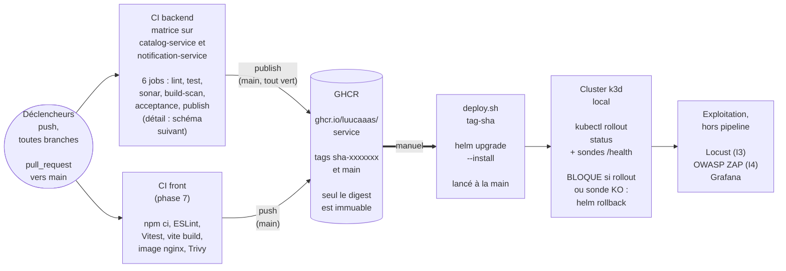
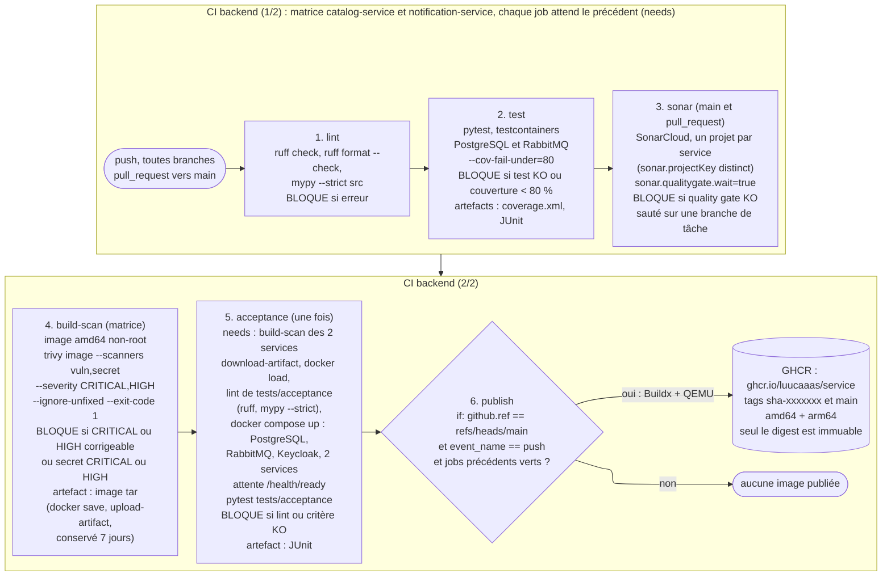

# Schéma CI/CD

Ce document décrit le pipeline de livraison continue de Collector, du commit au déploiement. C'est le **contrat** que les workflows GitHub Actions de la phase 5 devront suivre à l'identique : chaque job, chaque condition de blocage et chaque artefact ci-dessous doit se retrouver dans `.github/workflows`. Le workflow `backend.yml` est écrit (phase 5) et sa conformité à ce contrat est prouvée, ligne par ligne, dans [conformite-pipeline.md](conformite-pipeline.md) ; le job `sonar` reste à ajouter (tâche P5-04) et `frontend.yml` est prévu en phase 7. « POC » désigne, comme dans [devsecops.md](devsecops.md), une mesure dans le périmètre du POC mise en œuvre pendant les phases 3 à 9, et « cible » une mesure documentée comme limite (L1 à L22 de [architecture-poc.md](../02-architecture/architecture-poc.md#8-limites-assumées-du-poc)).

## 1. Vue d'ensemble

### Environnements

| Environnement | Où | Rôle |
| --- | --- | --- |
| Poste du développeur | Mac, `docker compose` (PostgreSQL, RabbitMQ, Keycloak, services) | Développer et exécuter les tests avant de pousser |
| Intégration continue | Exécuteurs GitHub Actions (Ubuntu), GHCR | Valider chaque modification, construire et publier les images |
| « Production » | Cluster k3d local sur le Mac, déployé par `deploy/local/deploy.sh` | Exécuter l'application pour la démonstration et les tests de charge |

Il n'y a pas d'environnement de recette distinct dans le POC (voir la section 5).

### Flux de branches

1. Une branche par tâche (`phase-<N>/<nom-tache>`), poussée sur GitHub : le pipeline tourne à chaque `push`.
2. La branche est auditée, puis fusionnée sur `main` par le Lead Developer uniquement (voir l'étape Code de [devsecops.md](devsecops.md)).
3. Le `push` sur `main` relance le pipeline complet et, s'il est entièrement vert, publie les images sur GHCR.
4. Le déploiement sur le cluster est lancé à la main avec le tag `sha-<7 caractères>` du commit publié.

### Déclencheurs

- `push` sur toutes les branches (`branches: ["**"]`, les tags ne déclenchent rien) : jobs `lint` à `acceptance`.
- `pull_request` vers `main` : mêmes jobs, afin que le résultat apparaisse sur la pull request.
- Le job `sonar` ne s'exécute que sur `main` et sur les pull requests (`if: github.ref == 'refs/heads/main' || github.event_name == 'pull_request'`) : le plan gratuit de SonarCloud n'analyse que la branche principale et les pull requests. Sur une branche de tâche, `sonar` est donc sauté ; `build-scan` et `acceptance` portent `if: ${{ !failure() && !cancelled() }}` pour s'exécuter malgré ce saut, tout en étant sautés si un job précédent échoue (`failure()` tient compte de tous les jobs ancêtres). Le quality gate s'applique ainsi là où le code entre dans `main` : sur la pull request, puis sur `main`.
- Le job `publish` ne s'exécute que sur un `push` sur `main`, grâce à la condition `if: github.ref == 'refs/heads/main' && github.event_name == 'push'`. Une pull request ou une branche de tâche ne publie jamais d'image ; le test de `event_name` garantit en plus qu'une pull request n'obtient jamais le droit d'écrire sur GHCR.
- **Exécutions concurrentes** (`concurrency`, groupe `workflow + ref`) : sur une branche de tâche, une nouvelle exécution annule l'ancienne ; sur `main`, elle attend la fin de la précédente, car annuler un `publish` en cours laisserait une publication partielle (un service publié, l'autre non).
- **Durcissement des exécuteurs** : tous les jobs tournent sur `ubuntu-24.04` (et non `ubuntu-latest`, dont l'image change sans prévenir) ; chaque action tierce est épinglée par son SHA de commit (le tag n'est qu'un commentaire), choisie parmi des versions publiées depuis plus de deux semaines ; `permissions: contents: read` par défaut, `packages: write` seulement dans `publish` ; `actions/checkout` avec `persist-credentials: false`, car aucune étape ne réutilise le jeton après le checkout. Même logique pour les images : `python:3.12-slim` et `ghcr.io/astral-sh/uv` dans les Dockerfile, PostgreSQL, RabbitMQ et Keycloak dans `deploy/compose/compose.yaml` sont épinglées par le digest de leur index multi-architecture (`tag@sha256:…`).

Deux workflows : `backend.yml` (matrice sur `catalog-service` et `notification-service`) et `frontend.yml` (mis en place en phase 7). Dans le backend, l'enchaînement est exprimé par `needs`, et la matrice `strategy.matrix.service` exécute les jobs `lint` à `build-scan` une fois par service, en parallèle.

## 2. Schémas du pipeline

### Vue d'ensemble

### Détail du job backend

## 3. Détail des étapes

Les indicateurs I1 à I5 sont définis dans [indicateurs.md](indicateurs.md) ; les mesures de sécurité renvoient aux étapes de [devsecops.md](devsecops.md). « — » signifie qu'il n'y a pas d'indicateur ou de mesure associé.

| Job | Outil et commande | Condition de blocage | Artefact | Indicateur | Mesure DevSecOps |
| --- | --- | --- | --- | --- | --- |
| `lint` (matrice) | `ruff check .`, `ruff format --check .` (`.` est le chemin par défaut de Ruff : même commande que `ruff check`), `mypy --strict src` (code du service ; les tests ne sont pas typés strictement). Le lint de `tests/acceptance` (Ruff, `mypy --strict .`) est fait dans le job `acceptance`, où ses dépendances sont installées | Une erreur de l'un des trois outils | — | I2 | 2. Code (Ruff, mypy) |
| `test` (matrice) | `pytest --cov=<paquet> --cov-fail-under=80 --cov-report=term --junitxml=junit.xml --cov-report=xml` (`<paquet>` : `catalog` ou `notification`) : tests unitaires et tests d'intégration (testcontainers PostgreSQL et RabbitMQ) | Un test en échec, ou couverture inférieure à 80 % | `coverage.xml`, `junit.xml` (obligatoires : le job échoue s'ils sont absents) | I1 | 4. Test (tests de sécurité 401/403/422, couverture) |
| `sonar` (matrice, sur `main` et les pull requests seulement) | Action `SonarSource/sonarqube-scan-action` (épinglée par SHA) avec le `coverage.xml` du job `test` (lignes et branches), un projet SonarCloud par service (`sonar.projectKey` distinct, `services/<service>/sonar-project.properties`), `sonar.qualitygate.wait=true`, jeton `SONAR_TOKEN` dans les secrets du dépôt | Quality gate en échec (note de maintenabilité, duplication, complexité, problèmes de sécurité sur le code nouveau) | Résultat consultable sur SonarCloud | I1, I2, I4 | 3. Build (SAST, quality gate) |
| `build-scan` (matrice) | `docker build` de l'image amd64, chargée dans le Docker local (Dockerfile multi-stage, utilisateur non root, `GIT_SHA` en argument de build), puis Trivy 0.76.0 installé depuis la release officielle (binaire dont la somme SHA-256, écrite dans le workflow, est vérifiée avant usage ; aucune action tierce) : `trivy image --scanners vuln,secret --severity CRITICAL,HIGH --ignore-unfixed --exit-code 1` (dépendances, paquets de l'OS, secrets) | Une vulnérabilité CRITICAL ou HIGH avec correctif disponible, ou un secret de sévérité CRITICAL ou HIGH (`--ignore-unfixed` ne concerne que les vulnérabilités). Le résultat se lit dans le journal du job | Image au format tar (`docker save`, `actions/upload-artifact`, rétention de 7 jours), transmise au job `acceptance` | I4 | 3. Build (image non root), 4. Test (SCA, secrets) |
| `acceptance` (une fois, `needs` : `build-scan` des 2 services) | `actions/download-artifact` et `docker load` des 2 images, puis lint de `tests/acceptance` (`ruff check .`, `ruff format --check .`, `mypy --strict .`), puis `deploy/compose/up.sh --no-build` avec `CATALOG_IMAGE` et `NOTIFICATION_IMAGE` (PostgreSQL, RabbitMQ, Keycloak avec le realm importé, les 2 services ; attente de toutes les sondes : `/health/ready` des services, configuration OpenID du realm pour Keycloak), puis `pytest tests/acceptance` (httpx), qui attend aussi un premier jeton | Une erreur de lint des tests d'acceptation, un des 17 critères en échec, ou une sonde qui ne répond pas dans le délai | Rapport JUnit des tests d'acceptation | I5 | 4. Test (comportements métier et sécurité de bout en bout) |
| `publish` (matrice, `needs` : `acceptance`, `if: github.ref == 'refs/heads/main' && github.event_name == 'push'`) | Docker Buildx avec QEMU et cache GitHub Actions : build amd64 + arm64, connexion à GHCR par le `GITHUB_TOKEN`, push sur `ghcr.io/luucaaas/<service>` avec les tags `sha-<7 caractères>` et `main` et les labels OCI de `docker/metadata-action` | Échec du build multi-architecture ou du push. N'est jamais lancé si un job précédent a échoué | Image multi-architecture dans GHCR, digest dans le résumé du job (`GITHUB_STEP_SUMMARY`) ; paquets GHCR publics, donc lisibles sans `imagePullSecret` | I4 (aucune publication hors seuil) | 5. Release |
| `frontend` (phase 7) | `npm ci`, ESLint, Vitest, `vite build`, image nginx non root, Trivy (mêmes règles), push sur `ghcr.io/luucaaas/frontend` sur `main` | Erreur ESLint, test Vitest en échec, échec du build, vulnérabilité CRITICAL ou HIGH avec correctif | Image GHCR (résultat Trivy dans le journal du job) | I4 | 3. Build, 4. Test, 5. Release |
| Déploiement (manuel) | `deploy/local/deploy.sh <tag sha>` (`helm upgrade --install`), puis `kubectl rollout status` et sondes | `rollout status` échoue ou sonde en échec : retour arrière par `helm rollback` | — | — | 6. Deploy |
| Tests de charge (phase 8) | Locust sur le cluster, Prometheus et Grafana | Seuils de I3 non respectés : ticket de dette, pas de blocage automatique | Résultats dans `tests/load` | I3 | 8. Monitor |
| Audit dynamique (phase 9) | OWASP ZAP lancé ponctuellement | — (constats vers le plan de remédiation) | Rapport dans `docs/06-securite` | I4 (complément) | 8. Monitor |

Précisions sur les points que le jury peut interroger :

- **Matrice** : `lint`, `test`, `sonar` et `build-scan` sont exécutés une fois par service. `acceptance` est unique car les critères traversent les deux services et Keycloak : il dépend (`needs`) de la fin du `build-scan` des deux entrées de la matrice et réutilise les images construites : chaque `build-scan` les exporte (`docker save`, `actions/upload-artifact`), `acceptance` les récupère (`actions/download-artifact`, `docker load`).
- **Pourquoi Trivy en binaire vérifié** : en mars 2026, des tags de `aquasecurity/trivy-action` et de `setup-trivy` ont été réécrits avec du code malveillant (avis GHSA-69fq-xp46-6x23). Le workflow n'utilise donc aucune action tierce pour Trivy : il télécharge la release officielle `v0.76.0` et refuse tout fichier dont la somme SHA-256 diffère de celle versionnée dans le dépôt. Résiduel : la base de vulnérabilités est téléchargée à l'exécution (limite pour le plan de remédiation).
- **Pourquoi Trivy après le build et avant le push** : l'image est scannée sous sa forme livrable ; une image vulnérable n'atteint jamais GHCR. L'option `--ignore-unfixed` écarte les vulnérabilités sans correctif, que l'on ne peut pas corriger : elles vont au plan de remédiation (I4).
- **Multi-architecture** : QEMU émule arm64 sur l'exécuteur amd64, Buildx produit un manifeste unique. Le `build-scan` ne construit que l'amd64 car la construction émulée est lente : elle n'est faite qu'une fois, au `publish`. Le scan porte donc sur l'amd64 ; les paquets arm64 viennent de la même base et des mêmes dépendances (limite assumée du POC).
- **Absence de déploiement automatique** : le cluster k3d est sur le Mac, inaccessible depuis GitHub. Les consignes de l'évaluation acceptent l'absence d'étape de déploiement automatique ; le déploiement est donc lancé à la main, reproductible par script. La cible est Argo CD (L12).

## 4. Traçabilité

Pouvoir remonter de ce qui tourne dans le cluster jusqu'au commit qui l'a produit.

1. **Tag `sha-<7 caractères>`** : propre à un commit, jamais réécrit par la CI. C'est le tag utilisé pour le déploiement. Le tag `main`, lui, est déplacé à chaque publication : il sert de repère de confort, pas au déploiement.
2. **Digest** : un tag est modifiable (n'importe qui ayant le droit d'écriture peut le faire pointer vers une autre image) ; seul le **digest** (`sha256:…`) est immuable, car il est calculé à partir du contenu de l'image. Le digest est relevé dans le résumé du job `publish` et au déploiement (`kubectl get pod -o jsonpath` sur `imageID`), et peut être consigné dans le compte rendu du déploiement.
3. **Labels OCI** : le Dockerfile reçoit `GIT_SHA` en argument de build et pose `org.opencontainers.image.revision=<sha complet>` et `org.opencontainers.image.source=<URL du dépôt>`. `docker inspect` sur l'image déployée donne le commit.
4. **Chemin complet** : pod → `imageID` (digest) → tag `sha-…` → commit → exécution du workflow (rapports Trivy, JUnit, quality gate SonarCloud).

La signature des images n'est pas dans le POC : la référence par digest suffit à garantir que l'image déployée est celle qui a passé les contrôles.

## 5. Écarts entre le POC et la cible

| Sujet | POC | Cible | Limite |
| --- | --- | --- | --- |
| Déploiement | Lancé à la main depuis le Mac (`deploy.sh`), sans détection de dérive | Argo CD synchronise le cluster depuis Git, sans identifiants du cluster dans la CI | L12 |
| Environnement de recette | Aucun : la « production » est le cluster local | Environnement de recette séparé, où tournent les tests et l'audit dynamique avant la production | L12, L13 |
| Scan des images | amd64 seul, l'arm64 est construit au `publish` sans être scanné | Scan de chaque architecture publiée | — (limite propre au pipeline) |
| Analyse SonarCloud | `main` et pull requests (plan gratuit) | Chaque branche analysée | — (limite du plan gratuit) |
| Analyses de sécurité en CI | SonarCloud et Trivy | Semgrep, Bandit, pip-audit et Gitleaks sur l'historique Git en CI, OWASP ZAP baseline sur la recette | L13 |
| Protection de `main` | Fusion faite par le Lead Developer après audit | Pull request obligatoire et checks requis | — (règle d'organisation, voir [devsecops.md](devsecops.md)) |
