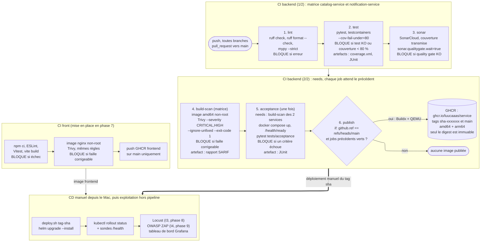

# Schéma CI/CD

Ce document décrit le pipeline de livraison continue de Collector, du commit au déploiement. C'est le **contrat** que les workflows GitHub Actions de la phase 5 devront suivre à l'identique : chaque job, chaque condition de blocage et chaque artefact ci-dessous doit se retrouver dans `.github/workflows`. Les workflows ne sont pas encore écrits ; « POC » désigne, comme dans [devsecops.md](devsecops.md), une mesure dans le périmètre du POC mise en œuvre pendant les phases 3 à 9, et « cible » une mesure documentée comme limite (L1 à L16 de [architecture-poc.md](../02-architecture/architecture-poc.md#8-limites-assumées-du-poc)).

## 1. Vue d'ensemble

### Environnements

| Environnement | Où | Rôle |
| --- | --- | --- |
| Poste du développeur | Mac, `docker compose` (PostgreSQL, RabbitMQ, Keycloak, services) | Développer et exécuter les tests avant de pousser |
| Intégration continue | Exécuteurs GitHub Actions (Ubuntu), GHCR | Valider chaque modification, construire et publier les images |
| « Production » | Cluster k3d local sur le Mac, déployé par `deploy/local/deploy.sh` | Exécuter l'application pour la démonstration et les tests de charge |

Il n'y a pas d'environnement de recette distinct dans le POC (voir la section 5).

### Flux de branches

1. Une branche par tâche (`phase-<N>/<nom-tache>`), poussée sur GitHub : le pipeline tourne à chaque `push`.
2. La branche est auditée, puis fusionnée sur `main` par le Lead Developer uniquement (voir l'étape Code de [devsecops.md](devsecops.md)).
3. Le `push` sur `main` relance le pipeline complet et, s'il est entièrement vert, publie les images sur GHCR.
4. Le déploiement sur le cluster est lancé à la main avec le tag `sha-<7 caractères>` du commit publié.

### Déclencheurs

- `push` sur toutes les branches : jobs `lint` à `acceptance`.
- `pull_request` vers `main` : mêmes jobs, afin que le résultat apparaisse sur la pull request.
- Le job `publish` ne s'exécute que sur `main`, grâce à la condition `if: github.ref == 'refs/heads/main'`. Une pull request ou une branche de tâche ne publie jamais d'image.

Deux workflows : `backend.yml` (matrice sur `catalog-service` et `notification-service`) et `frontend.yml` (mis en place en phase 7). Dans le backend, l'enchaînement est exprimé par `needs`, et la matrice `strategy.matrix.service` exécute les jobs `lint` à `build-scan` une fois par service, en parallèle.

## 2. Schéma du pipeline

## 3. Détail des étapes

Les indicateurs I1 à I5 sont définis dans [indicateurs.md](indicateurs.md) ; les mesures de sécurité renvoient aux étapes de [devsecops.md](devsecops.md). « — » signifie qu'il n'y a pas d'indicateur ou de mesure associé.

| Job | Outil et commande | Condition de blocage | Artefact | Indicateur | Mesure DevSecOps |
| --- | --- | --- | --- | --- | --- |
| `lint` (matrice) | `ruff check`, `ruff format --check`, `mypy --strict` | Une erreur de l'un des trois outils | — | I2 | 2. Code (Ruff, mypy) |
| `test` (matrice) | `pytest --cov=src --cov-fail-under=80 --junitxml=junit.xml --cov-report=xml` : tests unitaires et tests d'intégration (testcontainers PostgreSQL et RabbitMQ) | Un test en échec, ou couverture inférieure à 80 % | `coverage.xml`, `junit.xml` | I1 | 4. Test (tests de sécurité 401/403/422, couverture) |
| `sonar` (matrice) | Analyse SonarCloud avec `coverage.xml`, `sonar.qualitygate.wait=true` | Quality gate en échec (note de maintenabilité, duplication, complexité, problèmes de sécurité sur le code nouveau) | Résultat consultable sur SonarCloud | I1, I2, I4 | 3. Build (SAST, quality gate) |
| `build-scan` (matrice) | Build de l'image amd64 chargée localement (Dockerfile multi-stage, utilisateur non root), puis Trivy : `--severity CRITICAL,HIGH --ignore-unfixed --exit-code 1` (dépendances et paquets de l'OS, secrets) | Au moins une vulnérabilité CRITICAL ou HIGH avec correctif disponible, ou un secret détecté | Rapport SARIF du scan, image au format tar transmise au job `acceptance` | I4 | 3. Build (image non root), 4. Test (SCA, secrets) |
| `acceptance` (une fois, `needs` : `build-scan` des 2 services) | `docker compose up` (PostgreSQL, RabbitMQ, Keycloak avec le realm importé, les 2 images construites), attente des sondes `/health/ready`, puis `pytest tests/acceptance` (httpx) | Un des 17 critères d'acceptation en échec, ou une sonde `/health/ready` qui ne répond pas dans le délai | Rapport JUnit des tests d'acceptation | I5 | 4. Test (comportements métier et sécurité de bout en bout) |
| `publish` (matrice, `needs` : `acceptance`, `if: github.ref == 'refs/heads/main'`) | Docker Buildx avec QEMU et cache : build amd64 + arm64, push sur `ghcr.io/luucaaas/<service>` avec les tags `sha-<7 caractères>` et `main` | Échec du build multi-architecture ou du push. N'est jamais lancé si un job précédent a échoué | Image multi-architecture dans GHCR, digest relevé dans le journal du job | I4 (aucune publication hors seuil) | 5. Release |
| `frontend` (phase 7) | `npm ci`, ESLint, Vitest, `vite build`, image nginx non root, Trivy (mêmes règles), push sur `ghcr.io/luucaaas/frontend` sur `main` | Erreur ESLint, test Vitest en échec, échec du build, vulnérabilité CRITICAL ou HIGH avec correctif | Rapport SARIF, image GHCR | I4 | 3. Build, 4. Test, 5. Release |
| Déploiement (manuel) | `deploy/local/deploy.sh <tag sha>` (`helm upgrade --install`), puis `kubectl rollout status` et sondes | `rollout status` échoue ou sonde en échec : le déploiement est à reprendre ou à annuler (`helm rollback`) | — | — | 6. Deploy |
| Tests de charge (phase 8) | Locust sur le cluster, Prometheus et Grafana | Seuils de I3 non respectés : ticket de dette, pas de blocage automatique | Résultats dans `tests/load` | I3 | 8. Monitor |
| Audit dynamique (phase 9) | OWASP ZAP lancé ponctuellement | — (constats vers le plan de remédiation) | Rapport dans `docs/06-securite` | I4 (complément) | 8. Monitor |

Précisions sur les points que le jury peut interroger :

- **Matrice** : `lint`, `test`, `sonar` et `build-scan` sont exécutés une fois par service. `acceptance` est unique car les critères traversent les deux services et Keycloak : il dépend (`needs`) de la fin du `build-scan` des deux entrées de la matrice et réutilise les images construites.
- **Pourquoi Trivy après le build et avant le push** : l'image est scannée sous sa forme livrable ; une image vulnérable n'atteint jamais GHCR. L'option `--ignore-unfixed` écarte les vulnérabilités sans correctif, que l'on ne peut pas corriger : elles vont au plan de remédiation (I4).
- **Multi-architecture** : QEMU émule arm64 sur l'exécuteur amd64, Buildx produit un manifeste unique. Le `build-scan` ne construit que l'amd64 car la construction émulée est lente : elle n'est faite qu'une fois, au `publish`. Le scan porte donc sur l'amd64 ; les paquets arm64 viennent de la même base et des mêmes dépendances (limite assumée du POC).
- **Absence de déploiement automatique** : le cluster k3d est sur le Mac, inaccessible depuis GitHub. Les consignes de l'évaluation acceptent l'absence d'étape de déploiement automatique ; le déploiement est donc lancé à la main, reproductible par script. La cible est Argo CD (L12).

## 4. Traçabilité

Pouvoir remonter de ce qui tourne dans le cluster jusqu'au commit qui l'a produit.

1. **Tag `sha-<7 caractères>`** : propre à un commit, jamais réécrit par la CI. C'est le tag utilisé pour le déploiement. Le tag `main`, lui, est déplacé à chaque publication : il sert de repère de confort, pas au déploiement.
2. **Digest** : un tag est modifiable (n'importe qui ayant le droit d'écriture peut le faire pointer vers une autre image) ; seul le **digest** (`sha256:…`) est immuable, car il est calculé à partir du contenu de l'image. Le digest est relevé dans le journal du job `publish` et au déploiement (`kubectl get pod -o jsonpath` sur `imageID`), et peut être consigné dans le compte rendu du déploiement.
3. **Labels OCI** : le Dockerfile reçoit `GIT_SHA` en argument de build et pose `org.opencontainers.image.revision=<sha complet>` et `org.opencontainers.image.source=<URL du dépôt>`. `docker inspect` ou `crane config` sur l'image déployée donne le commit.
4. **Chemin complet** : pod → `imageID` (digest) → tag `sha-…` → commit → exécution du workflow (rapports Trivy, JUnit, quality gate SonarCloud).

La signature des images n'est pas dans le POC : la référence par digest suffit à garantir que l'image déployée est celle qui a passé les contrôles.

## 5. Écarts entre le POC et la cible

| Sujet | POC | Cible | Limite |
| --- | --- | --- | --- |
| Déploiement | Lancé à la main depuis le Mac (`deploy.sh`), sans détection de dérive | Argo CD synchronise le cluster depuis Git, sans identifiants du cluster dans la CI | L12 |
| Environnement de recette | Aucun : la « production » est le cluster local | Environnement de recette séparé, où tournent les tests et l'audit dynamique avant la production | L12, L13 |
| Analyses de sécurité en CI | SonarCloud et Trivy | Semgrep, Bandit, pip-audit et Gitleaks sur l'historique Git en CI, OWASP ZAP baseline sur la recette | L13 |
| Protection de `main` | Fusion faite par le Lead Developer après audit | Pull request obligatoire et checks requis | — (règle d'organisation, voir [devsecops.md](devsecops.md)) |
