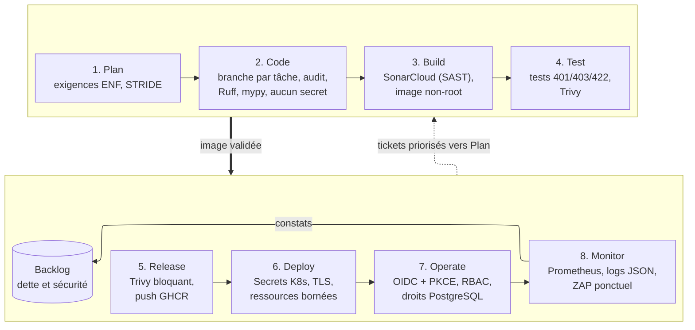

# Cycle de vie DevSecOps

La démarche DevSecOps intègre la sécurité à chaque étape du cycle de développement, au lieu de la contrôler une fois le logiciel terminé. Deux principes la guident.

- ***Shift left*** : un défaut est détecté le plus tôt possible, là où il coûte le moins cher à corriger. Une règle d'autorisation oubliée se trouve par un test en pull request, pas par un audit en production.
- **Responsabilité partagée** : la sécurité n'est pas déléguée à une équipe distincte. Le développeur écrit le test de sécurité avec le code, la CI l'exécute et bloque la livraison en cas d'échec, l'exploitation observe et renvoie ses constats au backlog.

Le cycle s'inspire du NIST SSDF (SP 800-218), qui organise ses pratiques en quatre groupes (PO, PS, PW, RV) que les étapes ci-dessous répartissent. « POC » désigne une mesure dans le périmètre du POC, mise en œuvre pendant les phases 3 à 9 ; la phase est indiquée quand la mesure n'existe pas encore. Les mesures marquées « cible » sont documentées comme limites dans [architecture-poc.md](../02-architecture/architecture-poc.md#8-limites-assumées-du-poc) (L1 à L25) et alimentent le plan de remédiation de `docs/06-securite`.

## Mesures de sécurité par étape

Les indicateurs I1 à I5 sont définis dans [indicateurs.md](indicateurs.md). « — » signifie que l'étape ne produit pas de mesure chiffrée.

| Étape | Activités | Mesures de sécurité | Outil ou pratique | Statut | Indicateur alimenté |
| --- | --- | --- | --- | --- | --- |
| 1. Plan | Rédiger les exigences et les user stories, décider l'architecture (ADR) | Exigences de sécurité explicites (ENF-01 à ENF-11), rattachées à une mesure et à un test | Exigences ENF dans `exigences.md`, ADR | POC (ENF-01 à ENF-04, ENF-07, ENF-08) ; POC partiel (ENF-05, voir L13) ; cible (ENF-06, L4 ; ENF-11, L6) ; cible, hors périmètre du POC (ENF-09, ENF-10, ADR 0007) | — |
| 1. Plan | Analyser les menaces | Modélisation des menaces STRIDE et revue OWASP Top 10 des composants, priorisation des risques | Document STRIDE de `docs/06-securite` (phase 9) | POC, phase 9 | — |
| 2. Code | Développer sur une branche par tâche, faire auditer avant fusion | Aucune fusion sur `main` sans audit de la branche de la tâche. Aucun secret dans le code : `.env.example` versionné, `.env` ignoré (ENF-04) | Une branche par tâche, audit avant fusion, fusion sur `main` faite uniquement par le Lead Developer (organisation multi-agents de CLAUDE.md) | POC ; protection GitHub de `main` (pull request obligatoire, checks requis) : cible, sans Lx car c'est une règle d'organisation du dépôt et non une limite du produit | I2 |
| 2. Code | Contrôler style et typage | Détection des erreurs de typage et des constructions dangereuses avant l'exécution | Ruff, mypy en mode strict (première étape de la CI) | POC | I2 |
| 3. Build | Analyser le code, construire l'image | Analyse statique des failles du code (injections, mauvaise gestion des erreurs) et quality gate bloquante. Image multi-stage `python:3.12-slim`, utilisateur non root, système de fichiers racine en lecture seule, capacités Linux retirées (S7) | SonarCloud (SAST), Dockerfile multi-stage | POC (S7, S8) ; ENF-05 partiel (Semgrep et Bandit : cible, L13) | I1, I2, I4 |
| 4. Test | Exécuter les tests automatisés | Tests de sécurité écrits avec le code : jeton absent ou invalide → 401, mauvais rôle ou ressource d'un autre vendeur → 403, données invalides → 422 (ENF-02, ENF-03, ENF-07). Couverture ≥ 80 % | pytest, pytest-cov, tests d'acceptation pytest + httpx | POC | I1, I5 |
| 4. Test | Analyser dépendances, image et secrets | Détection des vulnérabilités connues (SCA) et des secrets embarqués, bloquante sur CRITICAL ou HIGH avec correctif (ENF-05) | Trivy (dépendances, image, secrets) | POC (S8) ; pip-audit et Gitleaks sur l'historique Git : cible (L13) | I4 |
| 5. Release | Publier l'artefact | Aucune image publiée si Trivy ou la quality gate échoue. L'image porte un tag `sha-<commit>` propre à chaque commit, que la CI ne réécrit jamais ; seul le digest garantit l'immuabilité, il est relevé au déploiement | GitHub Actions, GHCR (`ghcr.io/luucaaas/<service>`, amd64 + arm64) | POC (S8) | I4 |
| 6. Deploy | Déployer sur le cluster | `deploy.sh` génère les mots de passe manquants dans un `.env` local non versionné (modèle `.env.example` versionné, à créer en phase 6), puis crée les Secrets Kubernetes (S6). TLS 1.2 minimum, redirection HTTP → HTTPS, certificat mkcert (S1, ENF-01). Ressources bornées et sondes `/health/live` et `/health/ready` | Helm, `deploy/local/deploy.sh`, Traefik, mkcert | POC (S1, S6) ; NetworkPolicies : cible (L4) ; mTLS : cible (L10) ; cert-manager : cible (L11) ; Argo CD : cible (L12) | — |
| 7. Operate | Exploiter l'application | Authentification OIDC avec PKCE, jeton de 5 min en mémoire (S2). Vérification du JWT par chaque service (S3). RBAC puis propriété de la ressource (S4). Un utilisateur PostgreSQL par service (S5) | Keycloak, PyJWT, rôles `buyer`, `seller`, `admin` | POC (S2 à S5) ; limitation de débit : cible (L6) ; BFF et CSP : cible (L5) | — |
| 8. Monitor | Surveiller, auditer | Logs JSON avec identifiant de corrélation et `sub` de l'utilisateur (ENF-08). Métriques de débit, latence p95 et taux d'erreur. Audit dynamique de l'application en fonctionnement | structlog, Prometheus, Grafana, OWASP ZAP lancé ponctuellement | POC ; ZAP intégré à la CI : cible (L13) | I3 |

## Boucle de rétroaction

Un constat n'a de valeur que s'il entre dans le backlog. Toute alerte issue d'une étape suit le même chemin.

1. **Source** : échec de la CI (SonarCloud, Trivy, tests), mesure hors seuil lors de la revue de fin de sprint ([indicateurs.md](indicateurs.md)), alerte observée dans Grafana, rapport ZAP de l'audit.
2. **Ticket** : une issue GitHub est ouverte avec la mesure, la preuve (lien vers le job CI ou le rapport) et la mesure de sécurité concernée. Elle est étiquetée `dette` ou `sécurité`.
3. **Priorisation** : le Lead Developer classe le ticket selon la sévérité (CVSS pour une vulnérabilité) et l'exposition. Un CRITICAL ou HIGH avec correctif passe avant toute nouvelle fonctionnalité. Les autres entrent dans le [plan de remédiation](../06-securite/plan-remediation.md) de `docs/06-securite` (règles de priorité R1 à R9 du § 2.2, suivi au § 9).
4. **Retour au Plan** : le ticket est planifié au sprint suivant. Si le constat révèle une exigence manquante, `exigences.md` est complétée. S'il remet en cause un choix d'architecture, une ADR est ouverte.
5. **Vérification** : la correction n'est validée que lorsque la mesure revient sous le seuil lors de l'exécution suivante de la CI.

## Écarts entre le POC et la cible

Dans le POC, les étapes Code à Release sont automatisées dans le pipeline, tandis que Plan et Monitor reposent sur des revues et des analyses ponctuelles. Plusieurs protections d'une exploitation en production sont volontairement absentes. Elles sont décrites, avec leur risque et leur priorité, dans [architecture-poc.md](../02-architecture/architecture-poc.md#8-limites-assumées-du-poc), et ne sont pas recopiées ici.

| Limite | Sujet | Étape du cycle concernée |
| --- | --- | --- |
| L4 | NetworkPolicies | Deploy, Operate |
| L5 | BFF et CSP | Operate |
| L6 | Limitation de débit | Operate |
| L10 | mTLS entre pods | Deploy, Operate |
| L11 | cert-manager | Deploy |
| L12 | Argo CD (GitOps) | Deploy |
| L13 | Semgrep, Bandit, pip-audit, Gitleaks, ZAP en CI | Build, Test, Monitor |
| L17 | `securityContext` de l'infrastructure (Keycloak, PostgreSQL) | Deploy |
| L18 | Broker RabbitMQ démarré en root | Deploy |
| L19 | Réduite en phase 9 : console d'administration de Keycloak retirée de l'hôte public (P9-02) ; reste la confiance dans les en-têtes `X-Forwarded-*` | Deploy, Operate |
| L20 | Observabilité sans stockage persistant ni contrôle d'accès | Operate, Monitor |
