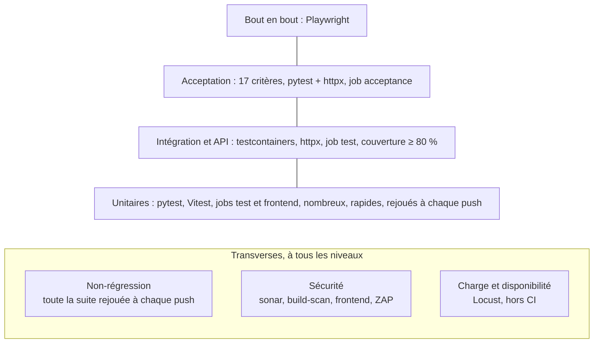

# Processus de test

Ce document formalise le processus de test de Collector : quels types de tests, avec quels outils, à quel moment, avec quelle sortie attendue, et qui en répond. Il s'appuie sur les indicateurs de [indicateurs.md](indicateurs.md), sur les étapes de [devsecops.md](devsecops.md) et sur les jobs de [cicd.md](cicd.md), dont il reprend les noms à l'identique (`lint`, `test`, `sonar`, `build-scan`, `acceptance`, `publish`, `frontend`).

« POC » désigne, comme dans [devsecops.md](devsecops.md), une mesure dans le périmètre du POC mise en œuvre pendant les phases 3 à 9. Aucun test n'est encore écrit : la colonne « Moment d'exécution » indique la phase où chaque type de test apparaît. Les seuils sont ceux d'[indicateurs.md](indicateurs.md) et d'[exigences.md](../03-backlog/exigences.md) (ENF-12, 13, 16, 22, 29), sans modification.

## 1. Stratégie

### Pyramide des tests

Plus un test est bas dans la pyramide, plus il est rapide, nombreux et précis dans sa localisation d'une panne. Plus il est haut, plus il est proche de l'usage réel, plus il est lent et coûteux à maintenir. On écrit donc beaucoup de tests unitaires, peu de tests de bout en bout.

### Principes

1. **Les tests sont écrits avec le code.** Aucune fonctionnalité n'est fusionnée sans son test (convention de CLAUDE.md). Les tests de sécurité (401, 403, 422) suivent la même règle ([devsecops.md](devsecops.md), étape 4).
2. **Aucun test fragile n'est toléré.** Un test qui échoue de façon intermittente est corrigé ou supprimé, jamais relancé en boucle jusqu'au vert. Il n'y a ni `sleep` arbitraire (on attend une condition avec un délai maximal) ni dépendance à l'ordre d'exécution : chaque test crée ses données et ne dépend d'aucun autre.
3. **Un test en échec bloque la fusion.** Le pipeline est rouge, aucune image n'est publiée ([cicd.md](cicd.md), job `publish`) et la branche n'est pas fusionnée sur `main`.
4. **Pas de test sans environnement reproductible.** Les dépendances (PostgreSQL, RabbitMQ, Keycloak) sont démarrées par testcontainers ou `docker compose`, jamais installées à la main.
5. **Le test le plus bas possible.** Une règle de gestion se teste en unitaire ; l'intégration ne vérifie que ce que l'unitaire ne peut pas voir (base de données, broker) ; l'acceptation ne vérifie que les 17 critères.

## 2. Types de tests

### Tableau des types de tests

Les jobs cités sont ceux de [cicd.md](cicd.md). « Poste » désigne le Mac du développeur ; le dossier d'un service est `services/<nom>-service/tests/` (la distinction entre tests unitaires et d'intégration, par dossier ou par marqueur pytest, est fixée en phase 4).

| Type | Objectif | Outil | Emplacement dans le repo | Moment d'exécution | Environnement et données | Sortie attendue et critère de succès | Responsable | Indicateur alimenté |
| --- | --- | --- | --- | --- | --- | --- | --- | --- |
| Unitaires (backend) | Vérifier la logique métier isolée : contrôle automatique (champs, prix > 0, aucun email ni téléphone), règles de prix, validation Pydantic, jetons expirés ou falsifiés | pytest, pytest-cov | `services/<nom>-service/tests/` | Poste à chaque modification ; job `test` à chaque push et pull request ; phases 3 et 4 | Aucun service externe, données construites dans le test, clé de signature de test générée par la suite | Tous les tests passent ; couverture ≥ 80 % (`--cov-fail-under=80`) ; `coverage.xml` et `junit.xml` | Développeurs, revus par le Lead Developer | I1 |
| Intégration | Vérifier le code qui touche l'infrastructure : repository SQLAlchemy, publication et consommation d'événements, idempotence (`UNIQUE (user_id, source_event_id)` et `ON CONFLICT DO NOTHING`), message persistant, file durable et acquittement après traitement (ENF-18) | pytest + testcontainers-python (PostgreSQL, RabbitMQ) | `services/<nom>-service/tests/` | Poste (Docker Desktop démarré) ; job `test` ; phases 3 et 4 | Conteneurs jetables créés par la suite, migrations Alembic appliquées, un jeu de données par test | Mêmes critères que ci-dessus : le même appel de `pytest` couvre unitaires et intégration ; un doublon d'événement ne crée qu'une notification | Développeurs, revus par le Lead Developer | I1 |
| API et sécurité de l'API | Vérifier le contrat HTTP de chaque route sur l'application FastAPI : 401 (jeton absent ou invalide), 403 (mauvais rôle, ressource d'un autre vendeur), 422 (entrée invalide), format d'erreur RFC 9457 (ENF-02, ENF-03, ENF-07) | pytest + httpx (client sur l'application FastAPI) | `services/<nom>-service/tests/` | Poste ; job `test` ; phases 3 et 4 | Application chargée en mémoire avec la base testcontainers, jetons de test signés par une clé générée par la suite (Keycloak n'est pas nécessaire) | Chaque route protégée a au moins un test 401, 403 et 422 ; tous passent | Développeurs, revus par le Lead Developer | I1 |
| Acceptation | Prouver que chacun des 17 critères d'acceptation est satisfait de bout en bout sur les 2 services, RabbitMQ et Keycloak | pytest + httpx | `tests/acceptance`, un test par critère nommé `test_usXX_caY_…` (ex. `test_us03_ca2_article_avec_coordonnees_rejete`) | Job `acceptance` sur chaque push et pull request ; poste avec `docker compose` ; contre le cluster local avant chaque démonstration ; phase 4 (pile) et phase 5 (job) | Pile `docker compose` : PostgreSQL, RabbitMQ, Keycloak avec le realm importé, 2 services construits par la CI (image du job `build-scan`). Comptes de démo `admin`, `alice`, `bob`, `chloe` | 17 critères sur 17 passent ; rapport JUnit en artefact ; sondes `/health/ready` répondant dans le délai | Lead Developer (exécution) ; Product Owner (validation, voir section 4) | I5 |
| Front : composants | Vérifier le rendu et le comportement des composants React (formulaires, affichage des statuts `PUBLISHED` et `REJECTED`, messages d'erreur en français) | Vitest | `frontend/src/**/*.test.tsx` (et `*.test.ts`) | Poste ; job `frontend` à chaque push ; phase 7 | jsdom, API simulée, aucun service lancé | Tous les tests Vitest passent ; échec bloque le job `frontend` | Développeurs, revus par le Lead Developer | Aucun indicateur chiffré (pas de seuil de couverture front dans ENF-22) |
| Front : bout en bout | Dérouler dans un navigateur les parcours de la démonstration (connexion Keycloak, mise en vente, changement de prix, notification) | Playwright | `frontend/e2e/` | Lancé ponctuellement sur le cluster local, avant la démonstration ; **hors CI** (décision du 31/10/2026) ; phase 7 | Cluster k3d, hôtes `app.` et `auth.127.0.0.1.sslip.io`, comptes de démo | Tous les parcours passent ; rapport Playwright et captures d'écran conservés avec le compte rendu de la répétition | Développeurs (écriture), Lead Developer (exécution avant la démo) | Aucun indicateur chiffré ; fiabilise la démo (critère 10) |
| Non-régression | Garantir qu'une modification ne casse pas un comportement déjà validé. Définition : rejeu automatique de toute la suite à chaque push, plus un test ajouté pour chaque anomalie corrigée | Les outils ci-dessus (pas d'outil propre) | Là où se trouve le test d'origine ; un test de non-régression est nommé d'après l'anomalie (ticket) | À chaque push et pull request (jobs `test`, `acceptance`, `frontend`) ; à partir de la phase 4 | Identique à chaque type rejoué | Aucun test existant ne passe au rouge ; toute anomalie corrigée est accompagnée d'un test qui échoue sans le correctif | Développeur qui corrige ; revue par le Lead Developer | I1, I5 |
| Performance et charge | Mesurer latence et taux d'erreur sous charge nominale, sur deux scénarios : lecture du catalogue et publication d'article | Locust, Prometheus, Grafana | `tests/load` (scénarios et résultats) | Phase 8, sur le cluster k3d, hors CI ; rejoué avec la démo de disponibilité | Cluster k3d déployé par `deploy/local/deploy.sh`, 50 utilisateurs simultanés, comptes de démo | Lecture du catalogue : p95 < 300 ms ; publication d'article : p95 < 500 ms (ENF-12) ; moins de 1 % de réponses 5xx (ENF-13) ; résultats archivés dans `tests/load`. Hors seuil : ticket de dette, sans blocage automatique | Lead Developer | I3 |
| Disponibilité | Vérifier qu'un service survit à la perte d'une instance (ENF-16) et qu'il monte en charge par ajout d'instances (ENF-29) | Locust, `kubectl`, Grafana | `tests/load` (scénario) ; protocole détaillé dans `docs/04-experimentations` | Phase 8, sur le cluster k3d, hors CI | 2 réplicas par service ; pendant un test Locust, suppression d'un pod de `catalog-service` puis observation de l'HPA | Le Deployment recrée le pod supprimé, le taux d'erreur est mesuré et consigné ; l'HPA fait passer `catalog-service` de 2 à 5 réplicas au plus, à 70 % de CPU (ENF-29) ; pas de démo de panne de nœud (cible) | Lead Developer | I3 |
| Sécurité | Détecter les failles du code (SAST), les dépendances vulnérables, les vulnérabilités de l'image et les secrets embarqués ; audit dynamique de l'application en fonctionnement | SonarCloud (SAST), Trivy (dépendances, image, secrets), OWASP ZAP (ponctuel) | Configuration dans `.github/workflows` (phase 5) ; rapport ZAP dans `docs/06-securite` | Jobs `sonar`, `build-scan` et `frontend` (Trivy, phase 7) à chaque push et pull request ; ZAP lancé ponctuellement en phase 9, hors CI | CI GitHub Actions ; ZAP contre le cluster local | `sonar` : quality gate verte. `build-scan` et `frontend` : 0 vulnérabilité CRITICAL ou HIGH avec correctif, aucun secret CRITICAL ou HIGH (`build-scan`). ZAP : constats vers le plan de remédiation, sans blocage | Lead Developer (analyse et priorisation) ; la CI exécute | I2, I4 |

Les contrôles de style et de typage du job `lint` (Ruff, mypy strict, voir [indicateurs.md](indicateurs.md), I2) ne sont pas des tests : ils s'exécutent avant les tests et alimentent la dette technique. Ils figurent dans le tableau de correspondance ci-dessous pour que celui-ci suive tous les jobs du pipeline.

Résultat obtenu : le 06/11/2026, les 6 parcours Playwright passent sur le cluster k3d (tag `sha-cd5751f`, HTTPS mkcert vérifié, aucune violation de CSP ni erreur réseau) deux fois de suite, puis sur la pile `docker compose` ; journal et captures d'écran dans [`frontend/e2e/resultats/`](../../frontend/e2e/resultats/journal-cluster.txt).

### Correspondance avec le pipeline

Les jobs sont listés dans l'ordre de [cicd.md](cicd.md). Un job qui n'exécute aucun test est signalé ; aucun test exécuté par la CI n'est en dehors de cette liste.

| Job ou étape de cicd.md | Types de tests exécutés | Remarque |
| --- | --- | --- |
| `lint` | Aucun test | Ruff et mypy strict ; première barrière, bloque avant les tests |
| `test` | Unitaires, intégration, API et sécurité de l'API, non-régression | Un seul appel de pytest, couverture ≥ 80 % |
| `sonar` | Sécurité (SAST) | Exploite le `coverage.xml` du job `test` |
| `build-scan` | Sécurité (Trivy : dépendances, image, secrets) | Scan de l'image amd64 avant tout push |
| `acceptance` | Acceptation, non-régression | Pile `docker compose` ; images issues du job `build-scan` |
| `publish` | Aucun test | N'est lancé que si tous les jobs précédents sont verts, sur `main` |
| `frontend` | Front : composants (Vitest), non-régression | `npm ci`, ESLint, Vitest, `npm audit`, build, Trivy |
| Déploiement (manuel) | Aucun test automatisé | `kubectl rollout status` et sondes `/health/live` et `/health/ready` après `deploy.sh` ; échec : `helm rollback` |
| Tests de charge (phase 8) | Performance et charge, disponibilité | Hors CI, sur le cluster |
| Audit dynamique (phase 9) | Sécurité (OWASP ZAP) | Hors CI, ponctuel |

Hors pipeline également : Playwright (avant la démo, sur le cluster, section 2).

## 3. Traçabilité

Chaque critère d'acceptation de [user-stories.md](../03-backlog/user-stories.md) est relié à un test, lui-même exécuté par un job, lui-même alimentant l'indicateur I5 :

critère d'acceptation → test d'acceptation (`tests/acceptance`) → job `acceptance` → indicateur I5 (17 sur 17)

Le nom du test porte la story et le critère. Exemple sur US-03, « Publier un article » :

| Critère | Résumé | Test d'acceptation | Job CI | Indicateur |
| --- | --- | --- | --- | --- |
| CA1 | Article conforme : 201, `PUBLISHED`, événement `article.published`, visible au catalogue | `test_us03_ca1_article_conforme_publie` | `acceptance` | I5 |
| CA2 | Coordonnées dans la description : 201, `REJECTED`, motif `CONTACT_EMAIL` ou `CONTACT_PHONE`, aucun événement | `test_us03_ca2_article_avec_coordonnees_rejete` | `acceptance` | I5 |
| CA3 | Article invalide (prix nul ou négatif, aucune photo, catégorie inexistante) : 422 | `test_us03_ca3_article_invalide_refuse` | `acceptance` | I5 |
| CA4 | Boutique d'un autre vendeur, rôle `buyer`, absence de jeton : 403, 403, 401 | `test_us03_ca4_publication_non_autorisee` | `acceptance` | I5 |

Le nom de ces tests est donné à titre d'illustration : seul `test_us03_ca2_article_avec_coordonnees_rejete` est fixé par le backlog. Le suffixe des autres est arrêté à l'écriture du test (phase 4), sans changer le préfixe `test_usXX_caY_`.

Les mêmes critères sont aussi vérifiés plus bas dans la pyramide (par exemple le rejet des coordonnées par un test unitaire du contrôle automatique) : le test d'acceptation prouve le comportement de bout en bout, les tests unitaires localisent la panne. Le taux I5 est calculé sur les seuls tests d'acceptation. Les 17 critères se répartissent ainsi : US-01 (3), US-02 (3), US-03 (4), US-04 (3), US-05 (4).

## 4. Parties prenantes

### Équipe et rôles

L'équipe du contexte Collector compte un Lead Developer et deux développeurs confirmés. Il n'y a ni rôle de testeur (QA) ni rôle d'exploitation (DevOps) : les tâches correspondantes sont portées par le Lead Developer et les développeurs. Le recrutement d'un QA et d'un DevOps est envisagé (voir `docs/05-competences`) : un QA reprendrait la revue des tests et la validation de l'acceptation, un DevOps reprendrait l'exécution de la CI et du déploiement. Tant qu'ils ne sont pas recrutés, ils n'apparaissent pas dans le tableau ci-dessous.

Le rôle de Product Owner est tenu par l'un·e des deux dirigeant·e·s de Collector, ancien·ne·s chefs de projet IT selon le contexte.

La CI exécute les tests automatiquement (GitHub Actions) ; la ligne « Exécuter la CI » désigne la personne qui répond de son fonctionnement et agit sur un échec.

### RACI

R = réalise, A = rend des comptes (un seul par ligne), C = consulté, I = informé.

| Activité | Lead Developer | Développeurs (2) | Product Owner (un·e dirigeant·e) | Direction Collector |
| --- | --- | --- | --- | --- |
| Écrire les tests | A | R | I | |
| Revoir les tests | A, R | C | | |
| Exécuter la CI (surveiller, corriger un échec) | A | R | | |
| Valider l'acceptation (17 critères) | R | C | A | I |
| Lancer la charge (Locust, disponibilité) | A, R | C | | I |
| Analyser la sécurité (SonarCloud, Trivy, ZAP, plan de remédiation) | A, R | C | | I |

Le Lead Developer reste le seul à fusionner sur `main`, après audit de la branche ([devsecops.md](devsecops.md), étape 2).

## 5. Gestion des anomalies

Une anomalie est un test en échec (en CI ou sur le poste) ou un défaut observé en démonstration. Elle suit toujours le même chemin.

1. **Constat** : le test en échec est identifié avec son journal (lien vers le job CI, rapport JUnit, résultat Locust). Un échec n'est jamais relancé « pour voir » : s'il est intermittent, c'est un test fragile, traité au principe 2.
2. **Qualification** : le Lead Developer tranche entre une correction immédiate (anomalie bloquante, test d'acceptation en échec, CRITICAL ou HIGH avec correctif) et un ticket. Le ticket est une issue GitHub étiquetée `dette` ou `sécurité` ([devsecops.md](devsecops.md), boucle de rétroaction), avec la mesure, la preuve et le critère concerné.
3. **Correction avec test de non-régression** : le correctif est accompagné d'un test qui échoue sans lui. Le test est nommé d'après le ticket. Si le défaut est un critère mal écrit plutôt qu'un code faux, le critère est révisé dans le backlog avec une décision documentée ([indicateurs.md](indicateurs.md), I5).
4. **Vérification** : la correction n'est validée que lorsque toute la suite repasse en CI et que la mesure concernée revient sous son seuil.
5. **Suivi** : les anomalies et leur statut sont relus à la revue de fin de sprint avec les indicateurs.

### Données de test

- **Comptes de démo** : `admin` (rôle `admin`), `alice` (`seller` et `buyer`), `bob` (`seller`), `chloe` (`buyer`), provisionnés dans le realm Keycloak `collector` importé depuis un fichier JSON. Ils servent aux tests d'acceptation, à Locust et à Playwright. Ce sont des comptes de démonstration, sans lien avec des personnes réelles ; aucun secret n'est versionné (convention de CLAUDE.md).
- **Fixtures** : les tests unitaires, d'intégration et d'API créent leurs données eux-mêmes (fixtures pytest) et ne partagent aucun état. Les catégories et boutiques nécessaires à un test d'acceptation sont créées par le test, avec un nom unique, afin que les tests puissent se rejouer sur une pile déjà utilisée.
- **Aucune donnée réelle** : aucune donnée de production ou personnelle n'est utilisée.

## 6. Lien avec la définition de terminé

La définition de terminé (DoD) est celle de [user-stories.md](../03-backlog/user-stories.md#définition-de-prêt-dor-et-définition-de-terminé-dod) ; elle n'est pas redéfinie ici. Ce document précise comment chaque élément qui relève du test est contrôlé :

| Élément de la DoD | Contrôlé par | Type de test ou d'analyse |
| --- | --- | --- |
| Les tests d'acceptation de la story passent en CI | Job `acceptance` | Acceptation |
| La couverture du service reste ≥ 80 % | Job `test` (`--cov-fail-under=80`) | Unitaires, intégration, API |
| La quality gate SonarCloud est au vert | Job `sonar` | Sécurité (SAST) |
| Le scan Trivy est au vert | Job `build-scan` | Sécurité |
| L'OpenAPI est à jour | Revue du Lead Developer à l'audit de la branche | Revue, pas un test automatisé |
| Le service est déployé par `deploy/local/deploy.sh` | Déploiement manuel et sondes | Vérification post-déploiement |
