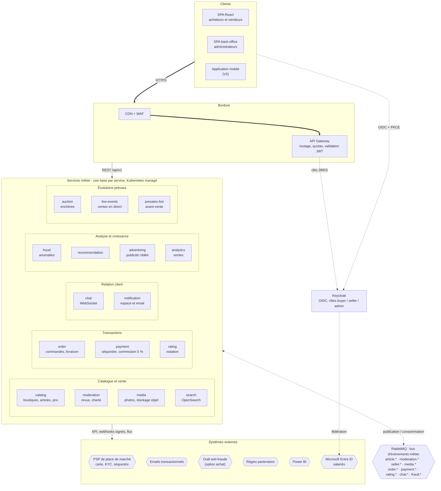
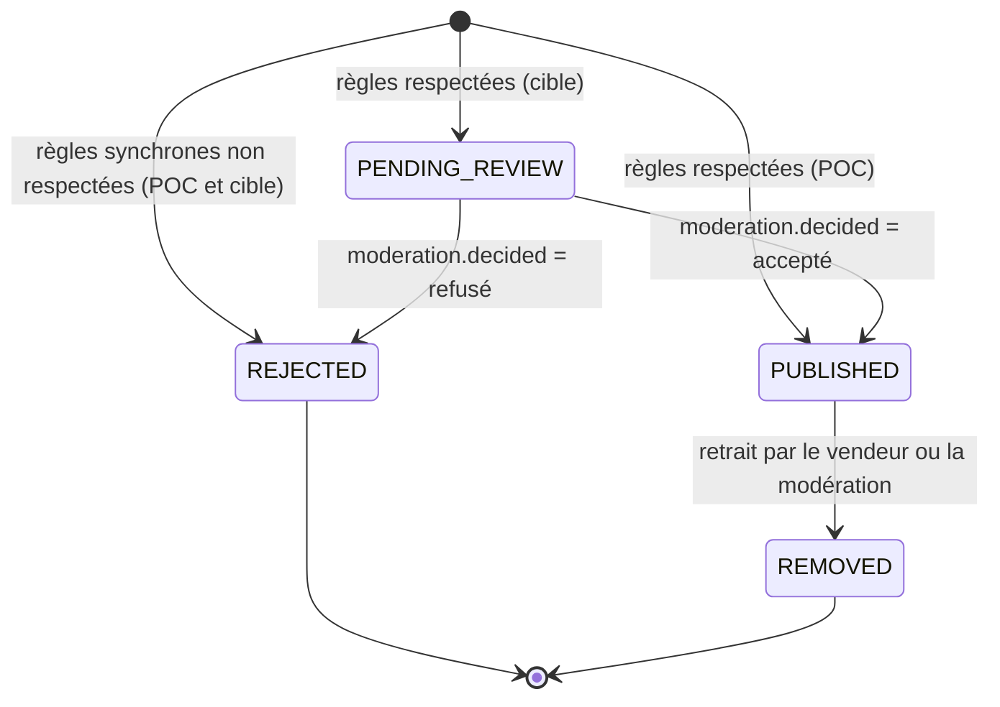

# Architecture cible de Collector.shop

L'architecture cible couvre toute la plateforme : catalogue, transactions, paiement, chat, notifications, détection de fraude, recommandations, publicité, ainsi que les évolutions annoncées (enchères, ventes en direct, bot d'avant-vente, analyse des ventes). Elle repose sur des **microservices découpés par domaine métier**, qui communiquent par **API REST synchrones** pour les requêtes des clients et par **événements asynchrones** pour propager les faits métier entre services. Le POC en réalise une tranche verticale, décrite dans [architecture-poc.md](architecture-poc.md).

## 1. Vue logique

**Légende** : trait épais = HTTPS depuis Internet ; trait plein = appel synchrone dans le cluster ; pointillé = échange asynchrone ou flux d'authentification.

> [!TIP]
> **À défendre à l'oral.** Le découpage suit les **contextes bornés** (*bounded contexts*) du domaine : chaque service possède son modèle et sa base, et une équipe peut le faire évoluer et le déployer seule. Les événements servent à propager un fait (« un article est publié ») sans que l'émetteur connaisse les destinataires. C'est ce qui permet d'ajouter les enchères ou le bot d'avant-vente en branchant de nouveaux consommateurs, sans modifier le catalogue.

## 2. Services

| Service | Responsabilité | Données | Publie | Consomme | Exigences | Version |
| --- | --- | --- | --- | --- | --- | --- |
| catalog | Catégories, boutiques, articles, prix et historique. Contrôle synchrone des règles (refus immédiat), puis article au statut `PENDING_REVIEW` jusqu'à la décision de moderation | PostgreSQL | `article.submitted`, `article.published`, `article.price_changed`, `article.removed`, `catalog.viewed` | `moderation.decided`, `seller.suspended` | EF-01 à EF-07, EF-27 | V1 (POC) |
| moderation | Contrôle approfondi **avant** mise en vente (classification d'images, coordonnées obfusquées), file de revue manuelle en cas de doute, application de la charte | PostgreSQL | `moderation.decided`, `seller.suspended` | `article.submitted`, `media.uploaded`, `chat.message_flagged`, `fraud.alert_raised` | EF-04, EF-05, EF-28, EF-29 | V1 |
| media | Téléversement, redimensionnement et analyse antivirus des photos | Stockage objet | `media.uploaded` | — | EF-03 | V1 |
| search | Recherche plein texte et facettes | OpenSearch (projection) | — | `article.*` | EF-01 | V1 |
| order | Commandes, suivi de livraison, confirmation de réception | PostgreSQL | `order.created`, `order.delivered` | `payment.captured` | EF-10 | V1 |
| payment | Paiement par carte via le PSP, séquestre, commission de 5 %, reversement au vendeur | PostgreSQL (aucune donnée de carte) | `payment.captured`, `payment.released`, `payment.refunded` | `order.created`, `order.delivered` | EF-17 à EF-20, ENF-09 | V1 |
| rating | Notation réciproque après transaction | PostgreSQL | `rating.submitted` | `order.delivered` | EF-11 | V1 |
| chat | Messagerie acheteur-vendeur en temps réel, filtrage des coordonnées | PostgreSQL + Redis (présence) | `chat.message_flagged` | `order.created` | EF-21, EF-22 | V1 |
| notification | Centres d'intérêt, recherches enregistrées, préférences, notifications dans l'espace et par email | PostgreSQL | — | `article.*`, `order.*`, `payment.*`, `seller.suspended`, `fraud.alert_raised` | EF-12 à EF-16, EF-36 | V1 (POC) |
| fraud | Règles d'anomalie, alertes, relais vers un outil tiers | PostgreSQL | `fraud.alert_raised` | `article.*`, `payment.*`, `rating.submitted` | EF-23 à EF-26 | V1 (POC) |
| recommendation | Recommandations par centres d'intérêt, puis par parcours de navigation | PostgreSQL + modèle | — | `article.*`, `catalog.viewed` (V2) | EF-30, EF-31 | V1, puis V2 |
| advertising | Flux produits et audiences pour les régies partenaires, sous consentement | PostgreSQL | — | `article.published` | EF-32, ENF-10 | V2 |
| analytics | Entrepôt de données des ventes, exposé à Power BI | Entrepôt analytique | — | tous les événements | EF-35 | V2 |
| auction, live-events, presales-bot | Enchères, ventes en direct en streaming, assistant d'avant-vente | selon le service | `auction.*`, `live.*` | `article.*` | EF-35 | Évolutions |

### Cycle de vie d'un article

Le contexte impose qu'un article ne soit mis en vente « qu'après contrôle » (EF-04). Dans la cible, les contrôles rapides restent synchrones dans catalog, et les contrôles lents ou humains se font avant la mise en vente, pendant que l'article attend au statut `PENDING_REVIEW`, invisible dans le catalogue.

Le POC n'applique que des règles déterministes (RM-01, RM-02) : il tranche toujours immédiatement et n'a donc pas besoin du statut `PENDING_REVIEW`.

## 3. Principes structurants

| Principe | Mise en œuvre | Exigences |
| --- | --- | --- |
| Une base par service | Aucune base partagée. Les autres services n'accèdent aux données que par l'API ou par des projections alimentées par les événements | ENF-21 |
| Synchrone pour les requêtes, asynchrone pour les faits | Le client interroge un service en REST via l'API Gateway. Un service n'appelle jamais un autre service de façon synchrone pour terminer une écriture : il publie un événement | EF-35, ENF-16 |
| Événements fiables | *Transactional outbox* côté producteur, livraison au moins une fois, consommateurs idempotents, *dead-letter queues* | ENF-18, ENF-19 |
| Contrats versionnés | API en `/api/v1` décrites en OpenAPI, événements avec `schema_version` et règles d'évolution rétrocompatibles | ENF-27, ENF-28 |
| Sécurité en profondeur | WAF et quotas en bordure, TLS partout (mTLS entre services via un service mesh), validation du JWT dans chaque service, NetworkPolicies, secrets dans un coffre | ENF-01 à ENF-11 |
| Périmètre PCI DSS minimal | La saisie de la carte se fait dans le composant du PSP (champs hébergés). Collector ne voit qu'un jeton | ENF-09 |
| Observabilité unifiée | OpenTelemetry pour les traces distribuées, Prometheus pour les métriques, Loki pour les logs, Grafana pour la visualisation | ENF-24 |
| Livraison continue et GitOps | GitHub Actions construit, teste et scanne. Argo CD synchronise le cluster avec le dépôt Git | ENF-05, ENF-30 |

> [!TIP]
> **À défendre à l'oral : le paiement.** Une place de marché qui encaisse pour le compte de vendeurs tiers doit soit être établissement de paiement, soit s'appuyer sur un PSP « marketplace » (par exemple Mangopay ou Stripe Connect). Ce PSP porte l'agrément, vérifie l'identité des vendeurs (KYC), conserve les fonds en séquestre et reverse la part du vendeur moins la commission de 5 %. Collector reste hors du périmètre de stockage des cartes (PCI DSS niveau SAQ A).

## 4. Catalogue des événements

| Événement | Producteur | Consommateurs | Déclencheur |
| --- | --- | --- | --- |
| `article.submitted` | catalog | moderation | Article conforme aux règles synchrones, en attente du contrôle approfondi (`PENDING_REVIEW`) |
| `article.published` | catalog | notification, fraud, search, recommendation, advertising, analytics | Article mis en vente après la décision de moderation (dans le POC : dès le contrôle synchrone) |
| `article.price_changed` | catalog | notification, fraud, search, analytics | Modification effective du prix |
| `article.removed` | catalog | search, notification, analytics | Retrait par le vendeur ou la modération |
| `moderation.decided` | moderation | catalog | Décision sur un article (mise en vente, rejet ou retrait) après contrôle automatique approfondi ou revue manuelle |
| `media.uploaded` | media | moderation | Photo téléversée et analysée par l'antivirus, prête pour la classification |
| `catalog.viewed` | catalog | recommendation, analytics | Consultation d'un article par un acheteur authentifié (V2, sous consentement) |
| `seller.suspended` | moderation | catalog, notification | Suspension d'un vendeur qui enfreint la charte |
| `order.created` / `order.delivered` | order | payment, chat, notification, rating, analytics | Commande passée, réception confirmée |
| `payment.captured` / `payment.released` / `payment.refunded` | payment | order, notification, fraud, analytics | Paiement accepté, fonds reversés, remboursement |
| `chat.message_flagged` | chat | moderation | Message bloqué ou signalé |
| `fraud.alert_raised` | fraud | moderation, notification (admins) | Règle d'anomalie déclenchée |
| `rating.submitted` | rating | fraud, analytics | Note déposée |

Les deux premiers événements sont implémentés dans le POC, avec les schémas décrits dans [contrats.md](contrats.md).

## 5. Intégration au système d'information existant

| Existant | Intégration |
| --- | --- |
| Office 365 et Exchange | Les salariés administrateurs se connectent au back-office avec leur compte Microsoft : Keycloak fédère Microsoft Entra ID (*identity brokering*). Les emails transactionnels des clients passent par un fournisseur dédié, pour ne pas dégrader la délivrabilité d'Exchange |
| Power BI | Le service analytics alimente un entrepôt de données que Power BI interroge pour les tableaux de bord de la direction |
| Site vitrine WordPress | Il reste le site éditorial et marketing. Il renvoie vers l'application, qui vit sur son propre sous-domaine |

## 6. Hébergement cible

La production vise un **Kubernetes managé chez un hébergeur européen**, pour la conformité RGPD et dans la continuité de l'hébergeur français actuel du site vitrine. Le choix précis (OVHcloud Managed Kubernetes, Scaleway Kapsule…) sera fait après le POC. Les charts Helm et les images multi-architecture du POC sont réutilisés tels quels (ENF-31). Le POC tourne sur un cluster k3d local (ADR 0006).

Les composants avec état passent sur des offres managées ou des opérateurs : PostgreSQL managé ou opérateur CloudNativePG avec réplicas, RabbitMQ en cluster de 3 nœuds avec *quorum queues*, sauvegardes automatiques (ENF-20).

## 7. Ce que le POC démontre de la cible

| Préoccupation de la cible | Démonstration dans le POC |
| --- | --- |
| Découpage par domaine, une base par service | 3 services FastAPI, 3 bases PostgreSQL |
| Contrôle automatique avant publication | Règles synchrones dans catalog, décision immédiate. La cible ajoute le statut `PENDING_REVIEW` : l'article n'est mis en vente qu'après la décision de moderation (contrôle des images, revue manuelle en cas de doute), conformément à EF-04 |
| Communication asynchrone fiable | Exchange `topic`, outbox, consommateurs idempotents, *dead-letter queues* |
| Ajout d'un service sans modifier les autres | notification et fraud consomment les mêmes événements, indépendamment l'un de l'autre |
| Sécurité | TLS, OIDC + PKCE, JWT vérifié par service, RBAC, NetworkPolicies, scans en CI |
| Disponibilité et montée en charge | Réplicas répartis sur les 2 agents, HPA, test de charge Locust, maintenance (drain) et panne d'un agent |
| Déploiement reproductible | Helm et Argo CD (GitOps) |
| Observabilité | Prometheus et Grafana, logs JSON corrélés |
