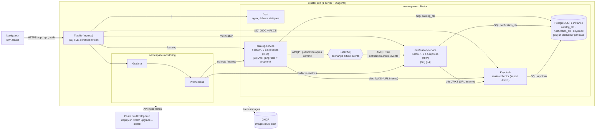
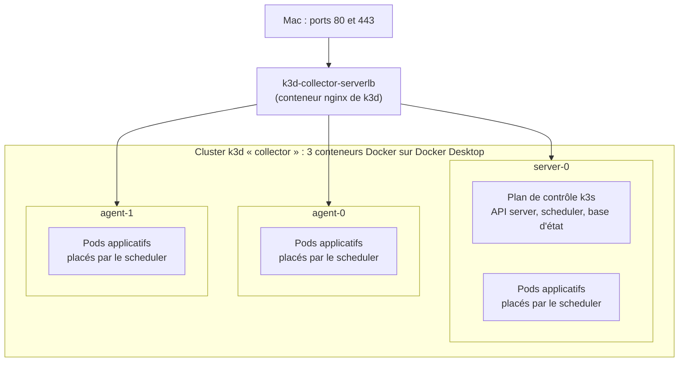
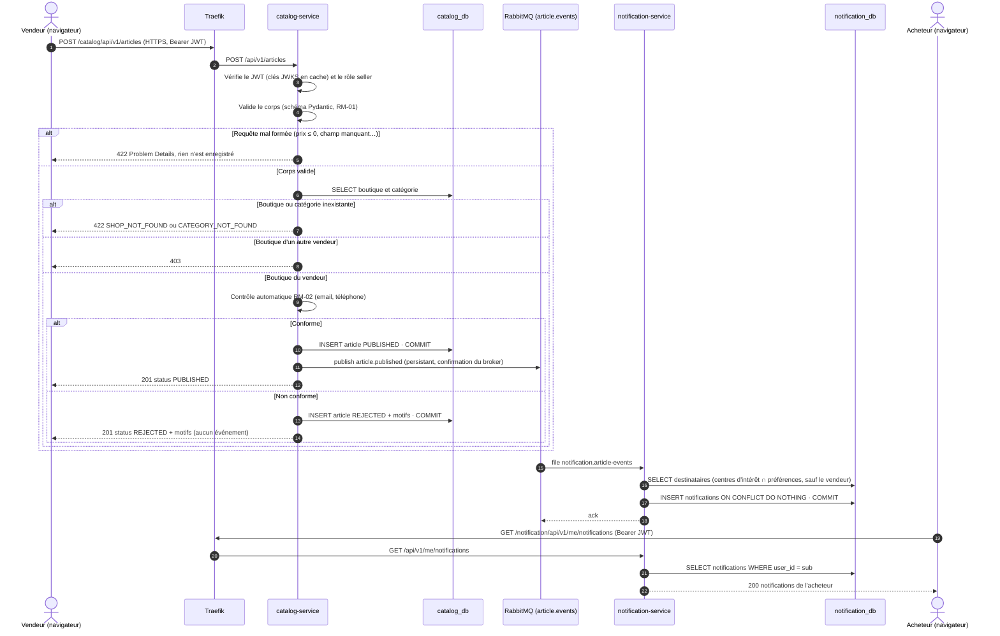
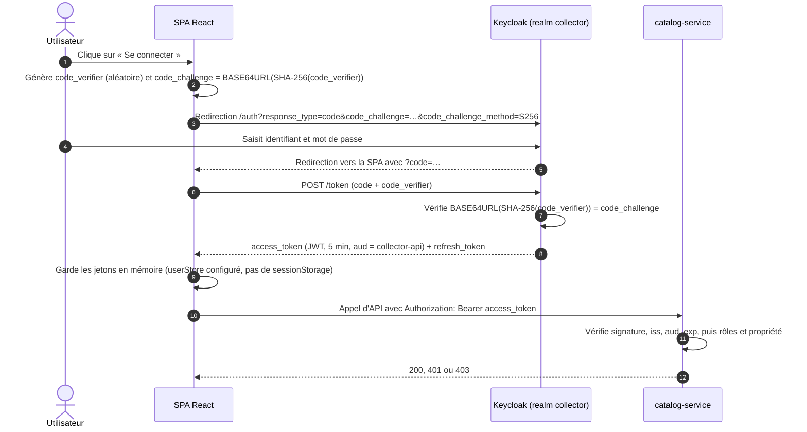

# Architecture du POC

Le POC réalise une tranche verticale de l'[architecture cible](architecture-cible.md) : **publication d'un article, contrôle automatique, événement, notification des acheteurs intéressés.** Il retient la solution la plus simple qui démontre chaque point évalué : découpage en services, communication asynchrone, sécurité, orchestration, disponibilité et montée en charge. Les éléments retirés sont listés, avec leur risque, en [section 8](#8-limites-assumées-du-poc), et justifiés dans l'ADR [0007](adr/0007-simplification-perimetre-poc.md).

Tout tourne sur le Mac de développement, dans un cluster Kubernetes k3d de trois nœuds, déployé par le script `deploy/local/deploy.sh` (chart Helm générique pour les deux services et le front, manifestes pour l'infrastructure). Les contrats d'API, d'événements et de données sont dans [contrats.md](contrats.md). L'infrastructure (PostgreSQL, RabbitMQ, Keycloak) est installée à partir des **images officielles par des manifestes simples, sans opérateur ni cert-manager** ; seule la pile d'observabilité passe par un chart Helm ([ADR 0008](adr/0008-infrastructure-images-officielles.md)).

## 1. Vue logique

**Légende.**
- Trait épais : HTTPS depuis le navigateur, seul flux applicatif qui entre dans le cluster.
- Trait plein : appel synchrone (HTTP ou SQL) dans le cluster.
- Pointillé : message asynchrone AMQP via RabbitMQ.
- `[Sn]` : point de sécurité détaillé en section 5.

### Domaines exposés

| URL | Composant |
| --- | --- |
| `https://app.127.0.0.1.sslip.io` | Front React |
| `https://api.127.0.0.1.sslip.io/{catalog,notification}/api/v1/…` | API des deux services |
| `https://auth.127.0.0.1.sslip.io` | Keycloak |
| `https://grafana.127.0.0.1.sslip.io` | Tableau de bord |

RabbitMQ et PostgreSQL ne sont jamais exposés. On y accède par `kubectl port-forward` pour le diagnostic.

### Front

Quatre pages React (MUI, React Router) : **catalogue** public filtrable par catégorie, **espace vendeur** (boutique, mise en vente, modification du prix), **espace acheteur** (centres d'intérêt, préférences, notifications), **catégories** pour l'admin. L'interface est en français. L'internationalisation et le contrôle d'accessibilité restent dans la cible.

## 2. Vue physique

- **Aucune règle de placement.** Le scheduler de Kubernetes répartit les pods selon les ressources disponibles. Il étale déjà, par défaut, les réplicas d'un même Deployment sur des nœuds différents quand il le peut, sans que ce soit garanti. Le placement réel est relevé par `kubectl get pods -o wide` ([protocole 4](../04-experimentations/04-deploiement/protocole.md), §5) : il change d'un déploiement à l'autre (journaux versionnés du protocole 4 : les deux réplicas de `catalog-service` sur `agent-0` et `agent-1` dans l'un, sur `server-0` et `agent-0` dans l'autre), et le server porte aussi des pods applicatifs.
- **Stockage.** PostgreSQL et RabbitMQ utilisent des volumes du provisionneur `local-path` de k3s, liés au disque du nœud où ils ont été créés.
- **Entrée du trafic.** k3d publie les ports 80 et 443 du Mac sur son conteneur `serverlb`, qui les répartit sur les 3 nœuds. ServiceLB, le répartiteur intégré à k3s, transmet ensuite le trafic à Traefik.

## 3. Choix techniques

| Couche | Solution | Rôle dans le POC | ADR |
| --- | --- | --- | --- |
| Front | React + TypeScript (Vite), MUI, React Router, react-oidc-context | 4 pages, OIDC + PKCE, jetons en mémoire | 0005 |
| Services | Python 3.12, FastAPI, Pydantic v2, SQLAlchemy 2.0 (asynchrone), Alembic | API REST, validation, accès aux données, migrations | 0002 |
| Messagerie | RabbitMQ, client aio-pika | Exchange `topic` `article.events`, une file durable | 0003 |
| Données | PostgreSQL, une instance, une base logique par service | Données séparées par service, isolées par les droits PostgreSQL | 0001, 0007 |
| Identité | Keycloak, realm `collector` importé depuis un JSON | Jetons OIDC, rôles `buyer`, `seller`, `admin`, comptes de démo | 0004 |
| Orchestration | k3d (k3s dans Docker), 1 server + 2 agents | Cluster Kubernetes multi-nœuds local | 0006 |
| Exposition et TLS | Traefik (fourni par k3s), certificat mkcert chargé comme Secret TLS | Routage par hôte et par chemin, HTTPS | 0006 |
| Déploiement | Un chart Helm générique pour les 2 services et le front, script `deploy/local/deploy.sh` | 2 réplicas, sondes, HPA, ressources, secrets | 0006 |
| Infrastructure | Images officielles `postgres`, `rabbitmq` et Keycloak, manifestes simples dans `deploy/infra`, Secrets générés par script | Installation sans opérateur ni cert-manager | 0008 |
| Observabilité | kube-prometheus-stack allégé (sans Alertmanager), structlog | Un tableau de bord Grafana : débit, latence p95, taux d'erreur. Logs JSON corrélés | 0008 |
| CI/CD | GitHub Actions, GHCR | Ruff + mypy → pytest + couverture → SonarCloud → build Docker multi-arch → Trivy → push GHCR | — |

Les versions exactes sont fixées dans les protocoles d'expérimentation (`docs/04-experimentations`).

## 4. Disponibilité et montée en charge

Le chart Helm donne à chaque service **2 réplicas minimum**, des **sondes** `liveness` et `readiness`, des **requests et limits** CPU et mémoire, et un **HorizontalPodAutoscaler** de 2 à 5 réplicas à 70 % de CPU. Le metrics-server nécessaire à l'HPA est fourni par k3s.

| Démonstration | Déroulé | Résultat attendu |
| --- | --- | --- |
| **Montée en charge** (ENF-29) | Test Locust à charge croissante sur le catalogue | L'HPA passe `catalog-service` de 2 à 5 réplicas, visible avec `kubectl get hpa -w` et dans Grafana. La latence p95 reste sous la cible d'ENF-12 |
| **Perte d'une instance** (ENF-16) | `kubectl delete pod` sur un réplica de `catalog-service` pendant le test Locust | Le pod supprimé sort des endpoints. L'autre réplica continue de servir. Le Deployment recrée un pod, qui reçoit du trafic dès que sa sonde `readiness` répond. Le taux d'erreur mesuré par Locust reste marginal (requêtes en cours sur le pod supprimé) |

> [!TIP]
> **À défendre à l'oral : pourquoi pas de démonstration de panne de nœud.** Sans règles de placement, rien ne garantit que les deux réplicas d'un service sont sur deux nœuds différents. Une démonstration de panne de nœud serait donc aléatoire. On démontre ce que le POC garantit vraiment, l'auto-réparation au niveau du pod et l'autoscaling, et on documente le reste dans les limites : répartition imposée, PodDisruptionBudget et stockage répliqué.

> [!TIP]
> **À défendre à l'oral : pourquoi k3d plutôt que docker-compose.** k3d lance une vraie distribution Kubernetes certifiée CNCF (k3s), sur plusieurs nœuds, dans des conteneurs Docker. On y démontre l'auto-réparation, l'autoscaling et le routage par Ingress, que docker-compose ne fournit pas. Le même chart Helm se déploie ensuite sur un Kubernetes managé.

## 5. Points de sécurité

| # | Mesure | Menace traitée | Exigence |
| --- | --- | --- | --- |
| S1 | TLS terminé par Traefik avec un certificat `*.127.0.0.1.sslip.io` généré par mkcert et chargé comme Secret TLS. Redirection HTTP → HTTPS | Écoute et altération du trafic | ENF-01 |
| S2 | OIDC *Authorization Code* + PKCE. Jeton d'accès de 5 min, gardé en mémoire : react-oidc-context stocke par défaut la session dans `sessionStorage`, on configure donc un `userStore` en mémoire | Interception du code d'autorisation, vol d'un jeton persistant | ENF-02 |
| S3 | Chaque service vérifie lui-même le JWT : signature RS256, `iss`, `aud`, `exp`. Aucune confiance implicite accordée au réseau interne | Usurpation d'identité, rejeu d'un jeton expiré | ENF-02 |
| S4 | RBAC par rôle, puis contrôle de propriété de la ressource. Les routes `/me` dérivent l'utilisateur du jeton | Élévation de privilèges, accès aux données d'un autre utilisateur (IDOR) | ENF-03 |
| S5 | Un utilisateur PostgreSQL par service, sans droit de connexion à la base de l'autre. Validation stricte des entrées (Pydantic) et requêtes paramétrées (ORM) | Lecture des données d'un autre service, injection SQL | ENF-07, ENF-21 |
| S6 | `deploy.sh` génère les mots de passe manquants dans un `.env` local non versionné (modèle `deploy/local/.env.example`, versionné), stables d'un déploiement à l'autre, puis crée les Secrets Kubernetes, injectés dans les pods par le chart | Fuite de secrets dans Git | ENF-04 |
| S7 | Images multi-stage `python:3.12-slim`, utilisateur non root, système de fichiers racine en lecture seule, toutes les capacités Linux retirées | Exploitation d'une vulnérabilité de l'image, évasion de conteneur | ENF-05 |
| S8 | Pipeline : SonarCloud (analyse statique, quality gate) et Trivy (dépendances, image, secrets) bloquants avant la publication sur GHCR | Vulnérabilité connue ou secret embarqué dans une image livrée | ENF-04, ENF-05 |

> [!TIP]
> **À défendre à l'oral : le piège du nom de domaine dans le cluster.** Le navigateur obtient ses jetons via `https://auth.127.0.0.1.sslip.io`, et c'est cette URL qui figure dans le claim `iss`. Or, dans un pod, `127.0.0.1` désigne le pod lui-même. Les services téléchargent donc les clés publiques par l'URL interne du Service Kubernetes (`http://keycloak.collector.svc.cluster.local:8080`, voir `contrats.md` §1.2) tout en vérifiant que `iss` vaut bien l'URL publique. Cette difficulté est vérifiée par l'[expérimentation 2](../04-experimentations/02-keycloak-tls/protocole.md) (mesures 4 et 5) : un jeton obtenu par l'URL interne porte le même `iss` que celui obtenu par l'URL publique, et un seul appel JWKS sert 216 requêtes. Le bac à sable utilisait `keycloak-service` dans le namespace `keycloak` (nommage hérité de l'opérateur) ; le POC utilise le Service `keycloak` du namespace `collector`.

## 6. Parcours principal : publication d'un article

Points clés de ce parcours :

- **Le contrôle est synchrone, la diffusion est asynchrone.** Le vendeur connaît le statut de son article dès la réponse HTTP. La notification se fait ensuite, sans allonger son temps de réponse ni dépendre de la disponibilité de `notification-service`.
- **Publication juste après le commit.** C'est la solution la plus simple, mais elle a une fenêtre de risque : si RabbitMQ est indisponible entre le commit et la publication, l'article est bien publié mais l'événement est perdu. L'erreur est journalisée. La cible ferme cette fenêtre avec l'outbox (section 8).
- **Acquittement après le commit.** `notification-service` n'acquitte le message qu'une fois les notifications enregistrées : s'il tombe pendant le traitement, RabbitMQ relivre le message. La contrainte d'unicité évite alors les doublons.
- **Point d'extension.** Un outil anti-fraude, interne ou acheté, recevra les mêmes événements en liant sa propre file à l'exchange, sans modification de `catalog-service` (EF-25).
- **Dans le POC, l'acheteur récupère ses notifications par interrogation périodique** (toutes les 10 s). Dans la cible, la notification sera poussée en temps réel par WebSocket ou *Server-Sent Events*.

Le parcours de modification de prix (US-04) suit le même schéma : la ligne de `price_history` et le nouveau prix sont écrits dans la même transaction, puis `article.price_changed` est publié.

## 7. Authentification : flux OIDC avec PKCE

> [!TIP]
> **À défendre à l'oral : pourquoi PKCE.** Une SPA est un client public : elle ne peut pas garder de secret client, puisque tout son code est lisible dans le navigateur. PKCE (RFC 7636) lie la demande d'autorisation et l'échange du code par un secret à usage unique, ce qui empêche un attaquant qui intercepterait le code de l'échanger contre un jeton. C'est le flux recommandé par l'OAuth 2.0 Security Best Current Practice (RFC 9700), qui déconseille le flux implicite. Les jetons en mémoire ne protègent pas d'un XSS actif : c'est une limite assumée (section 8).

## 8. Limites assumées du POC

Chaque élément de l'architecture cible absent du POC laisse un risque connu. Ce tableau alimente directement le plan de remédiation (`docs/06-securite`, critère 8). La priorité tient compte de l'impact en production et de la facilité d'exploitation.

| # | Élément absent du POC | Risque laissé | Recommandation pour la cible | Priorité |
| --- | --- | --- | --- | --- |
| L1 | Service anti-fraude (US-06, EF-23, EF-24, EF-26) | Aucune détection des prix anormaux ni des vendeurs suspects, alors que la plateforme garantit ses vendeurs | Brancher un service interne ou un produit du marché sur l'exchange `article.events`, avec sa propre file et ses règles (RM-07) | Haute |
| L2 | *Transactional outbox* | Événement perdu si RabbitMQ est indisponible entre le commit et la publication : notification manquée, et angle mort pour la future détection de fraude | Écrire l'événement dans une table `outbox_events` dans la même transaction, puis le publier par un relais (`FOR UPDATE SKIP LOCKED`) | Haute |
| L3 | Une seule instance PostgreSQL pour les deux services et Keycloak | Point de défaillance unique, concurrence pour les ressources entre services, et données de tous les services exposées si le compte d'administration de l'instance est compromis | Instance séparée par service, ou PostgreSQL managé répliqué (opérateur CloudNativePG), sauvegardes automatiques (ENF-20) | Haute |
| L4 | NetworkPolicies | Tout pod compromis peut joindre PostgreSQL, RabbitMQ et Keycloak (mouvement latéral). Seuls les droits PostgreSQL (S5) cloisonnent les données | NetworkPolicies en refus par défaut, puis autorisation flux par flux | Haute |
| L5 | BFF et politique de sécurité de contenu (CSP) | Un XSS actif peut appeler l'API avec le jeton de la page | BFF qui garde les jetons côté serveur (cookie `HttpOnly`), en-tête CSP strict | Haute |
| L6 | Limitation de débit | Déni de service applicatif, bourrage d'identifiants sur Keycloak | Middleware `RateLimit` de Traefik ou API Gateway. Détection de force brute de Keycloak activée | Moyenne |
| L7 | *Dead-letter queue*, *quorum queues* et table `processed_events` | Un message en échec est rejeté et seulement journalisé. File perdue si le volume du broker est perdu. Un futur consommateur devra gérer lui-même les doublons | DLQ par consommateur avec rejeu, cluster RabbitMQ de 3 nœuds et *quorum queues*, idempotence générale par `processed_events` | Moyenne |
| L8 | Règles de placement et PodDisruptionBudget | Les deux réplicas d'un service peuvent se retrouver sur le même nœud : la perte de ce nœud interrompt le service. Un `drain` peut évincer les deux réplicas en même temps | `topologySpreadConstraints` sur `kubernetes.io/hostname`, PodDisruptionBudget `minAvailable: 1` | Moyenne |
| L9 | Stockage répliqué, broker et Keycloak redondants | Volumes `local-path` liés à un nœud. RabbitMQ et Keycloak en une seule instance : leur perte bloque les événements ou les connexions | Stockage managé, cluster RabbitMQ, Keycloak à plusieurs réplicas | Moyenne |
| L10 | Chiffrement du trafic interne (mTLS) | Écoute du trafic entre pods par un attaquant déjà présent dans le cluster | Service mesh (Linkerd) avec mTLS automatique | Moyenne |
| L11 | Gestion automatique des certificats (cert-manager) | Certificat mkcert renouvelé à la main. La CA racine de mkcert, à laquelle le Mac fait confiance, sert à toute la démo | cert-manager avec un émetteur ACME (Let's Encrypt) sur un vrai domaine | Basse en POC, Haute en production |
| L12 | Déploiement GitOps (Argo CD) | Déploiement lancé depuis un poste, sans détection de dérive. L'accès administrateur au cluster reste sur ce poste | Argo CD synchronise le cluster avec le dépôt Git, sans identifiants du cluster dans la CI | Moyenne |
| L13 | Semgrep, Bandit, pip-audit, Gitleaks et ZAP dans la CI | Couverture SAST et SCA plus étroite. Secrets dans l'historique Git non détectés. Pas d'analyse dynamique à chaque livraison | Ajouter ces analyses au pipeline, ZAP baseline sur l'environnement de recette | Moyenne |
| L14 | Internationalisation et contrôle d'accessibilité | Non-conformité à l'European Accessibility Act, applicable au commerce en ligne depuis juin 2025, et au RGAA | react-i18next, contrôle axe dans les tests de bout en bout, audit RGAA | Moyenne |
| L15 | Détection des coordonnées obfusquées et revue manuelle | Contournement du contrôle (« zéro six… », texte dans les photos), donc transactions hors plateforme | Service moderation et statut `PENDING_REVIEW` (architecture cible) | Moyenne |
| L16 | Plan de contrôle redondant | Le server k3d unique est un point de défaillance du cluster | Kubernetes managé, plan de contrôle géré par le fournisseur | Basse en POC |
| L17 | `securityContext` de l'infrastructure : appliqué aux services et à PostgreSQL, **pas à Keycloak ni à RabbitMQ** (révélé par la phase 3, état en phase 6) | Les services du chart tournent en utilisateur 10001, système de fichiers racine en lecture seule, sans capacité Linux, avec `seccompProfile: RuntimeDefault`, et PostgreSQL a un système de fichiers racine en lecture seule. Keycloak ne peut pas l'avoir : sans `--optimized`, il reconstruit son application au démarrage et écrit dans son répertoire (erreur relevée en P6-02). RabbitMQ démarre en root (voir L18). Une vulnérabilité dans ces deux images donne donc plus de droits dans le conteneur que nécessaire | Construire une image Keycloak optimisée (`kc.sh build`) pour que Keycloak passe en lecture seule ; résoudre L18 pour RabbitMQ. Utilisateur non root, retrait des capacités Linux et `seccompProfile: RuntimeDefault` sont déjà posés sur PostgreSQL et Keycloak (`deploy/infra/postgres.yaml` et `keycloak.yaml`) : il ne reste à traiter que ces deux points | Moyenne |
| L18 | Broker RabbitMQ démarré en root, sans `securityContext` (phase 3, expérimentation 1) | Le point d'entrée de l'image démarre en root puis passe la main à l'utilisateur `rabbitmq`. Lors d'un essai non conservé, `fsGroup: 999` a rendu le cookie Erlang lisible par le groupe et le nœud a refusé de démarrer à la recréation du pod ; d'autres réglages n'ont pas été essayés | Pistes à étudier, non testées : préparer le volume autrement (conteneur d'initialisation qui fixe les droits, cookie fourni par un Secret), puis exécuter le broker en non-root ; hypothèse non testée : un opérateur (RabbitMQ Cluster Operator, cible) pourrait gérer ce démarrage | Moyenne |
| L19 | Console d'administration de Keycloak sur l'hôte public et confiance accordée aux en-têtes `X-Forwarded-*` (phase 3, expérimentation 2) | La console est joignable sur `auth.…` comme le realm. Keycloak (`KC_PROXY_HEADERS=xforwarded`) fait confiance aux en-têtes de tout appelant qui l'atteint dans le cluster, sans restriction par adresse. Un seul réplica de Keycloak | Restreindre la console (hôte ou réseau d'administration séparé), limiter les appelants autorisés à fixer ces en-têtes (NetworkPolicies, L4), Keycloak à plusieurs réplicas (L9) | Haute |
| L20 | Observabilité sans stockage persistant ni contrôle d'accès (phase 3, expérimentation 3) | Prometheus et Grafana utilisent des volumes `emptyDir` avec une rétention de 2 h : les mesures sont perdues au redémarrage du pod. Aucune authentification n'est posée devant Prometheus (accès par `port-forward` dans l'expérimentation) | Stockage persistant, Alertmanager et alertes sur le taux d'erreur et le p95, contrôle d'accès à Prometheus et à Grafana, supervision du plan de contrôle et des nœuds | Basse en POC |
| L21 | Compteur de livraisons du consommateur (phase 4, `notification-service`) | Le drapeau `redelivered` d'AMQP est aussi vrai après une coupure de connexion : une première erreur de traitement peut être prise pour une seconde tentative et le message rejeté sans nouvelle tentative, donc une notification perdue | *Quorum queues* et leur en-tête `x-delivery-count`, qui compte réellement les livraisons | Basse en POC |
| L22 | Remise en file immédiate des messages en échec (phase 4, `notification-service`) | Un message en échec est remis en file aussitôt, puis rejeté à la deuxième erreur. Une panne brève de PostgreSQL fait donc rejeter des événements après deux tentatives rapprochées, et les notifications correspondantes sont perdues | *Dead-letter queue* par consommateur et rejeu différé (délai croissant), avec alerte sur la taille de la DLQ | Moyenne |
| L23 | Le retour arrière Helm ne défait pas les migrations Alembic (phase 6, `deploy.sh services`) | `helm rollback` restaure le Deployment, la ConfigMap et le chart, pas le schéma de la base : si la version annulée avait appliqué une migration, l'ancienne version tourne sur le nouveau schéma. Sans effet tant que les migrations restent rétrocompatibles (ajouts de colonnes ou de tables), destructeur sinon | Règle de développement *expand / contract* : une migration ne supprime ni ne renomme rien dans la version qui l'introduit, le nettoyage vient une version plus tard. Migration descendante testée (`alembic downgrade`) et sauvegarde avant migration dans la cible | Moyenne |
| L24 | `style-src 'unsafe-inline'` dans la politique de sécurité du contenu du front (phase 7, image nginx) | MUI (Emotion) injecte des balises `<style>` à l'exécution : sans `'unsafe-inline'`, les styles sont refusés (vérifié dans le navigateur). Un script injecté pourrait ajouter des styles (habillage trompeur) ; `script-src 'self'` reste strict, donc pas d'exécution de script | CSP à nonce : le serveur génère un nonce par réponse et l'application le transmet à Emotion (`nonce` du cache), ou styles extraits à la compilation | Faible |
| L25 | Image du front reconstruite avec `apk upgrade` (phase 7, `frontend/Dockerfile`) | La base officielle `nginx-unprivileged` la plus récente contenait des CVE CRITICAL et HIGH déjà corrigées par Alpine. Le Dockerfile met donc les paquets à jour : le contenu dépend des dépôts Alpine au moment du build, deux builds du même commit peuvent différer | Compensé par le scan du digest publié (amd64 et arm64) avant l'étiquetage, le digest faisant foi. Cible : base corrigée en amont, ou image construite depuis une base minimale maîtrisée, puis retrait de `apk upgrade` | Moyenne |

## 9. Correspondance avec les critères d'évaluation

| Critère | Élément d'architecture |
| --- | --- |
| 2. Qualité du POC (découpage, communication, sécurité, orchestration) | 2 services et 2 bases logiques, REST et AMQP, points S1 à S8, k3d + Helm |
| 5. Environnement d'exécution (disponibilité, montée en charge) | 2 réplicas, sondes, HPA, démonstrations de perte d'un pod et de montée en charge |
| 8. Sécurité | Points S1 à S8 dans le POC, limites L1 à L25 pour le plan de remédiation |
