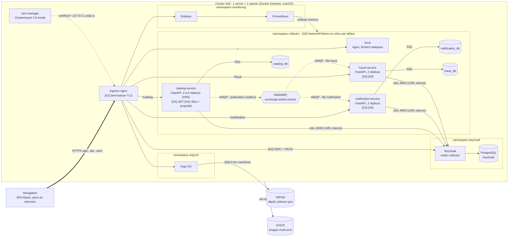
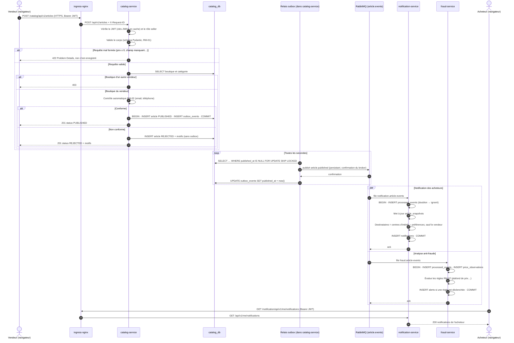
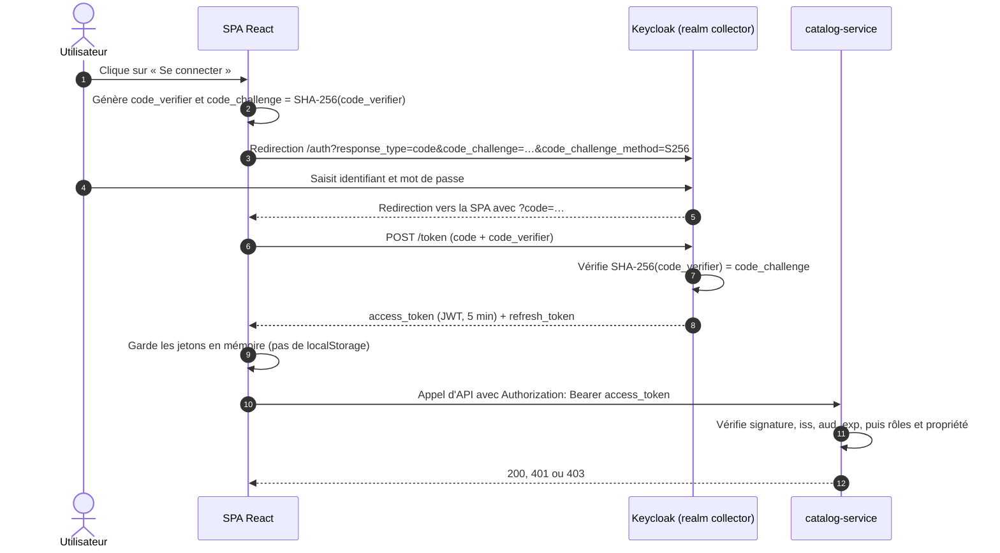

# Architecture du POC

Le POC réalise une tranche verticale de l'[architecture cible](architecture-cible.md) : **publication d'un article, contrôle automatique, événements, notification des acheteurs et analyse anti-fraude.** Tout tourne sur le Mac de développement, dans un cluster Kubernetes k3d de trois nœuds, déployé en GitOps par Argo CD. Les contrats d'API, d'événements et de données sont dans [contrats.md](contrats.md).

## 1. Vue de déploiement

**Légende.**
- Trait épais : HTTPS depuis le navigateur, seul flux qui entre dans le cluster.
- Trait plein : appel synchrone (HTTP ou SQL) dans le cluster.
- Pointillé : message asynchrone AMQP via RabbitMQ.
- `[Sn]` : point de sécurité détaillé en section 3.

### Domaines exposés

| URL | Composant |
| --- | --- |
| `https://app.127.0.0.1.sslip.io` | Front React |
| `https://api.127.0.0.1.sslip.io/{catalog,notification,fraud}/api/v1/…` | API des trois services |
| `https://auth.127.0.0.1.sslip.io` | Keycloak |
| `https://grafana.127.0.0.1.sslip.io` | Tableaux de bord |
| `https://argocd.127.0.0.1.sslip.io` | Argo CD |

RabbitMQ et les bases de données ne sont jamais exposés. On y accède par `kubectl port-forward` pour le diagnostic.

## 2. Choix techniques

| Couche | Solution | Rôle dans le POC | ADR |
| --- | --- | --- | --- |
| Front | React + TypeScript (Vite), MUI, TanStack Query, react-oidc-context, react-i18next | SPA, jeton d'accès gardé en mémoire, interface en français et en anglais | 0005 |
| Services | Python 3.12, FastAPI, Pydantic v2, SQLAlchemy 2.0 (asynchrone), Alembic | API REST, validation, accès aux données, migrations | 0002 |
| Messagerie | RabbitMQ, client aio-pika | Exchange `topic`, *quorum queues*, *dead-letter queues* | 0003 |
| Données | PostgreSQL, une instance par service | Isolation des données par service | 0001 |
| Identité | Keycloak, realm `collector` | Émission des jetons OIDC, rôles `buyer`, `seller`, `admin` | 0004 |
| Orchestration | k3d (k3s dans Docker), 1 server + 2 agents | Cluster Kubernetes multi-nœuds local | 0006 |
| Exposition et TLS | ingress-nginx, cert-manager, CA locale mkcert | Routage par hôte et chemin, certificats émis automatiquement | 0006 |
| Déploiement | Helm, Argo CD | Un chart par service, synchronisation GitOps depuis le dépôt | 0006 |
| Observabilité | kube-prometheus-stack (Prometheus, Grafana), structlog | Métriques RED (débit, erreurs, durée) et métriques métier, logs JSON corrélés | — |

Les versions exactes sont fixées dans les protocoles d'expérimentation (`docs/04-experimentations`).

### Placement sur les nœuds

| Nœud | Charge | Raison |
| --- | --- | --- |
| `server-0` | Plan de contrôle k3s, PostgreSQL, RabbitMQ, Keycloak | Les volumes du provisionneur `local-path` de k3s sont liés au disque d'un nœud. Les composants avec état restent donc sur le nœud qui n'est jamais arrêté pendant la démo |
| `agent-0`, `agent-1` | Front, 3 services, ingress-nginx | Composants sans état, répliqués et répartis entre les deux agents (`topologySpreadConstraints`), protégés par un PodDisruptionBudget |

La démonstration de disponibilité (ENF-16) arrête un agent : les réplicas restants continuent de servir pendant que Kubernetes replanifie les pods perdus sur l'autre agent.

> [!TIP]
> **À défendre à l'oral : pourquoi k3d plutôt que Minikube ou docker-compose.** k3d lance une vraie distribution Kubernetes certifiée CNCF (k3s), sur plusieurs nœuds, dans des conteneurs Docker. On peut donc démontrer la répartition des réplicas, l'arrêt d'un nœud, l'autoscaling et les NetworkPolicies, ce que docker-compose ne permet pas. Les mêmes charts Helm se déploient ensuite sur un Kubernetes managé.

> [!TIP]
> **À défendre à l'oral : la limite assumée.** PostgreSQL et RabbitMQ tournent en une seule instance dans le POC : ce sont des points de défaillance uniques. La cible les remplace par un PostgreSQL répliqué (opérateur CloudNativePG ou offre managée) et par un cluster RabbitMQ de 3 nœuds. Cette limite figure dans le plan de remédiation.

## 3. Points de sécurité

| # | Mesure | Menace traitée | Exigence |
| --- | --- | --- | --- |
| S1 | TLS terminé à l'Ingress, redirection HTTP → HTTPS, HSTS. Certificats émis par cert-manager à partir d'une CA locale générée par mkcert | Écoute et altération du trafic | ENF-01 |
| S2 | OIDC *Authorization Code* + PKCE. Le jeton d'accès (5 min) reste en mémoire, jamais dans `localStorage`. Il est renouvelé silencieusement | Vol de jeton par XSS, interception du code d'autorisation | ENF-02 |
| S3 | Chaque service vérifie lui-même le JWT : signature RS256, `iss`, `aud`, `exp`. Aucune confiance implicite accordée au réseau interne | Usurpation d'identité, rejeu d'un jeton expiré | ENF-02 |
| S4 | RBAC par rôle, puis contrôle de propriété de la ressource. Les routes `/me` dérivent l'utilisateur du jeton | Élévation de privilèges, accès aux données d'un autre utilisateur (IDOR) | ENF-03 |
| S5 | NetworkPolicies en refus par défaut, puis autorisation flux par flux (tableau ci-dessous) | Mouvement latéral après la compromission d'un pod | ENF-06 |
| S6 | Secrets Kubernetes créés par le script d'amorçage à partir d'un `.env` local non versionné. Gitleaks en CI | Fuite de secrets dans Git | ENF-04 |
| S7 | Images multi-stage `python:3.12-slim`, utilisateur non root, système de fichiers racine en lecture seule, toutes les capacités Linux retirées. Images analysées par Trivy | Exploitation d'une vulnérabilité de l'image, évasion de conteneur | ENF-05 |
| S8 | Argo CD ne déploie que ce qui est dans Git. Les images sont construites et scannées par la CI. Aucun `kubectl apply` manuel | Déploiement non tracé, dérive de configuration | ENF-05, ENF-30 |
| S9 | **Limite :** le trafic entre pods n'est pas chiffré (pas de mTLS) | Écoute du trafic à l'intérieur du cluster | Plan de remédiation : service mesh (Linkerd) |

### Flux autorisés par les NetworkPolicies

Tout flux absent de ce tableau est refusé. Chaque pod garde l'accès DNS (`kube-dns`, port 53).

| Source | Destination | Port |
| --- | --- | --- |
| ingress-nginx | front, catalog-service, notification-service, fraud-service | 8080, 8000 |
| ingress-nginx | Keycloak, Grafana, Argo CD | ports HTTP des services |
| catalog-service | catalog_db, RabbitMQ, Keycloak | 5432, 5672, 8080 |
| notification-service | notification_db, RabbitMQ, Keycloak | 5432, 5672, 8080 |
| fraud-service | fraud_db, RabbitMQ, Keycloak | 5432, 5672, 8080 |
| Keycloak | base keycloak | 5432 |
| Prometheus | les trois services, RabbitMQ | 8000 (`/metrics`), 15692 |

Ce tableau correspond au test d'ENF-06 : une connexion de `fraud-service` vers `catalog_db` doit échouer.

> [!TIP]
> **À défendre à l'oral : le piège du nom de domaine dans le cluster.** Le navigateur obtient ses jetons via `https://auth.127.0.0.1.sslip.io`, et c'est cette URL qui figure dans le claim `iss`. Or, dans un pod, `127.0.0.1` désigne le pod lui-même. Les services téléchargent donc les clés publiques par l'URL interne du Service Kubernetes (`http://keycloak.keycloak.svc…/certs`) tout en vérifiant que `iss` vaut bien l'URL publique. Cette difficulté sera documentée dans le protocole d'expérimentation de Keycloak.

## 4. Parcours principal : publication d'un article

Points clés de ce parcours :

- **Le contrôle est synchrone, la diffusion est asynchrone.** Le vendeur connaît le statut de son article dès la réponse HTTP. La notification et l'analyse anti-fraude se font ensuite, sans allonger son temps de réponse.
- **L'outbox découple la transaction de la publication.** Si RabbitMQ est arrêté, la publication de l'article réussit quand même. L'événement reste dans `outbox_events` et part au redémarrage du broker (ENF-18).
- **`FOR UPDATE SKIP LOCKED`** permet de faire tourner le relais dans plusieurs réplicas de `catalog-service` sans qu'ils publient deux fois la même ligne.
- **Les deux consommateurs travaillent en parallèle et indépendamment** : une panne de `fraud-service` ne retarde pas les notifications.
- **Dans le POC, l'acheteur récupère ses notifications par interrogation périodique** (TanStack Query, toutes les 10 s). Dans la cible, la notification sera poussée en temps réel par WebSocket ou *Server-Sent Events*.

Le parcours de modification de prix (US-04) suit le même schéma, avec l'événement `article.price_changed` et une ligne dans `price_history` écrite dans la même transaction.

## 5. Authentification : flux OIDC avec PKCE

> [!TIP]
> **À défendre à l'oral : pourquoi PKCE.** Une SPA est un client public : elle ne peut pas garder de secret client, puisque tout son code est lisible dans le navigateur. PKCE (RFC 7636) lie la demande d'autorisation et l'échange du code par un secret à usage unique, ce qui empêche un attaquant qui intercepterait le code de l'échanger contre un jeton. C'est le flux recommandé par l'OAuth 2.0 Security Best Current Practice (RFC 9700), qui déconseille le flux implicite.

## 6. Correspondance avec les critères d'évaluation

| Critère | Élément d'architecture |
| --- | --- |
| 2. Qualité du POC (découpage, communication, sécurité, orchestration) | 3 services et 3 bases, REST et AMQP, points S1 à S9, k3d + Helm + Argo CD |
| 5. Environnement d'exécution (disponibilité, montée en charge) | Réplicas sur 2 agents, PodDisruptionBudget, HPA, arrêt d'un nœud pendant la démo |
| 8. Sécurité | Points S1 à S8 dans le POC, S9 et les éléments cibles dans le plan de remédiation |
