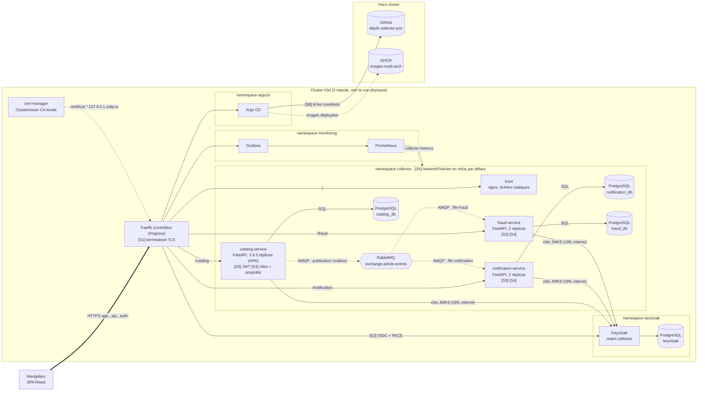
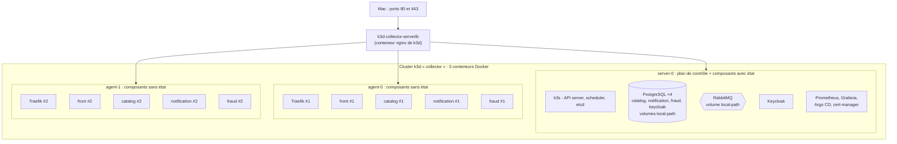
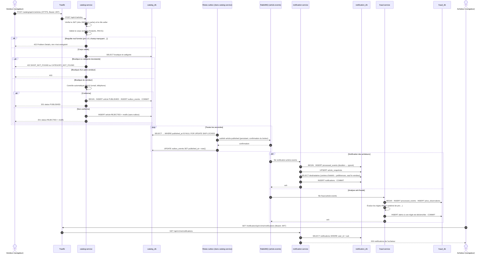
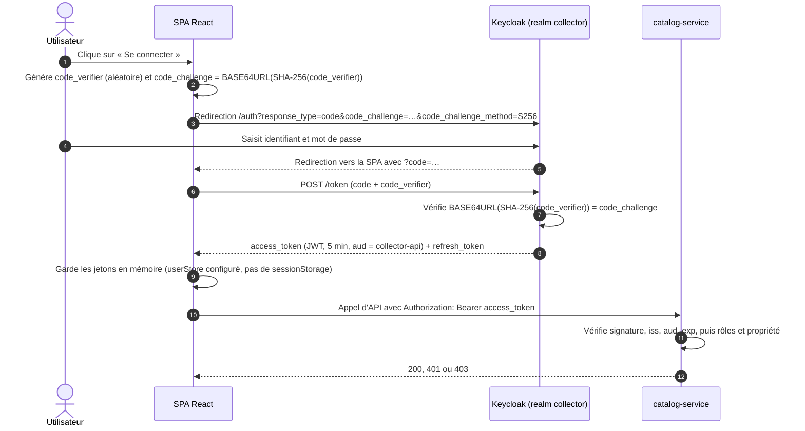

# Architecture du POC

Le POC réalise une tranche verticale de l'[architecture cible](architecture-cible.md) : **publication d'un article, contrôle automatique, événements, notification des acheteurs et analyse anti-fraude.** Tout tourne sur le Mac de développement, dans un cluster Kubernetes k3d de trois nœuds, déployé en GitOps par Argo CD. Les contrats d'API, d'événements et de données sont dans [contrats.md](contrats.md).

Deux vues décrivent le POC : la **vue logique** montre les composants et leurs flux, la **vue physique** montre sur quel nœud tourne chaque composant.

## 1. Vue logique

**Légende.**
- Trait épais : HTTPS depuis le navigateur, seul flux qui entre dans le cluster.
- Trait plein : appel synchrone (HTTP ou SQL) dans le cluster.
- Pointillé AMQP : message asynchrone via RabbitMQ.
- `[Sn]` : point de sécurité détaillé en section 4.

Les images sont tirées de GHCR par le kubelet de chaque nœud, aux versions qu'Argo CD a appliquées depuis le dépôt.

### Domaines exposés

| URL | Composant |
| --- | --- |
| `https://app.127.0.0.1.sslip.io` | Front React |
| `https://api.127.0.0.1.sslip.io/{catalog,notification,fraud}/api/v1/…` | API des trois services |
| `https://auth.127.0.0.1.sslip.io` | Keycloak |
| `https://grafana.127.0.0.1.sslip.io` | Tableaux de bord |
| `https://argocd.127.0.0.1.sslip.io` | Argo CD |

RabbitMQ et les bases de données ne sont jamais exposés. On y accède par `kubectl port-forward` pour le diagnostic.

## 2. Vue physique : placement sur les nœuds

| Nœud | Charge | Raison |
| --- | --- | --- |
| `server-0` | Plan de contrôle k3s, les 4 PostgreSQL, RabbitMQ, Keycloak, Prometheus, Grafana, Argo CD, cert-manager | Le provisionneur `local-path` de k3s crée des volumes liés au disque d'un nœud : les composants avec état restent donc sur le nœud qui n'est jamais arrêté. Les outils d'exploitation y sont aussi, pour garder Grafana affiché pendant la démonstration de panne d'un agent |
| `agent-0`, `agent-1` | Traefik, front et les 3 services, en 2 réplicas au moins | Composants sans état, un réplica par agent (`topologySpreadConstraints` sur `kubernetes.io/hostname`), avec un PodDisruptionBudget `minAvailable: 1`. Le placement est imposé par des règles d'affinité de nœud (`nodeAffinity`) |

**Entrée du trafic.** k3d publie les ports 80 et 443 du Mac sur son conteneur `serverlb`, qui les répartit sur les 3 nœuds. Sur chaque nœud, ServiceLB (le répartiteur intégré à k3s) transmet le trafic à un pod Traefik. Traefik est déployé en 2 réplicas sur les agents, via un `HelmChartConfig` qui configure aussi la redirection HTTP → HTTPS.

### Disponibilité démontrée (ENF-16)

| Scénario | Ce qui se passe | Résultat attendu |
| --- | --- | --- |
| **Maintenance** : `kubectl drain agent-1` pendant un test de charge | Les pods sont évincés un par un. Le PodDisruptionBudget garantit qu'un réplica de chaque service reste disponible. Chaque pod évincé est retiré des endpoints, puis s'arrête proprement (crochet `preStop` de quelques secondes, puis arrêt gracieux d'Uvicorn) pour terminer les requêtes en cours | Aucune erreur |
| **Panne brutale** : `docker stop k3d-collector-agent-1` pendant un test de charge | Le nœud n'est déclaré `NotReady` qu'au bout de la période de grâce du contrôleur de nœuds (environ 40 à 50 s). Pendant cette fenêtre, une partie des requêtes vise encore les pods de l'agent arrêté. Ensuite, ses pods sont retirés des endpoints et replanifiés sur `agent-0` au bout de 30 s (`tolerationSeconds` abaissé de 300 à 30 s) | Erreurs limitées à la fenêtre de détection, taux mesuré par Locust et visible dans Grafana. Le middleware `retry` de Traefik peut rejouer les requêtes `GET` en échec |

> [!TIP]
> **À défendre à l'oral : le PodDisruptionBudget ne protège pas de tout.** Un PDB ne limite que les évictions **volontaires** (drain, mise à jour de nœud). Il n'a aucun effet sur une panne. C'est pour cela qu'on présente deux scénarios : la maintenance, sans interruption, et la panne, avec une dégradation bornée et mesurée. Annoncer « aucune interruption » sur une panne brutale serait faux.

> [!TIP]
> **À défendre à l'oral : pourquoi k3d plutôt que Minikube ou docker-compose.** k3d lance une vraie distribution Kubernetes certifiée CNCF (k3s), sur plusieurs nœuds, dans des conteneurs Docker. On peut donc démontrer la répartition des réplicas, l'arrêt d'un nœud, l'autoscaling et les NetworkPolicies, ce que docker-compose ne permet pas. Les mêmes charts Helm se déploient ensuite sur un Kubernetes managé.

> [!TIP]
> **À défendre à l'oral : la limite assumée.** PostgreSQL et RabbitMQ tournent en une seule instance sur `server-0`. Ce sont des points de défaillance uniques, tout comme le plan de contrôle à un seul server. La cible les remplace par un PostgreSQL répliqué (opérateur CloudNativePG ou offre managée), un cluster RabbitMQ de 3 nœuds et un plan de contrôle managé. Cette limite figure dans le plan de remédiation.

## 3. Choix techniques

| Couche | Solution | Rôle dans le POC | ADR |
| --- | --- | --- | --- |
| Front | React + TypeScript (Vite), MUI, TanStack Query, react-oidc-context, react-i18next | SPA, jetons gardés en mémoire (stockage configuré explicitement), interface en français et en anglais | 0005 |
| Services | Python 3.12, FastAPI, Pydantic v2, SQLAlchemy 2.0 (asynchrone), Alembic | API REST, validation, accès aux données, migrations | 0002 |
| Messagerie | RabbitMQ, client aio-pika | Exchange `topic`, *quorum queues*, *dead-letter queues* | 0003 |
| Données | PostgreSQL, une instance par service | Isolation des données par service | 0001 |
| Identité | Keycloak, realm `collector` | Émission des jetons OIDC, rôles `buyer`, `seller`, `admin` | 0004 |
| Orchestration | k3d (k3s dans Docker), 1 server + 2 agents | Cluster Kubernetes multi-nœuds local | 0006 |
| Exposition et TLS | Traefik (fourni par k3s), cert-manager, CA locale mkcert | Routage par hôte et chemin, certificats émis automatiquement | 0006 |
| Déploiement | Helm, Argo CD | Un chart par service, synchronisation GitOps depuis le dépôt | 0006 |
| Observabilité | kube-prometheus-stack (Prometheus, Grafana), structlog | Métriques RED (débit, erreurs, durée) et métriques métier, logs JSON corrélés | — |

Les versions exactes sont fixées dans les protocoles d'expérimentation (`docs/04-experimentations`).

## 4. Points de sécurité

| # | Mesure | Menace traitée | Exigence |
| --- | --- | --- | --- |
| S1 | TLS terminé par Traefik, redirection HTTP → HTTPS, HSTS. Certificats émis par cert-manager à partir d'une CA locale | Écoute et altération du trafic | ENF-01 |
| S2 | OIDC *Authorization Code* + PKCE. Le jeton d'accès dure 5 min. Il est gardé **en mémoire** : par défaut, react-oidc-context (via oidc-client-ts) stocke la session dans `sessionStorage`, on configure donc explicitement un `userStore` en mémoire. Ce choix réduit la surface d'attaque (aucun jeton persistant lisible par un script injecté plus tard), mais **ne protège pas d'un XSS actif**, qui peut appeler l'API avec le jeton de la page. La parade complète, un BFF qui garde les jetons côté serveur, est dans le plan de remédiation | Vol de jeton persistant, interception du code d'autorisation | ENF-02 |
| S3 | Chaque service vérifie lui-même le JWT : signature RS256, `iss`, `aud`, `exp`. Aucune confiance implicite accordée au réseau interne | Usurpation d'identité, rejeu d'un jeton expiré | ENF-02 |
| S4 | RBAC par rôle, puis contrôle de propriété de la ressource. Les routes `/me` dérivent l'utilisateur du jeton | Élévation de privilèges, accès aux données d'un autre utilisateur (IDOR) | ENF-03 |
| S5 | NetworkPolicies en refus par défaut, appliquées par le contrôleur intégré à k3s, puis autorisation flux par flux (tableau ci-dessous) | Mouvement latéral après la compromission d'un pod | ENF-06 |
| S6 | Secrets Kubernetes créés par le script d'amorçage à partir d'un `.env` local non versionné. Gitleaks en CI | Fuite de secrets dans Git | ENF-04 |
| S7 | Images multi-stage `python:3.12-slim`, utilisateur non root, système de fichiers racine en lecture seule, toutes les capacités Linux retirées. Images analysées par Trivy | Exploitation d'une vulnérabilité de l'image, évasion de conteneur | ENF-05 |
| S8 | Argo CD ne déploie que ce qui est dans Git. Les images sont construites et scannées par la CI. Aucun `kubectl apply` manuel | Déploiement non tracé, dérive de configuration | ENF-05, ENF-30 |
| S9 | **Limite :** le trafic entre pods n'est pas chiffré (pas de mTLS) | Écoute du trafic à l'intérieur du cluster | Plan de remédiation : service mesh (Linkerd) |
| S10 | **Limite :** l'émetteur de cert-manager utilise la CA racine de mkcert, à laquelle le Mac fait confiance. Sa clé privée, stockée dans un Secret du cluster, permettrait d'émettre un certificat accepté par le navigateur du poste pour n'importe quel domaine | Usurpation de sites sur le poste de développement | Plan de remédiation : CA dédiée au cluster, de portée limitée aux domaines `*.127.0.0.1.sslip.io` |

### Flux autorisés par les NetworkPolicies

Tout flux absent de ce tableau est refusé. Chaque pod garde l'accès DNS (`kube-dns`, port 53).

| Source | Destination | Port |
| --- | --- | --- |
| Traefik (namespace `kube-system`) | front, catalog-service, notification-service, fraud-service | 8080, 8000 |
| Traefik | Keycloak, Grafana, Argo CD | ports HTTP des services |
| catalog-service | catalog_db, RabbitMQ, Keycloak | 5432, 5672, 8080 |
| notification-service | notification_db, RabbitMQ, Keycloak | 5432, 5672, 8080 |
| fraud-service | fraud_db, RabbitMQ, Keycloak | 5432, 5672, 8080 |
| Keycloak | base keycloak | 5432 |
| Prometheus | les trois services, RabbitMQ | 8000 (`/metrics`), 15692 |

Ce tableau correspond au test d'ENF-06 : une connexion de `fraud-service` vers `catalog_db` doit échouer.

> [!TIP]
> **À défendre à l'oral : le piège du nom de domaine dans le cluster.** Le navigateur obtient ses jetons via `https://auth.127.0.0.1.sslip.io`, et c'est cette URL qui figure dans le claim `iss`. Or, dans un pod, `127.0.0.1` désigne le pod lui-même. Les services téléchargent donc les clés publiques par l'URL interne du Service Kubernetes (`http://keycloak.keycloak.svc…/certs`) tout en vérifiant que `iss` vaut bien l'URL publique. Cette difficulté sera documentée dans le protocole d'expérimentation de Keycloak.

## 5. Parcours principal : publication d'un article

Points clés de ce parcours :

- **Le contrôle est synchrone, la diffusion est asynchrone.** Le vendeur connaît le statut de son article dès la réponse HTTP. La notification et l'analyse anti-fraude se font ensuite, sans allonger son temps de réponse.
- **L'outbox découple la transaction de la publication.** Si RabbitMQ est arrêté, la publication de l'article réussit quand même : la sonde *readiness* du catalogue ne dépend que de PostgreSQL. L'événement reste dans `outbox_events` et part au redémarrage du broker (ENF-18).
- **Délai de bout en bout.** Le relais interroge l'outbox toutes les secondes : une notification arrive donc en un peu plus d'une seconde au pire, sous la cible de 2 s (ENF-14).
- **`FOR UPDATE SKIP LOCKED`** permet de faire tourner le relais dans plusieurs réplicas de `catalog-service` sans qu'ils publient deux fois la même ligne.
- **Les deux consommateurs travaillent en parallèle et indépendamment** : une panne de `fraud-service` ne retarde pas les notifications.
- **Dans le POC, l'acheteur récupère ses notifications par interrogation périodique** (TanStack Query, toutes les 10 s). Dans la cible, la notification sera poussée en temps réel par WebSocket ou *Server-Sent Events*.

Le parcours de modification de prix (US-04) suit le même schéma, avec l'événement `article.price_changed` et une ligne dans `price_history` écrite dans la même transaction.

## 6. Authentification : flux OIDC avec PKCE

> [!TIP]
> **À défendre à l'oral : pourquoi PKCE.** Une SPA est un client public : elle ne peut pas garder de secret client, puisque tout son code est lisible dans le navigateur. PKCE (RFC 7636) lie la demande d'autorisation et l'échange du code par un secret à usage unique, ce qui empêche un attaquant qui intercepterait le code de l'échanger contre un jeton. C'est le flux recommandé par l'OAuth 2.0 Security Best Current Practice (RFC 9700), qui déconseille le flux implicite. Comme les jetons sont en mémoire, un rechargement de la page relance une redirection vers Keycloak, sans ressaisie du mot de passe tant que la session Keycloak est active.

## 7. Correspondance avec les critères d'évaluation

| Critère | Élément d'architecture |
| --- | --- |
| 2. Qualité du POC (découpage, communication, sécurité, orchestration) | 3 services et 3 bases, REST et AMQP, points S1 à S10, k3d + Helm + Argo CD |
| 5. Environnement d'exécution (disponibilité, montée en charge) | Réplicas sur les 2 agents, PodDisruptionBudget, HPA, scénarios de maintenance et de panne d'un agent |
| 8. Sécurité | Points S1 à S8 dans le POC, S9, S10 et les éléments cibles dans le plan de remédiation |
