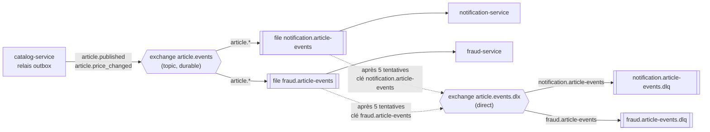
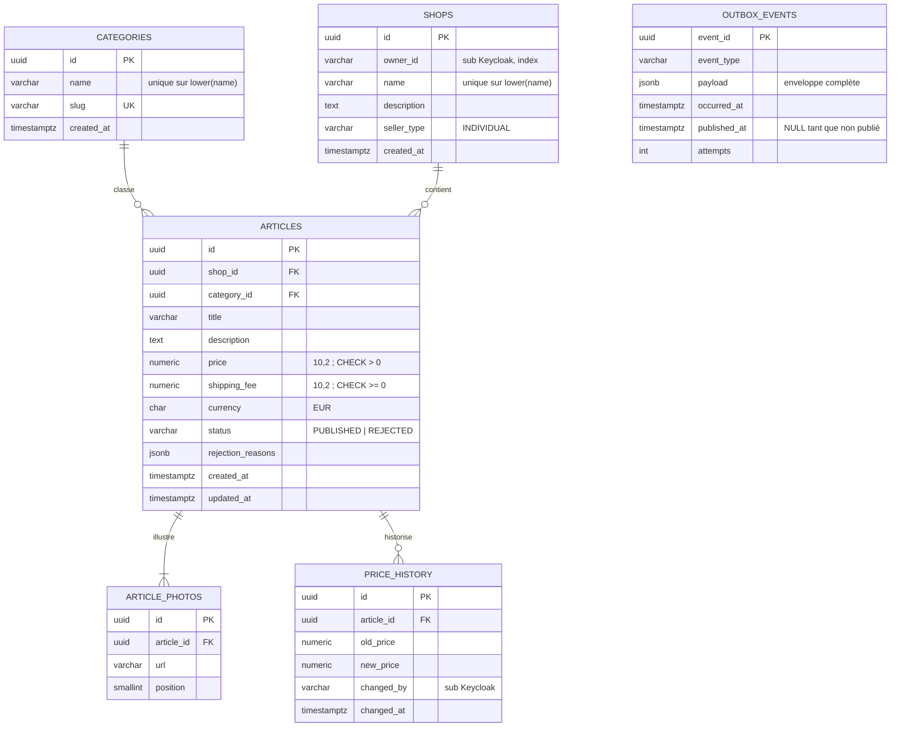
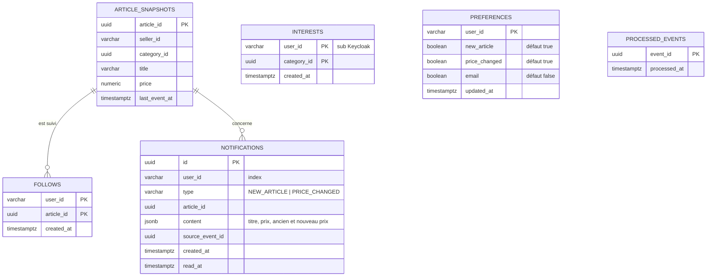
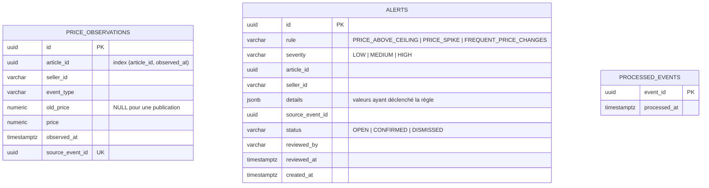

# Contrats d'interface du POC

Ce document fixe les contrats entre les composants du POC : API REST de chaque service, événements échangés via RabbitMQ et modèle de données. Il fait référence pour le développement (phase 4) et pour les tests de contrat. Les identifiants US, EF, ENF et RM renvoient au [backlog](../03-backlog/user-stories.md) et aux [exigences](../03-backlog/exigences.md).

## 1. Conventions communes

### 1.1 Exposition

| Hôte (TLS, certificat cert-manager) | Cible |
| --- | --- |
| `app.127.0.0.1.sslip.io` | Front React (fichiers statiques servis par nginx) |
| `api.127.0.0.1.sslip.io/catalog/…` | `catalog-service` |
| `api.127.0.0.1.sslip.io/notification/…` | `notification-service` |
| `api.127.0.0.1.sslip.io/fraud/…` | `fraud-service` |
| `auth.127.0.0.1.sslip.io` | Keycloak, realm `collector` |
| `grafana.127.0.0.1.sslip.io`, `argocd.127.0.0.1.sslip.io` | Outils d'exploitation |

Traefik, le contrôleur d'Ingress fourni par k3s, route par hôte et par chemin, puis retire le préfixe du service (`/catalog`, `/notification`, `/fraud`) grâce à un middleware `StripPrefix`. Chaque service expose donc ses routes sous `/api/v1`. Le domaine `sslip.io` résout `*.127.0.0.1.sslip.io` vers `127.0.0.1`, ce qui évite de modifier `/etc/hosts`.

Les sondes `/health/live` et `/health/ready`, ainsi que `/metrics`, ne sont pas routées par Traefik. Elles sont réservées au kubelet et à Prometheus, à l'intérieur du cluster.

### 1.2 Authentification et autorisation

- Chaque requête protégée porte `Authorization: Bearer <jeton d'accès>`, un JWT émis par Keycloak.
- Chaque service vérifie localement la signature RS256 avec les clés publiques du realm (endpoint JWKS, mises en cache), puis `iss`, `aud = collector-api` et `exp` (ENF-02). Keycloak n'ajoute pas cette audience par défaut : un *client scope* dédié porte un mapper « Audience » qui l'insère dans le jeton du client `collector-web`.
- Les rôles sont lus dans `realm_access.roles`. L'identifiant de l'utilisateur est le claim `sub`.
- Jeton absent, invalide ou expiré → **401**. Rôle insuffisant ou ressource appartenant à un autre utilisateur → **403** (ENF-03).
- Une ressource non publiée, consultée par un autre utilisateur que son propriétaire ou un admin, renvoie **404** et non 403. On ne révèle pas son existence.
- Le front est un client public OIDC (`collector-web`) qui utilise le flux *Authorization Code* avec PKCE. CORS n'autorise que l'origine `https://app.127.0.0.1.sslip.io`.

### 1.3 Formats

- JSON en UTF-8. Identifiants en UUID v4. Dates en ISO 8601 et en UTC (`2026-11-02T14:05:00Z`).
- **Montants en chaîne décimale** (`"120.00"`) avec une devise ISO 4217 (`"EUR"`). On évite ainsi les erreurs d'arrondi des nombres flottants.
- Les champs inconnus sont refusés (Pydantic `extra="forbid"`, ENF-07).
- Pagination par `limit` (20 par défaut, 100 au maximum) et `offset`. La réponse contient `items` et `total`.
- Les erreurs suivent la RFC 9457 (*Problem Details*, `application/problem+json`) :

```json
{
  "type": "https://collector.shop/problems/validation-error",
  "title": "Données invalides",
  "status": 422,
  "detail": "Le prix doit être strictement positif.",
  "errors": [{ "field": "price", "code": "PRICE_NOT_POSITIVE" }],
  "correlation_id": "6f1c2a8e-3d7b-4c55-9e0a-1b2c3d4e5f60"
}
```

- **Corrélation.** L'en-tête `X-Request-ID` est repris s'il est fourni par l'appelant, sinon généré par le service à l'entrée de la requête (middleware ASGI). Traefik ne génère pas cet identifiant nativement. Il est écrit dans chaque log JSON, renvoyé dans la réponse et recopié dans le champ `correlation_id` des événements émis (ENF-08).
- Le contrat OpenAPI 3.1 est généré par FastAPI à `/api/v1/openapi.json` (ENF-27).

## 2. Endpoints REST

Codes communs à tous les endpoints protégés, non répétés dans les tableaux : **401** (non authentifié) et **422** (requête mal formée, si un corps ou des paramètres sont attendus).

### 2.1 catalog-service

| Méthode | Chemin | Rôle requis | Codes de retour | Story |
| --- | --- | --- | --- | --- |
| GET | `/api/v1/categories` | public | 200 | US-01, US-03, US-05 |
| POST | `/api/v1/categories` | `admin` | 201, 403, 409 (nom déjà utilisé) | US-01 |
| POST | `/api/v1/shops` | `seller` | 201, 403, 409 (nom déjà utilisé), 422 (dont `CONTACT_EMAIL`, `CONTACT_PHONE`) | US-02 |
| GET | `/api/v1/shops/me` | `seller` | 200, 403 | US-02 |
| GET | `/api/v1/shops/{shop_id}` | public | 200, 404 | US-02 |
| POST | `/api/v1/articles` | `seller`, propriétaire de la boutique | 201 (`PUBLISHED` ou `REJECTED`), 403 (boutique d'un autre vendeur), 422 (dont `SHOP_NOT_FOUND`, `CATEGORY_NOT_FOUND`) | US-03 |
| GET | `/api/v1/articles?category_id=&shop_id=&limit=&offset=` | public, articles `PUBLISHED` seulement | 200 | US-03 |
| GET | `/api/v1/articles/{article_id}` | public si `PUBLISHED`, sinon propriétaire ou `admin` | 200, 404 | US-03, US-04 |
| PUT | `/api/v1/articles/{article_id}/price` | `seller`, propriétaire de l'article | 200, 403, 404, 409 (article non publié), 422 | US-04 |
| GET | `/api/v1/articles/{article_id}/price-history` | propriétaire ou `admin` | 200, 403, 404 | US-04 |

**Pourquoi `PUT` pour le prix.** On remplace une valeur : renvoyer la même requête produit le même état, ce qui correspond à la définition HTTP de l'idempotence (RFC 9110). RM-04 en découle : un prix identique ne crée ni ligne d'historique ni événement.

**Exemple : publication d'un article** (`POST /api/v1/articles`)

```json
{
  "shop_id": "1b9d6bcd-bbfd-4b2d-9b5d-ab8dfbbd4bed",
  "category_id": "3f1e9a62-7c1d-4a8b-9f3e-2d5c6b7a8e90",
  "title": "Boba Fett Kenner 1979",
  "description": "Figurine originale Kenner de 1979, complète avec son arme, très bon état.",
  "photo_urls": ["https://images.example.com/boba-1.jpg"],
  "price": "120.00",
  "shipping_fee": "8.00",
  "currency": "EUR"
}
```

Réponse 201, article conforme :

```json
{
  "id": "9c4e7f10-2b3a-4d5e-8f6a-7b8c9d0e1f23",
  "shop_id": "1b9d6bcd-bbfd-4b2d-9b5d-ab8dfbbd4bed",
  "category_id": "3f1e9a62-7c1d-4a8b-9f3e-2d5c6b7a8e90",
  "seller_id": "a7f3c2e1-5b4d-4c3a-9e8f-1d2c3b4a5f60",
  "title": "Boba Fett Kenner 1979",
  "price": "120.00",
  "shipping_fee": "8.00",
  "currency": "EUR",
  "status": "PUBLISHED",
  "rejection_reasons": [],
  "created_at": "2026-11-02T14:05:00Z"
}
```

Si le contrôle échoue (RM-02), la réponse est aussi un 201, avec `"status": "REJECTED"` et `"rejection_reasons": ["CONTACT_EMAIL"]`. Les motifs possibles sont `CONTACT_EMAIL` et `CONTACT_PHONE`.

**Codes de motif.** Le même vocabulaire sert partout : `rejection_reasons` d'un article rejeté, et `errors[].code` d'un refus 422. Une boutique ou une catégorie inexistante, référencée dans le corps de la requête, donne un 422 (`SHOP_NOT_FOUND`, `CATEGORY_NOT_FOUND`) et non un 404 : c'est le contenu de la requête qui est invalide, pas l'URL. Une boutique qui contient des coordonnées est refusée en 422 (`CONTACT_EMAIL`, `CONTACT_PHONE`) au lieu d'être enregistrée : elle n'a pas de cycle de modération (RM-05).

**Exemple : modification du prix** (`PUT /api/v1/articles/{article_id}/price`)

```json
{ "price": "95.00" }
```

Réponse 200 : l'article mis à jour, au même format que ci-dessus.

### 2.2 notification-service

| Méthode | Chemin | Rôle requis | Codes de retour | Story |
| --- | --- | --- | --- | --- |
| GET | `/api/v1/me/interests` | `buyer` | 200, 403 | US-05 |
| PUT | `/api/v1/me/interests` | `buyer` | 200, 403, 422 (plus de 20 catégories) | US-05 |
| GET | `/api/v1/me/preferences` | `buyer` | 200, 403 | US-05 |
| PUT | `/api/v1/me/preferences` | `buyer` | 200, 403 | US-05 |
| PUT | `/api/v1/me/follows/{article_id}` | `buyer` | 204, 403, 404 (article inconnu) | US-05 |
| GET | `/api/v1/me/notifications?limit=&offset=` | `buyer` | 200, 403 | US-05 |

Tous les chemins sont sous `/me` : l'utilisateur est toujours celui du jeton (`sub`). Aucun identifiant d'utilisateur n'apparaît dans l'URL, donc aucun accès aux données d'un autre acheteur n'est possible (critère 6 de US-05).

```jsonc
// PUT /api/v1/me/interests
{ "category_ids": ["3f1e9a62-7c1d-4a8b-9f3e-2d5c6b7a8e90"] }

// PUT /api/v1/me/preferences
{ "new_article": true, "price_changed": true, "email": false }
```

Sans préférences enregistrées, les deux types de notification sont actifs et l'email est désactivé.

`notification-service` ne connaît pas la liste des catégories, et n'appelle pas le catalogue de façon synchrone (ADR 0001). `PUT /me/interests` vérifie donc le format des identifiants, mais pas leur existence. Le front ne propose que des catégories existantes, lues sur `GET /categories`, et un identifiant inconnu n'a pas d'autre effet que de ne jamais déclencher de notification. La cible ajoutera un événement `category.created` pour tenir une projection locale des catégories.

### 2.3 fraud-service

| Méthode | Chemin | Rôle requis | Codes de retour | Story |
| --- | --- | --- | --- | --- |
| GET | `/api/v1/alerts?status=&rule=&limit=&offset=` | `admin` | 200, 403 | US-06 |
| PATCH | `/api/v1/alerts/{alert_id}` | `admin` | 200, 403, 404, 409 (alerte déjà traitée), 422 (statut inconnu) | US-06 |

```jsonc
// PATCH /api/v1/alerts/{alert_id}
{ "status": "CONFIRMED" }
```

Chaque alerte de la liste porte sa règle, sa sévérité, l'article et le vendeur concernés, les valeurs qui ont déclenché la règle (`details`) et l'identifiant de l'événement source : la liste suffit à l'admin, sans endpoint de détail.

Transitions autorisées : `OPEN → CONFIRMED` et `OPEN → DISMISSED`. Toute autre transition renvoie 409. L'auteur et la date de la décision sont enregistrés.

### 2.4 Endpoints techniques (tous les services)

| Méthode | Chemin | Usage |
| --- | --- | --- |
| GET | `/health/live` | Sonde *liveness* : le processus répond. Ne teste aucune dépendance, pour éviter des redémarrages en cascade |
| GET | `/health/ready` | Sonde *readiness* : la base de données du service est joignable. En cas d'échec, le pod est retiré du Service sans être redémarré. Le broker n'en fait **pas** partie : si RabbitMQ est arrêté, le catalogue continue d'accepter les publications (l'outbox conserve les événements), et notification et fraud continuent de servir leurs API. La connexion AMQP se rétablit automatiquement (connexion robuste d'aio-pika), et son état est exposé par une métrique et dans les logs |
| GET | `/metrics` | Métriques Prometheus (latence, débit et erreurs HTTP, plus les compteurs métier : articles publiés et rejetés, notifications créées, alertes créées) |

## 3. Événements

### 3.1 Topologie RabbitMQ



- **Exchange `article.events` de type `topic`.** Chaque consommateur a sa propre file, liée par le motif `article.*`. Chaque file reçoit une copie de chaque événement (*publish/subscribe*). Ajouter un consommateur, par exemple un futur service de recommandations, revient à créer une file et une liaison, sans modifier le producteur (EF-35).
- **Fiabilité (ENF-18).** Exchange et files durables, messages persistants (`delivery_mode = 2`), *publisher confirms* activés côté producteur. Côté consommateur : acquittement manuel après la validation de la transaction en base, et `prefetch = 10`.
- **Échecs.** Les files sont des *quorum queues* avec `x-delivery-limit = 5`. Au-delà, le message part dans la *dead-letter queue* de **son** consommateur. Pour cela, chaque file déclare `x-dead-letter-exchange = article.events.dlx` (exchange `direct`) et une `x-dead-letter-routing-key` égale à son propre nom. Sans cette clé, le message garderait sa clé d'origine (`article.published`) et serait copié dans les deux DLQ. Les files déclarent aussi `x-dead-letter-strategy = at-least-once`, qui impose `x-overflow = reject-publish` : sans ces réglages, le transfert vers la DLQ d'une quorum queue est « au plus une fois » et un message pourrait être perdu en route.
- **Propriétés AMQP.** `message_id = event_id`, `type = event_type`, `content_type = application/json` et l'en-tête `x-correlation-id`.

### 3.2 Garanties de livraison

| Garantie | Mécanisme |
| --- | --- |
| Pas d'événement sans écriture en base, ni l'inverse | **Transactional outbox** : l'article et la ligne `outbox_events` sont écrits dans la même transaction PostgreSQL. Un relais lit les lignes non publiées, les publie avec confirmation du broker, puis les marque publiées |
| Livraison au moins une fois | Le relais republie tant qu'il n'a pas reçu la confirmation du broker. Le consommateur n'acquitte qu'après traitement |
| Pas de doublon fonctionnel (RM-09) | **Consommateur idempotent** : l'insertion dans `processed_events` (clé primaire `event_id`) se fait dans la même transaction que l'effet métier. Un doublon viole la contrainte d'unicité : il est acquitté et ignoré |
| Ordre | Non garanti entre articles. Pour un même article, les événements portent `occurred_at`, et le consommateur ignore un `price_changed` plus ancien que le dernier qu'il a traité pour cet article |

### 3.3 Enveloppe commune

Tous les événements partagent une enveloppe inspirée de CloudEvents 1.0. Seul le champ `data` varie selon le type.

| Champ | Type | Rôle |
| --- | --- | --- |
| `event_id` | UUID | Identifiant unique de l'événement : clé d'idempotence |
| `event_type` | chaîne | `article.published` ou `article.price_changed`. Identique à la clé de routage |
| `schema_version` | entier | Version du schéma de `data`. Démarre à 1 |
| `occurred_at` | date-heure UTC | Moment du fait métier, c'est-à-dire de la transaction, et non de la publication |
| `producer` | chaîne | Service émetteur (`catalog-service`) |
| `correlation_id` | chaîne | `X-Request-ID` de la requête HTTP d'origine, pour suivre un parcours de bout en bout dans les logs |
| `data` | objet | Contenu métier |

**Règles d'évolution.**
- Un ajout de champ optionnel est rétrocompatible et garde la même version. Les consommateurs ignorent les champs qu'ils ne connaissent pas.
- Une suppression, un renommage ou un changement de type crée une nouvelle version. Le producteur publie alors les deux versions pendant la transition.

### 3.4 `article.published`

Émis quand un article passe au statut `PUBLISHED` (US-03). Consommé par `notification-service` (RM-08) et `fraud-service` (RM-07).

```json
{
  "$schema": "https://json-schema.org/draft/2020-12/schema",
  "$id": "https://collector.shop/schemas/events/article.published/1",
  "title": "article.published v1",
  "type": "object",
  "required": ["event_id", "event_type", "schema_version", "occurred_at", "producer", "correlation_id", "data"],
  "additionalProperties": false,
  "properties": {
    "event_id": { "type": "string", "format": "uuid" },
    "event_type": { "const": "article.published" },
    "schema_version": { "const": 1 },
    "occurred_at": { "type": "string", "format": "date-time" },
    "producer": { "const": "catalog-service" },
    "correlation_id": { "type": "string", "minLength": 1, "maxLength": 128 },
    "data": {
      "type": "object",
      "required": ["article_id", "shop_id", "seller_id", "category_id", "title", "price", "shipping_fee", "currency"],
      "additionalProperties": true,
      "properties": {
        "article_id": { "type": "string", "format": "uuid" },
        "shop_id": { "type": "string", "format": "uuid" },
        "seller_id": { "type": "string", "minLength": 1, "description": "claim sub Keycloak du vendeur" },
        "category_id": { "type": "string", "format": "uuid" },
        "title": { "type": "string", "minLength": 5, "maxLength": 120 },
        "price": { "type": "string", "pattern": "^(?!0+\\.00$)[0-9]{1,7}\\.[0-9]{2}$" },
        "shipping_fee": { "type": "string", "pattern": "^[0-9]{1,7}\\.[0-9]{2}$" },
        "currency": { "type": "string", "pattern": "^[A-Z]{3}$" }
      }
    }
  }
}
```

Exemple :

```json
{
  "event_id": "0f8e2d4c-6b1a-4f3e-9d7c-5a4b3c2d1e0f",
  "event_type": "article.published",
  "schema_version": 1,
  "occurred_at": "2026-11-02T14:05:00Z",
  "producer": "catalog-service",
  "correlation_id": "6f1c2a8e-3d7b-4c55-9e0a-1b2c3d4e5f60",
  "data": {
    "article_id": "9c4e7f10-2b3a-4d5e-8f6a-7b8c9d0e1f23",
    "shop_id": "1b9d6bcd-bbfd-4b2d-9b5d-ab8dfbbd4bed",
    "seller_id": "a7f3c2e1-5b4d-4c3a-9e8f-1d2c3b4a5f60",
    "category_id": "3f1e9a62-7c1d-4a8b-9f3e-2d5c6b7a8e90",
    "title": "Boba Fett Kenner 1979",
    "price": "120.00",
    "shipping_fee": "8.00",
    "currency": "EUR"
  }
}
```

L'événement transporte tout ce dont les consommateurs ont besoin (*event-carried state transfer*). Les consommateurs n'appellent jamais `catalog-service` en retour : ils restent disponibles et testables même si le catalogue est arrêté.

### 3.5 `article.price_changed`

Émis à chaque modification effective du prix d'un article publié (US-04, RM-04). Consommé par `notification-service` (RM-08) et `fraud-service` (RM-07).

```json
{
  "$schema": "https://json-schema.org/draft/2020-12/schema",
  "$id": "https://collector.shop/schemas/events/article.price_changed/1",
  "title": "article.price_changed v1",
  "type": "object",
  "required": ["event_id", "event_type", "schema_version", "occurred_at", "producer", "correlation_id", "data"],
  "additionalProperties": false,
  "properties": {
    "event_id": { "type": "string", "format": "uuid" },
    "event_type": { "const": "article.price_changed" },
    "schema_version": { "const": 1 },
    "occurred_at": { "type": "string", "format": "date-time" },
    "producer": { "const": "catalog-service" },
    "correlation_id": { "type": "string", "minLength": 1, "maxLength": 128 },
    "data": {
      "type": "object",
      "required": ["article_id", "seller_id", "category_id", "title", "old_price", "new_price", "currency", "changed_by"],
      "additionalProperties": true,
      "properties": {
        "article_id": { "type": "string", "format": "uuid" },
        "seller_id": { "type": "string", "minLength": 1 },
        "category_id": { "type": "string", "format": "uuid" },
        "title": { "type": "string", "minLength": 5, "maxLength": 120 },
        "old_price": { "type": "string", "pattern": "^(?!0+\\.00$)[0-9]{1,7}\\.[0-9]{2}$" },
        "new_price": { "type": "string", "pattern": "^(?!0+\\.00$)[0-9]{1,7}\\.[0-9]{2}$" },
        "currency": { "type": "string", "pattern": "^[A-Z]{3}$" },
        "changed_by": { "type": "string", "minLength": 1, "description": "claim sub de l'auteur de la modification" }
      }
    }
  }
}
```

Exemple :

```json
{
  "event_id": "5d3c1b2a-9e8f-4a7b-8c6d-0e1f2a3b4c5d",
  "event_type": "article.price_changed",
  "schema_version": 1,
  "occurred_at": "2026-11-03T09:30:00Z",
  "producer": "catalog-service",
  "correlation_id": "c2b4e6f8-1a3c-4e5f-8a9b-0c1d2e3f4a5b",
  "data": {
    "article_id": "9c4e7f10-2b3a-4d5e-8f6a-7b8c9d0e1f23",
    "seller_id": "a7f3c2e1-5b4d-4c3a-9e8f-1d2c3b4a5f60",
    "category_id": "3f1e9a62-7c1d-4a8b-9f3e-2d5c6b7a8e90",
    "title": "Boba Fett Kenner 1979",
    "old_price": "120.00",
    "new_price": "95.00",
    "currency": "EUR",
    "changed_by": "a7f3c2e1-5b4d-4c3a-9e8f-1d2c3b4a5f60"
  }
}
```

Les motifs des montants imposent deux décimales et excluent un prix nul (`(?!0+\.00$)`), conformément à RM-01. Les frais de port peuvent être nuls. Les mots-clés `format` (`uuid`, `date-time`) ne sont que des annotations en JSON Schema 2020-12 : les tests de contrat les vérifient en activant explicitement un *format checker*.

`old_price` et `new_price` permettent à `fraud-service` de calculer la variation (règle `PRICE_SPIKE`) sans historique local.

## 4. Modèle de données

Chaque service possède sa propre base PostgreSQL (*database per service*, ENF-21). Aucune clé étrangère ne traverse deux bases : les références vers un autre service (`seller_id`, `category_id` dans `notification-service`…) sont des identifiants opaques. Les utilisateurs n'ont pas de table : l'identité appartient à Keycloak, et les services ne stockent que le `sub`. Le schéma est versionné avec Alembic.

### 4.1 catalog_db (catalog-service)



- Un index partiel `WHERE published_at IS NULL` sur `outbox_events` garde la lecture du relais rapide, même avec beaucoup d'événements déjà publiés.
- `GET /articles` s'appuie sur un index `(status, category_id, created_at DESC)`.
- Le vendeur d'un article se déduit de `shops.owner_id`. Il n'est pas dupliqué dans `articles`.

### 4.2 notification_db (notification-service)



- `article_snapshots` est une **projection locale** construite à partir des événements. Elle permet de vérifier qu'un article existe avant de le suivre (404 sinon) et de connaître son vendeur, pour ne pas le notifier de son propre article (RM-08), sans appeler le catalogue.
- La contrainte `UNIQUE (user_id, source_event_id)` sur `notifications` double la protection de `processed_events` contre les doublons, y compris en cas de traitements concurrents.

### 4.3 fraud_db (fraud-service)



- Sévérités : `PRICE_ABOVE_CEILING` → HIGH, `PRICE_SPIKE` → MEDIUM, `FREQUENT_PRICE_CHANGES` → MEDIUM.
- La contrainte `UNIQUE (rule, source_event_id)` garantit une alerte au plus par règle et par événement (RM-09).
- **Anti-bruit.** Tant qu'une alerte `FREQUENT_PRICE_CHANGES` est `OPEN` pour un article, les modifications suivantes n'en créent pas de nouvelle.
- Le plafond de prix (10 000 € par défaut) et les seuils viennent de la configuration du service (ConfigMap Kubernetes). Ils ne sont pas codés en dur.

## 5. Traçabilité des endpoints

| Endpoint | Story | Exigences |
| --- | --- | --- |
| `GET /categories` | US-01, US-03, US-05 | EF-01, EF-27 |
| `POST /categories` | US-01 | EF-27, RM-06 |
| `POST /shops`, `GET /shops/me`, `GET /shops/{id}` | US-02 | EF-02, EF-05, RM-02, RM-05 |
| `POST /articles` | US-03 | EF-03, EF-04, EF-05, RM-01 à RM-03 |
| `GET /articles`, `GET /articles/{id}` | US-03, US-04 | EF-01 |
| `PUT /articles/{id}/price`, `GET /articles/{id}/price-history` | US-04 | EF-06, RM-04, ENF-08 |
| `/me/interests`, `/me/preferences`, `/me/follows/{id}`, `/me/notifications` | US-05 | EF-10, EF-12 à EF-16, RM-08 |
| `GET /alerts`, `PATCH /alerts/{id}` | US-06 | EF-26, RM-07 |
| Événement `article.published` | US-03, US-05, US-06 | EF-13, EF-23, ENF-18 |
| Événement `article.price_changed` | US-04, US-05, US-06 | EF-14, EF-23, EF-24, ENF-18 |
