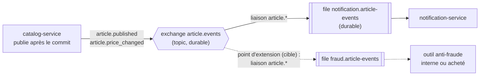
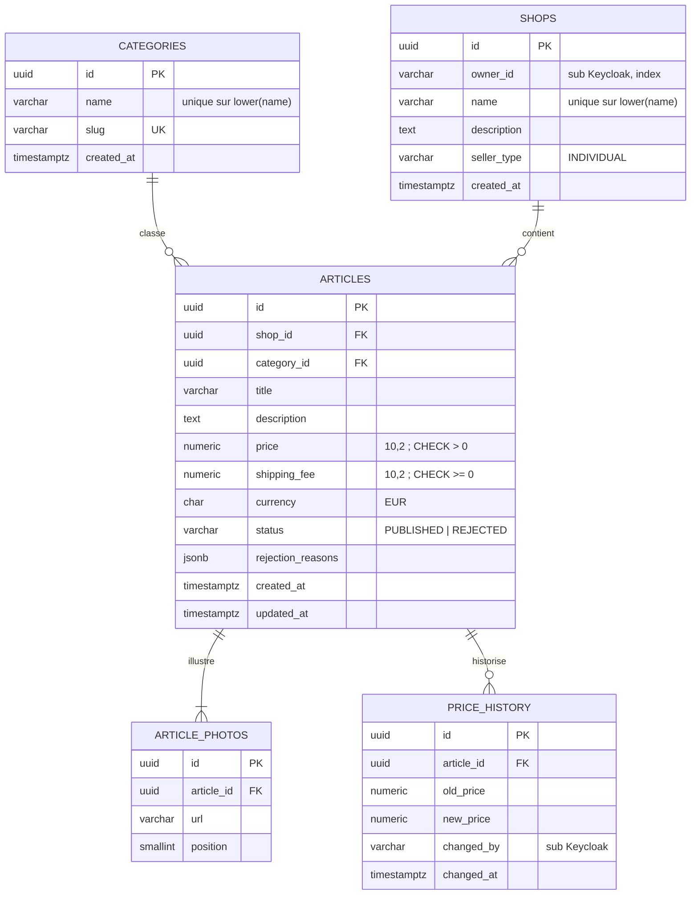
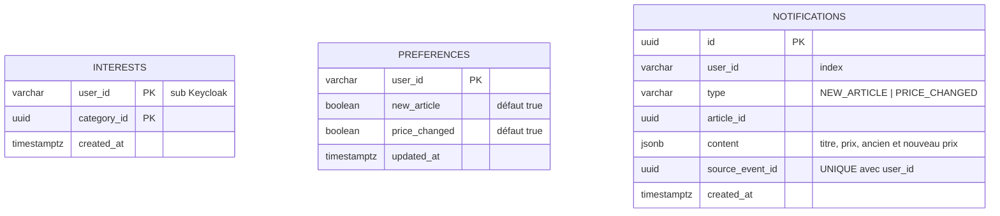

# Contrats d'interface du POC

Ce document fixe les contrats entre les composants du POC : API REST des deux services, événements échangés via RabbitMQ et modèle de données. Il fait référence pour le développement (phase 4) et pour les tests. Les identifiants US, EF, ENF et RM renvoient au [backlog](../03-backlog/user-stories.md) et aux [exigences](../03-backlog/exigences.md).

## 1. Conventions communes

### 1.1 Exposition

| Hôte (HTTPS) | Cible |
| --- | --- |
| `app.127.0.0.1.sslip.io` | Front React (fichiers statiques servis par nginx) |
| `api.127.0.0.1.sslip.io/catalog/…` | `catalog-service` |
| `api.127.0.0.1.sslip.io/notification/…` | `notification-service` |
| `auth.127.0.0.1.sslip.io` | Keycloak, realm `collector` |
| `grafana.127.0.0.1.sslip.io` | Tableaux de bord |

- **Routage.** Traefik, le contrôleur d'Ingress fourni par k3s, route par hôte et par chemin, puis retire le préfixe du service (`/catalog`, `/notification`) grâce à un middleware `StripPrefix`. Chaque service expose donc ses routes sous `/api/v1`.
- **TLS.** Un certificat générique `*.127.0.0.1.sslip.io`, généré une fois par mkcert, est chargé comme Secret TLS par défaut de Traefik.
- **Noms de domaine.** `sslip.io` résout `*.127.0.0.1.sslip.io` vers `127.0.0.1`, ce qui évite de modifier `/etc/hosts`.
- **Endpoints techniques.** Les sondes `/health/live` et `/health/ready`, ainsi que `/metrics`, ne sont pas routées par Traefik. Elles sont réservées au kubelet et à Prometheus, à l'intérieur du cluster.

### 1.2 Authentification et autorisation

- Chaque requête protégée porte `Authorization: Bearer <jeton d'accès>`, un JWT émis par Keycloak.
- Chaque service vérifie localement la signature RS256 avec les clés publiques du realm (endpoint JWKS, mises en cache), puis `iss`, `aud = collector-api` et `exp` (ENF-02). Keycloak n'ajoute pas cette audience par défaut : un *client scope* importé avec le realm porte un mapper « Audience » qui l'insère dans le jeton du client `collector-web`.
- **URL de Keycloak.** Les clés JWKS sont récupérées par l'URL interne du Service, `http://keycloak.collector.svc.cluster.local:8080` (un seul namespace `collector`, Service `keycloak`). `iss` est comparé à l'URL publique `https://auth.127.0.0.1.sslip.io/realms/collector`, car dans un pod `127.0.0.1` désigne le pod lui-même.
- Les rôles sont lus dans `realm_access.roles`. L'identifiant de l'utilisateur est le claim `sub`.
- Jeton absent, invalide ou expiré → **401**. Rôle insuffisant ou ressource appartenant à un autre utilisateur → **403** (ENF-03).
- Une ressource non publiée, consultée par un autre utilisateur que son propriétaire ou un admin, renvoie **404** et non 403. On ne révèle pas son existence.
- Le front est un client public OIDC (`collector-web`) qui utilise le flux *Authorization Code* avec PKCE. CORS n'autorise que l'origine `https://app.127.0.0.1.sslip.io`.

### 1.3 Formats

- JSON en UTF-8. Identifiants en UUID v4. Dates en ISO 8601 et en UTC (`2026-11-02T14:05:00Z`).
- **Montants en chaîne décimale** (`"120.00"`) avec une devise ISO 4217 (`"EUR"`). On évite ainsi les erreurs d'arrondi des nombres flottants.
- Les champs inconnus sont refusés (Pydantic `extra="forbid"`, ENF-07).
- Pagination par `limit` (20 par défaut, 100 au maximum) et `offset` pour `GET /articles` et `GET /me/notifications`. La réponse contient `items` et `total`.
- Les listes de référence, bornées par nature (`GET /categories`, `GET /shops/me`), ne sont pas paginées : elles renvoient tous les éléments sous la forme `{"items": [...], "total": n}`.
- Les erreurs suivent la RFC 9457 (*Problem Details*, `application/problem+json`) :

```json
{
  "type": "https://collector.shop/problems/validation-error",
  "title": "Données invalides",
  "status": 422,
  "detail": "Le prix doit être strictement positif.",
  "errors": [{ "field": "price", "code": "PRICE_NOT_POSITIVE" }],
  "correlation_id": "6f1c2a8e-3d7b-4c55-9e0a-1b2c3d4e5f60"
}
```

- **Corrélation.** L'en-tête `X-Request-ID` est repris s'il est fourni par l'appelant **et** s'il fait au plus 128 caractères parmi `[A-Za-z0-9._-]` ; sinon (absent, trop long ou caractères autres), un UUID est généré par le service à l'entrée de la requête (middleware ASGI). Il est écrit dans chaque log JSON, renvoyé dans la réponse et recopié dans le champ `correlation_id` des événements émis (ENF-08).
- Le contrat OpenAPI 3.1 est généré par FastAPI à `/api/v1/openapi.json` (ENF-27).

## 2. Endpoints REST

Codes communs à tous les endpoints protégés, non répétés dans les tableaux : **401** (non authentifié) et **422** (requête mal formée, si un corps ou des paramètres sont attendus).

### 2.1 catalog-service

| Méthode | Chemin | Rôle requis | Codes de retour | Story |
| --- | --- | --- | --- | --- |
| GET | `/api/v1/categories` | public | 200 (liste complète triée par nom, non paginée) | US-01, US-03, US-05 |
| POST | `/api/v1/categories` | `admin` | 201, 403, 409 (nom déjà utilisé) | US-01 |
| POST | `/api/v1/shops` | `seller` | 201, 403, 409 (nom déjà utilisé), 422 (dont `CONTACT_EMAIL`, `CONTACT_PHONE`) | US-02 |
| GET | `/api/v1/shops/me` | `seller` | 200 (liste complète, non paginée), 403 | US-02, US-03 |
| GET | `/api/v1/shops/{shop_id}` | public | 200, 404 | US-02 |
| POST | `/api/v1/articles` | `seller`, propriétaire de la boutique | 201 (`PUBLISHED` ou `REJECTED`), 403 (boutique d'un autre vendeur), 422 (dont `SHOP_NOT_FOUND`, `CATEGORY_NOT_FOUND`) | US-03 |
| GET | `/api/v1/articles?category_id=&shop_id=&limit=&offset=` | public, articles `PUBLISHED` seulement | 200 | US-03 |
| GET | `/api/v1/articles/{article_id}` | public si `PUBLISHED`, sinon propriétaire ou `admin` | 200, 404 | US-03, US-04 |
| PUT | `/api/v1/articles/{article_id}/price` | `seller`, propriétaire de l'article | 200, 403, 404, 409 (article non publié), 422 | US-04 |
| GET | `/api/v1/articles/{article_id}/price-history` | propriétaire ou `admin` | 200, 403, 404 | US-04 |

**Pourquoi `PUT` pour le prix.** On remplace une valeur : renvoyer la même requête produit le même état, ce qui correspond à la définition HTTP de l'idempotence (RFC 9110). RM-04 en découle : un prix identique ne crée ni ligne d'historique ni événement.

**Exemple : publication d'un article** (`POST /api/v1/articles`)

```json
{
  "shop_id": "1b9d6bcd-bbfd-4b2d-9b5d-ab8dfbbd4bed",
  "category_id": "3f1e9a62-7c1d-4a8b-9f3e-2d5c6b7a8e90",
  "title": "Boba Fett Kenner 1979",
  "description": "Figurine originale Kenner de 1979, complète avec son arme, très bon état.",
  "photo_urls": ["https://images.example.com/boba-1.jpg"],
  "price": "120.00",
  "shipping_fee": "8.00",
  "currency": "EUR"
}
```

Réponse 201, article conforme :

```json
{
  "id": "9c4e7f10-2b3a-4d5e-8f6a-7b8c9d0e1f23",
  "shop_id": "1b9d6bcd-bbfd-4b2d-9b5d-ab8dfbbd4bed",
  "category_id": "3f1e9a62-7c1d-4a8b-9f3e-2d5c6b7a8e90",
  "seller_id": "a7f3c2e1-5b4d-4c3a-9e8f-1d2c3b4a5f60",
  "title": "Boba Fett Kenner 1979",
  "price": "120.00",
  "shipping_fee": "8.00",
  "currency": "EUR",
  "status": "PUBLISHED",
  "rejection_reasons": [],
  "created_at": "2026-11-02T14:05:00Z"
}
```

Si le contrôle échoue (RM-02), la réponse est aussi un 201, avec `"status": "REJECTED"` et `"rejection_reasons": ["CONTACT_EMAIL"]`.

**Codes de motif.** Le même vocabulaire sert partout : `rejection_reasons` d'un article rejeté, et `errors[].code` d'un refus 422.
- `NAME_ALREADY_USED` (409) : nom de catégorie ou de boutique déjà utilisé, sans tenir compte de la casse, ou nom différent qui donne un slug déjà pris. Le `detail` est le même dans les deux cas : « Nom déjà utilisé ou trop proche d'un nom existant ».
- `NAME_INVALID` (422) : nom de catégorie qui ne contient aucune lettre ni chiffre, ou dont le slug dépasse 120 caractères.
- Les autres refus de validation (longueur, format, champ manquant ou inconnu) portent le code générique de Pydantic en majuscules : `STRING_TOO_SHORT`, `STRING_TOO_LONG`, `MISSING`, `EXTRA_FORBIDDEN`, `UUID_PARSING`…
- Description d'une boutique : facultative, au plus 1 000 caractères ; vide, elle est enregistrée `null`.
- Une boutique ou une catégorie inexistante, référencée dans le corps de la requête, donne un 422 (`SHOP_NOT_FOUND`, `CATEGORY_NOT_FOUND`) et non un 404 : c'est le contenu de la requête qui est invalide, pas l'URL.
- Une boutique qui contient des coordonnées est refusée en 422 (`CONTACT_EMAIL`, `CONTACT_PHONE`) au lieu d'être enregistrée : elle n'a pas de cycle de modération (RM-05).

**Exemple : modification du prix** (`PUT /api/v1/articles/{article_id}/price`)

```json
{ "price": "95.00" }
```

Réponse 200 : l'article mis à jour, au même format que ci-dessus.

### 2.2 notification-service

| Méthode | Chemin | Rôle requis | Codes de retour | Story |
| --- | --- | --- | --- | --- |
| GET | `/api/v1/me/interests` | `buyer` | 200, 403 | US-05 |
| PUT | `/api/v1/me/interests` | `buyer` | 200, 403, 422 (plus de 20 catégories) | US-05 |
| GET | `/api/v1/me/preferences` | `buyer` | 200, 403 | US-05 |
| PUT | `/api/v1/me/preferences` | `buyer` | 200, 403 | US-05 |
| GET | `/api/v1/me/notifications?limit=&offset=` | `buyer` | 200, 403 | US-05 |

Tous les chemins sont sous `/me` : l'utilisateur est toujours celui du jeton (`sub`). Aucun identifiant d'utilisateur n'apparaît dans l'URL, donc aucun accès aux données d'un autre acheteur n'est possible.

```jsonc
// PUT /api/v1/me/interests
{ "category_ids": ["3f1e9a62-7c1d-4a8b-9f3e-2d5c6b7a8e90"] }

// PUT /api/v1/me/preferences
{ "new_article": true, "price_changed": false }
```

- **Valeurs par défaut.** Sans préférences enregistrées, les deux types de notification sont actifs.
- **Catégories non vérifiées.** `notification-service` ne connaît pas la liste des catégories, et n'appelle pas le catalogue de façon synchrone (ADR 0001). `PUT /me/interests` vérifie donc le format des identifiants, mais pas leur existence. Le front ne propose que des catégories existantes, lues sur `GET /categories`. Un identifiant inconnu ne déclenche simplement jamais de notification.

### 2.3 Endpoints techniques (les deux services)

| Méthode | Chemin | Usage |
| --- | --- | --- |
| GET | `/health/live` | Sonde *liveness* : le processus répond. Ne teste aucune dépendance, pour éviter des redémarrages en cascade |
| GET | `/health/ready` | Sonde *readiness* : la base de données du service est joignable. En cas d'échec, le pod est retiré du Service sans être redémarré. RabbitMQ n'en fait pas partie : une panne du broker ne doit pas retirer les services du trafic. La connexion AMQP se rétablit automatiquement (connexion robuste d'aio-pika) |
| GET | `/metrics` | Métriques Prometheus (débit, latence et erreurs HTTP, plus les compteurs métier : articles publiés et rejetés, notifications créées) |

## 3. Événements

### 3.1 Topologie RabbitMQ



- **Exchange `article.events` de type `topic`.** Chaque consommateur déclare sa propre file et la lie avec le motif `article.*` : chaque file reçoit une copie de chaque événement (*publish/subscribe*).
- **Point d'extension.** Pour brancher l'outil anti-fraude, interne ou acheté (EF-25), il suffit de lier une nouvelle file à l'exchange. `catalog-service` n'est pas modifié. On le démontre pendant la soutenance avec une file temporaire.
- **Fiabilité dans le POC.** Exchange et file durables, messages persistants (`delivery_mode = 2`), confirmation de publication par le broker. Côté consommateur : acquittement après la validation de la transaction en base, `prefetch = 10`. Un message dont le traitement échoue est remis en file une fois, puis rejeté et journalisé.
- **Propriétés AMQP.** `message_id = event_id`, `type = event_type`, `content_type = application/json` et l'en-tête `x-correlation-id`.

### 3.2 Garanties et limites

| Point | Comportement dans le POC | Cible |
| --- | --- | --- |
| Publication | `catalog-service` publie l'événement **juste après le commit** de la transaction. Si le broker est indisponible à cet instant, l'écriture est conservée, mais l'événement est perdu et l'erreur est journalisée | *Transactional outbox* : événement écrit dans la même transaction, puis publié par un relais |
| Livraison | Au moins une fois entre le broker et le consommateur : acquittement après traitement | Inchangé |
| Doublons | Une notification par acheteur et par événement, garantie par la contrainte `UNIQUE (user_id, source_event_id)` | Table `processed_events` pour tout consommateur |
| Messages en échec | Rejetés après une nouvelle tentative et journalisés | *Dead-letter queue* par consommateur, avec rejeu |
| Ordre | Non garanti entre articles. Pour un même article, les événements portent `occurred_at` | Inchangé |

Ces limites sont reprises dans la section « Limites assumées du POC » de [architecture-poc.md](architecture-poc.md) et justifiées dans l'ADR [0007](adr/0007-simplification-perimetre-poc.md).

### 3.3 Enveloppe commune

Tous les événements partagent une enveloppe inspirée de CloudEvents 1.0. Seul le champ `data` varie selon le type.

| Champ | Type | Rôle |
| --- | --- | --- |
| `event_id` | UUID | Identifiant unique de l'événement : clé d'idempotence pour les consommateurs |
| `event_type` | chaîne | `article.published` ou `article.price_changed`. Identique à la clé de routage |
| `schema_version` | entier | Version du schéma de `data`. Démarre à 1 |
| `occurred_at` | date-heure UTC | Moment du fait métier (la transaction), et non de la publication |
| `producer` | chaîne | Service émetteur (`catalog-service`) |
| `correlation_id` | chaîne | `X-Request-ID` de la requête HTTP d'origine, pour suivre un parcours de bout en bout dans les logs |
| `data` | objet | Contenu métier |

**Règles d'évolution.**
- Un ajout de champ optionnel est rétrocompatible et garde la même version. Les consommateurs ignorent les champs qu'ils ne connaissent pas.
- Une suppression, un renommage ou un changement de type crée une nouvelle version. Le producteur publie alors les deux versions pendant la transition.

### 3.4 `article.published`

Émis quand un article passe au statut `PUBLISHED` (US-03). Consommé par `notification-service` (RM-08), et par l'outil anti-fraude dans la cible.

```json
{
  "$schema": "https://json-schema.org/draft/2020-12/schema",
  "$id": "https://collector.shop/schemas/events/article.published/1",
  "title": "article.published v1",
  "type": "object",
  "required": ["event_id", "event_type", "schema_version", "occurred_at", "producer", "correlation_id", "data"],
  "additionalProperties": false,
  "properties": {
    "event_id": { "type": "string", "format": "uuid" },
    "event_type": { "const": "article.published" },
    "schema_version": { "const": 1 },
    "occurred_at": { "type": "string", "format": "date-time" },
    "producer": { "const": "catalog-service" },
    "correlation_id": { "type": "string", "minLength": 1, "maxLength": 128 },
    "data": {
      "type": "object",
      "required": ["article_id", "shop_id", "seller_id", "category_id", "title", "price", "shipping_fee", "currency"],
      "additionalProperties": true,
      "properties": {
        "article_id": { "type": "string", "format": "uuid" },
        "shop_id": { "type": "string", "format": "uuid" },
        "seller_id": { "type": "string", "minLength": 1, "description": "claim sub Keycloak du vendeur" },
        "category_id": { "type": "string", "format": "uuid" },
        "title": { "type": "string", "minLength": 5, "maxLength": 120 },
        "price": { "type": "string", "pattern": "^(?!0+\\.00$)[0-9]{1,7}\\.[0-9]{2}$" },
        "shipping_fee": { "type": "string", "pattern": "^[0-9]{1,7}\\.[0-9]{2}$" },
        "currency": { "type": "string", "pattern": "^[A-Z]{3}$" }
      }
    }
  }
}
```

Exemple :

```json
{
  "event_id": "0f8e2d4c-6b1a-4f3e-9d7c-5a4b3c2d1e0f",
  "event_type": "article.published",
  "schema_version": 1,
  "occurred_at": "2026-11-02T14:05:00Z",
  "producer": "catalog-service",
  "correlation_id": "6f1c2a8e-3d7b-4c55-9e0a-1b2c3d4e5f60",
  "data": {
    "article_id": "9c4e7f10-2b3a-4d5e-8f6a-7b8c9d0e1f23",
    "shop_id": "1b9d6bcd-bbfd-4b2d-9b5d-ab8dfbbd4bed",
    "seller_id": "a7f3c2e1-5b4d-4c3a-9e8f-1d2c3b4a5f60",
    "category_id": "3f1e9a62-7c1d-4a8b-9f3e-2d5c6b7a8e90",
    "title": "Boba Fett Kenner 1979",
    "price": "120.00",
    "shipping_fee": "8.00",
    "currency": "EUR"
  }
}
```

L'événement transporte tout ce dont le consommateur a besoin (*event-carried state transfer*) : catégorie, vendeur, titre, prix. `notification-service` n'appelle jamais `catalog-service` en retour, et reste disponible et testable même si le catalogue est arrêté.

### 3.5 `article.price_changed`

Émis à chaque modification effective du prix d'un article publié (US-04, RM-04). Consommé par `notification-service` (RM-08), et par l'outil anti-fraude dans la cible.

```json
{
  "$schema": "https://json-schema.org/draft/2020-12/schema",
  "$id": "https://collector.shop/schemas/events/article.price_changed/1",
  "title": "article.price_changed v1",
  "type": "object",
  "required": ["event_id", "event_type", "schema_version", "occurred_at", "producer", "correlation_id", "data"],
  "additionalProperties": false,
  "properties": {
    "event_id": { "type": "string", "format": "uuid" },
    "event_type": { "const": "article.price_changed" },
    "schema_version": { "const": 1 },
    "occurred_at": { "type": "string", "format": "date-time" },
    "producer": { "const": "catalog-service" },
    "correlation_id": { "type": "string", "minLength": 1, "maxLength": 128 },
    "data": {
      "type": "object",
      "required": ["article_id", "seller_id", "category_id", "title", "old_price", "new_price", "currency", "changed_by"],
      "additionalProperties": true,
      "properties": {
        "article_id": { "type": "string", "format": "uuid" },
        "seller_id": { "type": "string", "minLength": 1 },
        "category_id": { "type": "string", "format": "uuid" },
        "title": { "type": "string", "minLength": 5, "maxLength": 120 },
        "old_price": { "type": "string", "pattern": "^(?!0+\\.00$)[0-9]{1,7}\\.[0-9]{2}$" },
        "new_price": { "type": "string", "pattern": "^(?!0+\\.00$)[0-9]{1,7}\\.[0-9]{2}$" },
        "currency": { "type": "string", "pattern": "^[A-Z]{3}$" },
        "changed_by": { "type": "string", "minLength": 1, "description": "claim sub de l'auteur de la modification" }
      }
    }
  }
}
```

Exemple :

```json
{
  "event_id": "5d3c1b2a-9e8f-4a7b-8c6d-0e1f2a3b4c5d",
  "event_type": "article.price_changed",
  "schema_version": 1,
  "occurred_at": "2026-11-03T09:30:00Z",
  "producer": "catalog-service",
  "correlation_id": "c2b4e6f8-1a3c-4e5f-8a9b-0c1d2e3f4a5b",
  "data": {
    "article_id": "9c4e7f10-2b3a-4d5e-8f6a-7b8c9d0e1f23",
    "seller_id": "a7f3c2e1-5b4d-4c3a-9e8f-1d2c3b4a5f60",
    "category_id": "3f1e9a62-7c1d-4a8b-9f3e-2d5c6b7a8e90",
    "title": "Boba Fett Kenner 1979",
    "old_price": "120.00",
    "new_price": "95.00",
    "currency": "EUR",
    "changed_by": "a7f3c2e1-5b4d-4c3a-9e8f-1d2c3b4a5f60"
  }
}
```

**Remarques sur les schémas.**
- Les motifs des montants imposent deux décimales et excluent un prix nul (`(?!0+\.00$)`), conformément à RM-01. Les frais de port peuvent être nuls.
- `old_price` et `new_price` permettront à l'outil anti-fraude de calculer la variation sans historique local.
- Les mots-clés `format` (`uuid`, `date-time`) ne sont que des annotations en JSON Schema 2020-12 : les tests les vérifient en activant explicitement un *format checker*.

## 4. Modèle de données

Une seule instance PostgreSQL héberge une **base logique par service**, plus la base de Keycloak. Chaque service se connecte avec son propre utilisateur PostgreSQL, qui n'a le droit de se connecter qu'à sa base (`REVOKE CONNECT … FROM PUBLIC`, puis `GRANT CONNECT` au seul propriétaire). Aucune clé étrangère ne relie les deux bases : `category_id` et `seller_id` sont des identifiants opaques dans `notification_db`. Les utilisateurs n'ont pas de table : l'identité appartient à Keycloak, et les services ne stockent que le `sub`. Le schéma est versionné avec Alembic.

### 4.1 catalog_db (catalog-service)



- `GET /articles` s'appuie sur un index `(status, category_id, created_at DESC)`.
- Le vendeur d'un article se déduit de `shops.owner_id`. Il n'est pas dupliqué dans `articles`.

### 4.2 notification_db (notification-service)



- Les destinataires d'un événement sont calculés par une seule requête : les `user_id` de `interests` pour la `category_id` de l'événement, joints à `preferences` (valeur par défaut si absente), sauf le `seller_id` de l'événement (RM-08).
- La contrainte `UNIQUE (user_id, source_event_id)` empêche une notification en double si un message est relivré (RM-09). L'insertion utilise `ON CONFLICT DO NOTHING`.

## 5. Traçabilité des endpoints

| Endpoint ou événement | Story | Exigences |
| --- | --- | --- |
| `GET /categories` | US-01, US-03, US-05 | EF-01, EF-27 |
| `POST /categories` | US-01 | EF-27, RM-06 |
| `POST /shops`, `GET /shops/me`, `GET /shops/{id}` | US-02 | EF-02, EF-05, RM-02, RM-05 |
| `POST /articles` | US-03 | EF-03, EF-04, EF-05, RM-01 à RM-03 |
| `GET /articles`, `GET /articles/{id}` | US-03, US-04 | EF-01 |
| `PUT /articles/{id}/price`, `GET /articles/{id}/price-history` | US-04 | EF-06, RM-04, ENF-08 |
| `/me/interests`, `/me/preferences`, `/me/notifications` | US-05 | EF-10, EF-12 à EF-16, RM-08 |
| Événement `article.published` | US-03, US-05 | EF-13, EF-25 |
| Événement `article.price_changed` | US-04, US-05 | EF-14, EF-25 |
