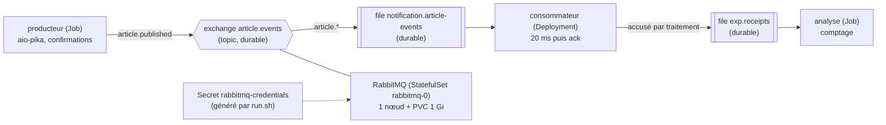

# Protocole d'expérimentation 1 — RabbitMQ sur k3d

Exécution de référence : **03/11/2026 18:55** (`./run.sh`, code de sortie 0). Sortie complète versionnée : [`resultats/run-20261103-1855.log`](resultats/run-20261103-1855.log). Le journal [`resultats/run-20261102-2149.log`](resultats/run-20261102-2149.log) est celui de la **version précédente**, faite avec RabbitMQ Cluster Operator et cert-manager : il n'est conservé que comme preuve de la comparaison (section 5).

## 1. Objectif et question posée

**Question** : l'image officielle de RabbitMQ, déployée sur un cluster k3d par de simples manifestes (StatefulSet, volume, Services), sans opérateur ni cert-manager, transporte-t-elle les événements du POC (`article.events`) sans perte quand le consommateur ou le broker est supprimé en plein flux, et applique-t-elle la règle d'échec du contrat (remise en file une fois, puis rejet) ? Cette version est-elle au moins aussi fiable et plus légère que la version avec opérateur ?

- Scénario A : le consommateur est supprimé pendant que 1 000 messages sont publiés (délai de grâce de 0 s, pour simuler un crash ; le conteneur reste en fait actif environ 2 s, voir la section 5).
- Scénario B : le pod RabbitMQ est supprimé pendant que 1 000 messages sont publiés (volume persistant conservé, arrêt propre).
- Scénario C : un message dont le traitement échoue volontairement est publié parmi 100 messages.
- Critères de réussite : 1 000 messages distincts traités en A et en B ; 99 messages sains traités en C, le message empoisonné étant traité 2 fois au total (une remise en file) puis rejeté et journalisé. Les doublons sont mesurés, pas interdits : la livraison est « au moins une fois » (`contrats.md` §3.2).

La topologie et les règles de fiabilité sont celles de `docs/02-architecture/contrats.md` §3.1 : exchange `topic` durable `article.events`, file durable `notification.article-events` liée par `article.*`, messages persistants (`delivery_mode = 2`), confirmations de publication, acquittement après traitement, `prefetch = 10`, propriétés `type` et en-tête `x-correlation-id`, et règle d'échec : `nack(requeue=True)` au premier échec, puis `reject(requeue=False)` et une ligne de journal si le message est déjà relivré.

## 2. Technologies testées et interactions

- **k3d / k3s** : cluster Kubernetes local (1 server, 2 agents).
- **RabbitMQ** : image officielle `rabbitmq:4.3.5-management`, déployée par `manifests/rabbitmq.yaml` : un `StatefulSet` d'un réplica, un volume `local-path` de 1 Gi monté sur `/var/lib/rabbitmq`, un Service `rabbitmq` (ports 5672 et 15672) et un Service *headless* `rabbitmq-headless`. Ce dernier donne au pod un nom d'hôte stable (`rabbitmq-0`) : le nœud s'appelle `rabbit@rabbitmq-0` avant et après la recréation du pod, et retrouve donc ses données sur le volume (scénario B).
- **Secret `rabbitmq-credentials`** : utilisateur et mot de passe générés par `run.sh` (module `secrets` de Python), jamais affichés ni versionnés. L'image crée l'utilisateur au premier démarrage d'un volume vide (`RABBITMQ_DEFAULT_USER`, `RABBITMQ_DEFAULT_PASS`).
- **Sondes** : *readiness* par `rabbitmq-diagnostics -q check_port_connectivity` (le nœud accepte des connexions), période 5 s ; *liveness* par `rabbitmq-diagnostics -q ping`, délai initial de 60 s et 6 échecs de 30 s avant redémarrage, pour ne jamais tuer un broker lent. `terminationGracePeriodSeconds: 60` : l'arrêt du broker est propre (SIGTERM) et dure environ 2 s (section 5), le délai n'est qu'une borne.
- **aio-pika** : client Python asynchrone, `connect_robust` (reconnexion automatique).
- **Méthode de comptage** : les journaux d'un pod supprimé sont perdus. Le consommateur publie donc, pour chaque traitement (réussi, remis en file ou rejeté), un accusé (identifiant, pod, horodatage, drapeau `redelivered`, issue) dans la file durable `exp.receipts`, avant d'acquitter. Un Job d'analyse la vide à la fin et calcule les mesures.

Aucun opérateur, aucune CRD ajoutée, pas de cert-manager (décision du 03/11/2026 : l'infrastructure du POC se déploie depuis les images officielles).

## 3. Environnement

| Élément | Valeur |
| --- | --- |
| Machine | Mac Apple Silicon (arm64), macOS 26.6.2 |
| Python de l'hôte | 3.15.2 (`python3`, utilisé par `run.sh` pour les calculs de temps) ; uv 0.13.6 |
| Docker Desktop | moteur 28.5.1, 10 CPU, 8 322 555 904 octets de mémoire, disque virtuel de 58,4 Go |
| k3d | v5.9.0 |
| kubectl | client v1.34.1 |
| Image k3s | `rancher/k3s:v1.35.8-k3s1` (publiée le 27/08/2026) |
| RabbitMQ | image `rabbitmq:4.3.5-management` (10/09/2026), RabbitMQ 4.3.5 sur Erlang/OTP 27 (`erlang:system_info(otp_release)` dans l'image), 1 nœud, volume de 1 Gi |
| Image utilitaire | `alpine:3.24.3` (mesure de l'espace disque de la VM Docker) |
| Application | Python 3.12 (`python:3.12-slim`), aio-pika 10.1.1 (10/10/2026), uv 0.13.6 dans l'image |
| Vérification du code | Ruff 0.17.3, mypy 2.4.1 (`--strict`) |
| **Disque libre requis** | **au moins 5 000 Mo** (`run.sh` refuse de démarrer sinon). L'expérimentation en consomme 1,5 Go (53,4 Go libres avant, 51,9 Go à la fin, 53,4 Go après suppression du cluster) ; le kubelet évince les pods sous environ 3,1 Go libres (valeur relevée lors de l'expérimentation 3, journal des décisions du 02/11/2026, non remesurée ici ; voir aussi §6) |

Aucune image ni aucun chart Bitnami. Aucun secret dans le dépôt.

## 4. Étapes reproductibles

Commande unique, depuis `docs/04-experimentations/01-rabbitmq/` : `./run.sh` (option `--keep` pour garder le cluster). Prérequis : Docker Desktop démarré, `k3d`, `kubectl`, `uv`, `python3`, `perl`, 5 Go de disque libre. Le script écrit sa sortie complète dans `resultats/run-AAAAMMJJ-HHMM.log`. Toutes les attentes sont bornées (`--timeout`, boucles à nombre d'essais fixe) et affichent un message d'échec clair ; en cas d'échec, le script affiche l'état des pods et les derniers événements.

| Étape | Ce que fait le script |
| --- | --- |
| 0 | Vérifie les outils, affiche la date, les versions et l'espace disque ; s'arrête sous 5 000 Mo libres |
| 1 | Crée le cluster `collector-exp1` (1 server, 2 agents, Traefik désactivé) |
| 2 | Crée le namespace `exp` et le Secret `rabbitmq-credentials` (identifiants générés, non affichés) |
| 3 | Applique `manifests/rabbitmq.yaml` (StatefulSet, Services) et attend que `rabbitmq-0` soit Ready |
| 4 | Construit l'image de l'application, l'importe dans le cluster (`k3d image import`), déploie le consommateur (`terminationGracePeriodSeconds: 0`) |
| A | Producteur (1 000 messages, 50 par seconde, confirmations) ; `kubectl delete pod --wait=false` sur le consommateur dès 500 messages confirmés ; analyse |
| B | Même flux ; `kubectl delete pod --wait=false` sur `rabbitmq-0` (volume conservé) ; mesure de la disparition de l'ancien pod, de la création du nouveau et de son passage à Ready ; analyse |
| C | 100 messages dont le n° 50 est empoisonné ; analyse |
| Synthèse | Espace disque, mémoire (`kubectl top`), tableaux de résultats |
| Fin | Supprime le cluster (sauf `--keep`), puis affiche l'espace disque, `k3d cluster list` et le code de sortie |

Le décalage entre l'horloge du Mac et celle du cluster (−0,011 s à cette exécution) est mesuré et corrigé pour dater les suppressions.

## 5. Résultats mesurés

Exécution de référence du 03/11/2026 18:55 (sortie : `resultats/run-20261103-1855.log`).

| Mesure | A : perte du consommateur | B : arrêt propre du broker |
| --- | --- | --- |
| Messages à traiter | 1 000 | 1 000 |
| Messages distincts traités | 1 000 | 1 000 |
| Messages manquants | **0** | **0** |
| Doublons (traitements en trop) | 0 | 0 |
| Messages relivrés (drapeau `redelivered`) | 1 | 1 |
| Suppression → dernier message traité par l'ancien pod | 2,044 s | sans objet |
| Suppression → premier message traité par le nouveau pod | 0,864 s | sans objet |
| Silence entre ancien et nouveau pod (négatif = chevauchement) | **−1,180 s** | sans objet |
| Suppression → dernier message traité avant la coupure | sans objet | 0,066 s |
| Suppression → pod RabbitMQ Ready | sans objet | 9,995 s |
| Pod Ready → premier message traité | sans objet | 0,307 s |
| Plus long silence de traitement | 0,032 s | 10,236 s |
| Indisponibilité vue par le producteur | sans objet | 10,547 s |
| Indisponibilité vue par le consommateur | sans objet | 10,204 s |
| Republications du producteur (même message, jusqu'à la confirmation) | 0 | 21 |

Scénario C (100 messages, n° 50 empoisonné) :

| Mesure | Valeur |
| --- | --- |
| Messages sains traités (distincts, sur 99) | 99 |
| Messages sains manquants | 0 |
| Tentatives de traitement du message empoisonné | 2 |
| Issues successives | `failed_requeued` puis `rejected` |
| Lignes de journal `message_rejected` | 1 |
| Plus long silence de traitement | 0,036 s (les autres messages ne sont pas bloqués) |

Décomposition du retour à Ready du broker en B (mesurée par `run.sh`, horloge du cluster ; les horodatages du kubelet sont à la seconde) :

| Phase | Durée |
| --- | --- |
| Suppression → ancien pod disparu et nouveau pod créé (arrêt propre par SIGTERM) | 1,634 s |
| Nouveau pod créé → Ready | 8,361 s |
| dont conteneur démarré (kubelet) 17:57:37 → premier message du nœud 17:57:40 | environ 3 s (démarrage de l'image et de la machine virtuelle Erlang) |
| dont démarrage du nœud (« Server startup complete ») | 0,5 s après son premier message |
| dont attente de la sonde *readiness* (nœud démarré à 17:57:40, Ready à 17:57:44) | environ 3,4 s (période de 5 s) |

Comparaison avec l'exécution du 02/11/2026 21:49, faite avec RabbitMQ Cluster Operator et cert-manager (même image RabbitMQ 4.3.5, mêmes scénarios, même code) :

| Mesure | Avec opérateur (02/11, 21:49) | Sans opérateur (03/11, 18:55) |
| --- | --- | --- |
| A : messages manquants / doublons / relivrés | 0 / 0 / 1 | 0 / 0 / 1 |
| A : chevauchement ancien et nouveau pod | −1,097 s | −1,180 s |
| A : suppression → dernier message de l'ancien pod | 2,063 s | 2,044 s |
| B : messages manquants / doublons / relivrés | 0 / 0 / 1 | 0 / 0 / 1 |
| B : suppression → pod RabbitMQ Ready | 54,164 s | **9,995 s** |
| B : pod Ready → premier message traité | 0,829 s | 0,307 s |
| B : indisponibilité vue par le producteur | 53,793 s | 10,547 s |
| B : indisponibilité vue par le consommateur | 53,539 s | 10,204 s |
| B : republications du producteur | 107 | 21 |
| C : messages sains traités / tentatives du message empoisonné / issues | 99 / 2 / `failed_requeued` puis `rejected` | 99 / 2 / `failed_requeued` puis `rejected` |
| Mémoire : cert-manager (3 pods) | 54 Mi | 0 (absent) |
| Mémoire : opérateur | 19 Mi | 0 (absent) |
| Mémoire : broker | 126 Mi | 135 Mi |
| Mémoire : consommateur | 23 Mi | 23 Mi |
| Disque consommé par l'exécution | 1,8 Go (7,9 → 6,1 Go libres) | 1,5 Go (53,4 → 51,9 Go libres) |
| Objets installés dans le cluster en plus de RabbitMQ | 2 opérateurs et leurs CRD, webhooks et certificats | aucun |

Les occupations de disque sont mesurées sur des états différents de la VM Docker (7,9 Go libres le 02/11, 53,4 Go le 03/11) : seule la consommation de l'exécution se compare. Les mémoires sont des relevés `kubectl top` en fin d'exécution (metrics-server de k3s). Un essai intermédiaire du 03/11/2026 18:52, non conservé (seuil de disque différent), a donné un retour à Ready d'environ 9,3 s : l'ordre de grandeur est donc de 10 s, pas de 54 s.

Lecture des résultats :

- **A** : aucun message perdu, aucun doublon, comme avec l'opérateur (le consommateur est le même) ; chevauchement et délais proches (−1,18 s contre −1,097 s). **L'absence de chevauchement n'est pas obtenue** : le conteneur de l'ancien pod a encore traité des messages 2,044 s après la suppression, malgré un délai de grâce de 0 s. La cause probable est le délai entre la suppression dans l'API et l'arrêt effectif du conteneur par le kubelet : c'est une hypothèse, non vérifiée. Le Deployment crée le remplaçant immédiatement. Pendant 1,18 s, les deux consommateurs travaillent ensemble : le flux n'est jamais interrompu.
- **B** (arrêt propre du broker : SIGTERM, volume conservé) : aucun message confirmé perdu, le nœud `rabbit@rabbitmq-0` reprend les données du volume. Le broker redevient prêt 9,995 s après la suppression, 5 fois plus vite qu'avec l'opérateur (54,164 s). Pendant l'indisponibilité, le producteur échoue sur `ChannelInvalidStateError`, republie le même message toutes les 0,5 s (21 tentatives) et obtient la confirmation dès le retour du broker. Le consommateur se reconnecte seul (`connect_robust`).
- **Cause du délai de B (mesurée sur cette version)** : sur 10 s, 1,6 s d'arrêt, environ 3 s de démarrage du conteneur et de la machine virtuelle Erlang, 0,5 s pour le nœud lui-même, et environ 3,4 s d'attente de la sonde *readiness* (période de 5 s). Les délais choisis pour les sondes ont donc un coût direct, ici d'au plus 5 s. **La cause des 54 s de la version avec opérateur n'a pas été remesurée** : cette version n'est plus installable dans le protocole. L'écart de 44 s est un fait mesuré ; son origine (paramètres de l'objet géré par l'opérateur : sondes, délai de grâce, séquence d'arrêt et de démarrage) reste une hypothèse non vérifiée.
- **C** : le message empoisonné est traité 2 fois (remis en file une fois, puis rejeté sans remise et journalisé). Les 99 autres messages sont traités sans retard, et le consommateur n'est pas bloqué par le message en échec.

## 6. Difficultés rencontrées et solutions

| Difficulté | Cause | Solution |
| --- | --- | --- |
| **Le pod RabbitMQ boucle en `CrashLoopBackOff` après sa recréation** : `Cookie file /var/lib/rabbitmq/.erlang.cookie must be accessible by owner only` (essai du 03/11/2026 18:41) | Un `fsGroup: 999` (utilisateur `rabbitmq`) dans le `securityContext` donne au groupe l'accès au volume, donc au cookie Erlang, que RabbitMQ refuse s'il est lisible par un autre que son propriétaire. Le premier démarrage réussissait ; la recréation du pod échouait | Aucun `securityContext` : le point d'entrée de l'image démarre en root, donne le volume à l'utilisateur `rabbitmq` et lui passe la main. Vérifié par la suppression du pod (B) |
| **Le nom de nœud doit survivre à la recréation du pod** | RabbitMQ range ses données dans un dossier nommé d'après son nœud (`rabbit@<nom d'hôte>`) ; un nom d'hôte différent ferait repartir le broker à vide | `StatefulSet` et Service *headless* : le pod s'appelle toujours `rabbitmq-0` |
| **Le serveur k3s ne démarrait pas** (délai de 300 s dépassé, puis 600 s ; erreur 502 de Docker Desktop au retour arrière), lors de l'exécution du 02/11/2026 | La mémoire et le CPU de la VM Docker étaient occupés par 7 conteneurs d'autres clusters locaux (environ 5 Go et plus de 6 CPU, charge machine de 16 à 27) | Arrêt de ces conteneurs avant l'expérimentation : le cluster démarre en 20 s. Prérequis : une VM Docker de 8 Go libre |
| **Pods évincés** : `The node was low on resource: ephemeral-storage`, pods `Pending` (exécution du 02/11/2026) | Disque de la VM Docker plein (98 % utilisé, 1,4 Go libres, relevé dans le journal de la fiche P3-01) ; seuil d'éviction du kubelet d'environ 3,1 Go libres, relevé lors de l'expérimentation 3 | Libération d'espace ; le script affiche l'espace libre et refuse de démarrer sous 5 000 Mo (1,5 Go consommés + 3,1 Go du kubelet) |
| Le consommateur plantait au démarrage : `No module named 'exp'` | L'image installait le projet en mode éditable : l'étape finale ne contenait que le lien vers `/app/src`, absent de l'image | `uv sync --frozen --no-dev --no-editable` dans l'étape de construction |
| **Python en PID 1 ignore SIGTERM** : lors d'une mesure exploratoire (exécution du 02/11/2026 21:43, journal non conservé, hors exécution de référence), l'ancien consommateur travaillait encore 9,808 s après la suppression, avec 8,86 s de chevauchement face au nouveau pod | Cause probable (non vérifiée par une mesure dédiée) : le noyau n'applique pas l'action par défaut de SIGTERM au PID 1 d'un conteneur, et le programme n'installe aucun gestionnaire : le conteneur n'est tué qu'à la fin du délai de grâce | `terminationGracePeriodSeconds: 0` dans `consumer.yaml` : arrêt immédiat, qui simule un crash. Le chevauchement tombe à 1,18 s, mais ne disparaît pas |
| Journal inutilisable en scénario B (une ligne `amqp_connection_lost` par seconde) | aio-pika rappelle le hook de fermeture à chaque tentative de reconnexion échouée | Le hook ne journalise qu'une fois par coupure |
| Le premier calcul « suppression → premier message traité » donnait 0,001 s | Il comptait les messages de l'ancien pod encore actif après la suppression | Mesures séparées pour l'ancien et le nouveau pod |
| Le consommateur ne suivait pas la règle d'échec du contrat | Il se contentait de journaliser l'échec, sans `nack` ni `reject` | `nack(requeue=True)` au premier échec, `reject(requeue=False)` et journal si le message est relivré ; scénario C pour le vérifier |
| Version abandonnée : RabbitMQ Cluster Operator et cert-manager (exécution du 02/11/2026 21:49) | L'opérateur exige cert-manager : deux composants et leurs CRD pour un seul broker | Remplacés par l'image officielle et un StatefulSet (journal des décisions du 03/11/2026) |

## 7. Limites de l'expérimentation

- **Broker démarré en root, sans `securityContext`** (`runAsNonRoot`, `readOnlyRootFilesystem` absents). Constaté lors d'un essai non conservé (03/11/2026 18:41) : avec un `fsGroup`, le cookie Erlang devient lisible par le groupe et le nœud refuse de démarrer à la recréation du pod. Le durcissement du conteneur (utilisateur non-root, volume préparé autrement) reste à faire en phase 6.
- **Un seul nœud RabbitMQ, file classique.** Un nœud et un volume persistant ne protègent pas d'une perte du volume ou du nœud : c'est la limite **L7** (*quorum queues*, cluster de 3 nœuds, *dead-letter queue*) de `architecture-poc.md`. Le message rejeté du scénario C est simplement supprimé de la file : sans DLQ, il n'est ni conservé ni rejouable (L7).
- **Sans opérateur, la maintenance est manuelle.** Aucune mise à jour pilotée, sauvegarde ni bascule : ce sont les services que rend un opérateur, utiles à un cluster répliqué, donc à la cible. Une mise à jour de version ici est un changement de tag de l'image, non testé.
- **Pas d'*outbox*.** Le producteur de l'expérience republie tant que le broker n'a pas confirmé. Le vrai `catalog-service` publie après le commit sans réessai : un événement est perdu si le broker est indisponible à cet instant (limite **L2**). Les résultats prouvent le transport, pas la cohérence base de données et événement.
- **A simule un crash, pas un arrêt propre.** `terminationGracePeriodSeconds: 0` demande l'arrêt du conteneur sans délai de grâce, donc sans lui laisser terminer son traitement ; il a pourtant traité des messages pendant 2,044 s après la suppression (hypothèse non vérifiée : délai entre l'API et le kubelet). Les services du POC (uvicorn) traiteront SIGTERM proprement : c'est un autre cas, non testé ici.
- **B est un arrêt propre du broker** (SIGTERM, volume conservé). Le crash brutal du broker (arrêt sans vidage de ses données) n'est pas testé : la durabilité des messages confirmés dans ce cas reste à vérifier.
- **Le drapeau `redelivered` ne distingue pas un crash d'un échec** : un message relivré après un crash du consommateur n'a plus qu'une tentative avant le rejet, puisque la règle d'échec s'appuie sur ce drapeau (`contrats.md` §3.1). Cible : le compteur de livraisons des *quorum queues* (`x-delivery-count`, limite L7).
- **Règle de mesure « pod Ready → premier message traité » (B).** Elle prend la fin du plus long silence de traitement comme premier message traité après la coupure. Elle n'est valable que si l'indisponibilité est ce plus long silence, ce qui est le cas ici (10,236 s contre 0,032 s en A).
- **Chevauchement résiduel en A (1,18 s).** Le Deployment crée le remplaçant avant que le kubelet n'ait arrêté l'ancien conteneur : le temps de reprise du consommateur n'est pas mesurable comme un silence. L'expérience prouve l'absence de perte et de doublon, pas une durée de reprise.
- **Comparaison : une exécution par version**, sans répétition statistique. L'écart de 54 s à 10 s est net, mais les durées dépendent de la machine et du moment (l'essai intermédiaire non conservé a donné environ 9,3 s). Les deux exécutions ont des états de disque et de charge différents. La cause du délai de la version avec opérateur n'est pas mesurée.
- **Débit modeste** (50 messages par seconde, un seul consommateur) : pas un test de charge. Le volume visé par la V1 est de quelques événements par seconde (ADR 0003).
- **Perte de la VM ou du disque non testée.** B supprime le pod, pas le volume.
- **Point d'extension non testé** : l'ajout d'une seconde file liée à l'exchange, annoncé comme confirmation dans l'ADR 0003, n'est pas vérifié ici.

## 8. Décision

**Adoption de RabbitMQ, déployé à partir de l'image officielle `rabbitmq:4.3.5-management` par un StatefulSet, sans opérateur ni cert-manager, pour le POC**, avec les conditions suivantes.

- Sur 2 × 1 000 messages, aucun message confirmé n'a été perdu, ni à la suppression du consommateur (A), ni à l'arrêt propre du broker (B). La règle d'échec du contrat est vérifiée : un message en échec est traité 2 fois puis rejeté et journalisé, sans bloquer les autres (C). Pertes, doublons et résultat de C sont identiques à ceux de la version avec opérateur ; B est nettement plus court (9,995 s contre 54,164 s, 21 republications contre 107).
- La version simple est plus légère (64 Mi de mémoire en moins : 54 + 19 Mi retirés, broker de 126 à 135 Mi ; deux composants de moins, sans CRD ni webhook) et le broker revient prêt en 10 s au lieu de 54 s. Le délai de 10 s est en partie le coût des sondes (période de 5 s) : il se règle.
- Les doublons possibles sont couverts par `UNIQUE (user_id, source_event_id)` côté `notification-service`. La reconnexion automatique d'aio-pika suffit : la sonde `/health/ready` ne dépend donc pas de RabbitMQ (`contrats.md` §2.3).
- Le TLS de l'ingress reste en mkcert (ADR 0006) ; cert-manager reste dans la cible (limite **L11**), les opérateurs aussi (limites **L3** et **L7**).
- Avec un nœud unique, une indisponibilité du broker d'une dizaine de secondes est à prévoir : les services doivent publier avec confirmation et réessayer. Sans *outbox* (L2), l'événement est perdu s'il n'est pas confirmé : limite assumée du POC.
- Ne pas poser de `fsGroup` sur le volume du broker (§6). Les images Python du POC doivent traiter SIGTERM (gestionnaire de signal ou init), faute de quoi l'arrêt d'un pod attend la fin du délai de grâce.
- Ressources à prévoir : environ 135 Mi pour le broker (requête de 200m CPU, 512 Mi de mémoire en requête et en limite).
- Cible : cluster de 3 nœuds, *quorum queues*, *dead-letter queue*, *outbox* (L2, L7) et, pour ce cluster répliqué, RabbitMQ Cluster Operator.

Voir l'ADR [0003](../../02-architecture/adr/0003-rabbitmq-plutot-que-kafka.md). Le choix d'installer l'infrastructure depuis les images officielles est consigné dans le journal des décisions du 03/11/2026 (ADR [0008](../../02-architecture/adr/0008-infrastructure-images-officielles.md)).
