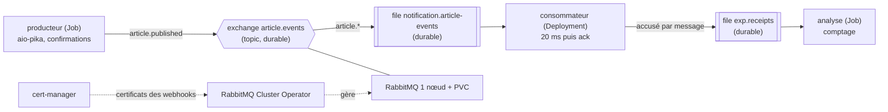

# Protocole d'expérimentation 1 — RabbitMQ sur k3d

Exécution de référence : **02/11/2026 21:33** (`./run.sh`, sortie complète sans erreur, code de sortie 0).

## 1. Objectif et question posée

**Question** : RabbitMQ, installé sur un cluster k3d par son opérateur officiel, transporte-t-il les événements du POC (`article.events`) sans perte quand le consommateur ou le broker est supprimé en plein flux ?

- Scénario A : le consommateur (`notification-service` simulé) est supprimé pendant que 1 000 messages sont publiés.
- Scénario B : le pod RabbitMQ est supprimé pendant que 1 000 messages sont publiés (volume persistant conservé).
- Critère de réussite : 1 000 messages distincts traités dans chaque scénario, aucun message confirmé perdu. Les doublons sont mesurés, pas interdits : la livraison est « au moins une fois » (`contrats.md` §3.2).

La topologie et les règles de fiabilité sont celles de `docs/02-architecture/contrats.md` §3.1 : exchange `topic` durable `article.events`, file durable `notification.article-events` liée par `article.*`, messages persistants (`delivery_mode = 2`), confirmations de publication, acquittement après traitement, `prefetch = 10`.

## 2. Technologies testées et interactions

- **k3d / k3s** : cluster Kubernetes local (1 server, 2 agents).
- **RabbitMQ Cluster Operator** : opérateur officiel de RabbitMQ qui crée le StatefulSet, le volume persistant et les identifiants à partir d'un objet `RabbitmqCluster`.
- **cert-manager** : exigé par le manifeste de l'opérateur (voir §6).
- **aio-pika** : client Python asynchrone, `connect_robust` (reconnexion automatique).
- **Méthode de comptage** : les journaux d'un pod supprimé sont perdus. Le consommateur publie donc, avant d'acquitter, un accusé (identifiant du message, pod, horodatage, drapeau `redelivered`) dans la file durable `exp.receipts`. Un Job d'analyse la vide à la fin et calcule les mesures.

## 3. Environnement

| Élément | Valeur |
| --- | --- |
| Machine | Mac Apple Silicon (arm64), macOS 26.6.2 |
| Docker Desktop | moteur 28.5.1, 10 CPU, 8 322 555 904 octets de mémoire (`docker info`), disque virtuel de 58,4 Go |
| k3d | v5.9.0 |
| kubectl | client v1.34.1 |
| Image k3s | `rancher/k3s:v1.35.8-k3s1` (publiée le 27/08/2026) |
| RabbitMQ Cluster Operator | v2.23.0 (09/09/2026), manifeste de release `manifests/cluster-operator-v2.23.0.yml`, image `ghcr.io/rabbitmq/cluster-operator:2.23.0` |
| cert-manager | v1.21.2 (11/09/2026), manifeste de release `manifests/cert-manager-v1.21.2.yaml`, images `quay.io/jetstack/cert-manager-{controller,cainjector,webhook}:v1.21.2` |
| RabbitMQ | image `rabbitmq:4.3.5-management` (10/09/2026), 1 nœud, volume de 1 Gi |
| Application | Python 3.12 (`python:3.12-slim`), aio-pika 10.1.1 (10/10/2026), uv 0.13.6 |
| Outils de vérification | Ruff 0.17.3, mypy 2.4.1 (`--strict`) |
| Disque libre nécessaire | **environ 2 Go** consommés par l'expérimentation (mesuré : 8,0 Go libres avant, 6,1 Go à la fin). Prévoir au moins 3,5 Go libres en plus, car le kubelet évince les pods sous un seuil d'environ 3,1 Go libres |
| Mémoire | voir §5 : environ 250 Mi pour l'ensemble des pods applicatifs et d'infrastructure du cluster d'expérimentation (hors système k3s) |

Aucune image ni aucun chart Bitnami. Les identifiants RabbitMQ sont générés par l'opérateur et lus dans le Secret `rabbitmq-default-user` (aucun secret dans le dépôt).

## 4. Étapes reproductibles

Commande unique, depuis `docs/04-experimentations/01-rabbitmq/` : `./run.sh` (option `--keep` pour garder le cluster). Prérequis : Docker Desktop démarré, `k3d`, `kubectl`, `uv`, `python3`, environ 4 Go de disque libre en plus du seuil du kubelet.

| Étape | Ce que fait le script |
| --- | --- |
| 0 | Vérifie les outils, affiche les versions et l'espace disque libre |
| 1 | Crée le cluster `collector-exp1` (1 server, 2 agents, Traefik désactivé) |
| 2a | Installe cert-manager et attend que ses 3 Deployments soient `Available` |
| 2b | Installe l'opérateur (application côté serveur : CRD volumineux), attend son déploiement puis le Secret `cluster-operator-webhook-server-cert` |
| 3 | Crée le `RabbitmqCluster` (1 nœud) et attend qu'il soit prêt |
| 4 | Construit l'image de l'application, l'importe dans le cluster (`k3d image import`), déploie le consommateur |
| A | Lance le producteur (1 000 messages, 50 par seconde, confirmations), supprime le pod consommateur dès 500 messages confirmés (`kubectl delete pod --grace-period=0 --force`, qui simule un arrêt brutal), attend la fin, puis lance l'analyse |
| B | Même flux, mais supprime le pod `rabbitmq-server-0` (même option, volume conservé), attend son retour, puis lance l'analyse |
| Synthèse | Affiche l'espace disque, la mémoire (`kubectl top`) et le tableau des résultats |
| Fin | Supprime le cluster (sauf `--keep`) |

Le décalage entre l'horloge du Mac et celle du cluster (0,030 s à cette exécution) est mesuré et corrigé pour dater les suppressions.

## 5. Résultats mesurés

Exécution du 02/11/2026 21:33.

| Mesure | A : perte du consommateur | B : perte du broker |
| --- | --- | --- |
| Messages publiés et confirmés | 1 000 | 1 000 |
| Messages distincts traités | 1 000 | 1 000 |
| Messages manquants | **0** | **0** |
| Doublons (accusés en trop) | 0 | 0 |
| Messages marqués `redelivered` | 1 | 1 |
| Suppression du pod → dernier message traité par l'ancien pod | 2,027 s | sans objet |
| Suppression du pod → premier message traité par le nouveau pod | 0,927 s | sans objet |
| Plus long silence de traitement | 0,041 s | 50,384 s |
| Indisponibilité vue par le producteur | sans objet | 50,737 s |
| Indisponibilité vue par le consommateur | sans objet | 50,341 s |
| Republications du producteur (même message, jusqu'à la confirmation) | 0 | 101 |

Mémoire consommée en fin d'exécution (`kubectl top pods`, metrics-server de k3s) :

| Pod | Mémoire |
| --- | --- |
| cert-manager (contrôleur) | 24 Mi |
| cert-manager-cainjector | 20 Mi |
| cert-manager-webhook | 12 Mi |
| **cert-manager, total** | **56 Mi** |
| rabbitmq-cluster-operator | 20 Mi |
| rabbitmq-server-0 (broker) | 149 Mi |
| consumer | 23 Mi |

Espace disque libre de la VM Docker : 8,0 Go avant, 6,1 Go après le téléchargement de toutes les images et à la fin.

Lecture des résultats :

- **A** : aucun message perdu et aucun silence. Après `kubectl delete pod --grace-period=0 --force`, l'API retire le pod tout de suite et le Deployment crée son remplaçant, qui traite son premier message 0,927 s après la suppression. Le conteneur de l'ancien pod, lui, n'est arrêté par le kubelet qu'environ 2 s après (il traite encore des messages pendant ce temps). Les deux consommateurs se sont donc chevauchés et le flux n'a jamais été interrompu. Le seul message marqué `redelivered` n'a pas produit de doublon.
- **B** : aucun message confirmé perdu. Le broker est indisponible environ 50 s (redémarrage du pod, relecture du volume, reprise des déclarations). Pendant ce temps, le producteur échoue sur `ConnectionClosed` à B-00573, republie le même message toutes les 0,5 s (101 tentatives) et le message est confirmé dès le retour du broker. Le consommateur se reconnecte seul (`connect_robust`) sans redémarrer.

## 6. Difficultés rencontrées et solutions

| Difficulté | Cause | Solution |
| --- | --- | --- |
| **Le serveur k3s ne démarrait pas** (délai de 300 s dépassé, puis 600 s ; Docker Desktop renvoyait une erreur 502 au retour arrière) | La mémoire et le CPU de la VM Docker étaient occupés par 7 conteneurs d'autres clusters locaux (environ 5 Go et plus de 6 CPU, charge machine de 16 à 27) | Arrêt de ces conteneurs, sans les supprimer, avant l'expérimentation. Le cluster démarre ensuite en 20 s. Prérequis de l'expérimentation : une VM Docker de 8 Go libre |
| **L'opérateur exige cert-manager** : `no matches for kind "Certificate" in version "cert-manager.io/v1"` | Le manifeste de release (v2.23.0, et v2.22.5) embarque des ressources cert-manager (`Certificate`, `Issuer`) et des webhooks dont le CA est injecté par cert-manager. Aucune variante sans cert-manager n'est publiée | Installation du manifeste officiel de cert-manager v1.21.2, figé dans `manifests/`, avant l'opérateur. Le script attend les 3 Deployments puis le Secret `cluster-operator-webhook-server-cert` avant de créer le `RabbitmqCluster`. Coût : 56 Mi de mémoire |
| **Les pods cert-manager étaient évincés** : `The node was low on resource: ephemeral-storage`, pods `Pending` | Le disque de la VM Docker était plein (58,4 Go, 98 % utilisés, 1,4 Go libres) alors que le kubelet évince sous environ 3,1 Go libres | Libération de l'espace par `docker image prune` et `docker builder prune`, qui laissent 8 Go libres. Le script affiche désormais l'espace libre avant, après le téléchargement des images, et en fin d'exécution |
| Le consommateur plantait au démarrage : `No module named 'exp'` | L'image installait le projet en mode éditable : l'étape finale ne contenait que le lien vers `/app/src`, absent de l'image | `uv sync --frozen --no-dev --no-editable` dans l'étape de construction |
| Journal inutilisable en scénario B (une ligne `amqp_connection_lost` par seconde) | aio-pika rappelle le hook de fermeture à chaque tentative de reconnexion échouée | Le hook ne journalise qu'une fois par coupure |
| Le premier calcul « suppression → premier message traité » donnait 0,001 s | Il comptait les messages de l'ancien pod encore actif après la suppression | Mesures séparées pour l'ancien et le nouveau pod (§5) |
| Message d'avertissement de `kubectl` sur la suppression immédiate | `--grace-period=0 --force` ne vérifie pas l'arrêt du conteneur | Conservé volontairement : il simule un arrêt brutal. Voir les limites |

## 7. Limites de l'expérimentation

- **Un seul nœud RabbitMQ, file classique.** Un nœud et un volume persistant ne protègent pas d'une perte du volume ou du nœud : c'est la limite **L7** (*quorum queues*, cluster de 3 nœuds, *dead-letter queue*) de `architecture-poc.md`, hors périmètre ici.
- **Pas d'*outbox*.** L'expérience publie depuis un producteur qui republie tant que le broker n'a pas confirmé. Le vrai `catalog-service` publie après le commit sans réessai : un événement est perdu si le broker est indisponible à cet instant (limite **L2**). Ces résultats prouvent le transport, pas la cohérence base de données et événement.
- **Scénario A non discriminant.** Le remplaçant du consommateur démarre en moins d'une seconde, plus vite que le kubelet n'arrête l'ancien conteneur : on ne mesure donc pas un vrai temps de reprise du consommateur. Le comportement d'un consommateur arrêté longtemps (messages accumulés dans la file) n'est pas testé.
- **Une seule exécution complète retenue**, sans répétition statistique : les durées (en particulier les 50 s de redémarrage du broker) dépendent de la machine et du moment.
- **Arrêt « brutal » approximatif** : `--force --grace-period=0` retire le pod de l'API, mais ce n'est pas une coupure électrique. La durabilité face à une perte de la VM n'est pas testée.
- **Débit modeste** (50 messages par seconde, un seul consommateur) : pas un test de charge. Le volume visé par la V1 est de quelques événements par seconde (ADR 0003).
- L'expérience ne teste pas l'ajout d'une seconde file liée à l'exchange (point d'extension de l'anti-fraude), annoncé comme confirmation dans l'ADR 0003 : à vérifier ailleurs.

## 8. Décision

**Adoption de RabbitMQ, installé par le RabbitMQ Cluster Operator, pour le POC.** Sur 2 × 1 000 messages, aucun message confirmé n'a été perdu, ni à la suppression du consommateur, ni à celle du broker. Les doublons possibles sont couverts par `UNIQUE (user_id, source_event_id)` côté `notification-service`. La reconnexion automatique d'aio-pika suffit : la sonde `/health/ready` ne dépend donc pas de RabbitMQ (`contrats.md` §2.3).

Conditions et conséquences :

- **cert-manager est installé, mais uniquement pour les certificats internes des webhooks de l'opérateur.** Le TLS de l'ingress reste en mkcert (ADR 0006) et cert-manager avec un émetteur ACME reste dans la cible (limite **L11**).
- Une indisponibilité du broker d'environ 50 s doit être attendue sur un nœud unique : les services doivent publier avec confirmation et réessayer. Sans *outbox* (L2), l'événement est perdu s'il n'est pas confirmé : limite assumée du POC.
- Ressources à prévoir sur le cluster : environ 56 Mi pour cert-manager, 20 Mi pour l'opérateur, 150 Mi pour le broker.
- Cible : cluster de 3 nœuds, *quorum queues*, *dead-letter queue* et *outbox* (L2, L7).

Voir l'ADR [0003](../../02-architecture/adr/0003-rabbitmq-plutot-que-kafka.md). Le choix de l'opérateur officiel plutôt que d'un chart Bitnami est consigné dans l'ADR 0008 (P3-05).
