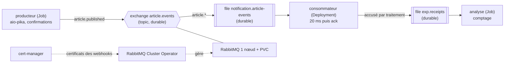

# Protocole d'expérimentation 1 — RabbitMQ sur k3d

Exécution de référence : **02/11/2026 21:49** (`./run.sh`, code de sortie 0). Sortie complète versionnée : [`resultats/run-20261102-2149.log`](resultats/run-20261102-2149.log).

## 1. Objectif et question posée

**Question** : RabbitMQ, installé sur un cluster k3d par son opérateur officiel, transporte-t-il les événements du POC (`article.events`) sans perte quand le consommateur ou le broker est supprimé en plein flux, et applique-t-il la règle d'échec du contrat (remise en file une fois, puis rejet) ?

- Scénario A : le consommateur est supprimé pendant que 1 000 messages sont publiés (arrêt immédiat, qui simule un crash).
- Scénario B : le pod RabbitMQ est supprimé pendant que 1 000 messages sont publiés (volume persistant conservé).
- Scénario C : un message dont le traitement échoue volontairement est publié parmi 100 messages.
- Critères de réussite : 1 000 messages distincts traités en A et en B ; 99 messages sains traités en C, le message empoisonné étant traité 2 fois au total (une remise en file) puis rejeté et journalisé. Les doublons sont mesurés, pas interdits : la livraison est « au moins une fois » (`contrats.md` §3.2).

La topologie et les règles de fiabilité sont celles de `docs/02-architecture/contrats.md` §3.1 : exchange `topic` durable `article.events`, file durable `notification.article-events` liée par `article.*`, messages persistants (`delivery_mode = 2`), confirmations de publication, acquittement après traitement, `prefetch = 10`, propriétés `type` et en-tête `x-correlation-id`, et règle d'échec : `nack(requeue=True)` au premier échec, puis `reject(requeue=False)` et une ligne de journal si le message est déjà relivré.

## 2. Technologies testées et interactions

- **k3d / k3s** : cluster Kubernetes local (1 server, 2 agents).
- **RabbitMQ Cluster Operator** : opérateur officiel qui crée le StatefulSet, le volume persistant et les identifiants à partir d'un objet `RabbitmqCluster`.
- **cert-manager** : exigé par le manifeste de l'opérateur (voir §6).
- **aio-pika** : client Python asynchrone, `connect_robust` (reconnexion automatique).
- **Méthode de comptage** : les journaux d'un pod supprimé sont perdus. Le consommateur publie donc, pour chaque traitement (réussi, remis en file ou rejeté), un accusé (identifiant, pod, horodatage, drapeau `redelivered`, issue) dans la file durable `exp.receipts`, avant d'acquitter. Un Job d'analyse la vide à la fin et calcule les mesures.

## 3. Environnement

| Élément | Valeur |
| --- | --- |
| Machine | Mac Apple Silicon (arm64), macOS 26.6.2 |
| Python de l'hôte | 3.15.2 (`python3`, utilisé par `run.sh` pour les calculs de temps) ; uv 0.13.6 |
| Docker Desktop | moteur 28.5.1, 10 CPU, 8 322 555 904 octets de mémoire, disque virtuel de 58,4 Go |
| k3d | v5.9.0 |
| kubectl | client v1.34.1 |
| Image k3s | `rancher/k3s:v1.35.8-k3s1` (publiée le 27/08/2026) |
| RabbitMQ Cluster Operator | v2.23.0 (09/09/2026), manifeste de release `manifests/cluster-operator-v2.23.0.yml`, image `ghcr.io/rabbitmq/cluster-operator:2.23.0` |
| cert-manager | v1.21.2 (11/09/2026), manifeste de release `manifests/cert-manager-v1.21.2.yaml`, images `quay.io/jetstack/cert-manager-{controller,cainjector,webhook}:v1.21.2` |
| RabbitMQ | image `rabbitmq:4.3.5-management` (10/09/2026), lue par `run.sh` dans `manifests/rabbitmq-cluster.yaml`, 1 nœud, volume de 1 Gi |
| Application | Python 3.12 (`python:3.12-slim`), aio-pika 10.1.1 (10/10/2026), uv 0.13.6 dans l'image |
| Vérification du code | Ruff 0.17.3, mypy 2.4.1 (`--strict`) |
| **Disque libre requis** | **au moins 4 Go** (`run.sh` refuse de démarrer sinon). L'expérimentation en consomme environ 1,8 Go (7,9 Go libres avant, 6,1 Go à la fin) ; le kubelet évince les pods sous environ 3,1 Go libres |

Aucune image ni aucun chart Bitnami. Les identifiants RabbitMQ sont générés par l'opérateur et lus dans le Secret `rabbitmq-default-user` (aucun secret dans le dépôt).

## 4. Étapes reproductibles

Commande unique, depuis `docs/04-experimentations/01-rabbitmq/` : `./run.sh` (option `--keep` pour garder le cluster). Prérequis : Docker Desktop démarré, `k3d`, `kubectl`, `uv`, `python3`, `perl`, 4 Go de disque libre. Le script écrit sa sortie complète dans `resultats/run-AAAAMMJJ-HHMM.log`.

| Étape | Ce que fait le script |
| --- | --- |
| 0 | Vérifie les outils, affiche la date, les versions et l'espace disque ; s'arrête sous 4 Go libres |
| 1 | Crée le cluster `collector-exp1` (1 server, 2 agents, Traefik désactivé) |
| 2a | Installe cert-manager et attend que ses 3 Deployments soient `Available` |
| 2b | Installe l'opérateur (application côté serveur : CRD volumineux), attend son déploiement puis le Secret `cluster-operator-webhook-server-cert` |
| 3 | Crée le `RabbitmqCluster` (1 nœud) et attend qu'il soit prêt |
| 4 | Construit l'image de l'application, l'importe dans le cluster (`k3d image import`), déploie le consommateur (`terminationGracePeriodSeconds: 0`) |
| A | Producteur (1 000 messages, 50 par seconde, confirmations) ; `kubectl delete pod --wait=false` sur le consommateur dès 500 messages confirmés ; analyse |
| B | Même flux ; `kubectl delete pod --wait=false` sur `rabbitmq-server-0` (volume conservé) ; attend le pod Ready ; analyse |
| C | 100 messages dont le n° 50 est empoisonné ; analyse |
| Synthèse | Espace disque, mémoire (`kubectl top`), tableaux de résultats |
| Fin | Supprime le cluster (sauf `--keep`) |

Le décalage entre l'horloge du Mac et celle du cluster (−0,021 s à cette exécution) est mesuré et corrigé pour dater les suppressions.

## 5. Résultats mesurés

Exécution du 02/11/2026 21:49 (sortie : `resultats/run-20261102-2149.log`).

| Mesure | A : perte du consommateur | B : perte du broker |
| --- | --- | --- |
| Messages à traiter | 1 000 | 1 000 |
| Messages distincts traités | 1 000 | 1 000 |
| Messages manquants | **0** | **0** |
| Doublons (traitements en trop) | 0 | 0 |
| Messages relivrés (drapeau `redelivered`) | 1 | 1 |
| Suppression → dernier message traité par l'ancien pod | 2,063 s | sans objet |
| Suppression → premier message traité par le nouveau pod | 0,966 s | sans objet |
| Silence entre ancien et nouveau pod (négatif = chevauchement) | **−1,097 s** | sans objet |
| Suppression → dernier message traité avant la coupure | sans objet | 1,420 s |
| Suppression → pod RabbitMQ Ready | sans objet | 54,164 s |
| Pod Ready → premier message traité | sans objet | 0,829 s |
| Plus long silence de traitement | 0,036 s | 53,573 s |
| Indisponibilité vue par le producteur | sans objet | 53,793 s |
| Indisponibilité vue par le consommateur | sans objet | 53,539 s |
| Republications du producteur (même message, jusqu'à la confirmation) | 0 | 107 |

Scénario C (100 messages, n° 50 empoisonné) :

| Mesure | Valeur |
| --- | --- |
| Messages sains traités (distincts, sur 99) | 99 |
| Messages sains manquants | 0 |
| Tentatives de traitement du message empoisonné | 2 |
| Issues successives | `failed_requeued` puis `rejected` |
| Lignes de journal `message_rejected` | 1 |
| Plus long silence de traitement | 0,042 s (les autres messages ne sont pas bloqués) |

Espace libre de la VM Docker, mesuré par `run.sh` : 7,9 Go avant la création du cluster, 6,1 Go après le téléchargement de toutes les images, 6,1 Go à la fin des scénarios.

Mémoire consommée en fin d'exécution (`kubectl top pods`, metrics-server de k3s) :

| Pod | Mémoire |
| --- | --- |
| cert-manager (contrôleur) | 27 Mi |
| cert-manager-cainjector | 16 Mi |
| cert-manager-webhook | 11 Mi |
| **cert-manager, total** | **54 Mi** |
| rabbitmq-cluster-operator | 19 Mi |
| rabbitmq-server-0 (broker) | 126 Mi |
| consumer | 23 Mi |

Lecture des résultats :

- **A** : aucun message perdu, aucun doublon. Un message a été relivré. Le remplaçant traite son premier message 0,966 s après la suppression. **L'absence de chevauchement n'est pas obtenue** : l'arrêt n'est pas instantané, car le conteneur de l'ancien pod a encore traité des messages 2,063 s après la suppression, malgré un délai de grâce de 0 s. La cause probable est le délai entre la suppression dans l'API et l'arrêt effectif du conteneur par le kubelet : c'est une hypothèse, non vérifiée. Le Deployment, lui, crée le remplaçant immédiatement. Pendant 1,097 s, les deux consommateurs travaillent ensemble. Le temps de reprise du consommateur n'est donc pas un silence mesuré : le flux n'est jamais interrompu.
- **B** (arrêt propre du broker : SIGTERM, volume conservé) : aucun message confirmé perdu. Le broker met 54,164 s à redevenir prêt, et le premier message est traité 0,829 s après. Pendant l'indisponibilité, le producteur échoue sur `ChannelInvalidStateError`, republie le même message toutes les 0,5 s (107 tentatives) et obtient la confirmation dès le retour du broker. Le consommateur se reconnecte seul (`connect_robust`) sans redémarrer.
- **C** : le message empoisonné est traité 2 fois (remis en file une fois, puis rejeté sans remise et journalisé). Les 99 autres messages sont traités sans retard, et le consommateur n'est pas bloqué par le message en échec.

## 6. Difficultés rencontrées et solutions

| Difficulté | Cause | Solution |
| --- | --- | --- |
| **Le serveur k3s ne démarrait pas** (délai de 300 s dépassé, puis 600 s ; erreur 502 de Docker Desktop au retour arrière) | La mémoire et le CPU de la VM Docker étaient occupés par 7 conteneurs d'autres clusters locaux (environ 5 Go et plus de 6 CPU, charge machine de 16 à 27) | Arrêt de ces conteneurs, sans les supprimer, avant l'expérimentation. Le cluster démarre ensuite en 20 s. Prérequis : une VM Docker de 8 Go libre |
| **L'opérateur exige cert-manager** : `no matches for kind "Certificate" in version "cert-manager.io/v1"` | Le manifeste de release (v2.23.0, et v2.22.5) embarque des ressources cert-manager (`Certificate`, `Issuer`) et des webhooks dont le CA est injecté par cert-manager. Aucune variante sans cert-manager n'est publiée | Installation du manifeste officiel de cert-manager v1.21.2, figé dans `manifests/`, avant l'opérateur. Le script attend les 3 Deployments puis le Secret `cluster-operator-webhook-server-cert`. Coût : 54 Mi de mémoire |
| **Les pods cert-manager étaient évincés** : `The node was low on resource: ephemeral-storage`, pods `Pending` | Disque de la VM Docker plein (98 % utilisé, 1,4 Go libres) alors que le kubelet évince sous environ 3,1 Go libres | Libération d'espace (`docker image prune`, `docker builder prune`), 8 Go libres. Le script affiche l'espace libre et refuse de démarrer sous 4 Go |
| Le consommateur plantait au démarrage : `No module named 'exp'` | L'image installait le projet en mode éditable : l'étape finale ne contenait que le lien vers `/app/src`, absent de l'image | `uv sync --frozen --no-dev --no-editable` dans l'étape de construction |
| **Python en PID 1 ignore SIGTERM** : lors d'une mesure exploratoire (exécution du 02/11/2026 21:43, journal non conservé, hors exécution de référence), après un `kubectl delete pod` sans modification du manifeste, l'ancien consommateur travaillait encore 9,808 s après la suppression, avec 8,86 s de chevauchement face au nouveau pod | Cause probable (non vérifiée par une mesure dédiée) : le noyau n'applique pas l'action par défaut de SIGTERM au PID 1 d'un conteneur, et le programme n'installe aucun gestionnaire : le conteneur n'est tué qu'à la fin du délai de grâce | `terminationGracePeriodSeconds: 0` dans `consumer.yaml` : arrêt immédiat, qui simule un crash. Dans l'exécution de référence, le chevauchement tombe à 1,097 s, mais ne disparaît pas |
| Journal inutilisable en scénario B (une ligne `amqp_connection_lost` par seconde) | aio-pika rappelle le hook de fermeture à chaque tentative de reconnexion échouée | Le hook ne journalise qu'une fois par coupure |
| Le premier calcul « suppression → premier message traité » donnait 0,001 s | Il comptait les messages de l'ancien pod encore actif après la suppression | Mesures séparées pour l'ancien et le nouveau pod |
| Le consommateur ne suivait pas la règle d'échec du contrat | Il se contentait de journaliser l'échec, sans `nack` ni `reject` | `nack(requeue=True)` au premier échec, `reject(requeue=False)` et journal si le message est relivré ; scénario C pour le vérifier |

## 7. Limites de l'expérimentation

- **Un seul nœud RabbitMQ, file classique.** Un nœud et un volume persistant ne protègent pas d'une perte du volume ou du nœud : c'est la limite **L7** (*quorum queues*, cluster de 3 nœuds, *dead-letter queue*) de `architecture-poc.md`. Le message rejeté du scénario C est simplement supprimé de la file : sans DLQ, il n'est ni conservé ni rejouable (L7).
- **Pas d'*outbox*.** Le producteur de l'expérience republie tant que le broker n'a pas confirmé. Le vrai `catalog-service` publie après le commit sans réessai : un événement est perdu si le broker est indisponible à cet instant (limite **L2**). Les résultats prouvent le transport, pas la cohérence base de données et événement.
- **A simule un crash, pas un arrêt propre.** `terminationGracePeriodSeconds: 0` tue le conteneur sans lui laisser terminer son traitement. Les services du POC (uvicorn) traiteront SIGTERM proprement (fin des requêtes et des messages en cours, puis arrêt) : c'est un autre cas, non testé ici.
- **B est un arrêt propre du broker** (SIGTERM, volume conservé). Le crash brutal du broker (arrêt sans vidage de ses données) n'est pas testé : la durabilité des messages confirmés dans ce cas reste à vérifier.
- **Le drapeau `redelivered` ne distingue pas un crash d'un échec** : un message relivré après un crash du consommateur n'a plus qu'une tentative avant le rejet, puisque la règle d'échec s'appuie sur ce drapeau (`contrats.md` §3.1). Cible : le compteur de livraisons des *quorum queues* (`x-delivery-count`, limite L7).
- **Règle de mesure « pod Ready → premier message traité » (B).** Elle prend la fin du plus long silence de traitement comme premier message traité après la coupure. Elle n'est valable que si l'indisponibilité est ce plus long silence, ce qui est le cas ici (53,573 s contre 0,036 s en A et 0,042 s en C).
- **Python en PID 1 ignore SIGTERM sans gestionnaire** : c'est une difficulté rencontrée (8,86 s de chevauchement lors d'une mesure exploratoire du 02/11/2026 21:43, journal non conservé, voir §6) et une précaution pour les images du POC (gestionnaire de signal ou processus d'init).
- **Chevauchement résiduel en A (1,097 s).** Le Deployment crée le remplaçant avant que le kubelet n'ait arrêté l'ancien conteneur : le temps de reprise du consommateur n'est pas mesurable comme un silence. L'expérience prouve l'absence de perte et de doublon, pas une durée de reprise.
- **Une seule exécution de référence**, sans répétition statistique : les durées (en particulier les 54 s de redémarrage du broker) dépendent de la machine et du moment.
- **Débit modeste** (50 messages par seconde, un seul consommateur) : pas un test de charge. Le volume visé par la V1 est de quelques événements par seconde (ADR 0003).
- **Perte de la VM ou du disque non testée.** B supprime le pod, pas le volume.
- **Point d'extension non testé** : l'ajout d'une seconde file liée à l'exchange, annoncé comme confirmation dans l'ADR 0003, n'est pas vérifié ici.

## 8. Décision

**Adoption de RabbitMQ, installé par le RabbitMQ Cluster Operator, pour le POC**, avec les conditions suivantes.

- Sur 2 × 1 000 messages, aucun message confirmé n'a été perdu, ni à la suppression du consommateur (A), ni à l'arrêt propre du broker (B). La règle d'échec du contrat est vérifiée : un message en échec est traité 2 fois puis rejeté et journalisé, sans bloquer les autres (C).
- Les doublons possibles sont couverts par `UNIQUE (user_id, source_event_id)` côté `notification-service`. La reconnexion automatique d'aio-pika suffit : la sonde `/health/ready` ne dépend donc pas de RabbitMQ (`contrats.md` §2.3).
- **cert-manager est installé, mais uniquement pour les certificats internes des webhooks de l'opérateur.** Le TLS de l'ingress reste en mkcert (ADR 0006) et cert-manager avec un émetteur ACME reste dans la cible (limite **L11**).
- Avec un nœud unique, une indisponibilité du broker d'environ 54 s est à prévoir : les services doivent publier avec confirmation et réessayer. Sans *outbox* (L2), l'événement est perdu s'il n'est pas confirmé : limite assumée du POC.
- Les images Python du POC doivent traiter SIGTERM (gestionnaire de signal ou init), faute de quoi l'arrêt d'un pod attend la fin du délai de grâce.
- Ressources à prévoir : environ 54 Mi pour cert-manager, 19 Mi pour l'opérateur, 126 Mi pour le broker.
- Cible : cluster de 3 nœuds, *quorum queues*, *dead-letter queue* et *outbox* (L2, L7).

Voir l'ADR [0003](../../02-architecture/adr/0003-rabbitmq-plutot-que-kafka.md). Le choix de l'opérateur officiel plutôt que d'un chart Bitnami est consigné dans l'ADR 0008 (P3-05).
