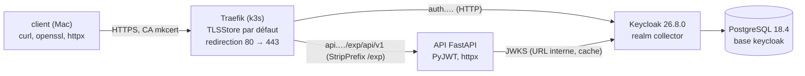

# Protocole d'expérimentation 2 — Keycloak, Traefik et TLS mkcert sur k3d

Exécution de référence : **03/11/2026 18:29** (`./run.sh`, code de sortie 0). Sortie complète versionnée : [`resultats/run-20261103-1829.log`](resultats/run-20261103-1829.log).

## 1. Objectif et question posée

**Question** : la chaîne d'accès du POC (HTTPS terminé par Traefik avec un certificat mkcert, redirection HTTP → HTTPS, Keycloak installé depuis son image officielle avec le realm `collector` importé au démarrage) permet-elle à un service FastAPI de valider **localement** un JWT (signature RS256 par JWKS, `iss`, `aud`, `exp`) puis les rôles, en rejetant avec le bon code (401 ou 403) chacun des jetons invalides testés ?

- **Méthode** : on déploie la chaîne dans un cluster k3d jetable, on obtient de vrais jetons de Keycloak, on fabrique des jetons invalides, et on compare, cas par cas, le code HTTP attendu au code obtenu.
- Critères de réussite : TLS 1.2 ou plus avec échec attendu sans la CA mkcert ; redirection 301 ou 308 ; les 15 cas de la matrice d'autorisation donnent le code attendu ; l'application récupère les clés JWKS par l'URL interne de Keycloak et les met en cache ; l'effet sur la validation de `iss` d'un jeton obtenu par l'URL interne est mesuré ; la mémoire et le disque sont relevés.
- Exigences visées : ENF-01 (TLS), ENF-02 (validation du JWT), ENF-03 (rôles) ; mesures S1 à S4 de `architecture-poc.md`, `contrats.md` §1.1 et §1.2.
- Hors périmètre : front React et PKCE dans un navigateur, BFF, CSP, limitation de débit, fédération Entra ID, cert-manager ACME, contrôles de propriété des ressources (phase 4).

## 2. Technologies testées et interactions

- **Traefik** (fourni par k3s, version 3.7.8) : terminaison TLS avec le certificat générique `*.127.0.0.1.sslip.io` (Secret TLS `mkcert-wildcard`, `TLSStore` `default`), redirection du point d'entrée `web` vers `websecure` (`HelmChartConfig`), `Middleware` `StripPrefix /exp`. Les deux `Ingress` n'écoutent que `websecure`.
- **Keycloak** : image officielle, `start --import-realm`, nom d'hôte public `https://auth.127.0.0.1.sslip.io`, HTTP dans le cluster (`KC_HTTP_ENABLED=true`), en-têtes `X-Forwarded-*` de Traefik (`KC_PROXY_HEADERS=xforwarded`). Le realm `collector` (`realm/collector-realm.json`) est rendu par `run.sh` avec les mots de passe générés, puis monté depuis un Secret.
- **PostgreSQL** : image officielle `postgres:18.4-alpine`, `StatefulSet` d'un réplica, volume `local-path`. Le script d'initialisation crée le rôle `keycloak` (sans droit de superutilisateur, de création de base ni de rôle) et la base `keycloak` dont il est propriétaire : c'est le mécanisme « un utilisateur par service » du POC (S5).
- **API de test** (`app/`) : `GET /api/v1/public`, `/me`, `/seller` (rôle `seller`). Clés JWKS récupérées par l'**URL interne** du Service Keycloak, mises en cache (600 s ; rechargement si un `kid` est inconnu, au plus une fois par 30 s) ; `iss` comparé à l'**URL publique** ; `aud = collector-api` ; `exp` ; RS256 imposé. Les rôles sont lus dans `realm_access.roles`. Chaque rejet est journalisé avec une raison (`reason`), jamais renvoyée au client.
- **Clients de test** (artefacts de l'expérience, voir §7) : `collector-tests` (avec le scope d'audience), `collector-tests-noaud` (sans), `collector-tests-short` (jeton de 10 s, pour le cas expiré). Le client public `collector-web` (Authorization Code + PKCE) est défini dans le realm mais n'est pas exercé.
- Sondes `/health/live` et `/health/ready` de l'API : joignables par le kubelet, **non routées** par l'ingress, car l'`Ingress` ne route que le préfixe `/exp/api/v1`.

## 3. Environnement

| Élément | Valeur |
| --- | --- |
| Machine | Mac Apple Silicon (arm64), macOS 26.6.2 |
| Docker Desktop | moteur 28.5.1, 10 CPU, 8 322 555 904 octets de mémoire, disque virtuel de 58,4 Go |
| k3d / kubectl | k3d v5.9.0 ; kubectl client v1.34.1 |
| Image k3s | `rancher/k3s:v1.35.8-k3s1` (27/08/2026) ; Traefik 3.7.8 fourni par k3s |
| mkcert | v1.4.4 (CA installée au préalable ; le script ne lance jamais `mkcert -install`) |
| Keycloak | `quay.io/keycloak/keycloak:26.8.0` (publiée le 01/10/2026) |
| PostgreSQL | `postgres:18.4-alpine` (dernière mise à jour du tag sur Docker Hub : 08/07/2026) |
| Application | Python 3.12 (`python:3.12-slim`), FastAPI 0.142.2, PyJWT 2.14.0 (11/09/2026), httpx 0.28.1, structlog 26.1.0, uvicorn 0.52.4, cryptography 50.0.2 (30/09/2026) et Starlette 1.10.0 (dépendances résolues par `app/uv.lock`), uv 0.13.6 |
| Outils de mesure | OpenSSL 4.1.0, curl 8.7.1, Python hôte 3.15.2 ; le client de test tourne sous Python 3.12.16 (uv) |
| Vérification du code | Ruff 0.17.3, mypy 2.4.1 (`--strict`) |
| Image utilitaire | `alpine:3.24.3` (mesure de l'espace disque de la VM Docker) |
| **Disque libre requis** | **au moins 7 Go** (`run.sh` refuse de démarrer sinon). L'exécution consomme 3,7 Go (53,5 Go libres avant, 49,8 Go après l'installation, 53,4 Go après la suppression du cluster) ; le kubelet évince les pods sous environ 3,1 Go libres (constaté à l'expérimentation 1) ; seuil = consommation + marge du kubelet, arrondi |

Aucun opérateur, aucune CRD ajoutée, aucun cert-manager, aucune image ni aucun chart Bitnami. Les ports 80 et 443 de l'hôte doivent être libres (le script s'arrête sinon).

## 4. Étapes reproductibles

Commande unique, depuis `docs/04-experimentations/02-keycloak-tls/` : `./run.sh` (option `--keep` pour garder le cluster). Prérequis : Docker Desktop démarré, `k3d`, `kubectl`, `uv`, `python3`, `perl`, `curl`, `openssl`, `lsof`, `mkcert` (CA déjà installée), 7 Go de disque libres, ports 80 et 443 libres. La sortie est écrite dans `resultats/run-AAAAMMJJ-HHMM.log`. Le certificat (clé privée comprise) et les mots de passe générés sont écrits dans `.local/`, ignoré par Git (`.gitignore` du dossier) ; ils ne sont jamais affichés.

| Étape | Ce que fait le script |
| --- | --- |
| 0 | Vérifie les outils, affiche les versions, vérifie que les ports 80 et 443 sont libres et le disque (7 Go) |
| 1 | Crée le certificat `*.127.0.0.1.sslip.io` s'il n'existe pas (jamais écrasé) ; génère les mots de passe (4 utilisateurs du realm, PostgreSQL, rôle `keycloak`, administrateur initial de Keycloak) |
| 2 | Cluster `collector-exp2` (1 server, 2 agents), ports 80 et 443 publiés sur le load balancer |
| 3 | Construit l'image de l'API (multi-stage, non-root), l'importe dans le cluster ; installe les dépendances du client de test (`uv sync`) |
| 4 | Secret TLS `mkcert-wildcard`, `HelmChartConfig` et `TLSStore` ; attend que Traefik redémarre avec la redirection |
| 5 | PostgreSQL : Secrets, ConfigMap d'initialisation, `StatefulSet` ; vérifie les droits des rôles |
| 6 | Rend le realm avec les mots de passe, le charge dans un Secret ; Deployment, Service et Ingress de Keycloak ; attend `https://auth…/realms/collector` |
| 7 | API de test : Deployment, Service, `Middleware`, Ingress ; relève mémoire et CPU au repos |
| Mesures 1 à 2 | Certificat présenté, version TLS, échec sans CA ; redirection |
| Mesure 3 | Matrice d'autorisation (`exp.client matrix`), puis raisons de rejet lues dans les journaux de l'API |
| Mesure 4 | Job dans le cluster : jeton obtenu par l'URL interne, puis appel de l'API avec ce jeton |
| Mesure 5 | 200 requêtes avec un même jeton ; compte des appels JWKS dans les journaux |
| Mesure 6 | Mémoire et CPU des pods, `kubectl top nodes`, disque |
| Fin (`trap`) | Supprime le cluster (sauf `--keep`), journalise l'espace disque, `k3d cluster list` et le code de sortie |

## 5. Résultats mesurés

Exécution du 03/11/2026 18:29 (sortie : `resultats/run-20261103-1829.log`).

**Mesure 1 : TLS.**

| Hôte | Sujet | Émetteur | Version | Sans la CA mkcert |
| --- | --- | --- | --- | --- |
| `auth.127.0.0.1.sslip.io` | organisation `O=mkcert development certificate`, SAN `DNS:*.127.0.0.1.sslip.io`, fin de validité 03/02/2029 | organisation `O=mkcert development CA` | TLS 1.3 (`TLS_AES_128_GCM_SHA256`), vérification OK avec la CA | échec : `CERTIFICATE_VERIFY_FAILED` (httpx, bundle certifi), code 20 d'OpenSSL |
| `api.127.0.0.1.sslip.io` | identique (même certificat) | identique | TLS 1.3, vérification OK | identique |

Le journal n'affiche que l'organisation du sujet et de l'émetteur (le CN et l'OU de mkcert contiennent le nom de l'utilisateur et celui de sa machine). curl avec la CA mkcert : `https://auth…/` répond 302 (probablement la redirection de la page d'accueil de Keycloak vers sa console ; non vérifié, sans effet sur les mesures), `https://api…/` répond 404 (aucune route sur `/`). Les deux hôtes présentent bien le certificat générique de mkcert.

**Mesure 2 : redirection.** `http://auth.127.0.0.1.sslip.io/realms/collector` → **301**, `Location: https://auth.127.0.0.1.sslip.io/realms/collector` ; `http://api.127.0.0.1.sslip.io/exp/api/v1/public` → **301** vers l'URL en `https://`. Dans les arguments de Traefik : `--entryPoints.web.http.redirections.entryPoint.to=:443`, `.scheme=https`, `.permanent=true`.

**Mesure 3 : matrice d'autorisation** (15 cas, 15 conformes) ; la raison de rejet est lue dans les journaux de l'API (jamais renvoyée au client).

| N° | Cas | Attendu | Obtenu | Raison journalisée par l'API |
| --- | --- | --- | --- | --- |
| 1 | `/public` sans jeton | 200 | 200 | — |
| 2 | `/me` sans jeton | 401 | 401 | `missing_token` |
| 3 | `chloe` (buyer) sur `/me` | 200 | 200 | — |
| 4 | `chloe` (buyer) sur `/seller` | 403 | 403 | `missing_role_seller` |
| 5 | `bob` (seller) sur `/seller` | 200 | 200 | — |
| 6 | `alice` (seller, buyer) sur `/seller` | 200 | 200 | — |
| 7 | `admin` sur `/seller` | 403 | 403 | `missing_role_seller` |
| 8 | jeton sans l'audience `collector-api` | 401 | 401 | `missing_claim_aud` |
| 9 | signature altérée (un caractère de la signature remplacé) | 401 | 401 | `invalid_signature` |
| 10 | signé par une autre clé RSA, `kid` inconnu | 401 | 401 | `unknown_kid` |
| 11 | signé par une autre clé RSA, `kid` du realm | 401 | 401 | `invalid_signature` |
| 12 | algorithme `none` | 401 | 401 | `invalid_algorithm` |
| 13 | `/exp/health/live` par l'ingress (non routé) | 404 | 404 | — (Traefik) |
| 14 | jeton de 10 s, avant expiration | 200 | 200 | — |
| 15 | même jeton, rejoué 11 s plus tard | 401 | 401 | `token_expired` |

Le jeton du cas 8 (client `collector-tests-noaud`) ne porte aucun claim `aud` : le rejet vient de l'absence de l'audience, pas d'une audience différente. Tous les 401 portent le même titre « Non authentifié » : la raison (expiré, signature, audience…) n'est que dans les journaux de l'API. Les cas 12 et 13 vont au-delà du brief (algorithme imposé, sondes non routées). Le jeton court (cas 14 et 15) vient d'un client de test dont le jeton vit 10 s ; les autres jetons vivent 300 s.

**Mesure 4 : `iss`.**

| Jeton obtenu par | `iss` | `aud` | Appel de l'API avec ce jeton |
| --- | --- | --- | --- |
| l'URL publique (`https://auth.127.0.0.1.sslip.io`, depuis le Mac) | `https://auth.127.0.0.1.sslip.io/realms/collector` | `collector-api` | 200 (cas 3) |
| l'URL interne (`http://keycloak-service.keycloak.svc.cluster.local:8080`, depuis un Job du cluster) | `https://auth.127.0.0.1.sslip.io/realms/collector` | `collector-api` | **200** |

Les deux `iss` sont **identiques** : un jeton obtenu par l'URL interne est accepté par l'API qui compare `iss` à l'URL publique. Hypothèse, non testée en changeant l'option : `KC_HOSTNAME` donné sous forme d'URL complète fixe l'URL publique de Keycloak, utilisée dans `iss` quelle que soit l'URL d'appel. Aucune option de Keycloak n'a été modifiée pour obtenir ce résultat.

**Mesure 5 : JWKS.** Un seul appel JWKS (`reason: cache_empty`, `url: http://keycloak-service.keycloak.svc.cluster.local:8080/realms/collector/protocol/openid-connect/certs`, statut 200, un `kid`) pour 216 requêtes HTTP journalisées par l'API depuis son démarrage, dont 200 avec un même jeton (compteur identique avant et après ce lot : 1 et 1). Toutes les URL de récupération des clés dans les journaux sont internes. Les cas de rejet avant la recherche de clé (sans jeton, algorithme `none`) ne passent pas par le cache. Le cas 10 (`kid` inconnu) n'a pas déclenché de rechargement : il survient pendant la matrice, peu après le premier appel, donc dans la fenêtre de 30 s sans rechargement (écart non chiffré : les lignes de requête du journal publié ne sont pas horodatées) ; le rechargement sur `kid` inconnu (rotation des clés) n'est pas exercé en tant que tel (voir §7).

**Mesure 6 : ressources** (`kubectl top pods`, metrics-server de k3s).

| Composant | Au repos (60 s après le démarrage de l'API) | Après les mesures |
| --- | --- | --- |
| Keycloak (1 pod) | 581 Mi, 20 m CPU | 596 Mi, 98 m CPU |
| PostgreSQL (`postgres-0`) | 56 Mi, 6 m CPU | 57 Mi, 6 m CPU |
| Traefik | 25 Mi, 1 m CPU | 25 Mi, 9 m CPU |
| API de test | 41 Mi, 5 m CPU | 42 Mi, 15 m CPU |
| **Total relevé** | **703 Mi, 32 m CPU** | **720 Mi, 128 m CPU** |

Le relevé « au repos » est pris 60 s après la première réponse 200 de l'API (`/public`), Keycloak étant prêt depuis plus longtemps. (Une exécution précédente, relevée sans attente pendant l'initialisation de Keycloak, avait donné 470 Mi et plus de 3 000 m CPU pour Keycloak : ce relevé n'est pas retenu.) `kubectl top nodes` en fin de mesures : server 873 Mi, agents 255 Mi et 890 Mi. Disque : 3,7 Go consommés (53,5 → 49,8 Go libres), 53,4 Go libres après la suppression du cluster ; le journal se termine par `k3d cluster list` (liste vide) et « Code de sortie de run.sh : 0 ».

**PostgreSQL** (vérifié à l'étape 5) : PostgreSQL 18.4 ; rôle `keycloak` : superutilisateur non, création de base non, création de rôle non ; base `keycloak` dont le propriétaire est `keycloak` ; rôle `postgres` : superutilisateur oui.

## 6. Difficultés rencontrées et solutions

| Difficulté | Cause | Solution |
| --- | --- | --- |
| **Essai avec les opérateurs, abandonné** : le pod de l'opérateur Keycloak 26.8.0 est en `CrashLoopBackOff` (« Informer startup error », ressource introuvable) ; le disque descend à 3,4 Go libres avant même l'import du realm | Les CRD `keycloakoidcclients` et `keycloaksamlclients`, en plus des deux CRD du brief, sont indispensables au démarrage de l'opérateur ; la pile avec CloudNativePG consommait plus de 4,5 Go à mi-parcours (cause non décomposée) | Décision du 03/11/2026 : images officielles et manifestes simples, sans opérateur, sans CRD ajoutée. Les mesures de ce protocole portent sur cette version |
| Le port 80 de l'hôte était occupé (`com.docker.backend`) | Un cluster kind de l'utilisateur publiait les ports 80 et 443 | Le script s'arrête dès l'étape 0 ; relancé une fois les ports libérés |
| Keycloak resté `Running` mais jamais prêt, l'exécution attendait sans fin | Les sondes visaient le port de gestion 9000 en `HTTPS` ; sans certificat côté Keycloak (TLS terminé par Traefik), l'événement relevé est « server gave HTTP response to HTTPS client » | Sondes en HTTP ; délais bornés et message d'échec explicite sur chaque attente |
| **Tous les jetons étaient rejetés** : le jeton n'avait ni `realm_access` ni (sans le scope d'audience) de claim `aud`, et le Job interne obtenait 401 | Le realm importé ne contenait que `offline_access` et `collector-api-audience` comme *client scopes* (liste relevée par l'API d'administration) : les scopes `roles` et `basic` manquaient. Hypothèse : définir `clientScopes` dans le JSON d'import désactive la création des scopes par défaut | Les scopes `basic`, `roles`, `web-origins` et `acr` (exportés d'un realm vierge du même Keycloak) sont ajoutés au JSON ; `profile` et `email` ne sont pas repris, l'API n'en a pas besoin |
| curl accepte le certificat même avec `--cacert /etc/ssl/cert.pem` (code de sortie 0, premier essai) | curl de macOS (SecureTransport) consulte aussi le trousseau système, où `mkcert -install` a placé la CA | L'échec sans la CA est démontré avec httpx (bundle certifi) et OpenSSL |
| `ModuleNotFoundError: exp` pour le client de test sur l'hôte | Le fichier `.pth` de l'installation éditable est marqué « hidden » par macOS ; Python l'ignore (« Skipping hidden .pth file ») | `uv sync --no-install-project` puis `PYTHONPATH=app/src` ; `uv run` 0.13.6 n'a pas l'option `--no-install-project` |
| Les sondes de l'API auraient été joignables par l'ingress si l'`Ingress` routait `/exp` | Avec `StripPrefix`, `/exp/health/live` devient `/health/live` | L'`Ingress` ne route que `/exp/api/v1` : `/exp/health/live` donne 404 (cas 13). Les `Ingress` du POC devront router `/catalog/api/v1` et `/notification/api/v1` |

## 7. Limites de l'expérimentation

- **Le client de test utilise le flux Resource Owner Password** (*Direct Access Grants* sur `collector-tests*`) : déconseillé par la RFC 9700 et différent du flux du front (Authorization Code + PKCE, défini dans le realm mais **non exercé** : aucun navigateur, aucun redirect URI, aucune vérification de PKCE). Les trois clients de test (dont un avec un jeton de 10 s) sont des artefacts qui ne doivent pas entrer dans le realm du POC.
- **Un seul réplica** de Keycloak, de PostgreSQL et de l'API ; aucune haute disponibilité, aucun cache distribué Infinispan testé.
- **TLS jusqu'à Traefik seulement** : Traefik parle HTTP à Keycloak et à l'API, à l'intérieur du cluster ; pas de mTLS, pas de TLS vers PostgreSQL. `KC_PROXY_HEADERS=xforwarded` fait confiance aux en-têtes `X-Forwarded-*` de tout appelant atteignant Keycloak dans le cluster (aucune restriction par adresse n'est configurée).
- **Certificat mkcert** : valable seulement sur le Mac où la CA est installée ; la résolution `*.127.0.0.1.sslip.io` suppose un accès Internet (DNS) ; ce n'est pas un certificat de production.
- **Hypothèses non testées** : (1) la présence de `clientScopes` dans le JSON d'import désactiverait la création des *client scopes* par défaut (expliquerait l'absence de `roles` et `basic`) : constaté, mais le mécanisme n'a pas été vérifié, par exemple en important le même realm sans `clientScopes` ; (2) `KC_HOSTNAME` en URL complète fixerait l'URL publique utilisée dans `iss` : le résultat est mesuré (mesure 4), pas l'effet de l'option, qui n'a pas été modifiée pour comparer.
- **Rotation des clés non testée** : le rechargement du JWKS sur `kid` inconnu, après plus de 30 s, et l'expiration du cache de 600 s ne sont pas exercés ; le cas 10 ne prouve que le rejet d'un `kid` inconnu dans la fenêtre sans rechargement.
- **Révocation** : un jeton valide reste accepté jusqu'à son expiration (300 s), puisque la validation est locale (ADR 0004) ; non testé.
- **Secrets** : les mots de passe sont dans des Secrets Kubernetes (encodés, non chiffrés) et dans `.local/` ; l'administrateur initial de Keycloak et la console d'administration sont sur le même hôte public que le realm (`auth.…`) : à restreindre dans la cible.
- **Realm importé une seule fois** : `--import-realm` ignore un realm déjà présent ; un changement du JSON ne s'applique pas à une base existante. PostgreSQL sans sauvegarde ni réplication.
- **Pas de test de charge, une seule exécution de référence** : les relevés de mémoire et de CPU datent de deux instants (avant et après les mesures), sans pic ni répétition. Le démarrage de Keycloak (durée, CPU) n'est pas mesuré.
- **Protection contre la force brute, MFA, politique de mots de passe** : non testées (le realm active `bruteForceProtected`, sans vérification).

## 8. Décision

**Adoption de la chaîne** pour le POC : Traefik de k3s avec certificat mkcert par défaut et redirection permanente (301), Keycloak 26.8.0 et PostgreSQL 18.4 en images officielles, validation locale des JWT par PyJWT. Les 15 cas de la matrice donnent le code attendu ; un jeton obtenu par l'URL interne passe la validation d'`iss` ; un seul appel JWKS a servi 216 requêtes, par l'URL interne.

Conditions et enseignements pour le POC :
- Reprendre dans le realm du POC les *client scopes* `roles`, `basic`, `web-origins`, `acr` et le scope d'audience `collector-api` ; ne pas reprendre les clients de test.
- Router chaque service par `/<service>/api/v1` pour que `/health/*` et `/metrics` restent hors de l'ingress.
- Sondes de Keycloak en HTTP sur le port 9000 ; `KC_HOSTNAME` en URL complète ; valider `iss` avec l'URL publique et récupérer les clés par l'URL interne (conforme à `contrats.md` §1.2).
- Un utilisateur PostgreSQL par service, créé par le script d'initialisation, sans droit de superutilisateur (S5).
- Mémoire de l'ensemble Keycloak, PostgreSQL, Traefik et API : environ 700 Mi (703 Mi au repos), à ajouter à celle de RabbitMQ (expérimentation 1) et de la pile d'observabilité (expérimentation 3).
- Cible : TLS jusqu'aux pods (mTLS), Keycloak à plusieurs réplicas, PostgreSQL répliqué et sauvegardé, restriction de la console d'administration, test de la rotation des clés et du flux PKCE avec le front.

L'ADR 0004 (Keycloak) est confirmée sur la validation locale du jeton et les cas 401 et 403 ; la vérification du flux PKCE dans un navigateur, prévue par sa section « Confirmation », reste à faire avec le front. Le choix d'installer l'infrastructure par les images officielles et des manifestes simples sera consigné dans l'ADR 0008 (P3-05).
