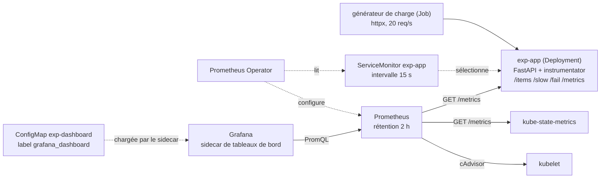

# Protocole d'expérimentation 3 — Observabilité avec kube-prometheus-stack sur k3d

Exécution de référence : **02/11/2026 22:43** (`./run.sh`, code de sortie 0). Sortie complète versionnée : [`resultats/run-20261102-2243.log`](resultats/run-20261102-2243.log).

## 1. Objectif et question posée

**Question** : kube-prometheus-stack, installé en version allégée sur k3d, collecte-t-il les métriques d'un service FastAPI instrumenté et restitue-t-il **exactement** les indicateurs du POC (débit, latence p95, taux d'erreur) dans Prometheus et dans un tableau de bord Grafana versionné, pour un coût en mémoire compatible avec un poste de 8 Go ?

- **Méthode** : une application de test aux comportements connus reçoit une charge dont le nombre de requêtes, les proportions et la durée sont connus. Ces valeurs injectées sont la **vérité terrain** à laquelle on compare ce que Prometheus restitue.
- Critères de réussite : les compteurs de Prometheus égalent le nombre de requêtes envoyées ; le débit et le taux d'erreur calculés par PromQL s'écartent de moins de 5 % des valeurs injectées ; les deux requêtes d'infrastructure (réplicas, CPU par pod) renvoient une valeur ; l'écart du p95 est mesuré et expliqué ; la source de données Grafana répond et le tableau de bord versionné est chargé sans action manuelle ; la mémoire de la pile est relevée (ENF-15 : ressources bornées, consommation suivie dans Grafana ; les valeurs de latence et d'erreur relèvent de l'indicateur I3 de `docs/01-qualite/indicateurs.md`, ENF-12 et ENF-13). Le seuil de 5 % a été fixé pour ce protocole : il n'est pas tiré d'une exigence.
- Charge injectée : 3 000 requêtes à 20 par seconde pendant 150 s, en cycle de 20 requêtes : 17 `GET /items` (85 %), 2 `GET /slow` (10 %, attente fixe de 200 ms), 1 `GET /fail` (5 %, réponse 500).

## 2. Technologies testées et interactions

- **k3d / k3s** : cluster Kubernetes local (1 server, 2 agents, Traefik désactivé).
- **kube-prometheus-stack** : chart qui installe l'opérateur Prometheus, Prometheus, Grafana, kube-state-metrics et la collecte du kubelet (cAdvisor), ces deux derniers pour afficher les réplicas et le CPU des pods lors de la démo de montée en charge du POC (critère 5). Le **ServiceMonitor** est un objet que l'opérateur traduit en configuration de collecte de Prometheus.
- **prometheus-fastapi-instrumentator** : expose `/metrics` (compteur `http_requests_total`, histogrammes de durée). Deux histogrammes sont enregistrés sur la durée des requêtes, avec des bornes différentes : celui de la bibliothèque (`http_request_duration_seconds`, bornes 0,1 / 0,5 / 1 s, par route) et un histogramme « serré » ajouté pour l'expérience (`http_request_duration_fine_seconds`, bornes 0,05 / 0,1 / 0,2 / 0,25 / 0,3 / 0,5 / 1 / 2,5 s).
- **structlog** : journaux JSON, avec `X-Request-ID` repris ou généré et écrit dans le champ `correlation_id` (`contrats.md` §1).
- **Tableau de bord** : `dashboards/collector-service.json`, publié dans une ConfigMap par `run.sh` ; cinq panneaux : débit, taux d'erreur, latence p95, réplicas du Deployment de l'application (kube-state-metrics), CPU par pod (cAdvisor, via le kubelet).
- **Requêtes PromQL** : `run.sh` ne les recopie pas, il **les lit dans le tableau de bord chargé par Grafana** (API `/api/dashboards/uid/...`) et les évalue dans Prometheus. Les mesures 1 à 3 utilisent donc exactement les requêtes des panneaux.

## 3. Environnement

| Élément | Valeur |
| --- | --- |
| Machine | Mac Apple Silicon (arm64), macOS 26.6.2 |
| Python de l'hôte | 3.15.2 (`python3`, utilisé par `run.sh` pour les calculs et les appels d'API) ; uv 0.13.6 |
| Docker Desktop | moteur 28.5.1, 10 CPU, 8 322 555 904 octets de mémoire, disque virtuel de 58,4 Go |
| k3d | v5.9.0 |
| kubectl | client v1.34.1 |
| Helm | v4.3.1 |
| Image k3s | `rancher/k3s:v1.35.8-k3s1` (publiée le 27/08/2026) |
| Chart | `kube-prometheus-stack` **91.9.0** (02/10/2026), installé depuis le registre OCI `oci://ghcr.io/prometheus-community/charts/kube-prometheus-stack` (aucun `helm repo add` nécessaire) ; `values/kube-prometheus-stack.yaml` |
| Images déployées par le chart | Prometheus `v3.15.0-distroless`, prometheus-operator et prometheus-config-reloader `v0.94.1`, Grafana `13.2.3-distroless`, k8s-sidecar `2.11.2`, kube-state-metrics `v2.20.0` (liste relevée par `run.sh`) |
| Application | Python 3.12 (`python:3.12-slim`), FastAPI 0.142.2 (30/09/2026), prometheus-fastapi-instrumentator 8.1.0 (26/07/2026), structlog 26.1.0 (06/06/2026), httpx 0.28.1 (06/12/2024), uvicorn 0.52.4 (19/08/2026), prometheus-client 0.26.0 et Starlette 1.10.0 (dépendances résolues par `app/uv.lock`), uv 0.13.6 dans l'image |
| Image utilitaire | `alpine:3.24.3` (mesure de l'espace disque de la VM Docker par `docker run --rm alpine:3.24.3 df`) |
| Vérification du code | Ruff 0.17.3, mypy 2.4.1 (`--strict`) |
| **Disque libre requis** | **au moins 7 Go** (`run.sh` refuse de démarrer sinon). L'expérimentation en consomme 3,7 Go (7,9 Go libres avant, 4,2 Go après le téléchargement des images de la pile, 7,9 Go de nouveau après la suppression du cluster, relevé par le `trap` de `run.sh`) ; le kubelet évince les pods sous environ 3,1 Go libres (constaté à l'expérimentation 1) |

Aucune image ni aucun chart Bitnami. Le mot de passe de Grafana est généré par le chart et lu dans le Secret `kps-grafana` par `run.sh` ; il n'est ni écrit dans le dépôt ni affiché dans le journal.

## 4. Étapes reproductibles

Commande unique, depuis `docs/04-experimentations/03-observabilite/` : `./run.sh` (option `--keep` pour garder le cluster). Prérequis : Docker Desktop démarré avec 8 Go, `k3d`, `kubectl`, `helm`, `uv`, `python3`, `perl`, `curl`, 7 Go de disque libre. Le script écrit sa sortie complète dans `resultats/run-AAAAMMJJ-HHMM.log`. Durée de l'exécution de référence : environ 8 minutes (22:43 à 22:51).

| Étape | Ce que fait le script |
| --- | --- |
| 0 | Vérifie les outils, affiche la date et les versions, s'arrête sous 7 Go libres |
| 1 | Crée le cluster `collector-exp3` (1 server, 2 agents, Traefik désactivé) |
| 2 | Construit l'image de l'application et l'importe dans le cluster (`k3d image import`) |
| 3 | `helm upgrade --install kps` du chart 91.9.0 avec les valeurs allégées, attend le pod Prometheus |
| 4 | Déploie l'application, le ServiceMonitor et la ConfigMap du tableau de bord (label `grafana_dashboard=1`) |
| 5 | Attend `up{job="exp-app"} = 1`, laisse 30 s à metrics-server, relève la mémoire de la pile au repos |
| Mesure 4 | 5 requêtes `/items` isolées ; mesure le temps avant que le compteur augmente dans Prometheus (pauses inégales entre essais) |
| 6 | Job de charge : 3 000 requêtes à 20 par seconde ; attend 45 s (trois cycles de collecte de 15 s), relève la mémoire |
| 7 | Grafana : `/api/health`, santé de la source de données, `/api/search`, lecture des requêtes des panneaux |
| Mesures 1 à 3 | Évalue dans Prometheus, à l'instant de fin de la charge, les requêtes lues dans Grafana, et les compare aux valeurs injectées ; évalue aussi les requêtes des panneaux 4 et 5 (le script s'arrête si l'une ne renvoie rien) |
| 8 | Vérifie le journal JSON et l'en-tête `X-Request-ID` |
| Synthèse | Espace disque, `kubectl top nodes`, suppression du cluster (sauf `--keep`) |
| Fin (`trap`) | Journalise l'espace disque après la suppression, la sortie de `k3d cluster list` et le code de sortie du script |

Les requêtes de la mesure 4 (5 requêtes `/items`) s'ajoutent à la charge dans le compteur : Prometheus doit donc compter 2 555 requêtes `/items`. Grafana, Prometheus et l'application sont joints par `kubectl port-forward` (pas d'ingress ni de TLS ici : c'est l'expérimentation 2). Les horodatages de la charge viennent de l'horloge du cluster, celle des requêtes de Prometheus aussi ; la mesure 4 n'utilise que l'horloge du Mac.

## 5. Résultats mesurés

Exécution du 02/11/2026 22:43 (sortie : `resultats/run-20261102-2243.log`).

**Compteurs** (`sum by (handler) (http_requests_total{job="exp-app"})`, après la charge) :

| Route | Envoyées | Prometheus | Écart |
| --- | --- | --- | --- |
| `/items` (2 550 de la charge + 5 de la mesure 4) | 2 555 | 2 555 | 0 |
| `/slow` | 300 | 300 | 0 |
| `/fail` | 150 | 150 | 0 |

**Mesures 1 à 3** (requêtes des panneaux Grafana, évaluées à l'instant de fin de la charge, fenêtre `[1m]`) :

| Mesure | Injecté | Prometheus | Écart | Écart relatif |
| --- | --- | --- | --- | --- |
| 1. Débit (requêtes/s) | 20,00 | 19,979 | −0,021 | −0,1 % |
| 2. Taux d'erreur 5xx | 5,00 % | 5,006 % | +0,006 point | +0,1 % |
| 3a. p95 de `/slow`, bornes serrées (panneau 3, requête B) | 0,200 s | 0,2474 s | +0,0474 s | +23,7 % |
| 3b. p95 de `/slow`, bornes par défaut de la bibliothèque (requête C) | 0,200 s | 0,4800 s | +0,2800 s | +140,0 % |
| 3c. p95 de toutes les routes, bornes serrées (requête A) | 0,200 s | 0,2239 s | +0,0239 s | +11,9 % |

Le « injecté » de la latence est l'attente de `/slow` (200 ms), qui est aussi la valeur théorique du p95 de toutes les routes : `/items` et `/fail` (90 % des requêtes) sont quasi instantanés, les 10 % de requêtes lentes occupent donc les rangs 90 à 100 %, et le 95ᵉ centile tombe au milieu d'elles. Latence p95 mesurée **côté client** (httpx, générateur de charge) : `/slow` 0,2087 s, `/items` 0,0072 s, `/fail` 0,007 s, toutes routes 0,205 s. Le client voit 9 ms de plus que l'attente injectée (surcoût du réseau, du serveur et du client ; cause non décomposée).

**Effet des bornes de l'histogramme.** `histogram_quantile` ne connaît que le nombre de requêtes sous chaque borne ; il suppose les durées réparties de façon uniforme dans le seuil qui contient le quantile.
- Bornes de la bibliothèque (0,1 / 0,5 / 1 s) : toutes les requêtes `/slow` (≈ 0,2 s) tombent dans l'intervalle ]0,1 ; 0,5], d'où `0,1 + (0,5 − 0,1) × 0,95 = 0,48 s`, exactement la valeur lue (0,4800 s), soit +140 % : l'estimation dépend de la largeur de l'intervalle, pas de la mesure.
- Bornes serrées : elles tombent dans ]0,2 ; 0,25] (l'attente de 200 ms et le surcoût dépassent 0,2 s), d'où `0,2 + 0,05 × 0,95 = 0,2475 s`, valeur lue : 0,2474 s (+23,7 %). Toutes routes : 90 % des requêtes sont sous 0,05 s et les 10 % lentes dans ]0,2 ; 0,25], le rang 95 % est au milieu de l'intervalle : `0,2 + 0,05 × 0,5 = 0,225 s`, valeur lue : 0,2239 s.
- **Écarts résiduels** (0,1 ms pour 3a, 1,1 ms pour 3c) : hypothèse non vérifiée. `rate` extrapole les compteurs aux bords de la fenêtre d'une minute et les instants de collecte (toutes les 15 s) ne coïncident pas avec ses bords, de sorte que les parts de requêtes rapides et lentes vues dans la fenêtre ne sont pas exactement 90 % et 10 %. Le taux d'erreur lu (5,006 %) va dans ce sens : la part vue de `/fail` n'est pas exactement 5 %.
- Une borne plus proche de la vraie valeur (par exemple 0,21 s) réduirait l'écart. Le p95 d'un histogramme est donc un encadrement, pas une mesure exacte.

**Mesure 4 : délai de collecte** (5 essais, intervalle du ServiceMonitor 15 s) :

| Essai | 1 | 2 | 3 | 4 | 5 |
| --- | --- | --- | --- | --- | --- |
| Visible dans Prometheus après | 13,12 s | 11,78 s | 7,41 s | 13,11 s | 3,69 s |

Minimum 3,69 s, moyenne 9,82 s, maximum 13,12 s : tous inférieurs à l'intervalle de 15 s.

**Grafana** : `/api/health` répond (version 13.2.3, base `ok`) ; la source de données `prometheus` répond « Successfully queried the Prometheus API » (statut `OK`) ; `/api/search?query=Collector` renvoie le tableau de bord `collector-service` (« Collector - service de test »), chargé par le sidecar sans action manuelle ; il contient 5 panneaux. Les requêtes des panneaux 1 à 3 sont celles évaluées pour les mesures 1 à 3.

**Panneaux d'infrastructure** (requêtes lues dans Grafana, évaluées à la fin de la charge) : `kube_deployment_status_replicas{namespace="exp",deployment="exp-app"}` renvoie 1 ; `sum by (pod) (rate(container_cpu_usage_seconds_total{namespace="exp",pod=~"exp-app-.*",container!=""}[1m]))` renvoie 0,042 cœur pour le pod `exp-app-6cfb689b79-l6gzg`. Les deux requêtes renvoient une valeur ; leur exactitude n'est pas comparée à une vérité terrain.

**Journaux** : l'en-tête `X-Request-ID: exp3-corr-check` est renvoyé, et la même valeur figure dans le champ `correlation_id` de la ligne JSON de l'application.

**Ressources** (`kubectl top pods`, metrics-server de k3s ; somme des conteneurs de chaque pod) :

| Pod (espace `monitoring`) | Au repos, avant la charge | Juste après la charge |
| --- | --- | --- |
| kps-grafana (Grafana + 2 sidecars) | 403 Mi | 377 Mi |
| kps-kube-state-metrics | 16 Mi | 16 Mi |
| kps-operator | 17 Mi | 19 Mi |
| prometheus-kps-prometheus-0 (Prometheus + config-reloader) | 164 Mi | 200 Mi |
| **Total de la pile** | **600 Mi, 45 m CPU** | **612 Mi, 57 m CPU** |
| exp-app (hors pile) | 56 Mi | 56 Mi |

`kubectl top nodes` en fin de mesures : server 1 064 Mi, agents 281 Mi et 957 Mi (le nœud server porte aussi le plan de contrôle de k3s ; la répartition des pods sur les agents n'est pas imposée). Disque : 3,7 Go consommés (7,9 Go libres avant, 4,2 Go après le téléchargement des images de la pile, 7,9 Go après la suppression du cluster). Le journal se termine par `k3d cluster list` (liste vide) et « Code de sortie de run.sh : 0 ».

## 6. Difficultés rencontrées et solutions

| Difficulté | Cause | Solution |
| --- | --- | --- |
| **Le pod de l'opérateur restait en `ContainerCreating`** ; `helm --wait` a expiré après 10 min (`Available: 0/1`) | Événement relevé : `MountVolume.SetUp failed for volume "tls-secret" : secret "kps-admission" not found`. Le Secret de ce certificat est créé par le Job « certgen » du chart, qui n'existe pas quand les webhooks d'admission sont désactivés (`prometheusOperator.admissionWebhooks.enabled: false`) | `prometheusOperator.tls.enabled: false` dans les valeurs. L'opérateur démarre, sans TLS sur son propre point d'entrée |
| Le premier essai de la mesure 4 donnait des délais presque identiques (10,56 à 11,40 s sur 5 essais, exécution intermédiaire du même jour, journal non conservé) | Les essais étaient espacés d'environ 15 s, soit l'intervalle de collecte : chacun retombait au même point du cycle | Pauses inégales entre les essais (3,1 / 7,7 / 1,9 / 11,3 s), d'où les 3,69 à 13,12 s de l'exécution de référence |
| L'expérimentation consomme 3,7 Go de disque, plus que les 1,8 Go de l'expérimentation 1 | Non analysé. Hypothèse : les images de la pile (Grafana, Prometheus, sidecars) sont chargées sur chaque nœud qui les exécute | Seuil du script relevé à 7 Go libres (avec 4 Go libres au départ, il resterait environ 0,3 Go à la fin, sous le seuil d'éviction du kubelet) |
| Le cluster n'est plus disponible pour diagnostiquer après un échec | `run.sh` supprime le cluster à la sortie, y compris en cas d'erreur | Relance avec `--keep` pour inspecter les événements du pod |
| Le chart du dépôt Helm `prometheus-community` publie une version toutes les quelques heures (92.17.0 le 31/10/2026) | Cadence de publication du chart | Version figée à 91.9.0, publiée le 02/10/2026 |

## 7. Limites de l'expérimentation

- **Une seule application, un seul réplica, un seul processus uvicorn** : les mesures ne portent pas sur l'agrégation de plusieurs pods (démo de disponibilité du critère 5, phase 8). Les requêtes `sum(...)` du tableau de bord ne sont pas vérifiées sur plusieurs séries, ni le panneau des réplicas avec plusieurs réplicas ou un HPA (le panneau 4 lit le Deployment, pas un HPA).
- **Charge modeste et régulière** : 20 req/s pendant 150 s, à cadence fixe. Ce n'est pas un test de charge. Les écarts de 0,1 % sur le débit et le taux d'erreur tiennent à la régularité de la charge et à la fenêtre de 1 minute évaluée à la fin de la charge ; une charge irrégulière donnerait des écarts plus grands. Ces valeurs ne démontrent pas que Prometheus est exact en général, seulement qu'il restitue une charge connue.
- **Le p95 est une estimation** (voir §5) : les bornes de l'histogramme fixent la précision. L'estimation est fiable ici parce que les valeurs injectées sont connues et que les bornes ont été choisies pour les encadrer. Les bornes à retenir pour le POC sont à fixer en fonction des seuils de l'indicateur I3 (300 ms et 500 ms) : une borne exactement sur chaque seuil permet de vérifier le seuil sans interpolation.
- **Le tableau de bord n'est pas vérifié visuellement** : `run.sh` contrôle qu'il est chargé, qu'il a 3 panneaux et que leurs requêtes donnent les valeurs attendues dans Prometheus, mais pas qu'ils s'affichent correctement dans Grafana (aucune capture ni requête passée par le proxy de Grafana).
- **Le délai de collecte repose sur 5 essais** : une estimation, pas une distribution. Le maximum attendu est l'intervalle de collecte (15 s), plus le temps d'évaluation de la requête.
- **Pile allégée : ce qui reste désactivé, et pourquoi.** Le total de 600 Mi (au repos) est celui de cette pile, pas d'une supervision complète du cluster : il grossirait avec les composants ci-dessous.
  - Alertmanager et règles d'alerte et d'enregistrement par défaut (`defaultRules`) : le POC n'a pas d'alertes (CLAUDE.md : « sans Alertmanager »). Les règles n'ont de sens qu'avec lui.
  - node-exporter (métriques de la machine, un pod par nœud) : la démo de disponibilité n'a besoin que des réplicas et du CPU des pods, fournis par kube-state-metrics et cAdvisor.
  - API server, controller-manager, scheduler, kube-proxy, etcd et CoreDNS : supervision du plan de contrôle, hors du besoin du POC. Leur coût n'est pas mesuré.
  - Webhooks d'admission et TLS de l'opérateur : retirent le Job « certgen » et une image ; l'opérateur ne valide donc pas les règles et sert sans TLS (voir §6).
  - Tableaux de bord par défaut du chart (`defaultDashboardsEnabled: false`) : seul le tableau de bord versionné est chargé, avec 5 panneaux.
  - Stockage persistant (voir plus bas).
- **Aucun stockage persistant** : Prometheus et Grafana utilisent des volumes `emptyDir`, rétention de 2 h. Tout est perdu au redémarrage du pod.
- **Accès par `port-forward`, sans authentification de Prometheus** : l'exposition par l'ingress et le TLS relèvent de l'expérimentation 2 ; la protection de Prometheus et de Grafana dans le cluster n'est pas traitée.
- **Une seule exécution de référence**, sans répétition statistique : les durées et la mémoire dépendent de la machine et du moment.
- **Mémoire mesurée à deux instants seulement** (avant et après la charge) : le pic de Prometheus pendant la charge n'est pas relevé. La mémoire de Prometheus passe de 164 à 200 Mi entre les deux relevés ; la cause n'est pas analysée.
- **Logs** : vérifiés sur le format JSON et `X-Request-ID` seulement. La centralisation des logs et les traces distribuées sont hors périmètre.

## 8. Décision

**Adoption de kube-prometheus-stack, en version allégée, pour le POC**, avec les conditions suivantes.

- Sur la charge injectée de 3 000 requêtes, les compteurs de Prometheus égalent exactement les requêtes envoyées (écart 0), et le débit (−0,1 %) et le taux d'erreur (+0,1 %) calculés par PromQL s'écartent de moins de 5 % des valeurs injectées. Grafana charge le tableau de bord versionné par son sidecar, sans action manuelle ; les requêtes des panneaux « réplicas » et « CPU par pod » renvoient une valeur, ce dont la démo de montée en charge (critère 5) a besoin.
- Le **p95 doit être lu avec les bornes de l'histogramme** : avec les bornes par défaut de l'instrumentator (0,1 / 0,5 / 1 s), le p95 de 200 ms est lu à 480 ms (+140 %). Le POC doit définir ses propres bornes, alignées sur les seuils de l'indicateur I3 (300 ms et 500 ms), comme l'histogramme `http_request_duration_fine_seconds` de cette expérimentation.
- **Coût mesuré** : environ 600 Mi de mémoire pour la pile retenue (au repos : Grafana 403 Mi avec ses sidecars, Prometheus 164 Mi, kube-state-metrics 16 Mi, opérateur 17 Mi ; 612 Mi après la charge), 3,7 Go de disque pendant l'expérimentation (ENF-15). Sur le Mac de 8 Go de Lucas, ce coût s'ajoute à celui de RabbitMQ (environ 126 Mi), de Keycloak, de PostgreSQL et des deux services ; la tenue de l'ensemble n'est pas mesurée ici.
- Le ServiceMonitor avec intervalle de 15 s suffit : les mesures sont visibles en moins de 15 s (maximum observé : 13,12 s).
- Pour le POC, les valeurs de `values/kube-prometheus-stack.yaml` sont reprises comme point de départ : kube-state-metrics et collecte du kubelet activés, Alertmanager et règles par défaut désactivés, webhooks et TLS de l'opérateur désactivés, `serviceMonitorSelectorNilUsesHelmValues: false`, rétention courte, ressources bornées, tableaux de bord chargés par le sidecar depuis une ConfigMap.
- Cible : stockage persistant, Alertmanager et alertes sur le taux d'erreur et le p95, supervision du plan de contrôle et des nœuds, contrôle d'accès à Prometheus et à Grafana.

Le choix de la configuration de kube-prometheus-stack sera consigné dans l'ADR 0008 (à venir, P3-05), avec les autres choix d'infrastructure de la phase 3.
