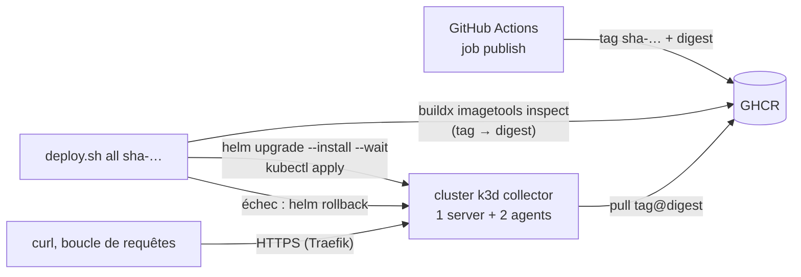

# Protocole d'expérimentation 4 — Déploiement du POC sur k3d, auto-réparation et retour arrière

Exécution de référence : **06/11/2026 00:39 à 00:50** (`./run.sh`, code de sortie 0). Sortie complète versionnée : [`resultats/run-20261106-0039.log`](resultats/run-20261106-0039.log). Vérification du README racine, exécuté tel quel depuis un cluster supprimé (`cluster.sh delete` compris dans le journal) : **06/11/2026 00:50 à 00:54**, [`resultats/readme-cluster-20261106-0050.log`](resultats/readme-cluster-20261106-0050.log). Seules les mesures de ces journaux sont données comme preuves. Contrairement aux protocoles 1 à 3, celui-ci ne teste pas une technologie nouvelle : il **mesure le déploiement du POC** réalisé en phase 6 (tâches P6-01 à P6-04) et démontre ce que le contrat de déploiement de [`cicd.md`](../../01-qualite/cicd.md) promet.

## 1. Objectif et question posée

**Question** : à partir de rien (cluster supprimé), un lecteur qui a les outils de `check-tools.sh` obtient-il, par des commandes copiables, le POC complet en HTTPS sur le cluster k3d ; ce déploiement tient-il dans le budget mémoire et disque estimé en phase 3 ; le service se répare-t-il seul quand on supprime un pod ; un mauvais déploiement est-il détecté et annulé sans interrompre le service ; et peut-on remonter de ce qui tourne jusqu'au commit et au run de CI qui l'ont produit ?

- **Méthode** : un script (`run.sh`) supprime le cluster `collector`, le recrée, déploie les images publiées par la CI, puis mesure. Les perturbations (suppression d'un pod, déploiement défaillant) sont faites sous une boucle de requêtes publiques par HTTPS, dont les échecs sont comptés.
- Critères de réussite : `smoke.sh` vert après un déploiement à froid ; mémoire et disque relevés et comparés au budget de la phase 3 ; retour de 2 réplicas `Ready` après suppression d'un pod avec 0 requête en échec ; déploiement défaillant détecté, annulé par `helm rollback`, service disponible tout du long ; chaîne de traçabilité pod → digest → tag → commit → run complète ; un événement de test publié par le compte `catalog` est consommé.
- Exigences visées : critères 2 (README exécutable), 4 (ligne « Déploiement » de `cicd.md` : `helm rollback` si échec) et 5 (environnement d'exécution, disponibilité) ; ENF-16 (perte d'une instance). Hors périmètre : montée en charge de l'HPA sous Locust (phase 8), front (phase 7).
- **Écart à la règle commune des expérimentations** (« cluster jetable, supprimé à la fin », [README](../README.md)) : ce protocole mesure le déploiement du POC lui-même ; `run.sh` recrée le cluster `collector` et le **laisse en place** à la fin, volontairement (c'est le cluster de la démonstration). Les protocoles 1 à 3 utilisent des clusters distincts, supprimés.

## 2. Technologies testées et interactions

Composants déployés (images épinglées par `tag@sha256`, relevées par `kubectl get pods -A`) : `catalog-service` et `notification-service` (`sha-bec38ed`, chart `collector-service` 0.1.0, 2 réplicas, HPA 2 à 5), PostgreSQL 18.4, RabbitMQ 4.3.5, Keycloak 26.8.0, kube-prometheus-stack 91.9.0 allégé (Prometheus v3.15.0, Grafana 13.2.3, opérateur v0.94.1, kube-state-metrics v2.20.0), plus ce que k3s fournit (Traefik 3.7.8, CoreDNS, metrics-server, local-path-provisioner). Détails des choix : [ADR 0006](../../02-architecture/adr/0006-kubernetes-local-k3d-argocd.md) et [ADR 0008](../../02-architecture/adr/0008-infrastructure-images-officielles.md).

## 3. Environnement

| Élément | Valeur |
| --- | --- |
| Machine | Mac Apple Silicon (arm64), macOS 27.2 (build 26B123) |
| Docker Desktop | moteur 28.5.1, 10 CPU, 8 322 555 904 octets de mémoire (7 937 Mi, calcul), disque virtuel de 59 768 Mo |
| Outils | k3d v5.9.0 ; kubectl client v1.34.1 ; Helm v4.3.1 ; mkcert v1.4.4 (CA installée au préalable ; aucun script ne lance `mkcert -install`) |
| Cluster | k3s `v1.35.8+k3s1` (`rancher/k3s:v1.35.8-k3s1` épinglée par digest dans `cluster.sh`), 1 server + 2 agents |
| Images des services | `ghcr.io/luucaaas/catalog-service:sha-bec38ed@sha256:81a09f74…` et `notification-service:sha-bec38ed@sha256:90050dc0…` (index multi-architecture publié par le run 42046581865) |
| Disque requis par les scripts | 10 000 Mo libres (`cluster.sh create` refuse de démarrer sinon, seuil fixé d'après ce protocole) ; ports 80 et 443 du Mac libres |
| Mesure du disque | `df` dans l'image k3s épinglée, déjà présente (méthode de `cluster.sh`) : aucune autre image |

## 4. Étapes reproductibles

Commande unique : `docs/04-experimentations/04-deploiement/run.sh [<tag>]` (défaut `sha-bec38ed`). **Elle supprime puis recrée le cluster `collector`** ; le certificat mkcert et `deploy/local/.env` sont conservés. Durée : environ 11 minutes dont 5 min d'attente du déploiement défaillant. Le script échoue (code non nul) si `deploy.sh` ne rend pas 1 pour la version défaillante ou si une requête de la boucle échoue pendant l'auto-réparation ou le retour arrière ; si une erreur survient après le lancement de la version défaillante, son `trap` redéploie la configuration nominale. La sortie est écrite dans `resultats/run-AAAAMMJJ-HHMM.log` ; aucun mot de passe n'est affiché.

| Étape | Ce que fait le script |
| --- | --- |
| 1 | Relève les versions de l'hôte et d'outils, l'espace libre du Mac |
| 2 | `cluster.sh delete`, mesure du disque de la VM Docker sans cluster, `cluster.sh create`, `deploy.sh all <tag>` (infrastructure, supervision, services, `smoke.sh`), chacun chronométré |
| 3 | Après 90 s de repos : disque de la VM, `kubectl top nodes`, `kubectl top pods -A`, `kubectl get pods -A -o wide`, images en cours d'exécution |
| 4 | Lance une boucle de requêtes (`GET /catalog/api/v1/categories` par HTTPS, une toutes les 0,1 s environ), supprime un pod de `catalog-service` (`kubectl delete pod --wait=false`), relève l'instant où il a disparu et celui où 2 réplicas sont à nouveau `Ready` (2 pods), compte les échecs de la boucle |
| 5 | Même boucle ; `DEPLOY_VALUES=<values défaillantes> deploy.sh services <tag>` avec `resources.limits.memory: 24Mi` (le service en utilise 77 Mi) ; code de sortie (assertion : 1), durée, état des pods à 90 s, `helm history`, `smoke.sh` après coup |
| 6 | Traçabilité : `imageID` du pod, tag, digest du tag sur GHCR, commit (`git rev-parse`), run de CI (`gh run list --commit`), label OCI `org.opencontainers.image.revision` |
| 7 | `deploy/local/publish-test-event.sh` : événement `article.published` publié avec le compte RabbitMQ `catalog`, compteur `events_consumed_total{outcome="processed"}` lu avant et après |

Sans le script, les commandes de l'étape 2 sont celles du [README racine](../../../README.md#déployer-sur-le-cluster-local) : `deploy/local/cluster.sh create` puis `deploy/local/deploy.sh all sha-bec38ed`.

## 5. Résultats mesurés

Tous les chiffres viennent de `resultats/run-20261106-0039.log` (commande indiquée à chaque ligne), sauf ceux du README, tirés de `resultats/readme-cluster-20261106-0050.log`. Un calcul fait ici est signalé.

### Déroulé à froid

| Mesure | Valeur | Commande |
| --- | --- | --- |
| Suppression du cluster | 2,7 s | `deploy/local/cluster.sh delete` |
| Création du cluster (3 nœuds Ready, certificat, Traefik, HTTPS) | 50,5 s | `deploy/local/cluster.sh create` |
| Déploiement complet (infrastructure, supervision, 2 services, `smoke.sh` 8/8) | 148,6 s | `deploy/local/deploy.sh all sha-bec38ed` |
| **Total depuis le cluster supprimé** | **199,1 s** (3 min 19) | création + déploiement |
| README racine suivi tel quel, depuis un cluster supprimé (`delete`, `check-tools.sh`, `create`, `deploy.sh all`, puis `curl`, `smoke.sh`, événement de test), 06/11/2026 00:50 | **199 s** au total (suppression, vérification des outils et création 53 s, déploiement 146 s) ; `smoke.sh` 8/8 ; événement consommé | [`readme-cluster-20261106-0050.log`](resultats/readme-cluster-20261106-0050.log) |

Les durées comprennent le téléchargement des images : les nœuds sont neufs à chaque création.

### Mémoire (au repos, 90 s après la fin du déploiement : attente commencée à 00:43:12, mesures vers 00:44:42 le 06/11/2026)

`kubectl top pods -A` ; les sommes sont des calculs.

| Composant | Mémoire | Budget de la phase 3 |
| --- | --- | --- |
| `catalog-service` (2 pods) | 77 + 77 = 154 Mi | non mesuré |
| `notification-service` (2 pods) | 73 + 73 = 146 Mi | non mesuré |
| Keycloak | 590 Mi | 581 Mi |
| RabbitMQ | 140 Mi | 135 Mi |
| PostgreSQL | 70 Mi | 56 Mi |
| Traefik | 29 Mi | 25 Mi |
| Pile d'observabilité (Grafana 488, Prometheus 233, kube-state-metrics 17, opérateur 19) | 757 Mi | 600 Mi |
| CoreDNS, local-path-provisioner, metrics-server | 15 + 12 + 25 = 52 Mi | non compté |
| **Somme des pods (calcul)** | **1 938 Mi** (1 857 Mi dans le namespace `collector`) | 1 397 Mi (sans les services) |

- Les composants du budget de la phase 3 (RabbitMQ, Keycloak, PostgreSQL, Traefik, observabilité) totalisent 1 586 Mi (calcul) au lieu de 1 397 Mi estimés : **+189 Mi (+14 %)**, surtout Grafana (488 Mi au lieu de 403 Mi avec ses sidecars) et Prometheus (233 Mi au lieu de 164 Mi). Les deux services ajoutent 300 Mi (calcul).
- `kubectl top nodes` : server-0 2 409 Mi, agent-0 1 099 Mi, agent-1 661 Mi, soit **4 169 Mi (calcul)**, 53 % des 7 937 Mi de Docker Desktop (calcul) ; la différence avec la somme des pods est le système, k3s et le plan de contrôle. CPU des nœuds : 154 m, 51 m et 237 m (442 m, calcul).
- Rapprochement avec la tâche P6-04 : son journal (`monitoring-cluster-collector-20261105.log`, relevé du 05/11/2026 entre 23:48 et 23:50) additionne 1 871 Mi pour le namespace `collector` (calcul sur ses lignes), du même ordre.

### Disque

| Mesure | Valeur | Commande |
| --- | --- | --- |
| Disque de la VM Docker, cluster supprimé | 5 975 Mo utilisés, 50 726 Mo libres | `docker run --rm --entrypoint df <image k3s épinglée> -m /` (méthode de `cluster.sh`) |
| Disque de la VM Docker, déploiement complet | 12 397 Mo utilisés, 44 304 Mo libres | idem |
| **Consommation du déploiement complet (calcul)** | **6 422 Mo** (6,3 Go) | 12 397 − 5 975 |
| Cache d'images de Docker, cluster supprimé | 30 images, 3,2 Go, 100 % récupérables ; aucun volume ni conteneur | `docker system df` |

Le cache d'images (3,2 Go) était déjà là (images des nœuds k3d et d'outils téléchargées lors de phases précédentes). Sur un Docker neuf, la consommation serait donc plus élevée de la part de ces images, au plus 3,2 Go (calcul).

### Placement (06/11/2026 vers 00:44:42, `kubectl get pods -A -o wide`)

| Nœud | Pods |
| --- | --- |
| `k3d-collector-server-0` | Grafana, kube-state-metrics, opérateur Prometheus, Prometheus, CoreDNS, metrics-server, local-path-provisioner |
| `k3d-collector-agent-0` | `catalog-service` (1), `notification-service` (1), Keycloak, Traefik |
| `k3d-collector-agent-1` | `catalog-service` (1), `notification-service` (1), PostgreSQL, RabbitMQ |

Aucune règle de placement. Ici, les deux réplicas de chaque service sont sur deux nœuds différents ; ce n'est **pas garanti** : dans l'exécution du README (`readme-cluster-20261106-0050.log`), les réplicas de `catalog-service` étaient sur `server-0` et `agent-0`, et ceux de `notification-service` sur `server-0` et `agent-1`. Le plan de contrôle n'est pas isolé : le server porte aussi des pods applicatifs (limite L8).

### Auto-réparation (06/11/2026 00:44:43)

| Mesure | Valeur | Commande |
| --- | --- | --- |
| Pod supprimé | un des 2 pods de `catalog-service`, 2 réplicas `Ready` avant | `kubectl delete pod --wait=false` |
| Disparition de l'ancien pod | 6,9 s (arrêt ordonné : `preStop` de 5 s) | sondage toutes les 0,5 s |
| **Retour de 2 réplicas `Ready` (et de 2 pods)** | **7,1 s** | idem |
| Requêtes pendant l'opération | 120 requêtes en 17,6 s, 120 réponses 200, **0 en échec** (assertion du script) | boucle de `curl` sur la route publique |

Le service est resté disponible parce que `catalog-service` a 2 réplicas : le pod supprimé sort des endpoints (`preStop`) pendant que l'autre répond, et le pod de remplacement reçoit du trafic dès que sa sonde `readiness` passe.

### Retour arrière (06/11/2026 00:45:01)

Version défaillante : `resources.limits.memory: 24Mi` (requête de 16 Mi), passée par `DEPLOY_VALUES` ; l'image est la même (`sha-bec38ed`). Le service en utilise 77 Mi : le noyau tue le conteneur (OOMKilled) avant qu'il soit prêt.

| Mesure | Valeur |
| --- | --- |
| Sortie de `deploy.sh services` | `UPGRADE FAILED: resource Deployment/collector/catalog-service not ready. status: InProgress, message: Updated: 1/2`, puis « ÉCHEC : retour arrière », « catalog-service : retour à la révision 1 », « Rollback was a success! », « notification-service : non modifié par ce lancement, laissé tel quel » |
| Code de sortie | **1** (assertion du script) |
| Durée de `deploy.sh` | 309,8 s : 300 s d'attente du déploiement (`helm --wait --timeout 5m`), puis le retour arrière |
| État des pods 90 s après le début | nouveau pod `catalog-service-6fccff6cf7-qd8dw` : `CrashLoopBackOff`, 3 redémarrages, dernier arrêt `OOMKilled`, prêt = false ; les 2 anciens pods : `Running`, prêts, 0 redémarrage |
| `helm history catalog-service` | 1 `superseded` « Install complete » ; 2 `failed` « Upgrade "catalog-service" failed: resource Deployment/collector/catalog-service not ready… » ; 3 `deployed` « **Rollback to 1** » |
| **Requêtes pendant l'opération** | **2 113 requêtes en 318,2 s, 2 113 réponses 200, 0 en échec** (assertion du script) |
| Après l'opération | 2 pods anciens `Ready`, limite mémoire de 256 Mi rétablie, `smoke.sh` 8/8 |

C'est la stratégie `RollingUpdate` (`maxSurge: 1`, `maxUnavailable: 0`) qui garde l'ancienne version en service : un pod neuf n'est jamais compté disponible tant que sa sonde `readiness` n'a pas réussi, donc aucun ancien pod n'est arrêté. L'échec est détecté par `helm upgrade --wait` (le Deployment n'atteint pas l'état prêt dans le délai), avant `kubectl rollout status` que `deploy.sh` lance ensuite : il n'a pas été atteint dans cet essai. Le second garde-fou du contrat (`smoke.sh`) n'a pas non plus été sollicité ; il a été démontré en P6-03 (journal de la fiche : `smoke.sh` forcé en échec, `Rollback to 4`).

### Traçabilité (06/11/2026 00:50:21, `cicd.md` §4)

| Maillon | Valeur | Commande |
| --- | --- | --- |
| Pod | `catalog-service-f7885fd67-9f8p5` | `kubectl get pods` |
| Image demandée | `ghcr.io/luucaaas/catalog-service:sha-bec38ed@sha256:81a09f74…fd50f8` | `kubectl get pod -o jsonpath='{.spec.containers[0].image}'` |
| `imageID` (digest réellement exécuté) | `ghcr.io/luucaaas/catalog-service@sha256:81a09f741d93f70db11261b767c0ed46208554653a83506b74b1fc4bcdfd50f8` | `…{.status.containerStatuses[0].imageID}` |
| Tag | `sha-bec38ed`, **même digest** que le tag sur GHCR | `docker buildx imagetools inspect ghcr.io/luucaaas/catalog-service:sha-bec38ed` |
| Label OCI | `org.opencontainers.image.revision` = `bec38eddae8d84b8e546d9385d8e162313c05a16` | `docker buildx imagetools inspect … --format '{{json .Image}}'` |
| Commit | `bec38eddae8d84b8e546d9385d8e162313c05a16`, « Fusion de P5-06 : constats SonarCloud corrigés… (#2) » | `git rev-parse bec38ed` |
| Run de CI | workflow `backend`, `success`, https://github.com/Luucaaas/collector-poc/actions/runs/42046581865 | `gh run list --commit <sha>` |

### Événement de test de bout en bout (06/11/2026 00:50:25)

`deploy/local/publish-test-event.sh` : `events_consumed_total{outcome="processed"}` (somme des 2 pods de `notification-service`) **0 → 1** après la publication d'un `article.published` (schéma 1, catégorie inexistante donc aucun acheteur notifié) par le compte RabbitMQ `catalog`. Droits de ce compte (`deploy/compose/render.py`) : configure et write sur l'exchange `article.events`, read vide, aucune étiquette d'administration. Son mot de passe est lu dans `deploy/local/.env` et transmis par l'entrée standard de `kubectl exec`, jamais en argument ni affiché. Vérifié par le développeur pendant la tâche (essai non versionné, mot de passe faux) : une erreur de connexion n'affiche que `Connexion à RabbitMQ impossible : ProbableAuthenticationError`, jamais la chaîne AMQP.

## 6. Difficultés rencontrées et solutions

| Difficulté | Solution |
| --- | --- |
| Le compte `catalog` n'a pas l'étiquette de gestion : l'outil `rabbitmqadmin` (API HTTP de gestion) lui est refusé. La méthode de P6-03 utilisait le compte `admin` | Publication en AMQP avec aio-pika, depuis un pod de `catalog-service` (la bibliothèque y est installée), mot de passe sur l'entrée standard, exceptions interceptées (le message d'une exception de connexion peut contenir la chaîne AMQP). Le compteur est lu dans les pods (`python -c` avec `urllib`), sans `port-forward` |
| Fabriquer un échec réaliste sans modifier le script ni l'image | Variable `DEPLOY_VALUES` ajoutée à `deploy.sh` (un fichier de values en plus). Une limite de mémoire trop basse donne un vrai défaut (OOMKilled). Une limite inférieure à la requête (24 Mi < 128 Mi) aurait été refusée immédiatement par l'API Kubernetes : la requête est donc abaissée aussi |
| Le disque doit être mesuré sans cluster pour avoir la consommation du déploiement, pas son delta | La mesure de référence est prise juste après `cluster.sh delete` |
| `date` de macOS n'a pas `%N` | Horloge de `python3` pour les durées au dixième de seconde |
| `pgrep -f` voit aussi le shell qui l'appelle | Fin du script lue dans son journal plutôt que par `pgrep` |

## 7. Limites de l'expérimentation

- **Une exécution par mesure**, sur une seule machine ; aucune statistique. La boucle de requêtes vient d'un client unique (environ 7 requêtes par seconde : 2 113 en 318,2 s) : ce n'est pas un test de charge (phase 8, Locust).
- L'auto-réparation est mesurée sur **un pod de `catalog-service`** seulement, en perdant un pod, pas un nœud (pas de démonstration de panne de nœud : placement non imposé, L8). La durée de 7,1 s dépend de l'image déjà présente sur le nœud (`IfNotPresent`) ; sur un nœud qui ne l'a pas, le téléchargement s'ajoute.
- Le retour arrière est démontré avec **une cause de défaut** (mémoire) et sur `catalog-service`, premier service déployé ; l'échec arrête le déploiement, donc `notification-service` n'est pas touché. Une défaillance de la sonde `readiness` ou du `smoke.sh` suit le même chemin dans `deploy.sh` mais n'a pas été rejouée ici.
- **Le retour arrière Helm ne défait pas les migrations Alembic** (limite L23) : sans effet ici (le défaut est de configuration), mais une migration non rétrocompatible casserait l'ancienne version restaurée.
- Le disque mesuré dépend du cache d'images de la VM Docker (3,2 Go déjà présents) ; les mesures de mémoire sont « au repos », sans pic de démarrage ni charge.
- L'accès public ne prouve rien sur Keycloak côté navigateur (PKCE, phase 7) ; les routes protégées ne sont vérifiées que par leur 401.
- Le `trap` de `run.sh` qui redéploie la configuration nominale si le script échoue pendant l'étape de défaillance n'a **pas été déclenché** : seul le chemin nominal est exécuté (lecture du code vérifiée par l'audit).
- Système de fichiers racine en lecture seule (limite L17) : appliqué aux services et à PostgreSQL, **pas à Keycloak ni à RabbitMQ** ; ce protocole ne le mesure pas (voir la limite mise à jour dans `architecture-poc.md`).

## 8. Décision

**Adoptée.** Le POC se déploie à froid en environ 3 min 20 (199 s, et 199 s aussi en suivant le README tel quel), tient dans 1 938 Mi de mémoire de pods (4 169 Mi sur les nœuds, 53 % de la mémoire de Docker Desktop) et 6,3 Go de disque, se répare seul (2 réplicas `Ready` en 7,1 s, 0 requête perdue), revient en arrière automatiquement sur un déploiement défaillant (2 113 requêtes sur 2 113 servies pendant les 5 minutes d'échec) et reste traçable du pod jusqu'au run de CI. Conséquences :

- **Seuil de disque fixé à 10 000 Mo (décision du chef)** : `MIN_FREE_MB` de `cluster.sh` passe de 7 000 à 10 000 Mo. Le déploiement consomme 6 422 Mo (jusqu'à 9 600 Mo sur un Docker sans cache d'images, calcul) et le kubelet évince les pods sous environ 3 100 Mo libres (relevé en phase 3), soit environ 9 500 Mo nécessaires à partir d'un cache chaud (calcul).
- **Budget mémoire** : mémoire mesurée supérieure de 14 % à l'estimation de la phase 3 pour les mêmes composants ; la section « Budget mémoire et disque » du [README des expérimentations](../README.md) est complétée par ces mesures.
- Limites L17 mise à jour et L23 ajoutée dans [`architecture-poc.md`](../../02-architecture/architecture-poc.md) §8 ; ligne « Déploiement » de [`conformite-pipeline.md`](../../01-qualite/conformite-pipeline.md) avec sa preuve.
- Architecture retenue confirmée par la mesure : k3d et Traefik ([ADR 0006](../../02-architecture/adr/0006-kubernetes-local-k3d-argocd.md)), infrastructure en images officielles et manifestes simples, sans opérateur ([ADR 0008](../../02-architecture/adr/0008-infrastructure-images-officielles.md)).
- À faire en phase 8 : mêmes mesures sous Locust, avec montée de l'HPA de 2 à 5 réplicas.
