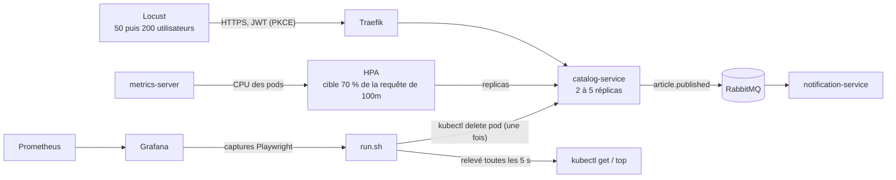

# Protocole d'expérimentation 5 — Montée en charge de l'HPA et disponibilité sous charge

Exécution de référence : **06/11/2026 11:32 à 11:46** (`run.sh` du commit `9f04231`, code de sortie 0), dossier [`resultats/20261106-1132/`](resultats/20261106-1132/). Les chiffres ci-dessous viennent de son [`resume.md`](resultats/20261106-1132/resume.md) et des relevés bruts du même dossier. Les captures Grafana ont été prises ensuite par `captures.sh` (voir §6). Ce qui a changé après l'exécution est listé en fin de §4.

## 1. Objectif et question posée

**Question** : sur le cluster k3d déployé par `deploy.sh`, l'HPA de `catalog-service` fait-il passer le service de 2 à 5 réplicas sous un pic de charge, puis de nouveau à 2 après la charge ; et la suppression d'un pod en plein pic est-elle absorbée (pod remplacé, taux d'erreur mesuré) ?

- Exigences visées : ENF-29 (de 2 à 5 réplicas à 70 % de CPU, démontré par Locust), ENF-16 (perte d'une instance : suppression d'un pod pendant un test Locust, taux d'erreur mesuré), ENF-15 (ressources bornées : requêtes et limites relevées), critère 5 de la grille (disponibilité et montée en charge démontrées). Définition de la ligne « Disponibilité » : [`processus-test.md`](../../01-qualite/processus-test.md).
- Critères de réussite : l'HPA demande 5 réplicas et 5 sont prêts ; un pod supprimé est remplacé et le nombre de réplicas prêts revient à 5 ; le taux de 5xx autour de la suppression est mesuré ; le service revient à 2 réplicas après l'arrêt de la charge ; la charge nominale respecte toujours I3.
- Hors périmètre : panne d'un nœud entier et du broker (cible : `PodDisruptionBudget`, répartition imposée), amélioration des ressources ou de l'HPA (axes d'amélioration au §7 et dans P8-04).
- **Écart à la règle commune** (« cluster jetable, supprimé à la fin ») : la montée en charge se mesure sur le **déploiement réel**. `run.sh` ne crée ni ne supprime le cluster ; il refuse de démarrer si `smoke.sh` échoue ou si un composant n'est pas à 2 réplicas. La seule modification qu'il fait sur le cluster est `kubectl delete pod` sur un pod de `catalog-service`.

## 2. Technologies testées et interactions

Composants en jeu : Locust 2.47.0 (profil de charge « pic » de `tests/load`), l'HPA du chart `collector-service` (2 à 5 réplicas, 70 % de la requête CPU), metrics-server de k3s, le Deployment et le ReplicaSet de `catalog-service`, Prometheus et Grafana (tableau de bord « Collector - service »), Playwright pour les captures.

## 3. Environnement

| Élément | Valeur |
| --- | --- |
| Machine | Mac Apple Silicon (arm64), macOS 27.2 |
| Docker Desktop | moteur 28.5.1, 10 CPU, 8 322 555 904 octets de mémoire |
| Outils | k3d v5.9.0, kubectl client v1.34.1, Helm v4.3.1, mkcert v1.4.4, Locust 2.47.0 (Python 3.12, uv) |
| Cluster | k3s v1.35.8+k3s1, 1 server + 2 agents (ni règle de placement, ni `PodDisruptionBudget`) |
| Images | `catalog-service`, `notification-service` et `frontend` en `sha-9d2c96e` (digests dans [`environnement.txt`](resultats/20261106-1132/environnement.txt)) |
| Ressources de `catalog-service` | requêtes 100m CPU et 128 Mi, limites 500m et 256 Mi |
| HPA | 2 à 5 réplicas, cible 70 % de la requête CPU, comportement de réduction par défaut de Kubernetes (fenêtre de stabilisation de 300 s) |
| État initial | 2 réplicas prêts pour `catalog-service`, `notification-service` et `frontend`, CPU à 5 %, `smoke.sh` vert |
| Locust | sur le même Mac que le cluster, cible `https://api.127.0.0.1.sslip.io` avec vérification TLS |

## 4. Étapes reproductibles

Commande unique, **identique à celle de la référence** (les valeurs par défaut sont celles de la référence : 50 utilisateurs pendant 240 s, pic de 200, captures Grafana comprises) : `docs/04-experimentations/05-charge-disponibilite/run.sh` (environ 15 minutes ; paramètres facultatifs en tête du script). `captures.sh` pose lui-même `GRAFANA_CAPTURES=1` ; on peut le relancer seul sur un dossier de résultats, dans les 2 h qui suivent. Prérequis : cluster déployé par `deploy/local/deploy.sh all <tag>`, `uv`, `mkcert`, Chromium de Playwright (`npx playwright install chromium` dans `frontend/`). Les mots de passe sont lus dans `deploy/local/.env` et donnés aux seuls processus qui en ont besoin, en préfixe de commande.

| Étape | Ce que fait le script |
| --- | --- |
| 1 | `smoke.sh` doit réussir ; les 3 composants doivent avoir 2 réplicas prêts |
| 2 | Relevé de l'environnement (versions, images, digests, ressources, HPA) ; lancement du **relevé continu** toutes les 5 s (HPA : réplicas souhaités, courants, CPU ; réplicas prêts ; pods ; CPU des pods) |
| 3 | Locust (profil `peak`) : **charge nominale** de 50 utilisateurs (montée de 1 par seconde) pendant 240 s, puis **pic** de 200 utilisateurs (montée de 5 par seconde) ; chaque requête est journalisée (instant, nom, durée, code) |
| 4 | Attente des 5 réplicas prêts (au plus 420 s), maintien de 60 s, puis `kubectl delete pod` sur un pod prêt de `catalog-service` ; mesure (toutes les 0,5 s) de la disparition de l'ancien pod, du premier remplaçant prêt et du retour au nombre de réplicas prêts d'avant ; maintien de 60 s |
| 5 | Arrêt de la charge (fichier d'arrêt lu par le profil), observation jusqu'à ce que les 3 composants soient revenus à 2 réplicas (au plus 900 s) |
| 6 | Événements Kubernetes, interrogation de Prometheus (5xx côté services), `tests/load/phases.py` écrit `resume.md` ; captures Grafana (`captures.sh`, Playwright, lancé à part par `GRAFANA_CAPTURES=1`) |
| 7 | État final du cluster, `smoke.sh`, anonymisation (nom de la machine, dossier personnel) |

**Choix des paramètres.** Pour que l'HPA demande 5 réplicas à 70 % de CPU, la charge totale de `catalog-service` doit dépasser 4 × 70m = 280m. Mesures : à 50 utilisateurs, 2 pods consomment en moyenne 135m sur le plateau (68 % de leur requête de 2 × 100m, cf. `cpu-pods.tsv`) ; un essai de calibrage non versionné à 200 utilisateurs a demandé 5 réplicas en 60 s, avec 114 à 122 % de CPU à 3 réplicas (environ 350m au total) ; l'exécution de référence mesure 72 à 75 % à 5 réplicas (environ 366m au total), soit environ 30 % au-dessus du seuil de 280m. 200 utilisateurs sont donc **juste assez** pour atteindre 5 réplicas avec une marge, sans saturer le Mac : environ 87 requêtes par seconde, p95 de 13 ms et aucun échec. Les durées : 240 s de charge nominale (190 s hors montée, 4 040 requêtes) donnent une référence stable ; 420 s d'attente maximale laissent 7 fois le délai observé (60 s) ; 900 s pour la réduction couvrent la fenêtre de stabilisation de 300 s de l'HPA avec une grande marge.

**Sources des instants.** Les instants de la suppression, du remplaçant prêt et de « 5 réplicas prêts » viennent de l'interrogation de `run.sh` toutes les 0,5 s (`chronologie.tsv`) ; ceux de l'HPA (demandes de 3, 4, 5 réplicas, retour à 2) et de « 3 et 4 réplicas prêts » du relevé de 5 s. « Il ne reste que 2 pods » est le premier relevé de 5 s après l'arrêt où `pods.tsv` ne liste que 2 pods de `catalog-service` (cohérent avec `all_back_2` de `chronologie.tsv`) ; le `currentReplicas` de l'HPA, en retard sur les pods, n'est pas utilisé.

**Ce que la référence doit à une version antérieure du script.** L'exécution a été faite avec le `run.sh` du commit `9f04231`, avec `NOMINAL_SECONDS=240 CAPTURES=0`. Ont changé ensuite, sans relancer le test : (1) l'étape 6 des événements (heure absolue, filtre sur l'exécution : `evenements.txt` régénéré avec la commande corrigée) ; (2) le motif facultatif de `captures.sh` ; (3) les défauts de `run.sh` (240 s, captures lancées par le script), les captures de la référence ayant été prises par `captures.sh` après l'exécution ; (4) la version de k3s de `environnement.txt` : le script relevait la version par défaut de k3d (v1.35.5) et non celle des nœuds, la ligne a été corrigée après coup (v1.35.8+k3s1, lue par `kubectl get nodes`) et le script aussi ; (5) l'anonymisation couvre désormais aussi `*.html` et `*.gz` ; (6) `phases.py` : retour à 2 défini par les pods (`pods.tsv`, 325 s au lieu de 338 s tirés du `currentReplicas`) et « 5 réplicas prêts » tiré de `chronologie.tsv`, `resume.md` régénéré par le script (`prometheus.json` conserve les valeurs de la première analyse : 0 réponse 5xx sur 20 235, Prometheus ne gardant que 2 h).

## 5. Résultats mesurés

Exécution du 06/11/2026 11:32 (début du pic à 11:36:56 = 0 s). Instants relevés par `run.sh` ou par le relevé de 5 s ; les délais de l'HPA sont donc précis à environ 5 s.

### Montée et retour de l'HPA

| Événement | Instant | Depuis le début du pic |
| --- | --- | --- |
| HPA demande 3 réplicas (3 prêts) | 11:37:08 (11:37:14) | +11 s (+17 s) |
| HPA demande 4 réplicas (4 prêts) | 11:37:42 (11:37:42) | +45 s (+45 s) |
| HPA demande 5 réplicas (5 prêts) | 11:37:53 (11:37:56) | +56 s (+60 s) |
| Suppression d'un pod | 11:38:56 | +120 s |
| Arrêt de la charge | 11:40:03 | +186 s |
| HPA demande 2 réplicas | 11:45:23 | +320 s après l'arrêt |
| Il ne reste que 2 pods de `catalog-service` | 11:45:28 | +325 s après l'arrêt |

Les événements Kubernetes ([`evenements.txt`](resultats/20261106-1132/evenements.txt)) confirment : `SuccessfulRescale` à 3 (11:37:06), 4 (11:37:36) et 5 (11:37:51), puis `Scaled down 5 to 2` à 11:45:22. La CPU moyenne était de 186 % de la requête au plus fort de la montée, puis de 72 à 75 % à 5 réplicas : juste au-dessus de la cible, c'est pourquoi l'HPA est resté à 5 jusqu'à l'arrêt.

### Suppression d'un pod de `catalog-service` pendant le pic (5 réplicas)

| Mesure | Valeur |
| --- | --- |
| Pod supprimé | un pod prêt (5 prêts avant) |
| Pod de remplacement prêt | **4,9 s** après la suppression |
| Ancien pod disparu de la liste | 6,1 s (délai d'arrêt du conteneur) |
| 5 réplicas de nouveau prêts | **6,2 s** |
| Requêtes pendant ces 6 s | 533, dont **0 échec** |
| Échecs de -5 s à +60 s autour de la suppression | **0** |

### Latence et erreurs par phase (requêtes de charge, vues par Locust)

| Phase | Durée | Requêtes | 5xx | Autres échecs | p95 liste | p95 publication | p95 toutes |
| --- | --- | --- | --- | --- | --- | --- | --- |
| Nominale (50 utilisateurs, hors montée) | 190 s | 4 040 | 0 | 0 | 20 ms | 23 ms | 19 ms |
| Pic, montée de l'HPA (2 à 5 réplicas prêts) | 60 s | 4 233 | 0 | 0 | 84 ms | 127 ms | 104 ms |
| Pic, 5 réplicas prêts | 60 s | 5 171 | 0 | 0 | 13 ms | 16 ms | 13 ms |
| Suppression du pod, jusqu'au retour des réplicas | 6 s | 533 | 0 | 0 | 12 ms | 16 ms | 12 ms |
| Pic après remplacement | 60 s | 5 133 | 0 | 0 | 13 ms | 20 ms | 13 ms |

Côté services (Prometheus, de la charge nominale à l'arrêt) : 0 réponse 5xx sur 20 235 requêtes. Locust : 0 échec sur toutes les requêtes de charge ([`locust_stats.csv`](resultats/20261106-1132/locust_stats.csv)).

### Comparaison aux exigences

| Exigence | Seuil | Mesure | Verdict |
| --- | --- | --- | --- |
| ENF-29 | de 2 à 5 réplicas à 70 % de CPU | 2 à 5 en 56 s (5 prêts en 60 s), retour à 2 | Conforme |
| ENF-16 | perte d'une instance sous charge, taux d'erreur mesuré | pod remplacé en 4,9 s, 0 échec sur 533 requêtes, 0 sur la fenêtre de 65 s | Conforme (une suppression) |
| I3, ENF-12, ENF-13 (50 utilisateurs) | p95 lecture < 300 ms, publication < 500 ms, 5xx < 1 % | 20 ms, 23 ms, 0 % | Conforme |
| ENF-15 | ressources bornées | requêtes 100m et 128 Mi, limites 500m et 256 Mi | Conforme |

Le pic (200 utilisateurs) est **hors I3** : ses chiffres sont informatifs. Le p95 de la montée (84 et 127 ms) est plus élevé que celui du plateau à 5 réplicas (13 et 16 ms) : tant que l'HPA n'a pas ajouté de réplicas, deux pods se partagent toute la charge.

### Captures Grafana

Prises après l'exécution (plage absolue, Prometheus garde 2 h) dans [`resultats/20261106-1132/`](resultats/20261106-1132/) : `grafana-pic-catalog-service.png` et `grafana-pic-notification-service.png` (de 1 min avant le pic à 15 s après l'arrêt), `grafana-retour-catalog-service.png` et `grafana-retour-notification-service.png` (de 1 min avant la charge à 30 s après le retour à 2 réplicas). Elles montrent débit, p95, réplicas (souhaités et prêts) et CPU par pod. Les 4xx visibles vers 11:33 sur la capture de `notification-service` sont une seule requête sans jeton, la vérification `smoke.sh` du début de l'exécution (« route protégée sans jeton », 401 attendu ; journal du pod : `missing_token` à 11:32:53), vue sur deux points de la fenêtre de calcul du débit. Le tableau de bord de `notification-service` ne montre pas de trafic HTTP de charge : ce service ne reçoit que la préparation de l'exécution ; il consomme les événements, d'où la CPU visible.

## 6. Difficultés rencontrées et solutions

- **p95 par phase impossible avec l'historique de Locust** : ses percentiles par seconde sont calculés sur une fenêtre glissante de 10 s. Solution : le locustfile journalise chaque requête (activé par `LOAD_REQUEST_LOG`) et `phases.py` calcule les p95 et les 5xx sur les fenêtres voulues.
- **Instants de l'HPA et réplicas prêts relevés par deux appels** : `phases.py` associe chaque ligne de l'HPA à la valeur de réplicas prêts la plus proche (moins de 4 s).
- **Événements d'exécutions précédentes mélangés** : `kubectl get events` garde 1 h d'événements ; `run.sh` les filtre par heure absolue (pour l'exécution de référence, le fichier a été régénéré après coup avec cette même commande).
- **Grafana tué par manque de mémoire pendant les captures.** Le conteneur `grafana` a une limite de 384 Mi et en consomme 290 à 350 Mi au repos ; l'ouverture d'un tableau de bord par un navigateur le dépasse : `OOMKilled`, redémarrages (4 au total pendant la mise au point), un passage en `CrashLoopBackOff`, panneaux « No data » et « no available server » sur les premières captures. Rien n'a été modifié sur le cluster. Contournement : `captures.sh` accepte un motif pour reprendre seulement les captures manquantes ; sur l'exécution de référence, 3 captures sur 4 ont réussi au premier passage (la 4e a tué Grafana), la dernière a été reprise après son redémarrage. Les captures versionnées sont complètes (vérifiées à la vue). **Correction appliquée après l'exécution** (06/11/2026, chef) : limite de Grafana relevée à 768 Mi et requête à 320 Mi dans `deploy/infra/monitoring/kube-prometheus-stack.yaml` (environ 384 Mi de plus sur le budget de la phase 3). Vérification : 4 captures de suite sans redémarrage, pic mesuré à 470 Mi (`kubectl top`), au-dessus de l'ancienne limite.
- **Connexion à Grafana par script** : poser le mot de passe par `evaluate` ne suffisait pas (formulaire React : « Password is required »). Solution : appeler l'accesseur natif de `value` de `HTMLInputElement` puis envoyer l'événement `input`. La page de connexion n'est jamais photographiée ; le mode `kiosk` masque le menu.
- **Mesure du remplacement** : pendant 6 s l'ancien pod reste listé (arrêt du conteneur) ; le script mesure donc séparément sa disparition, le premier pod prêt absent de la liste d'avant, et le retour au nombre de réplicas prêts.

## 7. Limites de l'expérimentation

- **Une seule exécution de référence** (précédée d'un essai de calibrage) : les délais de l'HPA varient de quelques secondes d'une exécution à l'autre ; un seul pod supprimé ne prouve pas l'absence d'erreur pour toute suppression (une requête en cours sur le pod supprimé peut échouer si l'arrêt est brutal).
- **Locust tourne sur le même Mac que le cluster** (10 CPU partagés) : la charge et la mesure se disputent le processeur ; les latences incluent Traefik et TLS. Un pic de 200 utilisateurs n'est pas un trafic réel : il sert à franchir le seuil de l'HPA.
- **L'HPA ne regarde que le CPU** : une saturation de la base, du broker ou de la mémoire ne le déclenche pas. À 5 réplicas la CPU restait à 72–75 % (cible 70 %) : le plafond de 5 est tout juste suffisant pour 200 utilisateurs.
- **La réduction est lente par construction** : la fenêtre de stabilisation de 300 s par défaut explique les 320 s observées entre l'arrêt de la charge et la demande de 2 réplicas, puis 325 s avant qu'il ne reste que 2 pods.
- **Pas de panne de nœud ni de broker** : aucune répartition imposée ni `PodDisruptionBudget` ; les 2 réplicas peuvent être placés sur le même nœud (limite assumée, architecture cible).
- Les ressources de `notification-service` et du front n'ont pas été sollicitées (pas de trafic HTTP de charge significatif).

## 8. Décision

**Adoptée.** Les mécanismes natifs de Kubernetes retenus (Deployment à 2 réplicas, sondes, HPA sur le CPU de 2 à 5 réplicas) **suffisent pour le POC** : 5 réplicas prêts en 60 s sous 200 utilisateurs, pod supprimé remplacé en 4,9 s sans une requête en échec, retour à 2 réplicas sans intervention (325 s après l'arrêt de la charge). Le critère 5 (disponibilité et montée en charge démontrées) s'appuie sur ce protocole rejouable.

Conditions pour la cible (architecture cible, aucune modification du POC) : `PodDisruptionBudget` et répartition des réplicas sur des nœuds distincts (perte d'un nœud) ; HPA sur des métriques complémentaires (débit, latence) et comportement de réduction réglé si la fenêtre de 300 s est trop longue ; plafond de réplicas révisé avec les ressources réelles ; limite mémoire de Grafana relevée (§6). Voir [`architecture-cible.md`](../../02-architecture/architecture-cible.md) et l'[ADR 0008](../../02-architecture/adr/0008-infrastructure-images-officielles.md) pour le choix de ne pas ajouter d'opérateur.
