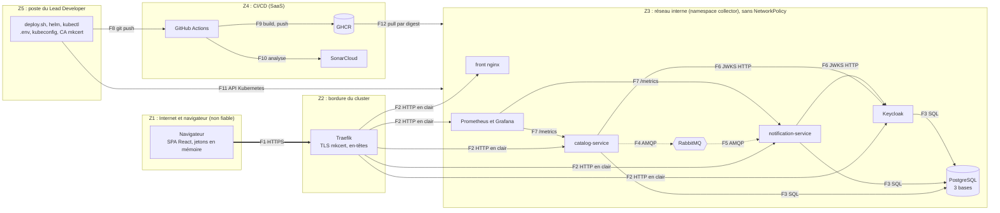
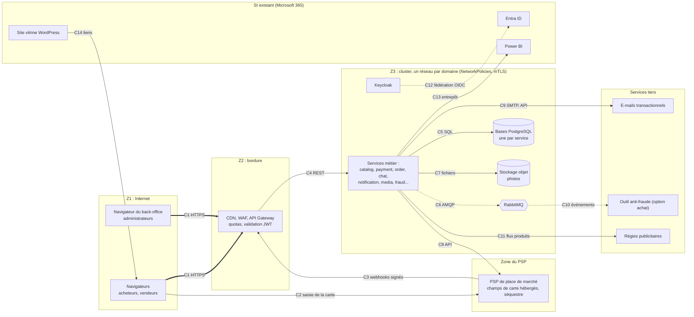

# Analyse de risques de sécurité de Collector (STRIDE et OWASP)

Ce document établit le **registre des risques de sécurité de tout le système d'information de Collector** : le POC, la plateforme Collector.shop cible et le système existant de la start-up. Il est l'entrée unique du plan de remédiation (P9-04), qui priorisera les actions : **il ne propose donc aucune action ici**.

Méthode : (1) recenser les actifs et leurs propriétaires, (2) définir des échelles d'impact et de probabilité, (3) dessiner les flux et les frontières de confiance, (4) appliquer **STRIDE** à chaque élément et chaque flux, (5) rattacher chaque risque applicatif à l'**OWASP Top 10:2025** et à l'**OWASP API Security Top 10:2023**, (6) analyser le reste du SI par **analyse documentaire** avec des hypothèses explicites, (7) croiser avec les obligations de conformité, puis (8) consolider le registre noté.

Entrées : [`contexte_Collector.pdf`](../../contexte_Collector.pdf), [architecture du POC](../02-architecture/architecture-poc.md) (mesures S1 à S9, limites L1 à L25), [architecture cible](../02-architecture/architecture-cible.md), [DevSecOps](../01-qualite/devsecops.md), [exigences](../03-backlog/exigences.md) (ENF-01 à ENF-11), [rapport des scans](rapport-scans.md) (constats F-01 à F-26, état après corrections en § 10) et [indicateurs](../01-qualite/indicateurs.md).

> [!NOTE]
> **Ce que ce document n'est pas.** Aucun scan ni aucune action n'a été lancé pour l'écrire. L'état réel de l'ancien système d'information (WordPress, Office 365, postes, Wi-Fi) n'est pas connu : tout ce qui le concerne est une **hypothèse** (§ 5) que le plan de remédiation devra commencer par vérifier.

## Sommaire

1. [Périmètre et actifs](#1-périmètre-et-actifs)
2. [Échelles et seuils](#2-échelles-et-seuils)
3. [Flux, frontières de confiance et STRIDE](#3-flux-frontières-de-confiance-et-stride)
4. [Correspondance OWASP](#4-correspondance-owasp)
5. [Reste du SI : analyse documentaire et hypothèses](#5-reste-du-si--analyse-documentaire-et-hypothèses)
6. [Conformité](#6-conformité)
7. [Registre des risques](#7-registre-des-risques)
8. [Traçabilité : constats et limites](#8-traçabilité--constats-et-limites)
9. [Sources](#9-sources)

## 1. Périmètre et actifs

### 1.1 Convention d'évaluation du POC

Le POC tourne **uniquement sur le Mac du Lead Developer** : les noms `*.127.0.0.1.sslip.io` se résolvent vers la machine elle-même et rien n'est joignable depuis Internet. Si on notait les risques « tel que déployé aujourd'hui », presque tous auraient une probabilité de 1. Ce n'est pas l'objet : le critère 8 demande de réduire les risques du **parc applicatif**.

> **Hypothèse H-00 (convention).** Les risques du bloc POC sont notés **comme si le POC était mis en production tel quel**, avec ses mesures actuelles et sans ses limites corrigées (exposition Internet, utilisateurs réels). L'exposition locale actuelle est une circonstance atténuante qui est rappelée dans la justification, mais qui ne fait pas baisser la note. Les risques de la cible sont notés comme si l'architecture cible était construite **sans autre mesure que celles que `architecture-cible.md` décrit**.

### 1.2 Actifs et sensibilité

Sensibilité : **C** confidentialité, **I** intégrité, **D** disponibilité, notées de 1 (faible) à 3 (forte) selon le dommage si l'actif est atteint sur ce critère. Les propriétaires sont des **rôles** : Dirigeant·e (D), Responsable administratif et RH (RH), Responsable communication et marketing (COM), Lead Developer (LD), équipe IT (IT), Product Owner (PO, tenu par un·e dirigeant·e).

#### Bloc A : POC

| Id | Actif | Propriétaire | C | I | D | Remarque |
| --- | --- | --- | :-: | :-: | :-: | --- |
| A-01 | Comptes et rôles Keycloak (realm `collector`, base `keycloak`) | LD | 3 | 3 | 3 | Toute l'authentification en dépend |
| A-02 | Données du catalogue : catégories, boutiques, articles, historique des prix (`catalog_db`) | LD | 1 | 3 | 2 | Données publiques en lecture, l'intégrité compte (prix) |
| A-03 | Notifications et centres d'intérêt (`notification_db`) | LD | 2 | 2 | 1 | Identifiants `sub` et préférences : données personnelles pseudonymes |
| A-04 | Événements `article.events` (RabbitMQ) | LD | 1 | 3 | 2 | Transportent l'état utile, déclenchent les notifications |
| A-05 | Jetons d'accès OIDC (5 min) et de rafraîchissement | Utilisateur | 3 | 3 | 1 | En mémoire du navigateur |
| A-06 | Secrets d'exécution (`deploy/local/.env`, `deploy/compose/.env`, Secrets Kubernetes) | LD | 3 | 3 | 2 | Mots de passe PostgreSQL, RabbitMQ, Keycloak, Grafana |
| A-07 | Poste du Lead Developer : kubeconfig administrateur, `.env`, clé de la CA mkcert, identifiants GitHub et GHCR | LD | 3 | 3 | 2 | Seul point d'administration du POC |
| A-08 | Dépôt Git, GitHub Actions, GHCR, SonarCloud : chaîne de livraison | LD | 2 | 3 | 2 | Une image publiée est déployée telle quelle |
| A-09 | Images (`catalog-service`, `notification-service`, `frontend`) | LD | 1 | 3 | 2 | Intégrité garantie par le digest |
| A-10 | Cluster k3d et son infrastructure (Traefik, PostgreSQL, RabbitMQ, Keycloak) | LD | 2 | 3 | 3 | Un seul namespace, un seul server |
| A-11 | Supervision : Prometheus, Grafana, journaux JSON | LD | 2 | 2 | 1 | Journaux avec `sub` et `correlation_id` |

#### Bloc B : Collector.shop cible

| Id | Actif | Propriétaire | C | I | D | Remarque |
| --- | --- | --- | :-: | :-: | :-: | --- |
| B-01 | Flux de paiement : jetons PSP, webhooks, séquestre, reversements, commission de 5 % | D (PO) | 3 | 3 | 3 | Aucune donnée de carte chez Collector (ENF-09) si le PSP tokenise |
| B-02 | Données personnelles des acheteurs et vendeurs : identité, e-mail, adresses de livraison, historique d'achats et de ventes | D (PO) | 3 | 2 | 2 | RGPD ; un vendeur est un particulier |
| B-03 | Messages du chat acheteur-vendeur | D (PO) | 3 | 2 | 2 | Peuvent contenir des données personnelles échangées malgré l'interdiction |
| B-04 | Photos des articles (stockage objet) | IT | 1 | 2 | 1 | Métadonnées EXIF possibles (géolocalisation) |
| B-05 | E-mails transactionnels et notifications (domaine d'expédition, réputation) | COM | 2 | 3 | 2 | Support d'hameçonnage si usurpé |
| B-06 | Réputation et notation des vendeurs, charte, décisions de modération | D (PO) | 1 | 3 | 1 | « Collector.shop se charge de la garantie de la qualité du vendeur, ses produits. » (contexte, p. 2) |
| B-07 | Détection de fraude : règles, alertes, outil tiers éventuel | D (PO) | 3 | 3 | 2 | Voit tous les événements |
| B-08 | Audiences et flux produits pour les régies publicitaires | COM | 2 | 2 | 1 | Soumis au consentement (ENF-10) |
| B-09 | Entrepôt analytique des ventes exposé à Power BI | D | 3 | 2 | 1 | Agrège données de vente et personnelles |
| B-10 | Back-office d'administration (suppression d'articles et de vendeurs, modération) | D (PO) | 3 | 3 | 2 | Compte Microsoft fédéré par Keycloak (cible) |
| B-11 | Bordure : CDN, WAF, API Gateway | LD | 1 | 3 | 3 | Point d'entrée de la plateforme |
| B-12 | Journaux d'audit des transactions, des actions d'administration et du chat | LD | 2 | 3 | 1 | Preuve en cas de litige |

#### Bloc C : système d'information existant

| Id | Actif | Propriétaire | C | I | D | Remarque |
| --- | --- | --- | :-: | :-: | :-: | --- |
| C-01 | Messagerie Exchange et boîtes de la direction, de l'administratif et RH | D | 3 | 3 | 3 | Contrats, RH, échanges avec les financeurs |
| C-02 | Fichiers Office 365 : OneDrive, SharePoint, Teams | D | 3 | 3 | 2 | Documents du crowdfunding, RH, contrats, partenariats |
| C-03 | Power BI : jeux de données et rapports | D | 3 | 2 | 1 | Données de la direction |
| C-04 | Adobe Creative Cloud : licences, comptes, fichiers de marque | COM | 1 | 2 | 1 | Peu sensible, mais comptes liés à l'identité de la marque |
| C-05 | Portables Windows 11 de tous les salariés | D (par salarié) | 3 | 3 | 2 | Contiennent des copies locales, sont physiquement portables |
| C-06 | Mac de conception graphique | COM | 2 | 2 | 1 | Fichiers de marque non publiés |
| C-07 | Wi-Fi de l'incubateur (réseau partagé avec d'autres entreprises) | Incubateur (tiers) | 3 | 2 | 2 | Seul accès Internet des locaux, non maîtrisé |
| C-08 | Site vitrine WordPress et son hébergement | COM | 1 | 3 | 2 | Image de marque ; formulaires éventuels |
| C-09 | Comptes et identités : Entra ID (Microsoft 365), administrateurs, comptes partagés | D | 3 | 3 | 3 | Racine de confiance de tout le SI existant |
| C-10 | Sauvegardes et capacité de reprise | D | 2 | 3 | 3 | Hypothèse : inexistantes hors des services SaaS |
| C-11 | Comptes de marque et de publicité (réseaux sociaux, régies partenaires) | COM | 2 | 3 | 1 | Peuvent dépenser de l'argent et publier au nom de Collector |
| C-12 | Relations fournisseurs : hébergeur WordPress, incubateur, Microsoft, Adobe, GitHub, SonarCloud, futur PSP | D | 2 | 2 | 2 | Sous-traitants au sens du RGPD pour ceux qui traitent des données personnelles |

## 2. Échelles et seuils

### 2.1 Impact (1 à 5)

Les repères sont ceux d'une start-up de moins de dix salariés qui vient de lever des fonds par crowdfunding : des pertes de quelques dizaines de milliers d'euros sont déjà graves, une atteinte à la confiance des premiers vendeurs peut condamner le lancement.

| Niveau | Perte financière | Données personnelles | Image et confiance | Conformité | Activité |
| :-: | --- | --- | --- | --- | --- |
| **1 Négligeable** | < 500 € | Aucune donnée personnelle touchée | Aucun effet visible | Aucun écart | Gêne de moins de 1 heure |
| **2 Mineur** | 500 € à 5 000 € | Quelques personnes, données peu sensibles (pseudonymes), sans conséquence | Mécontentement isolé | Écart documentaire sans sanction | Interruption de moins d'une demi-journée |
| **3 Significatif** | 5 000 € à 30 000 € | Dizaines à centaines de personnes, ou données d'identité | Plaintes publiques, perte de quelques vendeurs | Manquement à corriger, risque de mise en demeure | Interruption d'une demi-journée à 2 jours |
| **4 Majeur** | 30 000 € à 150 000 € | Milliers de personnes, ou données sensibles (adresses de livraison, échanges privés) : **notification à la CNIL sous 72 h** | Atteinte durable à la marque, couverture presse | Sanction possible, plainte | Interruption de 2 jours à 1 semaine, ou perte de données récupérable à grand-peine |
| **5 Critique** | > 150 000 € (ou perte du séquestre des vendeurs) | Fuite massive ou données de paiement ; **information des personnes obligatoire** | Perte de confiance de la place de marché, perte de la levée suivante | Sanction lourde, retrait d'agrément du PSP | Arrêt de plus d'une semaine, ou perte définitive de données |

### 2.2 Probabilité (1 à 5)

La probabilité combine la **facilité d'exploitation** (accès requis, compétence, outils publics) et la **fréquence observée dans le secteur**, en tenant compte des **mesures existantes** : elle est donc une probabilité résiduelle.

| Niveau | Facilité d'exploitation | Fréquence |
| :-: | --- | --- |
| **1 Très improbable** | Plusieurs compromissions préalables et une expertise rare | Moins d'une fois en 10 ans pour une organisation de cette taille |
| **2 Peu probable** | Une compromission préalable (compte, pod, poste) et un savoir-faire courant | Environ une fois en 3 à 10 ans |
| **3 Plausible** | Techniques connues et outils publics, un accès modeste suffit | Environ une fois en 1 à 3 ans |
| **4 Probable** | Exploitable sans accès préalable avec des outils automatisés, ou erreur humaine banale | Une fois par an environ |
| **5 Quasi certain** | Exploité en continu par des robots, ou conséquence inévitable d'une absence de mesure | Plusieurs fois par an |

### 2.3 Criticité et seuils

**Criticité = impact × probabilité** (de 1 à 25).

| Criticité | Score | Lecture |
| --- | :-: | --- |
| **Critique** | ≥ 15 | Traiter avant toute mise en production, ou à l'échelle de l'entreprise s'il s'agit du SI existant |
| **Élevé** | 10 à 14 | Traiter dans le plan, avec échéance |
| **Moyen** | 5 à 9 | Traiter si le coût est faible, sinon accepter explicitement |
| **Faible** | ≤ 4 | Accepter et surveiller |

**Pourquoi ces seuils.** Sur une grille 5 × 5, 15 est le produit le plus bas qui range en « critique » un impact catastrophique de probabilité seulement plausible (5 × 3), ce qui est la bonne réponse pour un événement qui ruinerait la start-up. Le même seuil range 4 × 4 (16) et 3 × 5 (15). À l'inverse, un impact catastrophique rare (5 × 2 = 10) reste « élevé » : il doit être traité, mais après les risques qui se réalisent plus souvent. Le seuil de 5 isole les extrêmes : 1 × 5 (un incident négligeable mais certain) et 5 × 1 (une catastrophe quasi impossible) sont « moyens », donc surveillés sans être prioritaires. Un score de 4 ou moins (1 × 4, 2 × 2, 4 × 1) correspond à un risque que l'on peut accepter par écrit.

## 3. Flux, frontières de confiance et STRIDE

### 3.1 Schéma des flux du POC

Les zones sont des **frontières de confiance** : un flux qui en traverse une est une surface d'attaque. Z1 Internet et navigateur (non fiable), Z2 bordure (Traefik), Z3 cluster, réseau interne du namespace `collector` (aucune NetworkPolicy : tous les pods se joignent), Z4 CI/CD (SaaS tiers), Z5 poste d'administration.

### 3.2 Schéma des flux de la cible

La cible ajoute des frontières : le **PSP** (zone de confiance du prestataire de paiement), les **services tiers** (e-mail, régies, outil anti-fraude) et le **système d'information existant** (Microsoft 365, Entra ID, Power BI, WordPress), qui n'est plus isolé de la plateforme.

### 3.3 STRIDE, POC

**Lecture.** Chaque ligne traite un élément ou un flux du schéma 3.1. Lettres : **S** usurpation (*spoofing*), **T** falsification (*tampering*), **R** répudiation, **I** divulgation d'informations, **D** déni de service, **E** élévation de privilèges. « Menace résiduelle » renvoie à un risque du [registre](#7-registre-des-risques) ; « aucune » signifie que la mesure est jugée suffisante au regard des échelles, la preuve étant citée.

| Élément ou flux | STRIDE | Menace | Mesure existante (preuve) | Menace résiduelle |
| --- | :-: | --- | --- | --- |
| **Navigateur et SPA** (Z1) | S, I | Vol d'un jeton ou injection de script dans la page pour appeler l'API | Jetons en mémoire (`InMemoryWebStorage`), PKCE S256, jeton de 5 min (S2) ; CSP `script-src 'self'`, `img-src 'self' data:` (S9, Playwright vérifie l'absence de violation) | R-09 : XSS actif non couvert par un BFF (L5), `style-src 'unsafe-inline'` (L24) |
| **F1 : navigateur → Traefik** | I, T | Écoute ou altération du trafic, rétrogradation vers HTTP | TLS 1.2 minimum par défaut de Traefik (non configuré dans le dépôt), redirection 301/308, HSTS un an sur `api.` et `auth.` (S1, S9 ; `cluster.sh verify`, `smoke.sh` 18/18, ZAP après correction) | R-25 : la confiance repose sur une CA locale (mkcert), pas sur une autorité publique (L11) |
| **Traefik** (Z2) | D, S | Saturation, requêtes en rafale sans compte ; usurpation d'en-têtes `X-Forwarded-*` | Redirection HTTPS, en-têtes de sécurité (middleware `headers` du chart) ; aucune limitation de débit | R-07 (L6) ; pour `X-Forwarded-*`, voir R-11 côté Keycloak (L19) |
| **F2 : Traefik → pods en HTTP** | I, T | Écoute entre la bordure et les pods par un pod compromis | TLS terminé à Traefik seulement (choix assumé, L10) | R-10 |
| **front nginx** | T, I | Défacement, divulgation de la configuration | Image nginx non root (uid 101), système de fichiers en lecture seule, CSP, `nosniff`, HSTS ; ZAP : aucune alerte HSTS ni `nosniff` sur le front | R-09 (reste de la CSP) |
| **catalog-service** | S | Usurpation d'identité par un jeton forgé ou rejoué | RS256 imposé, `iss`, `aud`, `exp`, `sub` obligatoires ; 401 à titre unique ; `services/*/tests/test_security.py` couvre jeton absent, expiré, signature altérée, `alg: none`, HS256 avec la clé publique, `kid` inconnu | aucune pour l'usurpation par jeton ; R-08 pour le vol d'identifiants |
| | T | Modification de ressource d'autrui, champ non prévu, injection | RBAC puis propriété (S4) : 17 tests d'acceptation ; `extra="forbid"` (Pydantic) ; ORM paramétré (S5) ; ZAP actif : 0 injection, 0 XSS | R-20 (route oubliée lors d'une évolution), R-21 |
| | R | Répudiation d'un prix modifié ou d'une publication | Historique des prix horodaté avec son auteur ; journaux JSON avec `sub` et `correlation_id` (ENF-08) | R-23 : journaux non centralisés ni conservés (L20) |
| | I | Fuite par erreurs, journaux ou métriques | Erreurs RFC 9457 sans détail interne ; raison d'un 401 seulement dans les journaux ; `/metrics` non exposé par l'Ingress | R-22 |
| | D | Surcharge, publication en masse | Ressources bornées, HPA 2 à 5 réplicas (protocole 5 : 0 réponse 5xx sur 20 235) ; rien ne limite un compte ou une IP | R-07, R-28 |
| | E | Élévation vers `admin` | Rôle vérifié côté API avant la lecture de la ressource ; test « mauvais rôle → 403 » ; l'audit ZAP n'a pas testé en tant qu'`admin` (rapport § 8) | R-20 |
| **notification-service** | S, T, E | Mêmes menaces que catalog-service ; lecture des notifications d'un autre utilisateur | Les routes `/me` dérivent l'utilisateur du jeton (S4) ; tests d'acceptation US-05 | R-20 |
| | T | Notification déclenchée par un événement forgé | Le consommateur est tolérant, valide le schéma ; aucune signature des événements | R-19 |
| | D | Message empoisonné ou en échec | Rejet après une seconde tentative, journalisé (L21, L22) | R-18 |
| **F3 : services → PostgreSQL** | I, T, E | Un service compromis lit ou modifie la base de l'autre ou la base de Keycloak | Un utilisateur PostgreSQL par service sans droit de connexion à la base de l'autre (S5) ; aucun droit de superutilisateur | R-05 (instance unique, L3), R-04 (réseau ouvert) |
| **PostgreSQL** | D, T | Perte du volume, corruption, suppression | Volume `local-path` lié à un nœud ; aucune sauvegarde | R-06, R-26 |
| **F4 et F5 : AMQP** | T, I, S | Publication ou lecture d'événements par un pod qui connaît le mot de passe | Compte RabbitMQ dans un Secret ; AMQP en clair dans le cluster ; messages persistants, file durable | R-19, R-10, R-04 |
| **RabbitMQ** | D, E | Perte de la file, exécution en root | Aucune quorum queue ni DLQ ; le conteneur démarre en root (L18) | R-17, R-18, R-12, R-26 |
| **F6 : JWKS par HTTP interne** | T, S | Remplacement des clés publiques par un pod malveillant (usurpation de Keycloak) | Clés en cache, `iss` vérifié contre l'URL publique, rechargement sur `kid` inconnu seulement ; l'URL interne n'est pas protégée par TLS | R-10, R-04, R-11 |
| **Keycloak** | S, E | Bourrage d'identifiants, prise de contrôle de la console | `bruteForceProtected: true` (paramètres par défaut, **jamais éprouvé**), pas d'inscription libre, client public sans flux implicite ni mot de passe direct ; console d'administration retirée de l'hôte public (P9-02 : `/admin` répond 404) | R-08, R-11 |
| | T, I | Exécution de code dans un conteneur à droits excessifs | PostgreSQL et Keycloak en non-root sans capacités ; Keycloak en système de fichiers inscriptible, RabbitMQ en root (L17, L18) | R-12 |
| | D | Un seul réplica | Reprise automatique (7,1 s mesurés pour un service, pas pour Keycloak) | R-26 |
| **Prometheus et Grafana** | S, I | Accès au tableau de bord de supervision sur l'hôte public `grafana.` | Mot de passe d'administration généré dans un Secret ; Prometheus non exposé | R-22 |
| | R, D | Aucune alerte ni persistance des mesures | `emptyDir`, rétention de 2 h, pas d'Alertmanager (L20) | R-23 |
| **F7 : Prometheus → `/metrics`** | I, S | Lecture des métriques ou usurpation du collecteur par un pod interne ; exposition de noms de routes et de volumes | `/metrics` hors de l'Ingress (404 vérifié par `smoke.sh`) ; collecte par ServiceMonitor interne ; aucune authentification ni TLS sur ce flux | R-04, R-10, R-22 |
| **F8 à F10 : dépôt et CI/CD** (Z4) | S, T | Image malveillante publiée sous un tag de confiance ; compte GitHub volé | Actions épinglées par SHA, `persist-credentials: false`, Trivy 0.76.0 vérifié par SHA-256, Trivy bloquant, tag `sha-<7>` jamais réécrit ; pas de protection de `main` ni de contrôle de l'authentification multifacteur du compte | R-02 |
| | I | Secret dans l'historique Git | `.env` ignoré, Trivy `--scanners secret` sur les images ; pas de Gitleaks sur l'historique (L13) | R-24 |
| **GHCR** (F9, F12) | T, S, I | Remplacement d'une image ou fuite des jetons de publication ; images publiques, donc lisibles de tous | Images publiques non secrètes, publication par jeton du workflow, tag `sha-<7>` jamais réécrit, digest vérifié avant déploiement | R-02, R-14 |
| **SonarCloud** (F10) | T, I | Analyse faussée ou compte du projet détourné ; transmission du code à un tiers | Plan gratuit, lecture publique, `quality gate` ; aucune donnée secrète analysée (Trivy secrets sur les images) | R-02, R-24 |
| **F12 : pull des images** | T | Substitution d'image au déploiement | `deploy.sh` vérifie le digest sur GHCR avant tout changement, déploie `tag@digest` | R-02 (résiduel si GHCR ou le compte est compromis) |
| **F11 : API Kubernetes** (Z5) | S, E, R | Usage du kubeconfig administrateur par un tiers, aucune trace nominative | kubeconfig local ; aucun RBAC fin, aucune journalisation d'audit exploitée ; `automountServiceAccountToken: false` sur les pods du chart | R-01 |
| **Poste du Lead Developer** | I, E | Vol des secrets et prise de contrôle du cluster, de GitHub et de GHCR | Aucune mesure documentée (état du poste : hypothèse H-S09) | R-01, R-03, R-25 |
| **Réseau interne** (Z3) | E, I | Mouvement latéral d'un pod compromis vers PostgreSQL, RabbitMQ, Keycloak | Seuls les droits PostgreSQL (S5) et l'authentification de chaque service cloisonnent ; pas de NetworkPolicy (L4) | R-04 |
| **Images** | E, T | Exploitation d'une CVE de l'image | Non root, système en lecture seule, capacités retirées, `seccompProfile` (S7) ; 0 vulnérabilité avec correctif après P9-02 ; 201 lignes sans correctif dans l'OS Debian (F-04, F-26) | R-13, R-14 |
| **Déploiement et migrations** | T, D | Retour arrière sur un schéma modifié | `helm rollback` automatique ; ne défait pas les migrations (L23) | R-27 |

### 3.4 STRIDE, cible

Les éléments de la cible n'existent pas : la colonne « mesure » est celle **prévue** par `architecture-cible.md`, et la menace résiduelle est la menace si seule cette mesure est mise en œuvre.

| Élément ou flux | STRIDE | Menace | Mesure prévue (source) | Menace résiduelle |
| --- | :-: | --- | --- | --- |
| **C1 : clients → bordure** | D, S | DDoS volumétrique pendant un pic ou une vente ; contournement de la bordure en joignant le cluster directement | CDN + WAF, quotas à l'API Gateway (architecture-cible § 1, ENF-11) | R-43 |
| **API Gateway** | S, E | Validation JWT contournée, quotas mal réglés | Validation du JWT dans la gateway **et** dans chaque service (principe de sécurité en profondeur) | R-43 |
| **C2 : saisie de la carte chez le PSP** | I, T | Vol de carte par script injecté dans la page (*skimming*) ; formulaire maison hors périmètre SAQ A | Champs hébergés par le PSP, Collector ne voit qu'un jeton (ENF-09, § 3 « Périmètre PCI DSS minimal ») | R-30 |
| **C4 : bordure → services (REST)** | S, T, E | Requête transmise au service sans contrôle (bypass de la gateway), en-têtes de confiance forgés | Validation du JWT par la gateway **et** par chaque service ; mTLS et NetworkPolicies prévus | R-43, R-20 |
| **C8 : services → PSP (API)** | S, T, I | Clé d'API du PSP volée ou réponse falsifiée | Secrets en coffre prévus ; clés restreintes et validation des réponses non décrites | R-29, R-30 |
| **PSP** (zone du prestataire) | D, I, R | Indisponibilité du PSP, incident chez le prestataire, litiges sans preuve côté Collector | Séquestre, KYC et jeton par le PSP (ENF-09) ; contrat, plan de sortie et journal des appels non décrits | R-60, R-44 |
| **C3 : webhooks du PSP** | S, T | Faux événement « paiement reçu », rejeu | Webhooks signés (architecture-cible § 1) ; idempotence à définir | R-29 |
| **payment** | T, E, R | Détournement d'un reversement, commission modifiée, absence de preuve | Séquestre côté PSP, aucune donnée de carte (§ 2) | R-32, R-44 |
| **order, rating** | T, R | Fausses notes, litiges sans preuve | Notation réciproque après transaction (EF-11) | R-31, R-44 |
| **chat** (WebSocket) | S, T, I, D | Détournement de WebSocket depuis un autre site, script stocké dans un message, inondation, échange de coordonnées | Filtrage des coordonnées (EF-21, EF-22) ; contrôle d'origine et authentification de la connexion WebSocket non décrits | R-33, R-15 |
| **media** | T, I, D | Fichier piégé, SVG avec script, EXIF géolocalisé, bucket public | Redimensionnement, antivirus (EF-03) ; confidentialité des métadonnées non traitée | R-41 |
| **notification, e-mail (C9)** | S, T | Usurpation du domaine d'expédition, lien d'hameçonnage glissé dans un titre d'article | Fournisseur d'e-mails dédié (architecture-cible § 5) ; authentification du domaine (SPF, DKIM, DMARC) non décrite | R-37 |
| **fraud (C10) et outil tiers** | I, T | Le prestataire reçoit tous les événements ; faux négatifs | Abonnement par sa propre file, sans modifier `catalog` (EF-25) | R-38, R-31 |
| **advertising (C11)** | I | Partage de données de profil sans consentement | Consentement (ENF-10) | R-36 |
| **analytics, Power BI (C13)** | I | Entrepôt de données personnelles lisible par tous ceux qui accèdent à Power BI | Entrepôt séparé des bases des services | R-51 (SI), R-34 |
| **Back-office** | E, R | Un administrateur supprime en masse ou modère abusivement, sans trace | Rôle `admin` (EF-08) ; journal d'audit non décrit | R-39 |
| **Keycloak** (cible) | S, E, D | Prise de contrôle du fournisseur d'identité (comptes, rôles), force brute, indisponibilité | Fédération pour les salariés, PKCE, rôles côté API ; MFA et réplication non décrits | R-08, R-32, R-40 |
| **C14 : site WordPress → plateforme** | S, T | Site vitrine compromis qui redirige les visiteurs vers un faux site de la plateforme ou injecte des liens frauduleux | Simples liens sortants, la plateforme est sur son propre sous-domaine (architecture-cible § 5) | R-45, R-46 |
| **C12 : fédération Entra ID** | S, E | Compte Microsoft d'un salarié compromis donne accès au back-office ; mauvais mappage de rôles | Fédération par Keycloak (architecture-cible § 5) ; MFA côté Microsoft | R-40, R-48 |
| **Bases de données** | I, D | Fuite massive de données personnelles, perte | Une base par service, sauvegardes (ENF-20), chiffrement non précisé | R-34, R-06 |
| **Bus RabbitMQ** | T, D | Événements forgés, perte | Outbox, quorum queues, DLQ (ENF-18) ; authentification et autorisation par exchange à définir | R-19 |
| **Services futurs** (enchères, direct, bot) | T, D | Manipulation d'enchères, injection de consignes dans un bot | Aucune mesure décrite | R-42 |

## 4. Correspondance OWASP

Les intitulés ci-dessous ont été relevés le 11/11/2026 sur les pages officielles : [OWASP Top 10:2025](https://top10.owasp.org/2025) (l'adresse `owasp.org/Top10/2025` y redirige) et [OWASP API Security Top 10:2023](https://api-security.owasp.org/editions/2023/en/0x11-t10) (redirigée depuis `owasp.org/API-Security`). La liste de 2025 diffère de celle de 2021 : *Software Supply Chain Failures* (A03) remplace *Vulnerable and Outdated Components* en l'élargissant à la chaîne de livraison, *Mishandling of Exceptional Conditions* (A10) est nouvelle, et *Server-Side Request Forgery* n'est plus une catégorie à part dans cette édition.

### 4.1 OWASP Top 10:2025

| Catégorie | Ce que le POC fait (preuve) | Ce qui manque | Risques |
| --- | --- | --- | --- |
| **A01:2025 Broken Access Control** | RBAC puis propriété de la ressource, 404 pour ne pas révéler un article non publié, routes `/me` dérivées du jeton (S4). 17 tests d'acceptation, `test_security.py` (rôle manquant → 403) ; ZAP actif : aucun contournement | Audit sans passe `admin` ; pas de NetworkPolicy (le réseau n'est pas un contrôle d'accès, L4) ; pas de journal d'audit des actions d'administration | R-04, R-20, R-34, R-39 |
| **A02:2025 Security Misconfiguration** | Image non root, système en lecture seule, capacités retirées, `seccompProfile` (S7) ; en-têtes HSTS, `nosniff`, CORP, CSP (S9) ; console Keycloak retirée de l'hôte public ; `trivy config` sur tout `deploy/` (59 constats qualifiés) | RabbitMQ en root, Keycloak en écriture (L17, L18) ; `X-Forwarded-*` de confiance (L19) ; pas de limites de ressources sur l'infrastructure (F-24) ; Grafana sur l'hôte public | R-03, R-04, R-11, R-12, R-22, R-26 |
| **A03:2025 Software Supply Chain Failures** | Actions épinglées par SHA, Trivy en binaire vérifié par SHA-256 (compromission de `trivy-action` en mars 2026, avis GHSA-69fq-xp46-6x23, cité dans `docs/01-qualite/cicd.md`), images déployées par digest vérifié, Trivy bloquant (S8), `npm audit` sans vulnérabilité de production | Aucun Gitleaks ni `pip-audit` (L13) ; builds non déterministes (L25) ; 201 lignes de CVE sans correctif (F-04, F-26) ; pas de scan planifié des images publiées ; pas de signature d'image ni de SBOM ; pas de protection de `main` | R-01, R-02, R-13, R-14, R-24 |
| **A04:2025 Cryptographic Failures** | TLS 1.2 minimum par défaut de Traefik (non configuré dans le dépôt), HSTS, RS256 imposé, jeton de 5 min, mots de passe générés par script, aucun secret détecté par Trivy dans les trois images | Trafic interne en clair (L10) ; chiffrement au repos des Secrets et des volumes non établi ; autorité de certification locale (L11) | R-03, R-10, R-25 |
| **A05:2025 Injection** | Pydantic strict (`extra="forbid"`), ORM paramétré (S5, ENF-07), React qui échappe le contenu ; ZAP actif complet (5 familles d'injection SQL, XSS, injection de commandes) : 0 constat | Corps JSON fuzzés en partie seulement (rapport § 8) ; `style-src 'unsafe-inline'` (L24) ; cible : chat et messages stockés | R-09, R-21, R-33, R-41 |
| **A06:2025 Insecure Design** | Aucun appel HTTP entre services, événements porteurs d'état, contrôle synchrone des règles métier (RM-01, RM-02), architecture documentée par ADR | Pas de modélisation des abus métier avant ce document ; contrôle des coordonnées contournable (L15) ; pas de détection de fraude (L1) ; pas de limitation de débit (L6) ; pas de BFF (L5) | R-07, R-09, R-15, R-16, R-28, R-31, R-42 |
| **A07:2025 Authentication Failures** | Keycloak, OIDC avec PKCE, pas de flux implicite ni de mot de passe direct, pas d'inscription libre, protection contre la force brute activée dans le realm | Protection jamais éprouvée, pas d'authentification multifacteur, comptes de démonstration, un seul réplica, rôle `admin` sans second facteur | R-08, R-22, R-32, R-40 |
| **A08:2025 Software or Data Integrity Failures** | Digest d'image vérifié avant déploiement ; schémas d'événements versionnés ; lecteur tolérant | Événements non signés ; aucun contrôle d'origine d'un événement ; retour arrière qui ne défait pas les migrations (L23) ; cible : webhooks à signer | R-19, R-27, R-29 |
| **A09:2025 Security Logging and Alerting Failures** | Journaux JSON avec `sub` et `correlation_id` (ENF-08), `X-Request-ID` borné, métriques Prometheus, tableau de bord Grafana | Aucune alerte (pas d'Alertmanager), pas d'agrégation ni de conservation des journaux, rétention de 2 h des métriques (L20) ; aucune détection d'un échec d'authentification répété | R-23, R-39, R-44 |
| **A10:2025 Mishandling of Exceptional Conditions** | Réponses 5xx sans détail interne, `try/finally` autour du `yield` du lifespan (F-23 corrigé), consommateur qui n'acquitte qu'après le commit, erreur de publication journalisée | Événement perdu entre commit et publication (L2) ; message rejeté après deux tentatives, sans DLQ (L7, L21, L22) | R-17, R-18 |

### 4.2 OWASP API Security Top 10:2023

| Catégorie | Ce que le POC fait (preuve) | Ce qui manque | Risques |
| --- | --- | --- | --- |
| **API1:2023 Broken Object Level Authorization** | Contrôle de propriété sur boutiques, articles, prix, historique ; `/me` dérivé du jeton ; UUID v4 non devinables ; tests d'acceptation sur la ressource d'un autre vendeur → 403 | Revue automatisée de chaque nouvelle route ; test dédié « chaque route avec un identifiant d'autrui » | R-20, R-34 |
| **API2:2023 Broken Authentication** | JWT vérifié par chaque service (RS256, `iss`, `aud`, `exp`), 401 à titre unique, jeton de 5 min, PKCE | Protection contre le bourrage jamais testée, pas de second facteur, pas de limitation de débit sur l'authentification | R-08, R-32 |
| **API3:2023 Broken Object Property Level Authorization** | `extra="forbid"` : un champ inattendu (`seller_id`, `status`) est refusé en 422 ; schémas de réponse explicites ; le prix passe par une route dédiée | Pas de test de masse « champs interdits par rôle » ; la cible ajoute des champs sensibles (adresse, IBAN chez le PSP) | R-20, R-34 |
| **API4:2023 Unrestricted Resource Consumption** | Ressources bornées par pod, HPA 2 à 5, taille d'entrée bornée par les schémas | Aucune limite de débit, de taille de corps, de pagination imposée, de quota par compte (L6) ; observation : un seul conteneur ZAP a fait monter `catalog-service` à 4 réplicas | R-07, R-28, R-33, R-43 |
| **API5:2023 Broken Function Level Authorization** | Rôles `admin`, `seller`, `buyer` vérifiés avant la lecture de la ressource ; `POST /categories` renvoie 403 à `alice` | Passe d'audit en `admin` à faire ; cible : fonctions du back-office (suppression de vendeurs) | R-20, R-39 |
| **API6:2023 Unrestricted Access to Sensitive Business Flows** | Contrôle automatique des coordonnées à la publication (RM-02) | Pas de plafond de publications par vendeur, pas de détection de scraping, contournement par obfuscation (L15), pas d'anti-fraude (L1) ; cible : création de compte et inscriptions en masse, enchères | R-15, R-16, R-28, R-31, R-42 |
| **API7:2023 Server Side Request Forgery** | Aucun service n'appelle d'URL fournie par un utilisateur (aucun appel HTTP entre services, aucune récupération d'image distante) ; ZAP a testé la famille SSRF : 0 constat | Cible : service `media` (récupération d'images par URL ?) et `advertising` (flux vers des régies) à évaluer à la conception | R-41 |
| **API8:2023 Security Misconfiguration** | En-têtes de sécurité sur `api.`, CORS limité à l'origine du front, `/metrics` et `/health/*` hors de l'Ingress, erreurs RFC 9457 | CORP `same-site` jugé « moins sûr » par ZAP (reste de F-07) ; pas de NetworkPolicy ; Keycloak : en-têtes posés par le produit (F-09) | R-04, R-10, R-11, R-12 |
| **API9:2023 Improper Inventory Management** | OpenAPI 3.1 générée par FastAPI pour chaque service, routes sous `/api/v1`, contrats dans `contrats.md` ; seul `<prefix>/api/v1` est routé | Pas de procédure de retrait d'anciennes versions ; une seule version existe aujourd'hui ; pas d'inventaire des environnements (la cible aura recette et production) | R-20 (résiduel faible) |
| **API10:2023 Unsafe Consumption of APIs** | Le POC ne consomme aucune API tierce ; les événements internes sont lus par un lecteur tolérant avec validation de schéma | Cible : webhooks du PSP, outil anti-fraude, régies, e-mails, Entra ID : données reçues à valider comme non fiables, délais d'attente, signatures | R-19, R-29, R-38 |

**Lecture de la couverture.** Le POC couvre bien l'injection (A05), l'authentification de l'API (A07, API2) et l'autorisation d'objet (A01, API1), c'est-à-dire ce qui est le plus fréquent dans une API. Les manques sont concentrés sur la **configuration de l'exploitation** (A02, réseau, ressources), la **détection** (A09) et la **protection des flux métier** (A06, API6), ce qui correspond aux limites volontairement assumées (L1, L4, L6, L20).

## 5. Reste du SI : analyse documentaire et hypothèses

Le sujet décrit le système d'information existant en une dizaine de lignes ([`contexte_Collector.pdf`](../../contexte_Collector.pdf), p. 1) : Office 365 Business Standard, Exchange, Power BI, Adobe Creative Cloud, des portables Windows 11 et un Mac, le Wi-Fi de l'incubateur, un site WordPress chez un hébergeur français. **Rien n'a été scanné ni inspecté.** Les menaces ci-dessous sont celles qui visent ces produits dans une organisation de cette taille ; chaque **hypothèse** (H-Sxx) décrit un état supposé et la façon de le vérifier, car le plan de remédiation doit commencer par confirmer ou infirmer ces hypothèses avant d'engager des actions.

Référence de bonnes pratiques : le [guide d'hygiène informatique de l'ANSSI](https://messervices.cyber.gouv.fr/guides/guide-dhygiene-informatique) (42 mesures, publié le 23 janvier 2017 d'après la page officielle ; la page ne permet pas de vérifier qu'une version plus récente n'existe pas) sert de repère pour l'état « attendu » d'un petit système d'information.

### 5.1 Hypothèses

| Id | Hypothèse (état supposé) | Comment la vérifier |
| --- | --- | --- |
| H-S01 | L'authentification multifacteur n'est pas activée pour tous les comptes Microsoft 365, ou seulement pour certains | Rapport d'inscription MFA du centre d'administration Microsoft 365 |
| H-S02 | Les enregistrements SPF, DKIM et DMARC du domaine de Collector ne sont pas tous en place, ou DMARC est à `p=none` | Interrogation DNS publique du domaine, test d'envoi |
| H-S03 | Les règles de transfert automatique ne sont pas surveillées et les utilisateurs peuvent consentir eux-mêmes à des applications tierces (réglage par défaut supposé) | Paramètres d'Exchange et d'Entra ID (consentement des utilisateurs), journal d'audit |
| H-S04 | Le partage externe de SharePoint et OneDrive est ouvert, avec liens « toute personne » possibles | Paramètres de partage du tenant, rapport des liens |
| H-S05 | La publication « sur le web » et le partage libre de rapports Power BI ne sont pas restreints | Paramètres du locataire Power BI |
| H-S06 | Les portables Windows 11 : disque non chiffré ou chiffrement non vérifié, utilisateurs administrateurs de leur poste, pas de détection de logiciels malveillants au-delà de l'antivirus intégré, pas de gestion centralisée (la licence Business Standard n'est pas supposée en fournir : à confirmer) | Inventaire des postes : état du chiffrement, groupe des administrateurs locaux |
| H-S07 | Les mises à jour de Windows suivent le réglage par défaut ; celles des logiciels tiers (navigateurs, Adobe, lecteurs PDF) ne sont pas suivies | Inventaire des versions installées |
| H-S08 | Le Mac de conception n'est pas chiffré (FileVault), pas géré, mis à jour à la main | État du poste |
| H-S09 | Le poste du Lead Developer n'a pas de procédure documentée de chiffrement, de verrouillage ni de sauvegarde de `~/.kube`, de `deploy/local/.env` et de la clé de mkcert (fait établi : le dossier du projet est sur le Bureau synchronisé par iCloud, voir `CLAUDE.md`, phase 8) | État du poste et réglages iCloud |
| H-S10 | Le Wi-Fi de l'incubateur est partagé entre entreprises sans isolation garantie des clients, sans VPN, et un portable peut être en profil réseau « privé » | Question à l'incubateur ; profil réseau des postes |
| H-S11 | Le site WordPress : mises à jour des extensions et du thème manuelles, authentification par mot de passe seul, nombre de tentatives non limité, `xmlrpc.php` actif, sauvegarde non vérifiée, version de PHP non contrôlée | Inventaire des extensions et versions, réglages de l'hébergeur |
| H-S12 | L'accès SFTP et l'espace client de l'hébergeur WordPress sont protégés par un mot de passe seul | Réglages de l'hébergeur |
| H-S13 | Au moins un compte administrateur global Microsoft 365 sert aussi au travail quotidien ; aucune revue périodique des droits ; pas de procédure de départ ; des comptes partagés existent | Liste des rôles d'administration, des comptes inactifs, des boîtes partagées |
| H-S14 | Il n'existe aucune sauvegarde indépendante de Microsoft 365, ni plan de continuité ou de reprise, ni test de restauration | Entretien avec la direction, politique de rétention du tenant |
| H-S15 | Aucun registre des fournisseurs ; les contrats de sous-traitance exigés par le RGPD ne sont pas tous vérifiés | Revue des contrats |
| H-S16 | Aucune politique de sécurité écrite, aucune sensibilisation, aucune procédure d'incident, aucun registre des traitements | Entretien avec la direction et l'administratif et RH |
| H-S17 | Les comptes des réseaux sociaux et des régies publicitaires sont partagés, sans MFA ni gestionnaire de mots de passe | Entretien avec la communication et le marketing |
| H-S18 | Les licences Adobe sont nominatives mais partagées ou associées à des adresses personnelles | Console d'administration Adobe |
| H-P01 | **Hypothèse** : le compte GitHub du Lead Developer n'a pas l'authentification multifacteur obligatoire, et la branche `main` n'est pas protégée par des règles de pull request et de vérifications obligatoires (fait établi : `devsecops.md` classe cette protection en « cible » ; le réglage réel de GitHub n'a pas été relevé) | Réglages du compte et du dépôt |
| H-P02 | Les Secrets Kubernetes ne sont pas chiffrés au repos dans la base d'état de k3s (réglage non activé par `cluster.sh`, comportement par défaut supposé) | Configuration de k3s |
| H-P03 | La protection contre la force brute de Keycloak fonctionne avec les paramètres par défaut du produit (aucun réglage n'est écrit dans le realm au-delà de `bruteForceProtected: true`) | Lecture des paramètres du realm, test contrôlé hors de ce document |

### 5.2 Menaces par actif

| Actif | Menaces réalistes | Hypothèses | Risques |
| --- | --- | --- | --- |
| **Site WordPress** (C-08) | Extensions et thèmes vulnérables : chaque semaine apparaissent des failles exploitées par des robots, qui visent le défacement, le dépôt de logiciels malveillants, la redirection des visiteurs ou l'hébergement d'hameçonnage. Force brute et bourrage d'identifiants sur `wp-login.php` et `xmlrpc.php` | H-S11, H-S12 | R-45, R-46, R-47 |
| **Office 365 et Exchange** (C-01) | Hameçonnage d'un dirigeant ou de l'administratif, détournement de virement (fraude au faux président ou au changement de RIB), accès aux données RH. Après compromission : règles de transfert cachées, applications OAuth autorisées, qui survivent à un changement de mot de passe. Usurpation du domaine si SPF, DKIM, DMARC sont absents | H-S01, H-S02, H-S03 | R-48, R-49 |
| **SharePoint, OneDrive, Teams** (C-02) | Lien de partage anonyme transmis par erreur, invité externe conservé, exposition de contrats, de documents RH ou des pièces du crowdfunding | H-S04 | R-50 |
| **Power BI** (C-03) | Rapport publié sur le web ou partagé avec un invité, jeu de données contenant des données personnelles ou financières, exposition d'identifiants de source de données | H-S05 | R-51 |
| **Adobe Creative Cloud** (C-04) | Compte personnel ou partagé compromis, extensions non officielles, logiciels piratés sur un poste de conception | H-S18 | R-52 |
| **Portables Windows 11** (C-05) | Vol ou perte d'un portable non chiffré (incubateur, trains, salons : l'activité historique de Collector est événementielle) ; exécution d'un logiciel malveillant avec des droits d'administrateur locaux ; logiciels tiers non à jour | H-S06, H-S07 | R-53, R-54, R-55 |
| **Mac de conception** (C-06) | Vol d'un poste non chiffré, mises à jour oubliées, fichiers de marque non sauvegardés | H-S08 | R-56 |
| **Wi-Fi de l'incubateur** (C-07) | Réseau partagé avec d'autres entreprises : découverte de machines, attaque d'un partage de fichiers, faux point d'accès au même nom (*evil twin*), écoute de trafic non chiffré. Collector ne contrôle ni le réseau ni sa journalisation | H-S10 | R-57 |
| **Comptes et identités** (C-09) | Compte administrateur global utilisé tous les jours, comptes d'anciens collaborateurs ou de stagiaires actifs, mots de passe réutilisés, comptes partagés sans traçabilité | H-S13 | R-58 |
| **Sauvegardes** (C-10) | Rançongiciel qui chiffre les fichiers synchronisés (la synchronisation propage le chiffrement), suppression accidentelle ou malveillante dans le tenant, aucune restauration testée | H-S14 | R-55, R-59 |
| **Fournisseurs** (C-12) | Défaillance ou compromission de l'hébergeur WordPress, de l'incubateur, de Microsoft, de GitHub, du futur PSP ; absence de contrat de sous-traitance, de plan de sortie ou de notification d'incident | H-S15 | R-60 |
| **Gouvernance** | Pas de politique ni de sensibilisation ni de procédure d'incident : la première réaction à une violation sera improvisée, avec un délai de 72 h de notification qui court déjà | H-S16 | R-61 |
| **Comptes de marque et de publicité** (C-11) | Compte de réseau social détourné pour publier au nom de Collector, compte de régie utilisé pour dépenser un budget | H-S17 | R-62 |

## 6. Conformité

Les risques de conformité sont **inscrits au registre** quand une obligation non satisfaite entraîne un dommage (R-35, R-36). Les obligations ci-dessous distinguent les sources **consultées pendant cette tâche** (lien fourni) des références **à confirmer** sur le texte officiel avant toute décision : le texte du Journal officiel de l'Union européenne n'a pas pu être relu ici.

| Obligation | Ce qu'elle impose à Collector | Source | État |
| --- | --- | --- | --- |
| **RGPD : violation de données** | Documenter **toute** violation dans un registre interne ; notifier la CNIL « au plus tôt » et au plus tard **72 h** après en avoir eu connaissance dès qu'il y a un risque pour les personnes ; informer les personnes si le risque est élevé, sauf données rendues incompréhensibles (chiffrement robuste) | [CNIL, les violations de données personnelles](https://www.cnil.fr/fr/les-violations-de-donnees-personnelles) | Consultée le 11/11/2026. Aucune procédure (H-S16) : R-61, R-34 |
| **RGPD : registre des traitements** | Tenir un registre ; la CNIL propose un modèle | [CNIL, RGPD : de quoi parle-t-on ?](https://www.cnil.fr/fr/rgpd-de-quoi-parle-t-on) (renvoie à « Créer un registre des traitements ») | Page consultée ; le détail du registre est sur la page citée par la CNIL et n'a pas été relu. Registre absent (H-S16) : R-35 |
| **RGPD : durées de conservation** | Fixer une durée par finalité ; pas de conservation indéfinie. Pour les journaux de sécurité, la CNIL recommande une conservation entre six mois et un an (recommandation sur la journalisation, n° 8) | [CNIL, recommandation sur la journalisation](https://www.cnil.fr/sites/cnil/files/atoms/files/recommandation_-_journalisation.pdf), n° 8, consultée le 11/11/2026 | À écrire pour les articles, notifications, chat, journaux : R-35. Les journaux du POC portent le `sub` : à intégrer |
| **RGPD : droits des personnes** | Accès, rectification, effacement (ENF-10), opposition, portabilité ; réponse sous un mois | Pages de la CNIL « Les droits des personnes sur leurs données » (citées par la page consultée) | **À confirmer** (délai d'un mois : texte du règlement) ; aucun processus : R-35 |
| **RGPD : analyse d'impact (AIPD)** | Obligatoire si le traitement est susceptible d'engendrer un risque élevé : figure sur la liste de la CNIL ou remplit au moins deux des neuf critères du CEPD (par exemple profilage, grande échelle) | [CNIL, AIPD](https://www.cnil.fr/fr/ce-quil-faut-savoir-sur-lanalyse-dimpact-relative-la-protection-des-donnees-aipd) | Recommandations V2 (parcours de navigation) et publicité ciblée : AIPD probable ; R-35, R-36 |
| **RGPD : sous-traitants** | Contrat de sous-traitance avec chaque prestataire qui traite des données personnelles (hébergeur, PSP, e-mail, outil anti-fraude, régies) | RGPD, article 28 | **À confirmer** sur le texte officiel ; R-60, R-38 |
| **ePrivacy et consentement** | Le dépôt de traceurs et la publicité ciblée exigent un consentement préalable ; le refus doit être aussi simple que l'acceptation | Lignes directrices de la CNIL sur les traceurs | **À confirmer** ; R-36 |
| **PCI DSS (paiement par carte)** | Réduire le périmètre : la page de paiement provient d'un prestataire validé (redirection ou *iframe*), ce qui relève du questionnaire d'auto-évaluation SAQ A. Toute partie de la page issue du site du commerçant sort de ce cas (SAQ A-EP). Même en redirection, le serveur qui redirige reste soumis aux exigences 2, 6 et 8 dans les anciennes versions du SAQ A ; l'acquéreur confirme le questionnaire applicable | [PCI SSC, FAQ 1292](https://www.pcisecuritystandards.org/faqs/1292/) (datée d'août 2015, à l'époque de SAQ A v3, donc antérieure à PCI DSS v4) ; PCI DSS v4.0.1 en vigueur d'après la [bibliothèque de documents du PCI SSC](https://www.pcisecuritystandards.org/document_library/) | Texte du SAQ A v4 non relu : toutes les exigences citées sont **à confirmer** avec l'acquéreur ou le PSP. Décision d'architecture : ENF-09. R-30 |
| **DSP2 (authentification forte)** | L'authentification forte du client (deux facteurs) à la saisie d'un paiement est portée par le PSP (3-D Secure) | Directive (UE) 2015/2366 | **À confirmer** : l'authentification forte pèserait sur le PSP agréé ; l'exclusion de l'agent commercial (article 3, point b) pourrait aussi intéresser une place de marché, mais son applicabilité à Collector n'est pas établie ici et doit être validée par un juriste ou le futur prestataire de paiement. La fraude à la source (compte vendeur) reste chez Collector : R-32 |
| **Place de marché : agrément de paiement** | Encaisser pour le compte de tiers suppose d'être établissement de paiement ou de s'appuyer sur un PSP agréé, qui fait le contrôle d'identité (KYC) | `architecture-cible.md` § 3 (décision du POC) | Pas une obligation de sécurité du SI, mais la raison de R-29 à R-32 |
| **Règlement sur les services numériques** | Une plateforme en ligne où des professionnels vendent doit pouvoir tracer ses vendeurs professionnels et fournir un mécanisme de signalement ; des exemptions existent pour les petites entreprises. Collector vend entre **particuliers** | Règlement (UE) 2022/2065 | **À confirmer** (applicabilité) : peut augmenter l'exigence de traçabilité, d'où R-31 et R-44 |
| **Obligations fiscales des plateformes** | Les plateformes déclarent les revenus de leurs vendeurs à l'administration (directive DAC7, transposée en France) | Directive (UE) 2021/514 | **À confirmer** ; conséquence sur la donnée à conserver et sur sa sécurité : R-34 |
| **Accessibilité** | Directive européenne sur l'accessibilité applicable au commerce en ligne depuis juin 2025, RGAA | `architecture-poc.md` L14 | Hors sécurité : L14 est **écartée** du registre (voir § 8) |

## 7. Registre des risques

Chaque risque a un **scénario en une phrase**, ses **mesures existantes** (avec leur preuve : S1 à S9, fichier ou test), un **impact** (I) et une **probabilité** (P) selon les échelles du § 2, la **criticité** C = I × P, une **justification** en une ligne pour chaque note, et ses sources : constats `F-xx` du [rapport des scans](rapport-scans.md), limites `Lxx` d'[architecture-poc.md](../02-architecture/architecture-poc.md#8-limites-assumées-du-poc), hypothèses `H-xxx` du § 5.1 (et `H-00` du § 1.1 pour la convention du POC). La colonne « Actif » renvoie aux actifs du § 1.2. La catégorie OWASP est « A » pour le Top 10:2025 et « API » pour l'API Security Top 10:2023 ; « — » signifie qu'aucune catégorie ne s'applique (risque d'exploitation, de poste ou d'organisation).

### 7.1 Synthèse

| Bloc | Risques | Critique (≥ 15) | Élevé (10 à 14) | Moyen (5 à 9) | Faible (≤ 4) |
| --- | ---: | ---: | ---: | ---: | ---: |
| A : POC (R-01 à R-28) | 28 | 1 | 10 | 16 | 1 |
| B : Collector.shop cible (R-29 à R-44) | 16 | 4 | 8 | 4 | 0 |
| C : SI existant (R-45 à R-62) | 18 | 2 | 12 | 4 | 0 |
| **Total** | **62** | **7** | **30** | **24** | **1** |

**Matrice impact × probabilité** (les identifiants sont ceux du registre ; lignes : impact, colonnes : probabilité).

| Impact \ Probabilité | 1 | 2 | 3 | 4 | 5 |
| --- | --- | --- | --- | --- | --- |
| **5** | (M) | 02, 04, 05, 30, 40 (É) | 01, 29, 32, 34, 55 (C) | 48 (C) | (C) |
| **4** | 21 (F) | 09, 11, 12, 20, 25, 38 (M) | 03, 06, 08, 16, 33, 35, 36, 37, 39, 43, 49, 50, 51, 53, 54, 57, 58, 59, 60, 61 (É) | 31 (C) | (C) |
| **3** | (F) | 10, 13, 19, 24, 27 (M) | 14, 17, 22, 26, 41, 42, 44, 47, 62 (M) | 07, 15, 23, 45, 46 (É) | (C) |
| **2** | (F) | (F) | 18, 52, 56 (M) | 28 (M) | (É) |
| **1** | (F) | (F) | (F) | (F) | (M) |

*(C) critique, (É) élevé, (M) moyen, (F) faible ; seuls les numéros sont écrits, `R-` est omis.*

### 7.2 Les dix risques les plus critiques

Classement par criticité, puis par impact en cas d'égalité, puis par identifiant (un classement ex æquo n'est pas une priorisation d'actions : celle-ci est faite par P9-04).

| Rang | Id | Bloc | Scénario court | I × P | Criticité |
| ---: | --- | --- | --- | :-: | --- |
| 1 | R-48 | C | Un dirigeant ou l'administratif reçoit un hameçonnage crédible : vol d'identifiants, sans MFA l'attaquant lit les boîtes, usurpe la direction et… | 5 × 4 = 20 | Critique |
| 2 | R-31 | B | Faux vendeurs, articles inexistants, comptes jetables, acheteurs de mauvaise foi qui demandent le remboursement : la place de marché perd de l'argent… | 4 × 4 = 16 | Critique |
| 3 | R-01 | A | Un logiciel malveillant ou un hameçonnage sur le Mac du Lead Developer livre le kubeconfig administrateur, `.env`, la clé de la CA mkcert et les… | 5 × 3 = 15 | Critique |
| 4 | R-29 | B | Un attaquant envoie un faux webhook « paiement capturé » ou rejoue un ancien : la commande est marquée payée sans encaissement, l'article part sans… | 5 × 3 = 15 | Critique |
| 5 | R-32 | B | Un compte vendeur est repris (bourrage, hameçonnage) et ses coordonnées de reversement sont changées : les fonds du séquestre partent vers… | 5 × 3 = 15 | Critique |
| 6 | R-34 | B | Une faille d'autorisation ou une injection expose adresses de livraison, e-mails, historique d'achats et échanges de milliers d'utilisateurs. | 5 × 3 = 15 | Critique |
| 7 | R-55 | C | Un rançongiciel chiffre les postes et les fichiers synchronisés avec OneDrive, qui propage le chiffrement ; sans sauvegarde hors ligne ni test de… | 5 × 3 = 15 | Critique |
| 8 | R-03 | A | Les mots de passe de `deploy/local/.env` et `deploy/compose/.env` (ignorés par Git) sont copiés dans iCloud avec le dossier du projet ; les Secrets… | 4 × 3 = 12 | Élevé |
| 9 | R-06 | A | Perte du disque du Mac, suppression du cluster ou corruption du volume `local-path` : le catalogue, les notifications et tous les comptes de Keycloak… | 4 × 3 = 12 | Élevé |
| 10 | R-08 | A | Bourrage d'identifiants ou force brute sur la connexion d'un vendeur ou de l'administrateur, sans second facteur. | 4 × 3 = 12 | Élevé |

### 7.3 Bloc A : POC

Notation selon la convention H-00 (POC supposé en production, avec ses mesures actuelles).

| Id | Actif ; STRIDE ; OWASP | Scénario | Mesures existantes | I | P | C | Justification (impact ; probabilité) | Sources |
| --- | --- | --- | --- | :-: | :-: | :-: | --- | --- |
| **R-01** | A-07 poste du LD ; E, I, S ; A03 ; A02 | Un logiciel malveillant ou un hameçonnage sur le Mac du Lead Developer livre le kubeconfig administrateur, `.env`, la clé de la CA mkcert et les identifiants GitHub et GHCR : prise de contrôle du cluster et publication d'images sous le nom du projet. | Aucune mesure documentée sur le poste ; `automountServiceAccountToken: false` sur les pods ; digest vérifié au déploiement (n'arrête pas un attaquant qui a aussi GHCR) | 5 | 3 | **15** Critique | I : Un seul poste détient tous les accès d'administration : contrôle complet du POC et de la chaîne de livraison. P : Hameçonnage et logiciels malveillants visent régulièrement les développeurs ; aucune mesure connue (H-S09). | L12, L11, H-S09 |
| **R-02** | A-08 chaîne CI/CD ; T, S ; A03 ; A08 | Compte GitHub sans second facteur volé, ou action tierce compromise : une image malveillante est publiée sur `main` et déployée par `deploy.sh` (qui ne vérifie que le digest publié). | Actions épinglées par SHA, `persist-credentials: false`, Trivy vérifié par SHA-256, Trivy bloquant, tag `sha-<7>` non réécrit, `sonar` sur `main` et pull requests | 5 | 2 | **10** Élevé | I : Code arbitraire dans tous les services, avec accès aux secrets montés. P : Les mesures de la CI sont fortes ; reste le compte unique et l'absence de protection de `main` (H-P01). | H-P01, L12, L13, F-25 (outillage de développement, écarté en § 8) |
| **R-03** | A-06 secrets ; I ; A02 ; A04 | Les mots de passe de `deploy/local/.env` et `deploy/compose/.env` (ignorés par Git) sont copiés dans iCloud avec le dossier du projet ; les Secrets Kubernetes ne sont pas chiffrés au repos : une fuite du compte iCloud, d'une sauvegarde ou du volume de k3s donne l'accès aux bases, au broker et à Keycloak. | `.env` ignoré par Git (ENF-04, S6) ; Secrets injectés par fichier ; Trivy ne trouve aucun secret dans les images (compteurs du rapport § 6) | 4 | 3 | **12** Élevé | I : Accès aux trois bases, au broker et à Keycloak, donc à tous les comptes et jetons. P : Le dossier du projet est sur le Bureau synchronisé par iCloud (fait établi en phase 8) ; chiffrement au repos supposé absent (H-P02). | S6, H-S09, H-P02 |
| **R-04** | A-10 réseau interne ; E, I, T ; A01 ; A02 / API8 | Un pod compromis (dépendance vérolée, vulnérabilité) joint PostgreSQL, RabbitMQ, Keycloak et Prometheus sans restriction : lecture du broker, tentative sur l'administration interne de Keycloak, mouvement latéral. | Droits PostgreSQL par service (S5), authentification de chaque service (S3), pods non root sans capacités (S7) | 5 | 2 | **10** Élevé | I : Keycloak compromis donne tous les comptes et rôles ; le broker donne tous les événements. P : Il faut d'abord compromettre un pod, ce que S7 et ZAP rendent peu probable, mais aucun cloisonnement réseau ensuite. | L4, ENF-06 |
| **R-05** | A-01 A-02 A-03 PostgreSQL ; I, T, E ; A01 ; A02 | Le compte d'administration de l'instance PostgreSQL (partagée par les deux services et Keycloak) est compromis : lecture et modification de toutes les bases, y compris celle de Keycloak. | Un utilisateur par service sans droit sur l'autre base ni superutilisateur (S5) ; PostgreSQL en lecture seule, non root ; instance non exposée | 5 | 2 | **10** Élevé | I : Les trois bases tombent ensemble ; on peut s'attribuer le rôle `admin` dans Keycloak. P : Le mot de passe d'administration est un Secret et l'instance n'est pas exposée ; le risque suppose un pod ou un poste déjà compromis. | L3 |
| **R-06** | A-01 A-02 A-03 données ; D, T ; — | Perte du disque du Mac, suppression du cluster ou corruption du volume `local-path` : le catalogue, les notifications et tous les comptes de Keycloak sont perdus sans sauvegarde. | Données reconstructibles à partir des scripts pour la démo ; aucune sauvegarde (ENF-20 : cible) | 4 | 3 | **12** Élevé | I : Perte irrécupérable des comptes et des articles : 2 à 7 jours pour recréer, perte de confiance. P : Un seul disque et un seul nœud de stockage ; panne ou erreur de manipulation plausibles en un à trois ans. | L3, L9, ENF-20 |
| **R-07** | A-10 API publique ; D ; A06 / API4 | Un attaquant sans compte envoie la charge d'un test Locust sur la lecture du catalogue : les réplicas montent à 5, puis les requêtes se dégradent ; sur Keycloak, la connexion devient indisponible. | Ressources bornées, HPA 2 à 5 (protocole 5, 0 réponse 5xx à 200 utilisateurs) ; aucune limitation de débit | 3 | 4 | **12** Élevé | I : Indisponibilité du service d'une demi-journée à 2 jours, sans perte de données. P : Lecture publique, sans compte, outils gratuits ; un seul conteneur ZAP a déjà fait monter le HPA à 4 réplicas (rapport § 7). | L6, ENF-11, F-24 |
| **R-08** | A-01 comptes Keycloak ; S, E ; A07 / API2 | Bourrage d'identifiants ou force brute sur la connexion d'un vendeur ou de l'administrateur, sans second facteur. | `bruteForceProtected: true` aux paramètres par défaut, jamais éprouvé ; pas d'inscription libre ; mots de passe générés pour les comptes de démonstration | 4 | 3 | **12** Élevé | I : Prise de contrôle d'un compte vendeur (publication frauduleuse, modification de prix) ou admin. P : Des listes d'identifiants volés circulent ; la protection existe, ni réglée ni testée, et aucun MFA (H-P03). Note : le rapport § 7 la dit « non activée » : le realm l'active (voir § 8). | L6, H-P03 |
| **R-09** | A-05 jetons, SPA ; T, I, E ; A05 ; A06 | Un script injecté (dépendance, XSS) s'exécute dans la page et appelle l'API avec le jeton gardé en mémoire ; `style-src 'unsafe-inline'` permet aussi un habillage trompeur. | Jetons en mémoire (S2), PKCE, jeton de 5 min, CSP `script-src 'self'` et `img-src 'self' data:` (S9), React qui échappe, ZAP : 0 XSS | 4 | 2 | **8** Moyen | I : Actions au nom de l'utilisateur pendant 5 min ; pas d'exfiltration durable du jeton. P : Aucune injection trouvée et `script-src` strict ; mais ni BFF ni nonce, et la dépendance npm de production est clean aujourd'hui seulement. | L5, L24, F-09, F-08 (corrigé) |
| **R-10** | A-04 A-08 trafic interne ; I, T ; A04 / API8 | Un attaquant déjà dans le cluster écoute ou modifie le trafic en clair : AMQP (identifiants du broker et événements), JWKS (substitution de clés), SQL, HTTP entre Traefik et les pods. | TLS à la bordure (S1) seulement ; clés JWKS en cache ; `iss` vérifié contre l'URL publique | 3 | 2 | **6** Moyen | I : Lecture d'événements, forge de jetons si les clés sont substituées (couplé à R-04). P : Suppose une présence dans le réseau interne ; ne s'ajoute pas à R-04 sans lui. | L10 |
| **R-11** | A-01 Keycloak ; S, D ; A02 ; A07 / API8 | Keycloak accepte les en-têtes `X-Forwarded-*` de tout appelant interne ; un pod malveillant fausse l'hôte, le schéma ou l'adresse, perturbe l'émission des jetons (`iss`) ou les redirections ; un seul réplica et le realm `master` joignable. | Console d'administration retirée de l'hôte public (P9-02, 404) ; mot de passe de l'administrateur dans un Secret ; accès par `port-forward` seulement | 4 | 2 | **8** Moyen | I : Fausses redirections, émission d'adresses de retour piégées, indisponibilité des connexions. P : Exige un appelant interne ; Keycloak est reconnu et suivi par ses mainteneurs. | L19, L9, F-06, F-09 |
| **R-12** | A-10 RabbitMQ, Keycloak ; E ; A02 | Une vulnérabilité de l'image RabbitMQ (démarré en root) ou Keycloak (système de fichiers inscriptible) donne un accès plus large dans le conteneur que nécessaire : persistance dans l'image, modification de la configuration. | PostgreSQL et Keycloak non root sans capacités ni accès privilégié ; RabbitMQ sans `securityContext` ; images officielles | 4 | 2 | **8** Moyen | I : Compromission du broker ou du fournisseur d'identité, puis latéralisation sans NetworkPolicy. P : Images officielles tenues à jour ; l'exploitation demande une faille d'exécution de code. | L17, L18, F-14, F-15 |
| **R-13** | A-09 images des services ; E, T ; A03 | Une des 201 lignes de CVE sans correctif de l'OS Debian (47 HIGH : `util-linux`, `libsqlite3-0`, `libsystemd0`, `perl-base`…) est exploitée après une exécution de code dans un conteneur. | Non root, système en lecture seule, capacités retirées, `seccompProfile` (S7) ; aucune CVE avec correctif depuis P9-02 ; ces paquets ne sont pas appelés par l'application | 3 | 2 | **6** Moyen | I : Élévation dans le conteneur, sans évasion démontrée. P : Aucun correctif publié ; l'exploitation exige une exécution de code préalable que S7 limite. | F-04, F-26, L25, F-05 (faux positif, écarté) |
| **R-14** | A-09 images publiées ; T, E ; A03 | Une CVE avec correctif apparue après la construction n'est vue qu'au build suivant ; les builds du même commit diffèrent (`apt-get`, `apk upgrade`) ; aucune signature ni SBOM : la provenance d'une image ne se vérifie que par son digest. | Trivy bloquant à la construction ; digest vérifié ; scan du digest publié amd64 et arm64 (front) ; compensation de L25 | 3 | 3 | **9** Moyen | I : Image déployée avec une faille connue des semaines, preuve de provenance limitée. P : F-01 l'a montré : 2 HIGH par service sur une image publiée avec une CI verte (rapport § 4.3). | L13, L25, F-01 à F-03 (corrigés, preuve avant et après § 10) |
| **R-15** | A-02 articles, B-03 chat ; T ; A06 / API6 | Un vendeur écrit un numéro en lettres, une adresse à moitié masquée ou le place dans une photo : le contrôle automatique le laisse passer et la vente se conclut hors plateforme (commission de 5 % perdue, fraude possible, hors garantie). | Contrôle synchrone des e-mails et numéros (RM-02) ; 422 ou `REJECTED` avec motif ; pas de revue humaine, pas d'analyse d'images | 3 | 4 | **12** Élevé | I : Perte de commission, sujet central du contexte (« empêcher l'échange d'informations personnelles »), mais sans fuite de données. P : Contournement facile et motivé économiquement (épargner 5 %) : environ une fois par an dès les premiers vendeurs (niveau 4). | L15, EF-21, EF-22 |
| **R-16** | B-07 fraude (en POC : catalogue) ; R, T ; A06 / API6 | Un vendeur suspect publie des prix aberrants, change un prix après avoir attiré des acheteurs ou multiplie les boutiques : rien ne le détecte, alors que Collector garantit ses vendeurs. | Événements `article.published` et `article.price_changed` prêts à être consommés ; aucun consommateur | 4 | 3 | **12** Élevé | I : Escroqueries aux acheteurs, atteinte à la promesse de garantie, sanction du PSP à terme. P : Premiers vendeurs réels : les escrocs viennent vite sur les places de marché. | L1, EF-23 à EF-26 |
| **R-17** | A-04 événements ; D, T ; A10 | RabbitMQ est indisponible entre le commit et la publication : l'article est publié, l'événement est perdu, la notification n'est jamais envoyée et le futur outil anti-fraude ne voit pas la modification de prix. | Message persistant, file durable, réessais pendant 5 s, erreur journalisée | 3 | 3 | **9** Moyen | I : Notification manquée ; angle mort pour la fraude dès qu'elle est branchée. P : Une coupure du broker à l'instant précis est rare, mais le broker n'a qu'une instance et redémarre à chaque mise à jour. | L2, ENF-18 |
| **R-18** | A-04 événements ; D ; A10 | Une panne brève de PostgreSQL pendant le traitement fait rejeter un message après deux tentatives rapprochées ; sans DLQ, il est perdu, et un message mal formé peut être rejeté à répétition. | Acquittement après commit, rejet journalisé, contrainte d'unicité | 2 | 3 | **6** Moyen | I : Notifications perdues, sans conséquence financière ni sur les données personnelles. P : Les pannes brèves existent (F-24 : redémarrages) ; l'effet est limité aux notifications. | L7, L21, L22 |
| **R-19** | A-04 bus ; T, S ; A08 | Un pod qui connaît le mot de passe du broker (ou qui l'atteint, sans NetworkPolicy) publie un faux `article.published` : fausses notifications dirigées vers des acheteurs, ou événement frauduleux pour tromper un futur consommateur. | Compte RabbitMQ dans un Secret ; lecteur tolérant avec validation de schéma ; aucune signature d'événement ; aucune autorisation par exchange | 3 | 2 | **6** Moyen | I : Notifications trompeuses ; fraude plus grave si le bus nourrit l'anti-fraude. P : Exige un accès au bus : couplé à R-04. | L4, L10, L7 |
| **R-20** | A-02 A-03 API ; E, I ; A01 / API1, API3, API5 | Lors d'une évolution, une nouvelle route oublie le contrôle de propriété ou de rôle (BOLA, BFLA, affectation de masse) : un vendeur modifie le prix d'un autre, un acheteur lit des notifications d'autrui. | RBAC puis propriété (S4), `extra="forbid"`, 17 tests d'acceptation, tests de sécurité des deux services ; ZAP actif sans constat ; audit sans passe `admin` | 4 | 2 | **8** Moyen | I : Intégrité des prix, fuite de pseudonymes. P : Les tests actuels couvrent l'existant, pas les futures routes ; pas de revue systématique. | ENF-03, rapport § 8 |
| **R-21** | A-02 A-03 données ; T, I ; A05 | Une entrée contourne la validation : injection SQL, script stocké dans un titre d'article affiché par la SPA. | Pydantic strict, ORM paramétré, React échappe le contenu, CSP ; ZAP actif complet : 0 constat | 4 | 1 | **4** Faible | I : Lecture ou modification des données d'un service. P : Quatre barrières successives, vérifiées par scan actif. | ENF-07, S5 |
| **R-22** | A-11 Grafana ; S, I ; A07 ; A02 / API8 | Grafana est joignable sur `grafana.` avec un seul compte administrateur local, sans second facteur ni limitation : prise de contrôle des tableaux de bord, lecture des métriques (volumes, erreurs, noms de routes). | Mot de passe généré dans un Secret ; Prometheus non exposé ; mémoire de Grafana bornée | 3 | 3 | **9** Moyen | I : Fuite d'informations d'exploitation et modification des vues de supervision, pas de donnée personnelle. P : Cible connue de tous les robots (`/login`) ; peu de valeur immédiate mais exposition permanente. | L20, L6 |
| **R-23** | A-11 journaux, supervision ; R ; A09 | Une attaque ou une panne ne déclenche aucune alerte ; les mesures sont perdues au redémarrage (rétention de 2 h) et les journaux JSON ne sont ni centralisés ni conservés : l'incident est découvert tard et ne peut être reconstitué. | Journaux JSON avec `sub` et `correlation_id` (ENF-08), métriques, tableau de bord ; pas d'Alertmanager, pas de Loki | 3 | 4 | **12** Élevé | I : Détection tardive, preuve et notification sous 72 h impossibles à établir. P : Probable (niveau 4) : incident ou attaque à détecter environ une fois par an, et l'absence d'alerte garantit qu'il passe inaperçu tant que personne ne regarde Grafana. | L20, ENF-08 |
| **R-24** | A-08 dépôt, déploiement ; I, T ; A03 ; A02 | Un secret commité par erreur dans l'historique Git n'est pas vu (Trivy analyse les images, pas l'historique) ; un déploiement hors dépôt crée une dérive que rien ne détecte ; aucune analyse ZAP ni `pip-audit` en CI. | `.env` ignoré, Trivy secrets sur les images, SonarCloud, déploiement par script versionné ; audit ZAP ponctuel | 3 | 2 | **6** Moyen | I : Compromission d'un secret ou déploiement non traçable, corrigeable en rotation. P : L'historique est petit et le dépôt individuel ; erreur humaine peu probable mais pas détectée. | L12, L13 |
| **R-25** | A-07 CA mkcert, TLS ; S, I ; A04 ; A02 | La clé de la CA racine de mkcert, installée comme racine de confiance du Mac, est volée avec le poste ou le dossier : l'attaquant émet des certificats acceptés par ce Mac pour n'importe quel site (interception du trafic du Lead Developer, y compris vers GitHub). | Certificat générique limité à `*.127.0.0.1.sslip.io` ; la CA ne sert qu'au développement ; pas d'autre usage prévu | 4 | 2 | **8** Moyen | I : Interception du trafic d'administration du poste de développement. P : Exige l'accès au fichier de la clé (couplé à R-01) ; mkcert n'est pas conçu pour la production. | L11, H-S09 |
| **R-26** | A-10 disponibilité ; D ; — | Le nœud qui porte PostgreSQL, RabbitMQ ou Keycloak tombe ou redémarre : plus de connexion, plus d'événements, base indisponible ; le server k3d unique est un point de défaillance du cluster ; l'infrastructure sans limites de ressources sature la machine (F-24). | 2 réplicas des services, sondes, HPA ; infrastructure en un exemplaire, volumes `local-path`, pas de PodDisruptionBudget | 3 | 3 | **9** Moyen | I : Indisponibilité de quelques heures de tout ou partie du service. P : Observé : un seul scan a mis plusieurs pods de l'infrastructure en `CrashLoopBackOff` pendant environ trois minutes. | L8, L9, L16, F-24, F-16 (CPU non limité) |
| **R-27** | A-02 A-03 migrations ; T, D ; A08 | `helm rollback` restaure l'ancienne version sur un schéma modifié par une migration non rétrocompatible : erreurs ou perte de données. | Retour arrière automatique ; migrations rétrocompatibles par discipline (ajouts) ; pas de test de `downgrade` | 3 | 2 | **6** Moyen | I : Indisponibilité ou corruption après un déploiement raté. P : Peu fréquent tant que les migrations restent des ajouts. | L23 |
| **R-28** | A-02 API publique ; D, T ; A06 / API6 | Un compte vendeur publie des milliers d'articles ou un robot aspire tout le catalogue public : coût de calcul, pollution du catalogue, notifications en masse aux acheteurs (spam). | Validation des entrées, contrôle synchrone ; aucun plafond de publications ni de débit | 2 | 4 | **8** Moyen | I : Nuisance et coût, sans fuite ; les notifications en masse dégradent l'image. P : Un compte gratuit suffit, motivation de concurrents ou de spammeurs. | L6, ENF-11 |

### 7.4 Bloc B : Collector.shop cible

Notation selon la convention H-00 : l'architecture cible est supposée construite avec les seules mesures décrites dans `architecture-cible.md`.

| Id | Actif ; STRIDE ; OWASP | Scénario | Mesures existantes | I | P | C | Justification (impact ; probabilité) | Sources |
| --- | --- | --- | --- | :-: | :-: | :-: | --- | --- |
| **R-29** | B-01 paiement ; T, S ; A08 ; A06 / API10 | Un attaquant envoie un faux webhook « paiement capturé » ou rejoue un ancien : la commande est marquée payée sans encaissement, l'article part sans paiement. | Webhooks signés prévus ; aucune idempotence ni règle de vérification décrite | 5 | 3 | **15** Critique | I : un faux paiement répété sur plusieurs ventes dépasse 150 000 € cumulés en quelques semaines et entame le séquestre des vendeurs (niveau 5), la garantie de Collector étant rompue. P : Technique classique contre les intégrations de paiement, URL des webhooks publique. | architecture-cible § 1, ENF-18 |
| **R-30** | B-01 page de paiement ; T, I ; A03 ; A05 | Un script injecté dans les pages de paiement (dépendance, régie, XSS) vole les cartes (*skimming*) ; ou une intégration non conforme (formulaire maison) sort du périmètre SAQ A. | Champs hébergés par le PSP (ENF-09) ; CSP du front ; `style-src 'unsafe-inline'` (L24) | 5 | 2 | **10** Élevé | I : Vol de cartes, obligations PCI DSS complètes, retrait par le PSP. P : Mesure structurante (PSP) ; reste la page marchande. | ENF-09, L24, L5 |
| **R-31** | B-06 B-07 vendeurs ; S, R ; A06 / API6 | Faux vendeurs, articles inexistants, comptes jetables, acheteurs de mauvaise foi qui demandent le remboursement : la place de marché perd de l'argent et la confiance. | Notation réciproque, séquestre du PSP, KYC du PSP ; détection de fraude absente (L1) | 4 | 4 | **16** Critique | I : Pertes directes, litiges, atteinte à la promesse « Collector garantit le vendeur ». P : Premier risque métier des places de marché entre particuliers, dès les premiers volumes. | L1, L15, EF-23 |
| **R-32** | B-01 B-10 comptes vendeurs ; S, E ; A07 / API2 | Un compte vendeur est repris (bourrage, hameçonnage) et ses coordonnées de reversement sont changées : les fonds du séquestre partent vers l'attaquant. | MFA, détection d'anomalie et validation des changements de coordonnées non décrites ; PSP et DSP2 pour la saisie du paiement | 5 | 3 | **15** Critique | I : Détournement de fonds de vendeurs, responsabilité de Collector. P : Attaque courante sur les marketplaces ; mots de passe réutilisés. | R-08, architecture-cible § 3 |
| **R-33** | B-03 chat ; T, I, D ; A05 ; A06 / API4 | Détournement de WebSocket depuis un autre site, script stocké dans un message, inondation du canal, ou échange de coordonnées pour sortir de la plateforme. | Filtrage des coordonnées (EF-21, EF-22) ; contrôle d'origine, authentification de la connexion et limite de débit non décrits | 4 | 3 | **12** Élevé | I : Compromission d'un compte via la page du chat, fuite d'échanges privés. P : Le chat est la surface la plus exposée aux entrées libres. | EF-21, EF-22 |
| **R-34** | B-02 données personnelles ; I ; A01 ; A04 / API1, API3 | Une faille d'autorisation ou une injection expose adresses de livraison, e-mails, historique d'achats et échanges de milliers d'utilisateurs. | Une base par service, rôles côté API, TLS ; chiffrement au repos et durées de conservation non décrits | 5 | 3 | **15** Critique | I : fuite massive de la base (dizaines de milliers de comptes avec adresses de livraison et échanges privés), au-delà du niveau 4 : information individuelle des personnes obligatoire (risque élevé), sanction lourde, atteinte forte à la marque. P : La plateforme publique concentre des données personnelles ; risque comparable à celui de toutes les places de marché. | ENF-10, L4, R-20 |
| **R-35** | B-02 conformité RGPD ; R ; — | Pas de registre, de durées de conservation, de procédure de droits des personnes ni d'AIPD : mise en demeure ou sanction de la CNIL après une plainte ou un contrôle. | ENF-10 (cible) ; rien de rédigé | 4 | 3 | **12** Élevé | I : Sanction possible, obligation de refaire des traitements. P : Les plaintes sont fréquentes ; la CNIL commence en général par une mise en demeure. | ENF-10, H-S16 |
| **R-36** | B-08 publicité ; I ; A01 | Des profils et des flux produits partent chez les régies sans consentement valable, ou sont plus larges que nécessaire. | Consentement prévu (ENF-10) ; aucun mécanisme, aucune minimisation décrits | 4 | 3 | **12** Élevé | I : Sanction, atteinte à l'image, perte de confiance. P : La publicité ciblée est une priorité de la direction : la pression du résultat prime sur la minimisation. | EF-32, ENF-10 |
| **R-37** | B-05 e-mails de la plateforme ; S, T ; A06 ; A02 | Le domaine d'expédition est usurpé ou un lien d'hameçonnage est glissé dans un titre d'article repris par une notification : les acheteurs saisissent leur mot de passe sur un faux site. | Fournisseur d'e-mails dédié prévu ; SPF, DKIM, DMARC et assainissement du contenu non décrits | 4 | 3 | **12** Élevé | I : Vol de comptes d'acheteurs, atteinte à l'image. P : Les marques de places de marché sont des cibles d'hameçonnage permanentes. | architecture-cible § 5, H-S02 |
| **R-38** | B-07 outil anti-fraude tiers ; I ; A03 / API10 | Le prestataire de l'outil reçoit tous les événements (vendeurs, prix, paiements) : une compromission chez lui ou un usage non prévu expose des données personnelles et d'affaires. | Abonnement par sa file ; contrat, minimisation et authentification non décrits | 4 | 2 | **8** Moyen | I : Fuite chez un sous-traitant, responsabilité du responsable de traitement. P : Dépend d'un choix non encore fait (interne ou acheté). | EF-25, ENF-28 |
| **R-39** | B-10 B-12 back-office ; E, R ; A01 ; A09 / API5 | Un administrateur (ou son compte volé) supprime des vendeurs ou des articles en masse ou modère de façon abusive, sans journal d'audit qui l'établisse. | Rôle `admin` ; journal d'audit des actions d'administration non décrit | 4 | 3 | **12** Élevé | I : Perte de données métier, contestation de décisions, dommage d'image. P : Les comptes à privilèges sont des cibles privilégiées et l'abus interne existe. | EF-08 |
| **R-40** | B-10 fédération Entra ID ; S, E ; A07 ; A01 | Le compte Microsoft d'un salarié est compromis (hameçonnage, R-48) : la fédération lui donne l'accès au back-office ; ou le mappage des rôles donne `admin` à trop de comptes. | Fédération prévue par Keycloak ; MFA Microsoft supposée non garantie (H-S01) | 5 | 2 | **10** Élevé | I : Prise de contrôle du back-office de la plateforme. P : La probabilité dépend de R-48 ; le mappage bien fait la réduit. | architecture-cible § 5, H-S01 |
| **R-41** | B-04 photos ; T, I ; A05 ; A01 / API7 | Fichier piégé ou SVG avec script, métadonnées EXIF révélant l'adresse du vendeur, stockage objet public, ou récupération d'image par URL (SSRF). | Redimensionnement et antivirus prévus (EF-03) ; suppression des métadonnées et contrôle des types non décrits | 3 | 3 | **9** Moyen | I : Fuite de géolocalisation (donnée personnelle), contenu malveillant servi sous le nom du site. P : Le téléversement d'images est un vecteur classique ; EXIF présent par défaut sur les photos de téléphone. | EF-03 |
| **R-42** | Services futurs ; T ; A06 / API6 | Enchères manipulées (enchères fictives, concurrence entre enchères), flux en direct détourné, bot d'avant-vente qui suit des consignes injectées par un utilisateur. | Aucune mesure décrite (évolutions) | 3 | 3 | **9** Moyen | I : Pertes limitées par vente mais atteinte à l'équité de la plateforme. P : Surfaces nouvelles, spécifications inconnues. | architecture-cible § 2 |
| **R-43** | B-11 bordure ; D, S ; A02 / API4, API8 | DDoS volumétrique pendant un pic (vente en direct), contournement du WAF par appel direct au cluster, quotas mal réglés. | CDN, WAF, quotas à l'API Gateway prévus ; ENF-17 (99,5 %) | 4 | 3 | **12** Élevé | I : Indisponibilité d'une plateforme de paiement pendant ses temps forts. P : Les ventes événementielles sont des cibles et des pics ; les extorsions par DDoS existent. | ENF-11, ENF-17, L6 |
| **R-44** | B-12 journaux d'audit ; R ; A09 | En cas de litige (non-réception, contestation d'un prix, abus), aucune preuve horodatée et infalsifiable des échanges, des commandes et des actions ne peut être produite. | Historique des prix horodaté (POC) ; piste d'audit de la cible non décrite | 3 | 3 | **9** Moyen | I : Litiges non tranchables, pertes à la charge de Collector. P : Les litiges sont quotidiens sur une place de marché. | ENF-08, RM-07 |

### 7.5 Bloc C : système d'information existant

Tous les risques de ce bloc reposent sur des **hypothèses** (§ 5.1) : la note de probabilité traduit la fréquence du risque dans une organisation de cette taille, pas un constat. Le plan commence par vérifier chaque hypothèse ; une hypothèse infirmée fait baisser la probabilité.

| Id | Actif ; STRIDE ; OWASP | Scénario | Mesures existantes | I | P | C | Justification (impact ; probabilité) | Sources |
| --- | --- | --- | --- | :-: | :-: | :-: | --- | --- |
| **R-45** | C-08 WordPress ; T, E ; A03 ; A02 | Une extension ou un thème vulnérable est exploité par un robot : défacement, redirection des visiteurs vers de l'hameçonnage, dépôt de logiciel malveillant, hébergement de contenus illicites sous le nom de Collector. | Hébergeur français ; mises à jour : hypothèse H-S11 | 3 | 4 | **12** Élevé | I : Atteinte à l'image au moment du lancement, remise en état de 1 à 2 jours. P : Des milliers de failles d'extensions exploitées chaque année ; sites WordPress scannés en continu. | H-S11 |
| **R-46** | C-08 administration WordPress ; S, E ; A07 | Force brute ou bourrage sur `wp-login.php` ou `xmlrpc.php` d'un compte administrateur : prise de contrôle du site et pivot vers l'hébergement. | Aucune connue ; hypothèse H-S11, H-S12 | 3 | 4 | **12** Élevé | I : Contrôle du site, publication de contenus, accès au compte d'hébergement. P : Attaque automatisée constante sur tout WordPress. | H-S11, H-S12 |
| **R-47** | C-08 C-12 hébergement ; D, I ; A02 | Compte d'hébergement ou SFTP compromis (mot de passe seul), sauvegarde non vérifiée, voisin compromis sur un hébergement mutualisé : indisponibilité ou perte du site. | Fournisseur français ; sauvegarde non vérifiée (hypothèse) | 3 | 3 | **9** Moyen | I : Site indisponible plusieurs jours, contenu à reconstruire. P : Sauvegardes non testées dans la majorité des petites structures. | H-S11, H-S12 |
| **R-48** | C-01 Exchange ; S, I ; A07 | Un dirigeant ou l'administratif reçoit un hameçonnage crédible : vol d'identifiants, sans MFA l'attaquant lit les boîtes, usurpe la direction et détourne un virement (changement de RIB, faux ordre de paiement). | MFA supposée non activée sur tous les comptes (H-S01) | 5 | 4 | **20** Critique | I : Détournement de fonds de la levée, fuite de données RH et contractuelles : au-delà de 150 000 € possible. P : Hameçonnage et fraude au faux président sont les premières causes d'incident des PME ; aucune mesure connue. | H-S01, H-S13, H-S16 |
| **R-49** | C-01 domaine, règles ; S, T ; A02 | Après une compromission, des règles de transfert cachées ou des applications OAuth autorisées survivent à un changement de mot de passe ; sans SPF, DKIM et DMARC stricts, n'importe qui envoie des messages au nom de Collector. | Non surveillés (H-S02, H-S03) | 4 | 3 | **12** Élevé | I : Fuite durable de courrier, hameçonnage des vendeurs et acheteurs au nom de la marque. P : Pratique standard des attaquants de messagerie ; configuration souvent laissée par défaut. | H-S02, H-S03 |
| **R-50** | C-02 fichiers Office 365 ; I ; A01 | Un lien de partage « toute personne » ou un invité externe oublié expose contrats, documents RH ou pièces du crowdfunding. | Réglage par défaut supposé (H-S04) | 4 | 3 | **12** Élevé | I : Fuite de données RH et de contrats, notification à la CNIL si données personnelles. P : Erreur humaine banale, fréquente dans les petites structures. | H-S04 |
| **R-51** | C-03 Power BI ; I ; A01 | Un rapport est publié sur le web ou partagé avec un invité : les données de vente et de clients (cible : entrepôt analytique) sont visibles de qui détient le lien. | Aucune connue (H-S05) | 4 | 3 | **12** Élevé | I : Fuite de données de la direction et, dès la V2, de données personnelles. P : Partage externe facile et conservé sans revue. | H-S05, B-09 |
| **R-52** | C-04 Adobe CC ; S, I ; A07 | Un compte Adobe partagé ou personnel est compromis : accès aux fichiers de marque, modification de visuels, usage de la licence. | Licences nominatives supposées partagées (H-S18) | 2 | 3 | **6** Moyen | I : Fuite de visuels non publiés, coût de licence. P : Valeur faible pour un attaquant ; mots de passe réutilisés plausibles. | H-S18 |
| **R-53** | C-05 portables ; I ; — | Un portable perdu ou volé (incubateur, déplacements, salons) est lu : synchronisation OneDrive, courrier en cache, jetons de session ouverts, fichiers RH. | Chiffrement du disque non vérifié (H-S06) | 4 | 3 | **12** Élevé | I : Fuite de données personnelles et de documents, notification probable. P : L'activité historique de Collector est événementielle : les portables voyagent. | H-S06 |
| **R-54** | C-05 postes ; E, T ; — | Un salarié administrateur de son poste exécute une pièce jointe ou un logiciel piraté : installation de logiciel malveillant, vol de mots de passe du navigateur, portes dérobées. | Antivirus intégré supposé seul (H-S06) ; mises à jour tierces non suivies (H-S07) | 4 | 3 | **12** Élevé | I : Compromission de postes, pivot vers les comptes Microsoft et l'accès au back-office de la cible. P : Vecteur d'infection de base, sans détection de comportement. | H-S06, H-S07 |
| **R-55** | C-05 C-10 rançongiciel ; T, D ; — | Un rançongiciel chiffre les postes et les fichiers synchronisés avec OneDrive, qui propage le chiffrement ; sans sauvegarde hors ligne ni test de restauration, l'activité s'arrête. | Aucune sauvegarde hors ligne supposée (H-S14) | 5 | 3 | **15** Critique | I : Arrêt de plus d'une semaine, perte de données, demande de rançon. P : Les petites structures sont des cibles courantes ; la voie d'entrée est R-48 ou R-54. | H-S14, H-S06 |
| **R-56** | C-06 Mac de conception ; I, D ; — | Le Mac, non chiffré et non sauvegardé, est volé ou panne : perte de fichiers de marque et fuite de visuels avant le lancement. | FileVault et sauvegarde non vérifiés (H-S08) | 2 | 3 | **6** Moyen | I : Perte de visuels, retard de lancement. P : Matériel de création souvent emporté en déplacement. | H-S08 |
| **R-57** | C-07 Wi-Fi incubateur ; I, S, T ; — | Sur un réseau partagé avec d'autres entreprises, un voisin découvre les portables, attaque leurs partages ou installe un faux point d'accès au même nom pour intercepter du trafic. | Aucune ; HTTPS pour les services Microsoft, GitHub, etc. ; pas de VPN (H-S10) | 4 | 3 | **12** Élevé | I : Compromission de postes ou de sessions, y compris celles de l'équipe IT. P : Accès physique facile pour des centaines de personnes de l'incubateur. | H-S10 |
| **R-58** | C-09 identités ; E, S ; A07 ; A01 | Un compte administrateur global sert au quotidien ; des comptes d'anciens collaborateurs ou partagés restent actifs : un seul hameçonnage donne les droits sur tout le tenant, et une attaque est difficile à attribuer. | Aucune revue ni procédure de départ (H-S13) | 4 | 3 | **12** Élevé | I : Prise de contrôle du tenant Microsoft 365 et de la fédération de la cible. P : Petite structure à rotation de stagiaires et d'intervenants, comptes d'administration partagés. | H-S13 |
| **R-59** | C-10 reprise ; D, T ; — | Suppression massive (erreur, malveillance), panne d'un service ou incident majeur : pas de sauvegarde indépendante de Microsoft 365, pas de plan de reprise ni de test de restauration. | Rétention par défaut de Microsoft (supposée) ; aucun plan (H-S14) | 4 | 3 | **12** Élevé | I : Données perdues ou indisponibles plusieurs jours. P : Responsabilité partagée mal comprise, rétention limitée supposée. | H-S14 |
| **R-60** | C-12 fournisseurs ; D, I ; A03 | Défaillance ou compromission de l'hébergeur WordPress, de l'incubateur, de GitHub, de Microsoft ou du futur PSP : sans contrat de sous-traitance, ni plan de sortie ni clause de notification, Collector subit sans pouvoir réagir. | Aucun registre de fournisseurs (H-S15) | 4 | 3 | **12** Élevé | I : Interruption ou fuite chez un tiers, non-conformité RGPD (article 28). P : Dépendances multiples non cartographiées ; incidents chez les fournisseurs SaaS réguliers. | H-S15 |
| **R-61** | Gouvernance du SI ; R, S ; — | Sans politique, formation ni procédure d'incident, la première violation est traitée dans l'improvisation : détection tardive, 72 h de notification dépassées, responsabilités floues. | Aucune connue (H-S16) | 4 | 3 | **12** Élevé | I : Aggravation de tout incident, sanction pour retard de notification. P : Absence de culture de sécurité typique d'une structure de 5 ans venue de l'événementiel. | H-S16 |
| **R-62** | C-11 marque et publicité ; S, I ; A07 | Un compte de réseau social ou de régie publicitaire partagé, sans MFA, est détourné : publications au nom de Collector, dépenses publicitaires frauduleuses, hameçonnage de la communauté. | Aucune connue (H-S17) | 3 | 3 | **9** Moyen | I : Atteinte d'image et perte de budget publicitaire. P : Les comptes de marque sont une cible fréquente, partagés et peu protégés. | H-S17 |

## 8. Traçabilité : constats et limites

Toute ligne du rapport des scans et toute limite de sécurité est ici rattachée à un risque, ou écartée avec sa raison. Les constats **déjà corrigés** par P9-02 n'ont plus de risque propre : la preuve avant et après est dans le [rapport, § 10.1](rapport-scans.md#101-les-sept-constats-corrigés--preuve-avant-et-après).

### 8.1 Constats F-01 à F-26

| Constat | Qualification du rapport | Rattachement ou raison de l'écart |
| --- | --- | --- |
| F-01, F-02, F-03 | Vrais positifs, corrigés (P9-02) | Plus de risque propre ; la leçon (une image publiée vieillit) nourrit **R-14** |
| F-04 | Vrai positif accepté (186 puis 201 lignes sans correctif) | **R-13** |
| F-05 | Faux positif probable | Écarté : n'est pas une vulnérabilité (la CVE vise un autre produit) ; disparu de la base du 11/11 |
| F-06 | Couvert par L19, corrigé | **R-11** (reste : `X-Forwarded-*`) |
| F-07 | Corrigé ; deux restes de niveau bas | Écartés : HSTS absent sur les 404 de Traefik hors des routes servies, CORP `same-site` jugé moins sûr par ZAP ; aucun scénario d'exploitation. Mentionnés en couverture API8 (§ 4.2) |
| F-08 | Corrigé | Plus de risque propre ; le reste de la CSP est dans **R-09** |
| F-09 | Front : L24. Keycloak : accepté | Front : **R-09**. Keycloak : écarté (produit tiers qui pose lui-même ses en-têtes, aucun scénario propre) |
| F-10 | Accepté (COOP, COEP, CORP) | Écarté : isolation d'origine croisée sans enjeu tant que aucun contenu sensible n'est servi aux autres origines |
| F-11 | Faux positif | Écarté (constante d'une bibliothèque, mot « admin » du code compilé) |
| F-12 | Anti-CSRF : faux positif ; cookies : accepté | Écarté : comportement standard de Keycloak, le formulaire est protégé par le `session_code` |
| F-13 | Non retenu | Écarté (informatif) |
| F-14, F-15 | Couverts par L17 et L18 ; UID et CPU acceptés | **R-12** ; UID et CPU de Keycloak écartés (faible) |
| F-16 | Accepté | Écarté (UID 70 imposé par l'image officielle) ; CPU non limité : **R-26** |
| F-17, F-18, F-19, F-20 | Faux positifs | Écartés (preuves dans le rapport) |
| F-21, F-22 | Acceptés | Écartés (UID 101 imposé par l'image ; sondes Kubernetes à la place du `HEALTHCHECK`) |
| F-23 | Corrigé | Plus de risque propre |
| F-24 | Vrai positif pour le plan | **R-26** (recoupe **R-07** pour l'effet d'une charge) |
| F-25 | Accepté (outillage de développement, `npm audit --omit=dev` : 0) | Écarté comme risque propre : l'outillage ne figure pas dans l'image ; la compromission de l'outillage relève de **R-02** |
| F-26 | Accepté (15 lignes UNKNOWN d'OpenSSL) | **R-13** |

### 8.2 Limites L1 à L25

| Limite | Rattachement |
| --- | --- |
| L1 anti-fraude | R-16 (cible : R-31) |
| L2 outbox | R-17 |
| L3 PostgreSQL unique | R-05, R-06 |
| L4 NetworkPolicies | R-04 (aggrave R-10, R-19) |
| L5 BFF et CSP | R-09 |
| L6 limitation de débit | R-07, R-08, R-22, R-28, R-43 |
| L7 DLQ, quorum queues | R-18, R-19 |
| L8 placement et PodDisruptionBudget | R-26 |
| L9 stockage répliqué, redondance | R-26, R-06, R-11 |
| L10 mTLS | R-10 |
| L11 cert-manager | R-25 |
| L12 GitOps | R-01, R-02, R-24 |
| L13 Semgrep, Bandit, pip-audit, Gitleaks, ZAP | R-14, R-24 |
| **L14 internationalisation, accessibilité** | **Écartée** : obligation de conformité (European Accessibility Act, RGAA) sans effet sur la sécurité ; reste dans `architecture-poc.md` |
| L15 coordonnées obfusquées | R-15 |
| L16 plan de contrôle redondant | R-26 |
| L17 `securityContext` de l'infrastructure | R-12 |
| L18 RabbitMQ en root | R-12 |
| L19 `X-Forwarded-*` (réduite) | R-11 |
| L20 observabilité sans persistance ni accès | R-22, R-23 |
| L21 compteur de livraisons | R-18 |
| L22 remise en file immédiate | R-18 |
| L23 retour arrière sans migration | R-27 |
| L24 `style-src 'unsafe-inline'` | R-09 |
| L25 images reconstruites avec les paquets à jour | R-13, R-14 |

### 8.3 Erreurs factuelles signalées et corrigées (décision du chef, après audit)

| Où | Écart | Preuve |
| --- | --- | --- |
| [`rapport-scans.md` § 7](rapport-scans.md#7-résultats-de-charge-vus-sous-langle-sécurité) | Dit que la détection de force brute de Keycloak est « non activée ». Le realm importé la **déclare activée** : `"bruteForceProtected": true`. Ce qui est exact : elle n'a jamais été éprouvée et aucun réglage fin n'est écrit (valeurs par défaut du produit) | `deploy/keycloak/collector-realm.json`, ligne 6 |
| [`architecture-poc.md` L6](../02-architecture/architecture-poc.md#8-limites-assumées-du-poc) | La recommandation « détection de force brute de Keycloak activée » laisse croire qu'elle est absente ; l'écart est de réglage et de preuve, pas d'activation | idem |

Les deux formulations ont été corrigées dans leur document (le rapport dit désormais « activée, mais ni réglée ni éprouvée » ; L6 recommande une détection « réglée et éprouvée »). Le registre en tient compte (R-08, H-P03) : la probabilité retenue suppose une protection présente mais non prouvée.

### 8.4 Limites de l'analyse

- **Notation par un seul évaluateur**, sans relecture contradictoire : les probabilités du bloc C surtout sont des estimations de fréquence, pas des mesures. Les revoir après vérification des hypothèses.
- **Convention H-00** : un lecteur qui préférerait noter le POC « tel que déployé » obtiendrait des probabilités de 1 partout, donc aucune priorité ; la convention est choisie pour que l'analyse serve le plan.
- **La cible n'existe pas** : ses risques viennent de la lecture de `architecture-cible.md`, pas d'un test.
- **Le périmètre humain et physique** (locaux, visiteurs, prestataires de ménage) n'est pas analysé, faute d'information.
- **Les montants** des échelles sont des repères de start-up, à valider avec la direction.

## 9. Sources

Consultées le 11/11/2026 (lecture seule, aucun envoi de donnée).

| Sujet | Source |
| --- | --- |
| OWASP Top 10:2025 : intitulés des dix catégories | [top10.owasp.org/2025](https://top10.owasp.org/2025) (redirection de `owasp.org/Top10/2025`) |
| OWASP API Security Top 10:2023 : intitulés des dix catégories | [api-security.owasp.org/editions/2023/en/0x11-t10](https://api-security.owasp.org/editions/2023/en/0x11-t10) (redirection de `owasp.org/API-Security`) |
| CNIL : violations de données (registre, 72 h, information des personnes) | [cnil.fr/fr/les-violations-de-donnees-personnelles](https://www.cnil.fr/fr/les-violations-de-donnees-personnelles) |
| CNIL : définitions du RGPD, renvoi vers le registre, les durées et les droits | [cnil.fr/fr/rgpd-de-quoi-parle-t-on](https://www.cnil.fr/fr/rgpd-de-quoi-parle-t-on) |
| CNIL : analyse d'impact (AIPD) | [cnil.fr, ce qu'il faut savoir sur l'AIPD](https://www.cnil.fr/fr/ce-quil-faut-savoir-sur-lanalyse-dimpact-relative-la-protection-des-donnees-aipd) |
| CNIL : durée de conservation des journaux (entre six mois et un an) | [Recommandation sur la journalisation](https://www.cnil.fr/sites/cnil/files/atoms/files/recommandation_-_journalisation.pdf), n° 8 |
| ANSSI : guide d'hygiène informatique (42 mesures) | [messervices.cyber.gouv.fr/guides/guide-dhygiene-informatique](https://messervices.cyber.gouv.fr/guides/guide-dhygiene-informatique) (la page de cyber.gouv.fr sollicitée en premier s'est révélée vide ; contenu connu par la recherche sur le site officiel) |
| PCI SSC : SAQ A, redirection et iframe | [PCI SSC, FAQ 1292](https://www.pcisecuritystandards.org/faqs/1292/) (connue par résultat de recherche, page non relue) |
| PCI SSC : version de PCI DSS en vigueur | [Bibliothèque de documents du PCI SSC](https://www.pcisecuritystandards.org/document_library/) : PCI DSS v4.0.1 en document phare ; la page ne dit pas que cette version est « en vigueur » |
| Règlement sur les services numériques, DSP2, DAC7, ePrivacy, RGPD (articles) | Références **non consultées** sur le texte officiel pendant cette tâche (le site EUR-Lex n'a rien renvoyé) ; le texte de la FAQ 1292 du PCI SSC est daté d'août 2015 et vise SAQ A v3 : marquées « à confirmer » au § 6 |
