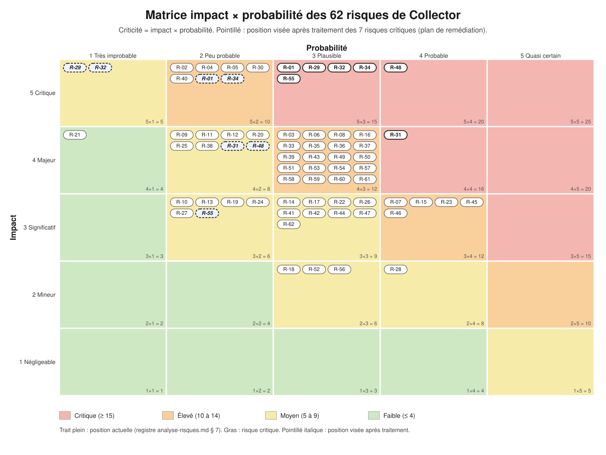

# Plan de remédiation de sécurité de Collector

Ce document est le **plan de remédiation priorisé** du critère 8. Il transforme le [registre de 62 risques](analyse-risques.md) (7 critiques, 30 élevés, 24 moyens, 1 faible) en **58 actions** datées, attribuées, chiffrées et mesurables, sur **tout le système d'information** de Collector : le POC, la plateforme Collector.shop cible et le système existant de la start-up. Il montre aussi, avec leurs preuves, les **bonnes pratiques de sécurité déjà intégrées au POC** (§ 7).

Rédigé le 11/11/2026 à partir de : [`analyse-risques.md`](analyse-risques.md) (échelles, hypothèses H-S01 à H-S18 et H-P01 à H-P03, convention H-00, conformité), [`rapport-scans.md`](rapport-scans.md) (constats F-01 à F-26, état après corrections en § 10), [`architecture-poc.md`](../02-architecture/architecture-poc.md#8-limites-assumées-du-poc) (mesures S1 à S9, limites L1 à L25), [`architecture-cible.md`](../02-architecture/architecture-cible.md), [`devsecops.md`](../01-qualite/devsecops.md), [`indicateurs.md`](../01-qualite/indicateurs.md) (axes d'amélioration d'I4) et [`docs/05-competences`](../05-competences/matrice.md) (équipe et recrutements).

> [!NOTE]
> **Ce que ce document ne fait pas.** Aucune action n'est appliquée ici (sauf celles déjà faites par P9-02, montrées au § 7.2). Les notes du registre ne sont pas modifiées. Les coûts sont des **ordres de grandeur** : chacun est sourcé ou marqué « estimation » ; aucun n'a fait l'objet d'un devis. L'état réel de l'ancien système d'information est **inconnu** : tout ce qui le concerne dépend de la vérification des hypothèses (PA-01), qui est la première action du plan.

## Synthèse projetable

Les sept risques critiques du registre, leur action principale et leur position avant et après traitement (détail au § 6) :

| Risque critique | Action principale | Horizon | Avant → après |
| --- | --- | --- | --- |
| **R-48** Hameçonnage d'un dirigeant ou de l'administratif, lecture des boîtes, détournement de virement | PA-02 (MFA) et PA-03 | CT | 20 → 8 (5×4 → 4×2) |
| **R-31** Faux vendeurs, comptes jetables, acheteurs de mauvaise foi | PA-27 (exigences), PA-41 (réalisation) | CT puis MT | 16 → 8 (4×4 → 4×2) |
| **R-01** Compromission du Mac du Lead Developer, kubeconfig, `.env`, CA mkcert, GitHub | PA-15 et PA-16 | CT | 15 → 10 (5×3 → 5×2) |
| **R-29** Faux webhook « paiement capturé » ou rejeu | PA-26 (exigences), PA-39 (réalisation) | CT puis MT | 15 → 5 (5×3 → 5×1) |
| **R-32** Compte vendeur repris, coordonnées de reversement changées | PA-28 (exigences), PA-40 (réalisation) | CT puis MT | 15 → 5 (5×3 → 5×1) |
| **R-34** Fuite d'adresses, d'e-mails, d'historiques et d'échanges de milliers de personnes | PA-29 (exigences), PA-42 (réalisation) | CT puis MT | 15 → 10 (5×3 → 5×2) |
| **R-55** Rançongiciel sur les postes et les fichiers synchronisés, sans sauvegarde hors ligne | PA-08 (sauvegarde restaurée) | CT | 15 → 6 (5×3 → 3×2) |

**Règle d'ouverture de la plateforme** : elle n'est ouverte à des utilisateurs réels que lorsqu'aucun risque du registre n'est noté critique (15 ou plus) et que PA-39, PA-40, PA-41, PA-42 et PA-49 sont livrés et vérifiés.



## Sommaire

1. [Lecture rapide](#1-lecture-rapide)
2. [Méthode de priorisation](#2-méthode-de-priorisation)
3. [Matrice impact × probabilité](#3-matrice-impact--probabilité)
4. [Plan d'action](#4-plan-daction)
5. [Couverture de tout le SI](#5-couverture-de-tout-le-si)
6. [Les 7 risques critiques et le registre complet](#6-les-7-risques-critiques-et-le-registre-complet)
7. [Déjà appliqué dans le POC](#7-déjà-appliqué-dans-le-poc)
8. [Feuille de route et budget](#8-feuille-de-route-et-budget)
9. [Suivi du plan](#9-suivi-du-plan)
10. [Sources, hypothèses de coût et réserves](#10-sources-hypothèses-de-coût-et-réserves)

## 1. Lecture rapide

| Horizon | Actions | Effort | Coût ponctuel (estimation) | Coût récurrent annuel (estimation) |
| --- | ---: | ---: | --- | --- |
| Court terme (0 à 3 mois) | 29 | 64 j | 100 à 2 350 € | 560 à 1 930 € |
| Moyen terme (3 à 6 mois) | 21 | 97,5 j | 6 500 à 16 500 € | 3 120 à 11 900 € |
| Long terme (6 à 12 mois et plus) | 8 | 64 j | 0 € | 5 600 à 13 800 € |
| **Total** | **58** | **225,5 j** | **6 600 à 18 850 €** | **9 280 à 27 630 €** |

- **Ce qui est traité en premier** : les 7 risques critiques et, parce qu'elles coûtent peu, les protections de l'existant (MFA, sauvegarde, postes chiffrés). Au bout de 3 mois, les trois critiques du système existant et du poste du Lead Developer (R-48, R-55, R-01) sont réduits, et les exigences des quatre critiques de la plateforme future (R-29, R-31, R-32, R-34) sont écrites, testables et bloquantes avant le développement ; ces quatre-là ne sont réduits qu'à la livraison de leur réalisation (§ 8.3).
- **Résultat attendu** (sommes des I × P du registre, § 8.3) : criticité cumulée de 650 aujourd'hui à 298 au bout de 12 mois (−54 %) ; risques critiques de 7 à 0 ; risques élevés de 30 à 3 (R-01, R-30 et R-34 : résiduels élevés **à faire accepter par la direction**, par écrit, et surveillés).
- **Règle d'ouverture de la plateforme** : elle n'est ouverte à des utilisateurs réels que lorsqu'aucun risque du registre n'est noté critique (15 ou plus) et que PA-39, PA-40, PA-41, PA-42 et PA-49 sont livrés et vérifiés. (§ 6.1).

## 2. Méthode de priorisation

### 2.1 Échelles et seuils (reprise de P9-03)

Criticité = impact (1 à 5) × probabilité (1 à 5), probabilité **résiduelle** (mesures existantes comprises) ; échelles complètes dans [`analyse-risques.md` § 2](analyse-risques.md#2-échelles-et-seuils). Seuils : **critique ≥ 15**, **élevé 10 à 14**, **moyen 5 à 9**, **faible ≤ 4**. Rappel de la convention H-00 : les risques du POC sont notés comme s'il était en production tel quel, ceux de la cible comme si elle était construite avec les seules mesures décrites.

### 2.2 Règles qui transforment criticité, effort et dépendances en horizon

L'**effort** est celui de l'action en jours-personne ; l'**horizon** est la date limite de l'action, pas son début.

| Règle | Condition | Décision | Pourquoi |
| --- | --- | --- | --- |
| **R1** | Chaque risque critique (≥ 15) | **Au moins une action à court terme**, quel que soit l'effort ; les actions complémentaires du même risque suivent R2 à R9 | Une perte de plus de 150 000 € ou de la confiance de la place de marché ne s'arbitre pas par l'effort |
| **R2** | Risque élevé, effort de l'action ≤ 3 j | **Court terme** | Le gain est grand pour un coût qui ne retarde rien |
| **R3** | Risque élevé, effort de l'action > 3 j | **Moyen terme** | Traité après les risques qui coûtent peu, mais avec échéance |
| **R4** | Risque moyen | Effort ≤ 2 j : **court terme** (gain rapide) ; 2 à 5 j : **moyen terme** ; > 5 j ou dépendant de la migration en production : **long terme** ; accepté si l'effort ne se justifie pas | Le registre dit « traiter si le coût est faible, sinon accepter explicitement » |
| **R5** | Risque faible (≤ 4) | **Accepter et surveiller** | La note est conservée à chaque revue |
| **R6** | Hypothèse non vérifiée (tout le bloc C et H-P01 à H-P03) | **Vérifier d'abord** (PA-01), agir ensuite ; hypothèse confirmée : l'action est maintenue ; infirmée : la probabilité du registre baisse et l'action est reclassée ; non vérifiable sous 30 jours : on garde la note du registre (pire cas) | Une action sur une hypothèse fausse gaspille l'effort ; une hypothèse fausse en sens inverse laisse un critique sans traitement. Exception : les actions peu coûteuses sur H-S01, H-S06 et H-S14 (PA-02, PA-07, PA-08) démarrent sans attendre la fin de PA-01, car leur coût est inférieur à celui d'une erreur |
| **R7** | Risque d'un composant qui n'existe pas (cible), ou action qui exige un recrutement | Le court terme porte l'**exigence écrite et testable** pour un risque critique (elle bloque le développement) ; la **réalisation** est datée avant l'ouverture (moyen terme) ou à la livraison du composant | On ne corrige pas ce qui n'est pas construit : on le conçoit sûr. Le risque reste noté critique tant que la réalisation n'est pas livrée et testée |
| **R8** | Plusieurs actions dans un même horizon | Une action qui traite plusieurs risques hérite de la criticité la plus élevée ; l'ordre de réalisation suit la criticité puis le gain par jour d'effort, puis les dépendances (vagues du § 8.1) | Mutualiser (une MFA protège 5 risques) coûte moins que traiter chaque risque |

| **R9** | Action dont l'horizon diffère de celui que R1 à R4 donnent pour son risque directeur | Elle porte la mention **« Exception »** et sa raison sur sa ligne : réalisation d'une exigence déjà écrite (R7), action complémentaire dépendante (R8) ou action périodique | Les règles ne cachent aucun écart ; `verifier-plan.py` contrôle qu'aucun écart n'est sans mention |

**Risque directeur d'une action** : le risque de plus haute criticité parmi ses risques principaux (ou, à défaut, parmi tous ses risques) ; les règles R1 à R4 s'appliquent à lui avec l'effort de l'action. Un risque peut avoir plusieurs actions : la première satisfait R1 à R4, les autres sont complémentaires.

**Ce qui ne change pas la priorité** : la sévérité d'un outil (par exemple « HIGH » de Trivy) n'a pas de poids propre : seul compte le risque du registre auquel le constat est rattaché (§ 8 du registre).

### 2.3 Résiduel visé

Pour chaque risque, la **criticité résiduelle visée** est la note (impact, probabilité) attendue **après toutes ses actions réalisées et leur indicateur de réussite atteint**. Elle ne baisse l'impact que si l'action agit réellement sur la conséquence (sauvegarde restaurée, virement validé par deux personnes), et la probabilité sinon. Un risque dont le résiduel reste élevé est dit, et **la direction doit l'accepter par écrit** (R-01, R-30, R-34 : résiduels de 10, voir la colonne « Traitement » du § 6.2) ; sans cette acceptation il reste ouvert.

### 2.4 Résiduels à probabilité 1

Une probabilité visée de 1 (« très improbable ») est une affirmation forte. Elle est donc justifiée ci-dessous quand elle n'est pas évidente, et jamais accordée avant la livraison de l'action : la projection du § 8.3 garde la note actuelle (ou le palier) tant qu'une action du risque n'est pas échue.

| Risque | Visé | Pourquoi la probabilité peut tomber à 1 |
| --- | :-: | --- |
| R-02 | 5×1 | La MFA obligatoire et la branche `main` protégée ferment les deux voies du scénario (compte volé, push direct) ; l'action (PA-16) est de court terme et ne dépend ni de PA-52 ni d'un recrutement |
| R-29 | 5×1 | Six tests écrits d'avance (signature, rejeu, horodatage, ordre inversé, montant, PSP indisponible), rapprochement quotidien avec le PSP et test d'intrusion : le faux webhook est refusé par la signature et par la relecture chez le PSP ; il faudrait un défaut du PSP lui-même |
| R-32 | 5×1 | Un compte vendeur n'est plus repris sans second facteur ; un changement de coordonnées exige une réauthentification forte puis 48 h sans reversement : l'attaquant devrait cumuler le vol du facteur et une attente sans détection |
| R-46 | 3×1 | MFA sur le compte administrateur de WordPress, `xmlrpc.php` coupé, tentatives limitées : le mot de passe seul ne donne plus accès |
| R-24 | 3×1 | Gitleaks sur l'historique, blocage en CI et analyse des secrets de GitHub : un secret commité est détecté avant ou à la livraison (l'erreur humaine subsiste, elle est attrapée) |
| R-10, R-17, R-18, R-19, R-25 | 3×1 ou 4×1 | **Conditionnés à une action de long terme** (PA-55, PA-54, PA-51) : aucun crédit n'est pris avant livraison (§ 8.3). R-01 (5×2) et R-14, R-30 (relevés à 2) l'illustrent : quand le gain dépend d'un recrutement ou d'un risque qui ne disparaît pas, la probabilité n'est pas ramenée à 1 |

Les autres résiduels à probabilité 1 supposent que le contrôle technique de l'action est prouvé par son indicateur de réussite : s'il ne l'est pas, la note remonte à la revue suivante.

## 3. Matrice impact × probabilité


La figure est produite par [`img/matrice-risques.py`](img/matrice-risques.py) (bibliothèque standard Python) qui **lit les notes dans le registre** ; elle ne peut donc pas diverger de [`analyse-risques.md`](analyse-risques.md). Trait plein : position actuelle ; pointillé italique : position visée des 7 risques critiques.

**Avant traitement** (les numéros sont ceux du registre, `R-` omis ; C critique, É élevé, M moyen, F faible) :

| Impact \ Probabilité | 1 | 2 | 3 | 4 | 5 |
| --- | --- | --- | --- | --- | --- |
| **5** | (M) | 02, 04, 05, 30, 40 (É) | 01, 29, 32, 34, 55 (C) | 48 (C) | (C) |
| **4** | 21 (F) | 09, 11, 12, 20, 25, 38 (M) | 03, 06, 08, 16, 33, 35, 36, 37, 39, 43, 49, 50, 51, 53, 54, 57, 58, 59, 60, 61 (É) | 31 (C) | (C) |
| **3** | (F) | 10, 13, 19, 24, 27 (M) | 14, 17, 22, 26, 41, 42, 44, 47, 62 (M) | 07, 15, 23, 45, 46 (É) | (C) |
| **2** | (F) | (F) | 18, 52, 56 (M) | 28 (M) | (É) |
| **1** | (F) | (F) | (F) | (F) | (M) |

**Après traitement** (nombre de risques par case, positions visées de ce plan) :

| Impact \ Probabilité | 1 | 2 | 3 | 4 | 5 |
| --- | --- | --- | --- | --- | --- |
| **5** | 6 (M) | 3 (É) | 0 (C) | 0 (C) | 0 (C) |
| **4** | 20 (F) | 5 (M) | 0 (É) | 0 (C) | 0 (C) |
| **3** | 13 (F) | 10 (M) | 1 (M) | 0 (É) | 0 (C) |
| **2** | 3 (F) | 1 (F) | 0 (M) | 0 (M) | 0 (É) |
| **1** | 0 (F) | 0 (F) | 0 (F) | 0 (F) | 0 (M) |

Les 7 risques critiques se déplacent ainsi (détail et conditions au § 6) : R-48 de 5×4 à 4×2, R-31 de 4×4 à 4×2, R-01 de 5×3 à 5×2, R-29 de 5×3 à 5×1, R-32 de 5×3 à 5×1, R-34 de 5×3 à 5×2, R-55 de 5×3 à 3×2.

## 4. Plan d'action

Légende des responsables (rôles de l'équipe réelle ou prévue, voir [`matrice.md`](../05-competences/matrice.md)) : **D** dirigeant·e (aussi Product Owner), **RH** responsable administratif et RH, **COM** responsable communication et marketing, **LD** Lead Developer (**référent sécurité** et propriétaire du plan, § 9), **Dev 1**, **Dev 2**, **DevOps** ingénieur DevOps/SRE à recruter (arrivée après le POC), **DPO externe** et **prestataire** externes. Tant que le DevOps n'est pas arrivé, ses actions sont portées par le LD. Les profils de Dev 1 et de Dev 2 sont des hypothèses de la matrice de compétences ; seule l'attribution par rôle compte. Les efforts sont en jours-personne ; « Résiduel visé » : `R-xx : note avant → note après`.

### 4.1 Court terme (0 à 3 mois)

| Id | Action et mise en œuvre | Risques traités | Justification de la priorité | Responsable, effort, coût | Dépendances | Indicateur de réussite | Résiduel visé |
| --- | --- | --- | --- | --- | --- | --- | --- |
| **PA-01** — Vérifier les hypothèses avant d'agir | Dérouler une liste de contrôle unique sur les 21 hypothèses H-S01 à H-S18 et H-P01 à H-P03 : rapport d'inscription MFA et rôles d'administration (centre d'administration Microsoft 365), consultation DNS de SPF, DKIM et DMARC, paramètres de partage SharePoint et Power BI, état du chiffrement et des administrateurs locaux de chaque poste, réglages de l'hébergeur WordPress, réglages GitHub (MFA, protection de `main`), `secrets-encryption` de k3s, paramètres de force brute du realm. Consigner pour chaque hypothèse : confirmée, infirmée ou partielle, la preuve (capture ou commande) et la note de probabilité révisée du registre. | R-01, R-02, R-03, R-08 et R-45 à R-62 (tout le bloc C et les hypothèses H-P) | Les 18 risques du bloc C reposent sur des hypothèses non vérifiées (§ 5.1 du registre) : une action engagée sur une hypothèse fausse gaspille de l'effort, une hypothèse fausse en sens inverse laisse un risque critique (R-48, R-55) sans traitement. Cette action est la première du plan et conditionne l'ordre des autres. | **LD (avec D pour les accès administrateur)** ; **4 j** ; 0 € | Aucune ; PA-02 à PA-12 peuvent démarrer sur les hypothèses les plus graves (H-S01, H-S06, H-S14) sans attendre la fin. | 21 hypothèses closes avec preuve ; probabilités révisées dans une nouvelle version du registre ; écart entre note supposée et note vérifiée consigné. | Aucune baisse propre (action de vérification) : fixe les 21 probabilités du registre. Effet attendu : 21 notes revues ; R-01 passe de 15 à 10 si H-S09 est infirmée. |
| **PA-02** — MFA pour tous les comptes Microsoft 365, authentification héritée bloquée, comptes d'administration séparés | Activer les valeurs par défaut de sécurité de Microsoft Entra ID (gratuites : MFA exigée de tous les utilisateurs et des administrateurs, blocage des protocoles d'authentification héritée) ou, si l'on dispose d'Entra ID P1, une stratégie d'accès conditionnel équivalente ; imposer l'application Authenticator avec nombre à saisir ; créer des comptes d'administration dédiés (aucun usage de messagerie) et deux comptes de secours hors MFA protégés par un mot de passe long conservé dans un coffre ; révoquer les sessions existantes après activation. | R-40, R-48, R-49, R-55, R-58 | Critique 20 (5 × 4) : R-48 est le premier risque du registre et la fraude au faux président est la première cause d'incident des petites structures ; la MFA associée au blocage de l'authentification héritée arrête, selon Microsoft, plus de 99,9 % des attaques d'identité courantes (affirmation de l'éditeur, Microsoft Learn, § 10.1). Effort de 2 jours, coût nul : critique, donc court terme. | **D (compte administrateur) avec LD** ; **2 j** ; 0 € (valeurs par défaut de sécurité gratuites, source Microsoft Learn) | PA-01 (savoir qui n'a pas la MFA) ; information des salariés avant l'activation (PA-04). | 100 % des comptes avec une méthode MFA inscrite (rapport d'inscription) ; 0 connexion par authentification héritée sur 30 jours (journal de connexion) ; 2 comptes de secours testés. | R-48 : 20 → 8 (5×4 → 4×2) |
| **PA-03** — Double validation des virements et des changements de coordonnées bancaires | Écrire et faire signer par la direction une règle d'une page : tout virement au-dessus d'un seuil, toute nouvelle coordonnée bancaire d'un fournisseur ou d'un financeur et tout ordre reçu par e-mail ou téléphone est validé par deux personnes et par un rappel sur un numéro déjà connu (jamais celui du message). Journaliser les validations dans un tableau partagé. | R-48 | Critique 20 : la MFA (PA-02) ne protège pas d'un salarié trompé en personne ; la règle ramène l'impact d'un détournement de plus de 150 000 € à un incident borné par le seuil (impact 5 → 4). Une journée, aucun coût : critique, donc court terme. | **D avec RH** ; **1 j** ; 0 € | Aucune. | Règle signée ; 100 % des virements au-dessus du seuil avec deux validations (contrôle trimestriel par RH sur un échantillon de 10). | R-48 : 20 → 8 (5×4 → 4×2) |
| **PA-04** — Sensibilisation à l'hameçonnage et procédure de signalement | Séance de deux heures pour tous les salariés (cas réels : faux ordre de virement, faux lien Microsoft, pièce jointe piégée, consentement à une application), exercice d'hameçonnage simulé interne sur un message inoffensif, bouton ou adresse unique de signalement, rappel par courriel à chaque trimestre. Support écrit par le Lead Developer à partir du guide d'hygiène informatique de l'ANSSI. | R-48, R-54, R-61, R-62 | Critique 20 (R-48) et élevé 12 (R-54) : tous les scénarios de compromission du bloc C commencent par une personne qui clique ; la sensibilisation est la seule mesure qui agit sur ce premier maillon. Deux jours, coût faible : court terme. | **LD (animation) avec RH (planification)** ; **2 j** ; 0 à 600 € (estimation : intervenant externe optionnel pour la séance) | PA-02 (la MFA doit être en place pour que le message de la séance soit « signalez, la MFA vous protège »). | 100 % des salariés formés (liste d'émargement) ; taux de clic de l'exercice simulé sous 20 % à la deuxième campagne (seuil d'objectif, estimation) ; nombre de signalements en hausse. | R-54 : 12 → 8 (4×3 → 4×2) |
| **PA-05** — SPF, DKIM, DMARC, règles de transfert et consentement des applications dans Exchange et Entra ID | Publier ou corriger SPF et DKIM pour tous les expéditeurs légitimes (Exchange, fournisseur d'e-mails futur), poser DMARC à `p=none` avec rapports, puis `quarantine` après 4 semaines de rapports propres, puis `reject` ; interdire le transfert automatique vers l'extérieur ; restreindre le consentement des utilisateurs aux applications vérifiées et recenser les applications déjà autorisées ; alerte sur création de règle de boîte aux lettres. | R-37, R-49 | Élevé 12 (R-49) : sans ces réglages n'importe qui envoie un message au nom de Collector et une règle cachée survit à un changement de mot de passe ; deux jours, coût nul : élevé à faible effort, donc court terme. | **Dev 1 avec D** ; **2 j** ; 0 € | PA-01 (état réel de H-S02 et H-S03). | DMARC à `p=reject` avec 4 semaines de rapports sans échec légitime ; 0 règle de transfert externe ; liste des applications autorisées relue. | R-49 : 12 → 4 (4×3 → 4×1) |
| **PA-06** — Partage externe de SharePoint, OneDrive et Power BI | Remplacer les liens « toute personne » par des liens limités aux personnes désignées avec expiration (30 jours), désactiver la publication « sur le web » de Power BI et restreindre le partage aux invités nommés, revoir la liste des invités externes et des rapports publiés, étiqueter les dossiers RH et contrats. | R-50, R-51 | Élevé 12 pour R-50 et R-51 : une erreur de lien suffit à exposer des documents RH ou des pièces du crowdfunding, avec notification à la CNIL si des données personnelles sont touchées ; une journée et demie, coût nul : court terme. | **Dev 2 avec RH** ; **1,5 j** ; 0 € | PA-01 (H-S04, H-S05). | 0 lien « toute personne » actif ; 0 rapport Power BI publié sur le web ; revue des invités consignée. | R-50 : 12 → 4 (4×3 → 4×1)<br>R-51 : 12 → 4 (4×3 → 4×1) |
| **PA-07** — Poste de travail : chiffrement, droits, mises à jour | Activer BitLocker sur chacun des 7 portables Windows 11 (édition Pro ou supérieure requise : à vérifier, sinon option Business Premium) et FileVault sur le Mac de conception, stocker les clés de récupération dans Entra ID, retirer les droits d'administrateur local aux usages courants, activer les mises à jour automatiques de Windows et de macOS, inventorier et mettre à jour les logiciels tiers (navigateurs, Adobe, lecteurs PDF) avec `winget`, verrouillage à 5 minutes. | R-53, R-54, R-55, R-56 | Élevé 12 (R-53, R-54) : un portable volé non chiffré livre le courrier en cache et les fichiers synchronisés, et l'activité historique de Collector (événementiel) fait voyager les postes ; trois jours pour 7 portables et un Mac : court terme. | **LD** ; **3 j** ; 0 € si l'édition le permet ; option Business Premium (Intune, Defender for Business) environ 8 $ de plus par utilisateur et par mois selon des sources tierces, soit environ 670 $/an pour 7 personnes et 960 $/an pour 10 (estimation, à confirmer par devis en euros) | PA-01 (H-S06, H-S07, H-S08) ; décision de la direction sur l'option Business Premium. | 100 % des postes chiffrés avec clé de récupération stockée ; 0 poste avec droits d'administrateur local d'usage courant ; 100 % des postes à jour de moins de 30 jours. | R-53 : 12 → 4 (4×3 → 4×1)<br>R-54 : 12 → 8 (4×3 → 4×2)<br>R-56 : 6 → 2 (2×3 → 2×1) |
| **PA-08** — Sauvegarde indépendante (règle 3-2-1) et restauration éprouvée | Mettre en place une sauvegarde de Microsoft 365 (courrier, OneDrive, SharePoint) chez un prestataire indépendant du tenant, une copie hors ligne et chiffrée des dossiers critiques (RH, contrats, crowdfunding, fichiers de marque) sur un disque conservé hors du bureau, l'export du site WordPress ; rédiger la procédure de restauration, **la jouer une fois** sur un jeu de fichiers et un sinistre simulé (suppression massive, poste perdu), mesurer le temps de reprise, puis un test par trimestre. | R-47, R-55, R-56, R-59 | Critique 15 (R-55) et élevé 12 (R-59) : un rançongiciel chiffre les fichiers que OneDrive synchronise et propage ; une sauvegarde jamais restaurée n'est pas une sauvegarde. La mesure ne réduit pas la probabilité mais l'impact (5 → 3, arrêt de moins de 2 jours) : critique, donc court terme. | **LD avec D** ; **3 j** ; environ 100 à 200 € de disque et environ 250 à 420 €/an de sauvegarde Microsoft 365 par un prestataire (estimation : 3 à 5 € par utilisateur et par mois, 7 utilisateurs ; 360 à 600 € pour 10) | PA-01 (H-S14) ; PA-02 (la compromission d'un compte ne doit pas permettre d'effacer la sauvegarde : compte séparé). | Une restauration réussie documentée avec temps mesuré (objectif de moins de 4 h pour un dossier, estimation) ; test trimestriel consigné ; 1 copie hors ligne à jour de moins de 7 jours. | R-55 : 15 → 6 (5×3 → 3×2)<br>R-59 : 12 → 3 (4×3 → 3×1) |
| **PA-09** — Réseau de l'incubateur : profil public, partages coupés, appareils sensibles hors du réseau partagé | Imposer le profil réseau « public » sur les portables (pare-feu Windows actif, découverte et partage de fichiers désactivés), utiliser un partage de connexion mobile pour les opérations d'administration (centre d'administration Microsoft 365, GitHub, kubeconfig), vérifier que HTTPS est le seul usage, poser la question de l'isolation des clients à l'incubateur et consigner sa réponse. | R-57 | Élevé 12 (R-57) : le réseau est partagé avec d'autres entreprises et non maîtrisé ; un jour de réglages ramène la probabilité de 3 à 2 en attendant le VPN (PA-50) : élevé à faible effort, donc court terme. | **Dev 2** ; **1 j** ; 0 € | PA-01 (H-S10). | 100 % des postes en profil public sur le Wi-Fi de l'incubateur (inventaire) ; réponse écrite de l'incubateur. | R-57 : 12 → palier 8 (4×2) après le court terme, cible 4 (4×1) |
| **PA-10** — Site WordPress : mises à jour, accès administrateur, sauvegarde de l'hébergeur | Inventaire des extensions et du thème, suppression de tout ce qui n'est pas utilisé, mises à jour du cœur, des extensions et du thème avec activation des mises à jour automatiques de sécurité, version de PHP à jour, compte administrateur nominatif avec mot de passe long et MFA, désactivation de `xmlrpc.php`, limitation des tentatives de connexion, accès SFTP par clé ou authentification renforcée de l'espace client, vérification d'une sauvegarde de l'hébergeur et d'une restauration à blanc. | R-45, R-46, R-47 | Élevé 12 pour R-45 et R-46 : WordPress est scanné en continu par des robots et le site est la vitrine au moment du lancement ; deux jours, coût quasi nul : court terme. | **COM avec LD** ; **2 j** ; 0 à 150 €/an (estimation : extension de sécurité ou de MFA) | PA-01 (H-S11, H-S12). | 0 extension en retard de plus de 30 jours ; MFA sur 100 % des comptes administrateurs ; une restauration à blanc réussie. | R-45 : 12 → 6 (3×4 → 3×2)<br>R-46 : 12 → 3 (3×4 → 3×1)<br>R-47 : 9 → 6 (3×3 → 3×2) |
| **PA-11** — Comptes et identités : droits, administrateur global, départs | Lister tous les comptes, rôles d'administration, boîtes partagées et invités ; limiter le rôle d'administrateur global à 2 personnes qui ont un compte d'usage courant séparé ; supprimer les comptes inactifs ou d'anciens collaborateurs ; rendre nominatifs les comptes partagés ou, à défaut, tracer leur usage ; écrire la procédure d'arrivée et de départ (désactivation le jour du départ, transfert de la boîte, retrait des licences) ; revue des droits chaque trimestre. | R-40, R-58 | Élevé 12 (R-58) : un compte administrateur global qui sert au quotidien donne le tenant entier à un seul hameçonnage ; deux jours : court terme. | **D avec RH** ; **2 j** ; 0 € | PA-01 (H-S13) ; PA-02. | 0 compte inactif depuis plus de 90 jours ; administrateur global limité à 2 comptes dédiés ; première revue trimestrielle consignée. | R-58 : 12 → 4 (4×3 → 4×1) |
| **PA-12** — Comptes de marque, régies publicitaires et licences Adobe : coffre de mots de passe, MFA, accès nominatifs | Déployer un gestionnaire de mots de passe d'équipe, y placer tous les comptes partagés, activer la MFA sur chaque réseau social et chaque régie, remplacer les partages de mot de passe par des accès délégués nominatifs là où la plateforme le permet, associer les licences Adobe à des adresses professionnelles nominatives, fixer un plafond de dépense quotidien sur chaque compte publicitaire. | R-52, R-62 | Moyen 9 (R-62) et 6 (R-52), effort de 1,5 jour inférieur au seuil de deux jours : gain rapide en court terme (le coût d'un compte de régie détourné se compte en budget publicitaire et en image). | **COM** ; **1,5 j** ; environ 250 à 420 €/an (estimation : 3 à 5 € par utilisateur et par mois, 7 utilisateurs ; 360 à 600 € pour 10) | PA-01 (H-S17, H-S18). | 100 % des comptes de marque en MFA ; 0 mot de passe partagé hors du coffre ; plafond de dépense posé sur 100 % des régies. | R-62 : 9 → 3 (3×3 → 3×1)<br>R-52 : 6 → 2 (2×3 → 2×1) |
| **PA-13** — Politique de sécurité minimale, référent sécurité et procédure d'incident | Désigner officiellement le Lead Developer comme référent sécurité du plan ; rédiger une politique d'une dizaine de pages (mots de passe, MFA, postes, données personnelles, déplacements) et une procédure d'incident : qui prévenir, comment isoler, qui décide de notifier la CNIL (dans les 72 h, source CNIL), modèle de registre des violations, annuaire de crise imprimé ; un exercice de table de deux heures. | R-35, R-61 | Élevé 12 (R-61) : sans procédure, la première violation sera improvisée et les 72 h de notification courent déjà ; trois jours : élevé à faible effort, court terme. | **D (décision) avec LD (rédaction)** ; **3 j** ; 0 € | Aucune. | Politique signée et diffusée ; procédure d'incident testée par un exercice de table (compte rendu avec actions) ; registre des violations créé. | R-61 : 12 → 6 (4×3 → 3×2) |
| **PA-14** — Registre des fournisseurs, contrats de sous-traitance, plan de sortie | Recenser tous les fournisseurs (hébergeur WordPress, incubateur, Microsoft, Adobe, GitHub, SonarCloud, futur PSP, régies, fournisseur d'e-mails) avec les données traitées, le pays, le contrat et l'engagement de notification d'incident ; vérifier la présence d'un accord de sous-traitance (article 28 du RGPD, à confirmer sur le texte officiel) pour chacun qui traite des données personnelles ; pour l'hébergeur et le futur PSP, écrire un plan de sortie (export des données, délai). | R-38, R-60 | Élevé 12 (R-60) : sans registre ni contrat, Collector subit l'incident d'un tiers sans recours ; trois jours, coût faible : court terme. | **RH avec D** ; **3 j** ; 0 à 1 500 € (estimation : relecture juridique des contrats) | PA-01 (H-S15). | Registre complet (100 % des fournisseurs) ; 100 % des fournisseurs de données personnelles avec accord signé ou demandé. | R-60 : 12 → 6 (4×3 → 3×2) |
| **PA-15** — Protéger le poste du Lead Developer et ses secrets | Sortir le dépôt et les secrets (`deploy/local/.env`, `deploy/compose/.env`, `~/.kube`, clé de la CA mkcert) des dossiers synchronisés par iCloud (désactiver « Bureau et Documents » ou déplacer le projet vers un dossier non synchronisé), activer FileVault et un verrouillage automatique, imposer une clé de sécurité ou un passkey pour GitHub, GHCR et Microsoft 365, utiliser un jeton GitHub à périmètre minimal et à expiration pour GHCR, retirer la CA racine de mkcert du magasin de confiance quand le POC ne tourne pas ou limiter sa clé à un volume chiffré, établir une copie chiffrée hors ligne des secrets (PA-08). | R-01, R-03, R-25 | Critique 15 (R-01) : un seul poste détient toute l'administration du POC et de la chaîne de livraison ; H-S09 établit déjà le point d'iCloud. Deux jours : critique, donc court terme. | **LD** ; **2 j** ; 0 € (clé de sécurité matérielle optionnelle : environ 50 € l'unité, estimation) | PA-01 (H-S09) ; PA-08 (copie hors ligne des secrets). | 0 secret ni kubeconfig dans un dossier synchronisé (vérification par `find`) ; FileVault actif ; GitHub, GHCR et Microsoft 365 sous clé de sécurité. | R-01 : 15 → 10 (5×3 → 5×2)<br>R-03 : 12 → palier 8 (4×2) après le court terme, cible 4 (4×1)<br>R-25 : 8 → 4 (4×2 → 4×1) |
| **PA-16** — Protéger GitHub : MFA, branche `main`, jetons, analyse des secrets | Exiger l'authentification multifacteur sur le compte et l'organisation, protéger `main` (pull request obligatoire, vérifications `lint`, `test`, `sonar`, `build-scan`, `acceptance` requises, interdiction du force push et de la suppression), conserver des permissions de workflow en lecture seule par défaut, activer Dependabot (alertes de sécurité) et l'analyse des secrets de GitHub (gratuite pour un dépôt public, source GitHub), imposer CODEOWNERS pour `.github/` et `deploy/`. | R-01, R-02, R-24 | Élevé 10 (R-02, 5 × 2) : une image malveillante publiée par `main` est déployée telle quelle ; la protection est la règle d'organisation que `devsecops.md` classe encore en « cible ». Une journée : élevé à faible effort, court terme. | **LD** ; **1 j** ; 0 € | PA-15 (clé de sécurité) ; l'organisation multi-agents poussera désormais par pull request (règle de CLAUDE.md à ajuster par le chef). | `main` protégée (relevé des règles) ; 0 push direct sur `main` sur 30 jours ; alertes Dependabot et secrets traitées sous 7 jours. | R-02 : 10 → 5 (5×2 → 5×1) |
| **PA-17** — Keycloak : régler et éprouver la protection contre la force brute, MFA des administrateurs | Écrire explicitement dans le realm (`deploy/keycloak/collector-realm.json`) les paramètres de détection de force brute (échecs avant blocage, durée croissante, réinitialisation) au lieu des valeurs par défaut du produit ; jouer un test contrôlé sur un compte de test (N échecs successifs, blocage constaté, déblocage constaté, `alice` non verrouillée), archiver le protocole et le résultat dans `docs/04-experimentations` ; imposer la politique de mot de passe (12 caractères au moins) ; rendre obligatoire l'OTP pour le rôle `admin` (action requise `CONFIGURE_TOTP`) ; surveiller les échecs répétés (PA-32). | R-08 | Élevé 12 (R-08) : la protection est déclarée activée mais jamais éprouvée (H-P03) ; l'audit a justement exclu ce test (rapport § 8). Deux jours : élevé à faible effort, court terme. | **Dev 1** ; **2 j** ; 0 € | PA-01 (H-P03) ; PA-18 (limitation de débit complémentaire) ; Playwright à rejouer si la politique de mot de passe change les comptes de démonstration. | Test de force brute rejoué avec blocage constaté et archivé ; 100 % des comptes `admin` avec OTP ; Playwright 6 sur 6 maintenu. | R-08 : 12 → palier 8 (4×2) après le court terme, cible 4 (4×1) |
| **PA-18** — Limitation de débit à la bordure et plafond de publications | Ajouter le middleware `rateLimit` de Traefik (moyenne et rafale par adresse source) sur `api.` et sur les chemins de connexion de `auth.`, avec la stratégie d'adresse source adaptée à la chaîne de proxys du cluster ; ajouter un plafond de publications et de modifications de prix par vendeur et par jour dans `catalog-service` (réponse 429, RFC 9457) ; rejouer le test Locust à 200 utilisateurs pour vérifier que la charge normale n'est pas bridée et qu'une charge d'un seul poste l'est. | R-07, R-08, R-22, R-28 | Élevé 12 (R-07, 3 × 4) : un seul conteneur ZAP a déjà fait monter l'HPA à 4 réplicas pendant l'audit ; trois jours : élevé dont l'effort ne dépasse pas trois jours, donc court terme (règle R2). | **Dev 1** ; **3 j** ; 0 € | Aucune ; à coordonner avec PA-17 (même surface de connexion). | 429 constaté au-delà du seuil (test) ; p95 inchangé à 50 utilisateurs (Locust) ; 0 réponse 5xx à 200 utilisateurs ; réplicas maximaux atteints seulement par la charge légitime. | R-07 : 12 → 6 (3×4 → 3×2)<br>R-28 : 8 → 4 (2×4 → 2×2) |
| **PA-19** — Sauvegarde chiffrée de PostgreSQL hors du Mac et restauration éprouvée | CronJob quotidien `pg_dump` des trois bases (`catalog_db`, `notification_db`, base de Keycloak) avec un compte de sauvegarde en lecture seule, chiffrement du fichier avec `age` (clé hors du cluster, PA-15), envoi vers un stockage hors du Mac (stockage objet d'un hébergeur européen ou disque chiffré), rétention de 7 jours et 4 semaines, script `restore.sh` qui reconstruit les trois bases sur un cluster neuf, **restauration jouée** et temps mesuré (RPO et RTO) ; sauvegarde avant chaque migration dans `deploy.sh services`. | R-06, R-26, R-27 | Élevé 12 (R-06) : un seul disque et un seul nœud de stockage, aucune sauvegarde (ENF-20 est en cible) ; trois jours : élevé à faible effort, court terme. | **Dev 1** ; **3 j** ; environ 60 à 240 €/an de stockage objet (estimation : 5 à 20 €/mois) | PA-15 (gestion de la clé `age`). | Restauration complète réussie depuis la sauvegarde, `smoke.sh` 18/18 ensuite ; RPO de 24 h au plus ; RTO mesuré consigné ; sauvegarde du jour présente (contrôle d'alerte). | R-06 : 12 → palier 6 (3×2) après le court terme, cible 3 (3×1) |
| **PA-20** — Chiffrement des Secrets Kubernetes au repos | Vérifier l'état de H-P02, puis activer l'option `--secrets-encryption` du serveur k3s (non activée par défaut ; la documentation de K3s la présente comme une option de démarrage du serveur). **Reste à valider par un essai sur un cluster jetable** : si l'option s'applique à un cluster existant ou seulement à un cluster neuf, et la commande de vérification (`k3s secrets-encrypt status`, à relire dans la documentation). Une fois l'essai fait : l'ajouter à `deploy/local/cluster.sh create` et prouver par lecture directe de la base d'état qu'un Secret n'y est plus en clair. | R-03 | Élevé 12 (R-03) : la fuite du volume de k3s ou d'une sauvegarde de l'état donne tous les mots de passe ; une journée et demie : élevé à faible effort, court terme. | **Dev 1** ; **1,5 j** ; 0 € | PA-01 (H-P02) ; PA-19 (sauvegarde avant toute opération sur le cluster) ; résultat de l'essai sur cluster jetable (recréer le cluster réinstallerait Keycloak, `deploy.sh all`, seulement si l'essai l'exige). | `secrets-encrypt status` : enabled ; lecture directe de la base d'état : aucune valeur de Secret lisible ; déploiement complet `smoke.sh` 18/18. | R-03 : 12 → palier 8 (4×2) après le court terme, cible 4 (4×1) |
| **PA-21** — Scan planifié des images publiées et de l'arm64 des services | Ajouter un workflow `schedule` (une fois par jour) qui lit les digests déployés, lance Trivy 0.76.x (version et somme SHA-256 relevées à jour) sur chaque digest en amd64 et arm64, **sans** `--ignore-unfixed` pour archiver le décompte des vulnérabilités sans correctif, et ouvre une issue `sécurité` dès qu'une vulnérabilité CRITICAL ou HIGH **avec correctif** apparaît ; ajouter au job `publish` du backend l'étape « Trivy sur le digest publié (arm64) » que le front possède déjà. | R-02, R-13, R-14 | Moyen 9 (R-14) et surtout rappel de F-01 : une image publiée avec une CI verte avait 2 HIGH avec correctif le lendemain ; deux jours, effort au plus égal au seuil du gain rapide : court terme. C'est aussi l'axe d'I4 ouvert depuis la phase 5. | **Dev 1** ; **2 j** ; 0 € | PA-16 (permissions du workflow). | Workflow quotidien vert pendant 14 jours ; décompte des lignes sans correctif archivé (référence : 201 par service au 11/11/2026) ; temps de réaction à un correctif de moins de 7 jours. | R-14 : 9 → 6 (3×3 → 3×2) |
| **PA-22** — Gitleaks, pip-audit, Semgrep et Bandit en CI | Lancer Gitleaks une fois sur tout l'historique, traiter les trouvailles (rotation du secret si besoin), puis l'ajouter en étape de la CI (`lint`) avec une action ou un binaire épinglé et vérifié ; ajouter `pip-audit` (ou l'équivalent `uv audit`) sur `uv.lock` dans `test`, puis Semgrep (règles Python publiques) et Bandit dans `lint` pour compléter l'analyse statique de SonarCloud (L13). | R-24 | Moyen 6 (R-24) : un secret commité dans l'historique n'est vu par personne aujourd'hui (Trivy ne lit que les images) ; deux jours, gain rapide à la limite du seuil (règle R4) : court terme. | **Dev 1** ; **2 j** ; 0 € | PA-16. | 0 secret dans l'historique ; les quatre contrôles actifs en CI et bloquants sur un commit d'essai qui contient un faux secret et un motif Bandit connu. | R-24 : 6 → 3 (3×2 → 3×1) |
| **PA-23** — Isoler l'administration de PostgreSQL | Retirer le mot de passe du compte d'administration de PostgreSQL de tous les pods autres que celui de la base et du Job d'initialisation, déplacer la base de Keycloak sur sa propre instance (second StatefulSet) afin que la perte ou la compromission de l'instance des services ne donne pas la base des comptes, et prouver par un test que les comptes `catalog` et `notification` n'ont aucun droit sur la base de Keycloak. | R-04, R-05 | Élevé 10 (R-05, 5 × 2) : l'instance partagée expose les trois bases dont celle de Keycloak (L3) ; trois jours : élevé à faible effort, court terme (la réplication reste au long terme, PA-53). | **Dev 1** ; **3 j** ; 0 € (ressources locales) | PA-19 (sauvegarde avant de déplacer) ; `deploy.sh realm` (recréation de la base de Keycloak) à lancer avec l'accord du Lead Developer. | 2 instances distinctes ; test de refus (`permission denied`) sur chaque base croisée ; `smoke.sh` 18/18. | R-05 : 10 → 5 (5×2 → 5×1) |
| **PA-24** — Tester CORP `same-origin` avec Playwright | Basculer la valeur de `Cross-Origin-Resource-Policy` de `same-site` à `same-origin` dans le middleware du chart sur une branche d'essai, rejouer les 6 parcours Playwright avec le contrôle des violations de CSP (`frontend/e2e/run-cluster.sh`), décider selon le résultat (restes de F-07 dans le rapport § 10.2). | R-09 | Moyen 8 (R-09) : proposition ouverte du rapport des scans ; une demi-journée, effort sous le seuil du gain rapide : court terme. | **Dev 2** ; **0,5 j** ; 0 € | Cluster à jour. | Playwright 6 sur 6 avec `same-origin` ; décision consignée (adopter ou garder `same-site` avec la raison) ; le reste CORP disparaît du rapport ZAP si adopté. | R-09 : aucune baisse seule (8) ; cible 4 (4×1) avec PA-34 et PA-56. |
| **PA-25** — Grafana : retirer l'hôte public ou y brancher Keycloak | Retirer l'Ingress `grafana.` et accéder par `kubectl port-forward` (comme pour la console de Keycloak) ou, si l'accès public reste utile, brancher l'authentification de Grafana sur Keycloak (client OIDC dédié, rôle `admin`, MFA de PA-17) et désactiver le compte local. | R-22 | Moyen 9 (R-22) : cible connue des robots, aucune donnée personnelle mais exposition permanente ; une journée, gain rapide : court terme. | **Dev 1** ; **1 j** ; 0 € | PA-17 si SSO retenu. | `curl https://grafana.…` : 404 ou redirection vers Keycloak ; `smoke.sh` complété d'un contrôle. | R-22 : 9 → 3 (3×3 → 3×1) |
| **PA-26** — Exigences de sécurité du paiement : webhooks vérifiés, idempotents, rapprochés | Écrire l'ADR et les critères d'acceptation **avant** le service `payment` : vérification de la signature de chaque webhook avec comparaison en temps constant et tolérance d'horodatage (Stripe documente un en-tête `Stripe-Signature` en HMAC SHA-256, avec protection contre le rejeu ; pour un PSP qui ne signe pas, relire la ressource par l'API avant toute écriture), identifiant d'événement unique pour l'idempotence, aucune commande marquée payée sans rapprochement avec le PSP, liste d'adresses du PSP en filtre complémentaire, journal de chaque webhook reçu, test de rejeu et de faux événement écrits d'avance. | R-29 | Critique 15 (R-29) : un faux webhook « payé » répété entame le séquestre et rompt la garantie ; la plateforme n'existe pas encore, donc le court terme porte l'exigence écrite et testable, qui bloque le développement tant qu'elle n'est pas respectée (PA-39 la réalise). | **LD avec D (PO)** ; **3 j** ; 0 € | Choix du PSP (D) ; ENF-09. | ADR validée ; 6 critères d'acceptation écrits (signature invalide, horodatage hors tolérance, rejeu, ordre inversé, PSP indisponible, montant différent) avant la première ligne du service. | R-29 : 15 → 5 (5×3 → 5×1) |
| **PA-27** — Exigences anti-fraude de la place de marché | Définir et faire valider par la direction (PO) : KYC du PSP obligatoire avant tout reversement, libération du séquestre à la confirmation de réception, plafond et délai de reversement progressifs pour les nouveaux vendeurs, procédure de litige et de remboursement, signalement d'un vendeur, liste de refus (comptes jetables), jeu de règles d'anomalie de PA-36 chiffrées (seuils de prix, nombre de boutiques, délai entre notification et changement de prix). | R-16, R-31 | Critique 16 (R-31, 4 × 4) : premier risque métier des places de marché entre particuliers et promesse centrale du contexte (« Collector garantit le vendeur ») ; l'exigence est de court terme, la réalisation en moyen (PA-36 et PA-41). | **D (PO) avec LD** ; **4 j** ; 0 € | Choix du PSP ; PA-26. | Règles de fraude et de litige validées par écrit ; 100 % des règles traduites en critères d'acceptation ; chaque règle a un seuil chiffré. | R-31 : 16 → 8 (4×4 → 4×2) |
| **PA-28** — Exigences de protection des comptes vendeurs | Écrire les exigences : MFA obligatoire pour tout vendeur avant la première vente ; tout changement de coordonnées de reversement exige une réauthentification forte (step-up) puis un délai de 48 h pendant lequel les reversements sont suspendus, avec un courriel à l'ancienne adresse ; détection d'un nouvel appareil ou d'une nouvelle zone ; blocage des mots de passe compromis ; journal d'audit de ces changements. | R-08, R-32 | Critique 15 (R-32) : un compte repris détourne le séquestre ; l'exigence écrite est de court terme, sa réalisation (PA-40) vient avant la première vente. | **LD avec D (PO)** ; **2 j** ; 0 € | ENF-09 ; PA-17. | Exigences écrites avec 5 critères d'acceptation testables ; reprises dans le backlog (user stories de sécurité). | R-32 : 15 → 5 (5×3 → 5×1) |
| **PA-29** — Exigences de protection des données personnelles de la plateforme | Écrire : liste des données et de leur durée de conservation par finalité, minimisation (aucun champ non nécessaire), chiffrement au repos par le stockage managé, adresses de livraison chiffrées au niveau applicatif ou séparées dans un coffre de données, journaux sans donnée personnelle (identifiants seulement), accès aux données en lecture journalisés, durée de conservation des journaux de sécurité entre six mois et un an (recommandation CNIL), mécanismes d'effacement et d'export ; test de contrôle d'accès systématique par route (PA-33). | R-34, R-35 | Critique 15 (R-34) : une fuite de milliers d'adresses et d'échanges impose l'information individuelle ; l'exigence est écrite avant le code, réalisée en moyen terme (PA-33, PA-42, PA-49). | **LD avec D (PO)** ; **3 j** ; 0 € | PA-13 (politique) ; PA-14. | Exigences écrites ; chaque durée de conservation fixée (aucune « indéfinie ») ; critères d'acceptation reliés au registre des traitements (PA-44). | R-34 : 15 → 10 (5×3 → 5×2) |

### 4.2 Moyen terme (3 à 6 mois)

| Id | Action et mise en œuvre | Risques traités | Justification de la priorité | Responsable, effort, coût | Dépendances | Indicateur de réussite | Résiduel visé |
| --- | --- | --- | --- | --- | --- | --- | --- |
| **PA-30** — NetworkPolicies : refus par défaut puis autorisation flux par flux | Appliquer une NetworkPolicy de refus par défaut dans le namespace `collector` (entrée et sortie), puis autoriser uniquement : Traefik vers front, services et Keycloak ; services vers PostgreSQL, RabbitMQ et JWKS de Keycloak ; Prometheus vers `/metrics` ; Keycloak vers sa base ; DNS. k3s embarque un contrôleur de NetworkPolicy que `cluster.sh` ne désactive pas (`--disable-network-policy` absent ; à vérifier par un test, la page consultée de la documentation de K3s ne l'indique pas explicitement). Prouver par script qu'un pod d'essai ne joint plus PostgreSQL, RabbitMQ ni Keycloak hors des flux autorisés et que `smoke.sh` et Playwright restent verts. | R-04, R-05, R-10, R-11, R-12, R-19 | Élevé 10 (R-04, 5 × 2) : un pod compromis joint tout le cluster (L4) ; quatre jours, au-dessus du seuil de trois : moyen terme. C'est aussi le moyen de réduire R-11 (`X-Forwarded-*`) et R-19 (événements forgés). | **LD (appui Dev 1)** ; **4 j** ; 0 € | PA-23 (instances) ; PA-31. | Test de refus : 100 % des flux non autorisés échouent ; `smoke.sh` 18/18 et Playwright 6 sur 6 avec les politiques actives. | R-04 : 10 → 5 (5×2 → 5×1)<br>R-11 : 8 → 4 (4×2 → 4×1)<br>R-19 : 6 → 3 (3×2 → 3×1) |
| **PA-31** — Durcir RabbitMQ et Keycloak, borner l'infrastructure | Ajouter `securityContext` (non root, capacités retirées, `seccompProfile`) à Keycloak et à RabbitMQ (conteneur d'initialisation pour les droits du volume et le cookie Erlang, L18), lecture seule du système de fichiers de Keycloak en construisant l'image avec `kc.sh build` puis `start --optimized` (L17), `requests` et `limits` de CPU et de mémoire sur PostgreSQL, Keycloak et RabbitMQ (F-24), PodDisruptionBudget des services ; rejouer le protocole 5 (disponibilité) pour constater l'absence de régression. | R-11, R-12, R-26 | Moyen 8 (R-12) et 9 (R-26) ; et Trivy classe F-14 et F-15 en HIGH. Trois jours, au-dessus du seuil du gain rapide : moyen terme. | **Dev 1** ; **3 j** ; 0 € | PA-30 (tester d'abord le refus réseau). | Trivy config : 0 HIGH sur RabbitMQ et Keycloak (7 HIGH au total aujourd'hui, rapport § 4.1) ; protocole 5 rejoué sans erreur ; aucun pod d'infrastructure sans limites. | R-12 : 8 → 4 (4×2 → 4×1) |
| **PA-32** — Journaux centralisés, alertes de sécurité et conservation | Déployer Alertmanager et des règles d'alerte (taux d'erreur, p95, échecs d'authentification répétés de Keycloak, pod en redémarrage, sauvegarde manquante, échec de publication d'événement) vers une adresse de la direction et du Lead Developer ; centraliser les journaux JSON (Loki, avec `correlation_id` et `sub`) avec conservation de six mois à un an (recommandation CNIL pour les journaux de sécurité) ; persistance de Prometheus avec rétention de 15 jours ; exercice : provoquer une attaque de force brute et vérifier que l'alerte arrive. | R-22, R-23, R-39, R-44 | Élevé 12 (R-23, 3 × 4) : sans alerte ni journaux conservés, un incident passe inaperçu et la notification sous 72 h ne peut pas être établie ; six jours : moyen terme. | **Dev 1** ; **6 j** ; environ 120 à 600 €/an de stockage (estimation) | PA-17, PA-19 (alertes de sauvegarde). | Alerte reçue en moins de 5 minutes sur une force brute simulée ; 6 mois de journaux consultables par `correlation_id` ; 0 alerte non traitée de plus de 7 jours. | R-23 : 12 → 6 (3×4 → 3×2) |
| **PA-33** — Tests de sécurité systématiques des routes et passe ZAP en tant qu'administrateur | Écrire un test paramétré qui parcourt l'OpenAPI de chaque service et vérifie pour chaque route : 401 sans jeton, 403 avec un mauvais rôle, 403 ou 404 sur la ressource d'un autre utilisateur (UUID d'autrui) ; l'ajouter à la CI pour qu'aucune route nouvelle n'échappe au contrôle ; rejouer l'audit ZAP avec un jeton `admin` ; ajouter ZAP baseline en CI sur la pile `docker compose` (L13) ; ajouter une liste de contrôle de sécurité au modèle de pull request. | R-20, R-21, R-34 | Moyen 8 (R-20) mais risque de défaillance de contrôle d'accès, première catégorie de l'OWASP (A01) et cause directe du risque critique R-34 ; quatre jours : moyen terme. | **Dev 2 (appui QA à son arrivée)** ; **4 j** ; 0 € | PA-16 (pull request obligatoire). | Test de routes vert dans la CI et rouge sur une route volontairement non protégée (test du test) ; audit ZAP `admin` sans constat de niveau élevé. | R-20 : 8 → 4 (4×2 → 4×1)<br>R-21 : 4 → 4 (4×1 → 4×1) |
| **PA-34** — Durcir le front : CSP à nonce, ESLint majeur, en-têtes d'isolation | Faire porter un nonce par réponse à Emotion pour retirer `'unsafe-inline'` de `style-src` (L24), monter ESLint et `typescript-eslint` en version majeure sur une branche d'essai pour éliminer les 10 vulnérabilités modérées de l'outillage (F-25), poser COOP et COEP si les parcours Playwright le permettent (F-10) ; vérifier l'absence de violation de CSP. | R-09 | Moyen 8 (R-09) : réduit l'impact d'un script injecté ; trois jours : moyen terme. Priorité inférieure à PA-30 (le front n'a révélé aucune injection). | **Dev 2** ; **3 j** ; 0 € | PA-24. | ZAP front : 0 alerte moyenne ; `npm audit` complet : 0 ; Playwright 6 sur 6 sans violation de CSP. | R-09 : 8, puis 6 (3×2) par PA-34 seule (styles injectés refusés : impact 4 → 3) ; cible 4 (4×1) avec PA-56. |
| **PA-35** — Essai d'une base d'image minimale pour les services | Essai en branche d'une image d'exécution plus petite (par exemple les images « distroless » du projet public GoogleContainerTools/distroless, ou une image Debian dépouillée construite par nos soins) : taille, vulnérabilités sans correctif, démarrage, compatibilité amd64 et arm64 et de l'environnement construit par `uv` ; décision consignée dans une ADR ; retirer alors la ligne `apt-get --only-upgrade zlib1g` (L25). | R-13 | Moyen 6 (R-13) : 201 lignes sans correctif par service (F-04, F-26) sont acceptées parce que Debian n'a rien publié, la base minimale supprime les paquets (`util-linux`, `perl-base`…) ; trois jours : moyen terme. | **LD** ; **3 j** ; 0 € | PA-21 (mesure de référence). | Nombre de lignes sans correctif divisé par au moins 3 sur l'image essayée (objectif, estimation) ; tests d'acceptation 17 sur 17 ; ADR rédigée. | R-13 : 6 → 3 (3×2 → 3×1) |
| **PA-36** — Détection de fraude V1 : consommateur d'événements et règles | Créer le consommateur `fraud` sur sa propre file liée à l'exchange `article.events` (aucune modification de `catalog-service`, point d'extension du POC) qui applique les règles chiffrées de PA-27 (prix aberrant par catégorie, nombre de boutiques créées par jour, changement de prix après notifications), enregistre des alertes dans sa base et les expose à l'administrateur ; compteur Prometheus de publications en échec pour pallier L2 en attendant l'outbox (PA-54). | R-16, R-31 | Élevé 12 (R-16) : les événements nécessaires existent déjà, aucun consommateur ne les lit ; huit jours : moyen terme. | **Dev 1** ; **8 j** ; 0 € | PA-27 (règles) ; PA-32 (alertes) ; PA-54 pour la fiabilité complète. | 5 règles en production sur un jeu de scénarios de fraude simulés ; taux de détection mesuré (objectif 80 %, estimation) ; 0 modification de `catalog-service`. | R-16 : 12 → 8 (4×3 → 4×2) |
| **PA-37** — Contrôle des coordonnées obfusquées | Étendre `contact.py` aux contournements courants (chiffres en lettres, mots à la place des symboles comme « arobase » et « point », séparateurs exotiques, homoglyphes), tester contre un jeu de cas écrit à partir des contournements observés, garder la preuve de temps linéaire (régression S8786), ajouter un signalement acheteur ; la revue humaine (statut `PENDING_REVIEW`) reste au long terme (PA-57). | R-15 | Élevé 12 (R-15, 3 × 4) : l'enjeu est la commission de 5 % et le sujet central du contexte ; quatre jours : moyen terme. | **Dev 2** ; **4 j** ; 0 € | PA-27. | Jeu de 50 cas de contournement (estimation) : taux de détection d'au moins 90 % ; faux positifs mesurés sur un échantillon d'annonces légitimes ; détection en moins de 100 ms sur les pires cas. | R-15 : 12 → 6 (3×4 → 3×2) |
| **PA-38** — Migrations rétrocompatibles et test de retour arrière | Imposer la règle expand/contract (une migration ne supprime ni ne renomme dans la version qui l'introduit), ajouter à la CI un test `alembic upgrade` puis `downgrade` puis `upgrade` sur une base de test, et une vérification que l'ancienne version de l'application passe ses tests sur le nouveau schéma ; sauvegarde avant migration (PA-19). | R-27 | Moyen 6 (R-27) : `helm rollback` ne défait pas les migrations (L23) ; trois jours : moyen terme. | **LD** ; **3 j** ; 0 € | PA-19. | Test d'aller-retour en CI sur les deux services ; règle citée dans la liste de contrôle de la pull request. | R-27 : 6 → 3 (3×2 → 3×1) |
| **PA-39** — Réaliser la sécurité des paiements (webhooks signés, rapprochement, idempotence) | Implémenter dans le service `payment` les critères de PA-26 avec leurs tests (signature invalide, rejeu, horodatage hors tolérance, ordre inversé, montant différent) et le rapprochement quotidien avec le PSP ; journaliser chaque webhook ; alerter sur tout écart de rapprochement. | R-29, R-30 | Critique 15 (R-29) : réalisation de l'exigence de court terme ; huit jours, à terminer avant l'ouverture de la plateforme (aucune mise en production tant qu'un risque critique n'est pas réduit). **Exception à R1 à R4** (critique, réalisation en moyen terme) : règle R7, le service `payment` n'existe pas ; l'exigence de court terme (PA-26) satisfait R1. | **Dev 1** ; **8 j** ; 0 € | PA-26 ; PA-32 ; choix du PSP et environnement de test. | 6 tests d'acceptation de PA-26 verts en CI ; rapprochement quotidien sans écart pendant 30 jours de bac à sable ; risque R-29 ramené à 5 × 1. | R-29 : 15 → 5 (5×3 → 5×1) |
| **PA-40** — Réaliser la protection des comptes vendeurs (MFA, step-up, délai de reversement) | Configurer Keycloak pour exiger l'OTP ou une clé de sécurité (WebAuthn) pour le rôle `seller`, mettre en place la réauthentification avant tout changement de coordonnées de reversement, le délai de 48 h avec suspension des reversements et le courriel à l'ancienne adresse, la détection de nouvel appareil ; tests d'acceptation écrits en PA-28. | R-08, R-32, R-40 | Critique 15 (R-32) : réalisation de l'exigence de court terme, six jours, avant la première vente. **Exception à R1 à R4** (critique, réalisation en moyen terme) : règle R7, la fonction n'existe pas ; l'exigence de court terme (PA-28) satisfait R1. | **Dev 1** ; **6 j** ; 0 € | PA-28 ; PA-17 ; PA-39. | 5 tests d'acceptation de PA-28 verts ; 100 % des vendeurs avec un second facteur ; 0 reversement dans les 48 h suivant un changement de coordonnées (test). | R-32 : 15 → 5 (5×3 → 5×1) |
| **PA-41** — Réaliser les contrôles anti-fraude de la place de marché | Implémenter les règles de PA-27 : KYC obligatoire avant reversement (porté par le PSP), libération du séquestre à la confirmation de réception, plafond progressif des nouveaux vendeurs, parcours de litige avec preuve horodatée (PA-43), signalement d'un vendeur, suspension d'un vendeur par la modération (événement `seller.suspended`). | R-31 | Critique 16 (R-31) : réalisation des exigences de court terme ; huit jours, avant l'ouverture de la plateforme. **Exception à R1 à R4** (critique, réalisation en moyen terme) : règle R7, la fonction n'existe pas ; l'exigence de court terme (PA-27) satisfait R1. | **Dev 2 (appui Dev 1)** ; **8 j** ; 0 € | PA-27 ; PA-36 ; PA-39 ; PA-43. | Jeu de scénarios de fraude simulés : aucun reversement avant la réception ; taux de litiges suivi mensuellement ; risque R-31 ramené à 4 × 2. | R-31 : 16 → 8 (4×4 → 4×2) |
| **PA-42** — Réaliser la protection des données personnelles | Appliquer PA-29 : chiffrement au repos (stockage managé ou chiffrement applicatif des adresses de livraison), purge automatique à la fin des durées de conservation, journaux sans donnée personnelle (test qui échoue si un e-mail ou une adresse apparaît dans un journal), export et effacement d'un compte, journalisation des accès en lecture aux données sensibles, rotation des clés. | R-34, R-35 | Critique 15 (R-34) : réalisation de l'exigence de court terme ; six jours, avant l'ouverture. **Exception à R1 à R4** (critique, réalisation en moyen terme) : règle R7, la plateforme n'existe pas ; l'exigence de court terme (PA-29) satisfait R1. | **Dev 2** ; **6 j** ; 0 € | PA-29 ; PA-33 ; PA-51. | Test de journaux sans donnée personnelle vert ; essai de purge ; export et effacement jouables en moins de 5 minutes ; R-34 ramené à 5 × 2. | R-34 : 15 → 10 (5×3 → 5×2) |
| **PA-43** — Journal d'audit infalsifiable et double validation des actions d'administration | Table d'audit en ajout seul (aucune mise à jour ni suppression pour le compte applicatif), horodatée, signée par chaînage de hachages, exportée chaque jour vers un stockage hors du cluster, pour les actions du back-office (suppression d'articles et de vendeurs, modération), les décisions de litige et les échanges de chat ; double validation (quatre yeux) pour toute suppression en masse au-delà d'un seuil ; alerte sur un volume anormal d'actions d'administration. | R-39, R-44 | Élevé 12 (R-39) et moyen 9 (R-44) : sans trace, un abus d'administrateur est indémontrable et les litiges ne se tranchent pas ; cinq jours : moyen terme. | **Dev 2** ; **5 j** ; 0 € | PA-32 ; PA-47 (qui est administrateur). | Test : une tentative de modification d'une ligne d'audit échoue ; 100 % des actions d'administration journalisées (test) ; export quotidien contrôlé. | R-39 : 12 → 4 (4×3 → 4×1)<br>R-44 : 9 → 3 (3×3 → 3×1) |
| **PA-44** — Programme RGPD : registre, durées, droits, analyse d'impact, consentement, sous-traitants | Avec un·e DPO ou un cabinet externe (matrice de compétences, écart n° 4) : registre des traitements (modèle de la CNIL), durées de conservation par finalité, procédure de réponse aux demandes de droits (délai d'un mois à confirmer sur le texte du règlement), analyse d'impact pour les recommandations et la publicité ciblée, mécanisme de consentement (refus aussi simple que l'acceptation), minimisation des flux vers les régies et vers l'outil anti-fraude, accords de sous-traitance (PA-14), information des vendeurs. | R-35, R-36, R-38 | Élevé 12 (R-35 et R-36) : une plainte entraîne une mise en demeure puis une sanction ; huit jours internes et un accompagnement externe : moyen terme, avant tout traitement de données de recommandation ou de publicité. | **D avec DPO externe** ; **8 j** ; 1 500 à 3 000 € d'accompagnement ponctuel et 3 000 à 8 000 €/an de DPO externalisé (estimation, à confirmer par devis) | PA-13 ; PA-14 ; PA-29. | Registre complet ; 0 traitement sans base légale documentée ; AIPD signée pour les 2 traitements concernés ; délai de réponse aux droits mesuré. | R-35 : 12 → 4 (4×3 → 4×1)<br>R-36 : 12 → 4 (4×3 → 4×1) |
| **PA-45** — Page de paiement isolée et conforme SAQ A | Champs de carte hébergés par le PSP (redirection ou iframe), page de paiement sans script tiers (aucune régie, aucun outil d'analyse), CSP stricte et SRI sur chaque script de la page, surveillance des modifications de la page, questionnaire d'auto-évaluation confirmé avec l'acquéreur ou le PSP (SAQ A, à confirmer : les exigences relatives aux scripts de page de PCI DSS v4.0.1 sont à relire sur le texte officiel). | R-30 | Élevé 10 (R-30, 5 × 2) : un script injecté dans la page vole des cartes et fait sortir Collector du périmètre le plus léger ; quatre jours : moyen terme. | **Dev 2** ; **4 j** ; 0 à 1 500 € (estimation : appui de l'acquéreur ou du PSP) | PA-26 ; choix du PSP ; PA-34. | Aucun script tiers sur la page de paiement (contrôle automatisé de Playwright) ; questionnaire SAQ A confirmé par écrit. | R-30 : 10 → 10 (5×2 → 5×2) |
| **PA-46** — Bordure : CDN, WAF, quotas, origine fermée et plan de déni de service | Placer un CDN et un WAF d'un fournisseur européen devant la plateforme, restreindre l'entrée du cluster aux plages du CDN, quotas par clé et par IP à l'API Gateway, test de charge de la bordure (Locust, par le QA à son arrivée), plan de déni de service : qui appeler, comment basculer en mode dégradé (catalogue en lecture seule). | R-07, R-43 | Élevé 12 (R-43) : une plateforme de paiement indisponible en vente événementielle perd de l'argent et de la confiance ; cinq jours : moyen terme, avant la première vente événementielle. | **DevOps (appui LD)** ; **5 j** ; 0 à 3 000 €/an (estimation : CDN et WAF selon le trafic) | PA-18 ; migration vers le Kubernetes managé (PA-51). | Test de charge de la bordure sans erreur à 5 fois la charge nominale (objectif, estimation) ; accès direct au cluster refusé depuis l'extérieur du CDN. | R-43 : 12 → 8 (4×3 → 4×2) |
| **PA-47** — Fédération Entra ID : MFA imposée, rôles par groupe, revue | Fédérer le back-office par un groupe Entra dédié (`collector-admins`, 3 personnes au plus) vers le rôle `admin` de Keycloak, jamais par défaut ; exiger côté Entra l'accès conditionnel avec MFA pour ce groupe (PA-02) ; refuser l'accès sans MFA ; revue trimestrielle du groupe avec PA-11 ; journalisation de la connexion fédérée dans l'audit (PA-43). | R-40, R-58 | Élevé 10 (R-40, 5 × 2) : la compromission du compte Microsoft d'un salarié donnerait la plateforme ; deux jours seulement, mais le composant n'existe pas encore : moyen terme, daté de sa construction. **Exception à R2** (élevé de 2 jours, moyen terme) : règle R7, le back-office et la fédération n'existent pas ; la MFA des comptes Microsoft est faite à court terme (PA-02). | **Dev 1 avec D** ; **2 j** ; 0 € | PA-02 ; PA-11 ; construction du back-office. | Test : un compte hors du groupe n'obtient jamais `admin` ; test : connexion sans MFA refusée ; revue trimestrielle consignée. | R-40 : 10 → 5 (5×2 → 5×1) |
| **PA-48** — Exigences de sécurité des fonctions à venir et revue de menaces obligatoire | Écrire avant leur développement les exigences du chat (contrôle de l'origine du WebSocket, authentification du handshake, jeton court, débit par connexion, échappement des messages, filtrage des coordonnées), du service `media` (suppression des métadonnées EXIF, type de fichier vérifié, SVG refusé, stockage objet privé, aucune récupération d'image par URL), des e-mails (sous-domaine d'expédition dédié avec SPF, DKIM, DMARC, aucun lien issu d'un titre sans assainissement) et de la publicité (consentement) ; imposer une revue STRIDE d'une page avant chaque nouveau service (enchères, direct, bot). | R-33, R-37, R-41, R-42 | Élevé 12 (R-33, R-37) et moyen 9 (R-41, R-42) : ces fonctions n'existent pas, la règle est de les concevoir sûres plutôt que de les corriger ; quatre jours : moyen terme. | **LD** ; **4 j** ; 0 € | PA-29 ; PA-44. | 4 jeux d'exigences validés avant le premier ticket de développement correspondant ; 100 % des nouveaux services avec une revue de menaces jointe à leur ADR. | R-33 : 12 → 4 (4×3 → 4×1)<br>R-41 : 9 → 3 (3×3 → 3×1)<br>R-37 : 12 → 4 (4×3 → 4×1) |
| **PA-49** — Test d'intrusion externe avant la mise en production | Faire exécuter par un prestataire indépendant un test d'intrusion de la plateforme (API, front, Keycloak, flux de paiement de bac à sable, bordure) avec une passe authentifiée par rôle (acheteur, vendeur, administrateur) et une revue de la configuration du cluster ; corriger les constats critiques et élevés avant l'ouverture ; rejouer le test à chaque évolution majeure (PA-58). | R-04, R-20, R-32, R-34 | Moyen terme comme condition d'ouverture : c'est la vérification indépendante de toutes les réductions des critiques R-29, R-32 et R-34 et de R-04 ; la matrice de compétences prévoit déjà un test d'intrusion annuel. **Exception à R1** (condition d'ouverture) : règle R8, le test d'intrusion vérifie les réalisations PA-30, PA-33, PA-39, PA-40, PA-42 et ne peut pas les précéder ; R-34 a une action de court terme (PA-29). | **LD (suivi), prestataire externe** ; **1,5 j** ; 5 000 à 12 000 € (estimation : 5 à 8 jours de prestataire à 1 000 à 1 500 € par jour, à confirmer par devis) | PA-30, PA-33, PA-39, PA-40, PA-42 terminées ; environnement de recette. | Rapport remis ; 0 constat critique et 0 élevé ouverts à l'ouverture ; délai de correction des élevés sous 30 jours. | Aucune baisse propre : vérifie les résiduels visés (R-29 : 5, R-32 : 5, R-34 : 10, R-04 : 5). Un constat critique ou élevé les relève. |
| **PA-50** — VPN d'entreprise pour les postes et accès d'administration | Mettre en place un VPN (WireGuard auto-hébergé ou service géré) obligatoire hors des locaux, avec accès d'administration réservé aux postes enrôlés ; vérifier l'isolation des clients du Wi-Fi de l'incubateur selon la réponse de PA-09. | R-57 | Élevé 12 (R-57) : réduit la probabilité de 3 à 1 ; deux jours, mais dépend de la réponse de l'incubateur et de la gestion des postes (PA-07) : moyen terme. **Exception à R2** (élevé de 2 jours, moyen terme) : action complémentaire (règle R8), dépend de PA-07 et de la réponse de l'incubateur ; R-57 a déjà une action de court terme (PA-09). | **LD** ; **2 j** ; 0 à 300 €/an (estimation : service de VPN géré) | PA-07 ; PA-09. | 100 % des postes avec VPN actif hors locaux ; accès d'administration refusé sans VPN (test). | R-57 : 12 → 4 (4×3 → 4×1) |

### 4.3 Long terme (6 à 12 mois et plus)

| Id | Action et mise en œuvre | Risques traités | Justification de la priorité | Responsable, effort, coût | Dépendances | Indicateur de réussite | Résiduel visé |
| --- | --- | --- | --- | --- | --- | --- | --- |
| **PA-51** — Migration vers le Kubernetes managé : TLS public, coffre de secrets, chiffrement géré | Déployer par le chart du POC sur le Kubernetes managé européen retenu (architecture-cible § 6), certificats par cert-manager et ACME (Let's Encrypt) sur un vrai domaine, retrait de la CA racine de mkcert de tout poste, secrets dans un coffre ou le service géré du fournisseur à la place des fichiers `.env`, chiffrement des Secrets et des volumes par le fournisseur, rotation des secrets. | R-03, R-10, R-25 | Moyen 8 (R-25) : disparaît avec la migration, qui est le jalon de mise en production ; huit jours, hors périmètre du POC. | **DevOps (recruté)** ; **8 j** ; 0 € de certificats (ACME, Let's Encrypt : gratuité à confirmer, estimation) ; hébergement hors du périmètre de ce plan | Recrutement du DevOps/SRE (matrice de compétences § 5.1) ; PA-20 ; formation Kubernetes et Helm du Lead Developer. | Aucune CA mkcert installée ; 100 % des secrets hors dépôt et hors fichiers locaux ; certificat valide renouvelé automatiquement (test d'expiration). | R-25 : 8 → 4 (4×2 → 4×1) |
| **PA-52** — Déploiement GitOps (Argo CD) sans identifiants du cluster dans le poste ni la CI | Argo CD synchronise le cluster avec le dépôt (L12) ; la CI ne détient plus de jeton d'administration du cluster ; le poste du Lead Developer n'a plus de kubeconfig administrateur en usage courant (accès par rôle nominatif avec journal d'audit) ; détection de dérive. | R-01 | Complément du traitement de R-01 (critique 15, déjà ramené à 5×2 par PA-15 et PA-16 à court terme) : supprime le poste comme point unique d'administration et vise 5×1, objectif non compté dans la cible parce qu'il dépend du recrutement du DevOps/SRE. **Exception à R1 à R4** : action complémentaire datée par R7 et R8 (migration vers le Kubernetes managé, recrutement), pas par la criticité de R-01. Huit jours : long terme. | **DevOps (recruté)** ; **8 j** ; 0 € | PA-51 ; PA-16 ; PA-15. | 0 kubeconfig administrateur hors coffre ; toute modification du cluster passe par un commit (contrôle de dérive à 0). | R-01 : 10 maintenu dans la cible ; 5 (5×1) si PA-52 est réalisé (objectif conditionné au recrutement, non compté). |
| **PA-53** — PostgreSQL managé et répliqué, Keycloak et RabbitMQ redondants, répartition des réplicas | PostgreSQL managé répliqué avec une base ou une instance par service et sauvegardes du fournisseur, Keycloak à plusieurs réplicas, RabbitMQ en cluster de 3 nœuds avec quorum queues, `topologySpreadConstraints` et PodDisruptionBudget, démonstration de panne de nœud. | R-05, R-06, R-11, R-26 | Moyen 9 (R-26) et 8 (R-11) : la disponibilité de la cible ; dix jours : long terme, avec la migration. | **DevOps (recruté)** ; **10 j** ; environ 600 à 1 800 €/an de surcoût pour un PostgreSQL managé répliqué (estimation) | PA-51 ; PA-23 ; PA-19. | Basculer un nœud sans coupure ni perte (démonstration) ; disponibilité mesurée au moins égale à 99,5 % (ENF-17). | R-26 : 9 → 6 (3×3 → 3×2)<br>R-11 : 8 → 4 (4×2 → 4×1) |
| **PA-54** — Fiabilité des événements : outbox, quorum queues, DLQ, idempotence, authentification par exchange | Table `outbox_events` écrite dans la transaction métier et relais (`FOR UPDATE SKIP LOCKED`) (L2) ; quorum queues et `x-delivery-count` (L21) ; DLQ par consommateur avec rejeu différé et alerte sur sa taille (L7, L22) ; idempotence générale ; comptes RabbitMQ distincts par service avec droits d'écriture et de lecture limités par exchange ; signature des événements sensibles. | R-17, R-18, R-19 | Moyen 9 (R-17), 6 (R-18, R-19) : fort effort et faible gravité tant que seules des notifications transitent ; deviennent prioritaires dès que l'anti-fraude et le paiement s'appuient sur le bus : long terme. | **Dev 1** ; **10 j** ; 0 € | PA-30 ; PA-36 ; PA-53 pour les quorum queues. | Événement jamais perdu dans un test de panne du broker entre commit et publication ; 0 message en échec sans DLQ ; 100 % des producteurs authentifiés distinctement. | R-17 : 9 → 3 (3×3 → 3×1)<br>R-18 : 6 → 2 (2×3 → 2×1)<br>R-19 : 6 → 3 (3×2 → 3×1) |
| **PA-55** — Chiffrement du trafic interne (mTLS par service mesh) | Service mesh (Linkerd, L10) en mTLS automatique entre pods ; vérifier la compatibilité avec les NetworkPolicies de PA-30. | R-10 | Moyen 6 (R-10) : suppose déjà R-04, que PA-30 supprime ; six jours, fort effort pour un gain résiduel : long terme. | **DevOps (recruté)** ; **6 j** ; 0 € | PA-30 ; PA-51. | 100 % des flux entre pods en mTLS (contrôle du mesh) ; latence p95 inchangée à 5 % près. | R-10 : 6 → 3 (3×2 → 3×1) |
| **PA-56** — BFF : jetons côté serveur, cookie `HttpOnly`, CSP sans `unsafe-inline` | Mettre en place le BFF décrit dans l'architecture cible : le navigateur ne détient plus de jeton, la session passe par un cookie `HttpOnly` `SameSite` ; CSP stricte (L5). | R-09 | Moyen 8 (R-09) : supprime l'exposition du jeton à un script injecté ; huit jours, changement d'architecture du front : long terme. | **Dev 2** ; **8 j** ; 0 € | PA-34 ; PA-51. | Aucun jeton lisible depuis le JavaScript de la page (test Playwright) ; ZAP front : 0 alerte moyenne. | R-09 : 8 → 4 (4×2 → 4×1) |
| **PA-57** — Modération : statut `PENDING_REVIEW`, analyse d'images et revue humaine | Service `moderation` (architecture cible) : analyse d'images (texte dans les photos), file de revue humaine pour les cas douteux, publication seulement après décision ; suppression des métadonnées EXIF au téléversement (R-41). | R-15, R-41 | Élevé 12 (R-15) : la part que le contrôle automatique ne rattrape pas ; dix jours : long terme, après la première version de la plateforme. **Exception à R3 et R4** (élevé de 10 jours en long terme) : règle R7, le service `moderation` n'existe pas ; R-15 a déjà une action de moyen terme (PA-37). | **Dev 2** ; **10 j** ; 0 € (estimation de coûts d'analyse d'images non chiffrée ici) | PA-37 ; PA-48. | Taux de détection des coordonnées dans les images mesuré sur un jeu de test ; temps moyen de revue sous 24 h. | R-15 : 12 → 6 (3×4 → 3×2)<br>R-41 : 9 → 3 (3×3 → 3×1) |
| **PA-58** — Revue annuelle : exercices, test d'intrusion, nouvelle notation du registre | Chaque année : exercice de restauration complète (PA-08 et PA-19), exercice d'incident avec notification simulée de la CNIL, test d'intrusion externe, nouvelle notation du registre avec les probabilités vérifiées, revue de la liste des fournisseurs et des droits, mise à jour de ce plan. | R-61 | Élevé 12 (R-61) : maintient dans la durée les réductions obtenues ; quatre jours internes par an : long terme (périodique). **Exception à R3** (élevé de 4 jours en long terme) : action périodique (règle R9), complément de PA-13 (court terme) pour R-61. | **LD avec D** ; **4 j** ; 5 000 à 12 000 €/an pour le test d'intrusion annuel (estimation, voir PA-49) | PA-13 ; PA-49. | Revue annuelle tenue à date ; criticité résiduelle moyenne du registre en baisse ou stable ; 100 % des exercices avec actions suivies. | R-61 : 12 → 6 (4×3 → 3×2) |

## 5. Couverture de tout le SI

### 5.1 Système d'information existant (bloc C), actif par actif

Chaque actif du contexte a au moins une action, et chacune commence par la vérification de l'hypothèse correspondante (PA-01).

| Actif | Hypothèses | Risques | Actions |
| --- | --- | --- | --- |
| C-01 Exchange et boîtes | H-S01 à H-S03 | R-48, R-49 | PA-02, PA-03, PA-04, PA-05 |
| C-02 Fichiers Office 365 (OneDrive, SharePoint, Teams) | H-S04, H-S14 | R-50, R-55 | PA-06, PA-08 |
| C-03 Power BI | H-S05 | R-51 | PA-06 (puis PA-44 pour l'entrepôt de la cible) |
| C-04 Adobe Creative Cloud | H-S18 | R-52 | PA-12, PA-07 (mises à jour) |
| C-05 Portables Windows 11 | H-S06, H-S07 | R-53, R-54, R-55 | PA-07, PA-08, PA-04, PA-50 |
| C-06 Mac de conception | H-S08 | R-56 | PA-07, PA-08 |
| C-07 Wi-Fi de l'incubateur | H-S10 | R-57 | PA-09, PA-50 |
| C-08 Site WordPress et hébergement | H-S11, H-S12 | R-45, R-46, R-47 | PA-10, PA-08 |
| C-09 Comptes et identités (Entra ID) | H-S13 | R-58 | PA-02, PA-11 |
| C-10 Sauvegardes et reprise | H-S14 | R-55, R-59 | PA-08, PA-58 |
| C-11 Comptes de marque et de publicité | H-S17 | R-62 | PA-12 |
| C-12 Fournisseurs | H-S15 | R-60 | PA-14 |
| Gouvernance (hors actif) | H-S16 | R-61 | PA-13, PA-58 |

### 5.2 POC et plateforme cible (blocs A et B), actif par actif

| Actif | Actions | Actif | Actions |
| --- | --- | --- | --- |
| A-01 Comptes Keycloak | PA-17, PA-23, PA-53 | B-01 Flux de paiement | PA-26, PA-39, PA-45 |
| A-02 Catalogue | PA-33, PA-38 | B-02 Données personnelles | PA-29, PA-42, PA-44 |
| A-03 Notifications | PA-33, PA-38 | B-03 Chat | PA-48 |
| A-04 Événements | PA-30, PA-54 | B-04 Photos | PA-48, PA-57 |
| A-05 Jetons OIDC | PA-24, PA-34, PA-56 | B-05 E-mails | PA-05, PA-48 |
| A-06 Secrets | PA-15, PA-20, PA-51 | B-06 Réputation, charte | PA-27, PA-41 |
| A-07 Poste du Lead Developer | PA-15, PA-16 | B-07 Détection de fraude | PA-27, PA-36 |
| A-08 Chaîne de livraison | PA-16, PA-21, PA-22, PA-52 | B-08 Audiences publicitaires | PA-44 |
| A-09 Images | PA-21, PA-35 | B-09 Entrepôt analytique | PA-06, PA-44 |
| A-10 Cluster | PA-23, PA-30, PA-31 | B-10 Back-office | PA-40, PA-43, PA-47 |
| A-11 Supervision | PA-25, PA-32 | B-11 Bordure | PA-46 |
| | | B-12 Journaux d'audit | PA-43 |

### 5.3 Limites L1 à L25 encore ouvertes

| Limite | Action | Limite | Action |
| --- | --- | --- | --- |
| L1 anti-fraude | PA-27, PA-36 | L14 internationalisation, accessibilité | Écartée du plan : sans effet sur la sécurité (registre § 8.2) |
| L2 outbox | PA-54 (compteur d'échecs en attendant : PA-36) | L15 coordonnées obfusquées | PA-37, PA-57 |
| L3 PostgreSQL unique | PA-23, PA-53 | L16 plan de contrôle redondant | PA-51 (Kubernetes managé) |
| L4 NetworkPolicies | PA-30 | L17 `securityContext` de l'infrastructure | PA-31 |
| L5 BFF et CSP | PA-56 (PA-34 d'ici là) | L18 RabbitMQ en root | PA-31 |
| L6 limitation de débit | PA-18, PA-17 | L19 `X-Forwarded-*` (réduite) | PA-30, PA-53 |
| L7 DLQ et quorum queues | PA-54 | L20 observabilité sans persistance ni accès | PA-25, PA-32 |
| L8 placement et PodDisruptionBudget | PA-31, PA-53 | L21 compteur de livraisons | PA-54 |
| L9 stockage répliqué et redondance | PA-53 | L22 remise en file immédiate | PA-54 |
| L10 mTLS | PA-55 | L23 retour arrière sans migration | PA-38 |
| L11 cert-manager | PA-51 | L24 `style-src 'unsafe-inline'` | PA-34, PA-56 |
| L12 GitOps | PA-52 | L25 images reconstruites avec les paquets à jour | PA-35, PA-21 |
| L13 Semgrep, Bandit, pip-audit, Gitleaks, ZAP | PA-22 (Gitleaks, pip-audit, Semgrep, Bandit), PA-33 (ZAP), PA-21 (Trivy planifié) | | |

### 5.4 Constats ouverts du rapport des scans et axes d'I4

| Constat ou axe | Origine | Action |
| --- | --- | --- |
| 201 lignes sans correctif par service (F-04, F-26) | Rapport § 10.2 | PA-35 (base minimale), PA-21 (suivi quotidien) |
| Scan planifié des images publiées ; version de Trivy ; arm64 des services au `publish` | Axes d'I4 de `indicateurs.md` ; proposition de P9-04 du rapport § 4.3 | PA-21 |
| `npm audit` majeur : ESLint (F-25) | Axe d'I4 ; rapport § 9.2 | PA-34 |
| CORP `same-origin` à tester par Playwright (reste de F-07) | Rapport § 10.2 | PA-24 |
| RabbitMQ et Keycloak : `securityContext` (F-14, F-15) | Rapport § 9.2 | PA-31 |
| Console Keycloak : reste la confiance dans `X-Forwarded-*` (F-06, L19) | Rapport § 10.1 | PA-30, PA-53 |
| Requêtes et limites de l'infrastructure (F-24) | Rapport § 9.2 | PA-31 |
| COOP, COEP, CORP du front (F-10) ; CSP à nonce (F-09, L24) | Rapport § 9.2 | PA-34, PA-56 |
| Limitation de débit ; force brute de Keycloak réglée et éprouvée (H-P03) | Rapport § 7, L6 | PA-17, PA-18 |
| ZAP et Trivy planifiés dans la CI (L13) | Rapport § 9.2 | PA-21, PA-33 |
| F-12, F-16, F-21, F-22 | Rapport § 5 | Aucune action, acceptés avec leur raison : F-12 (anti-CSRF faux positif, cookies standard de Keycloak), F-16 et F-21 (UID imposé par l'image officielle), F-22 (les sondes Kubernetes remplacent `HEALTHCHECK`) |
| Faux positifs (F-05, F-11, F-17 à F-20), constats informatifs (F-13) | Rapport § 5 | Aucune action : écartés avec leur preuve |

## 6. Les 7 risques critiques et le registre complet

### 6.1 Les 7 risques critiques

Chaque critique a au moins une action de **court terme** (règle R1). Pour les quatre risques de la plateforme future (R-29, R-31, R-32, R-34), le court terme livre l'exigence écrite et ses critères d'acceptation, la réalisation vient avant l'ouverture (règle R7).

| Risque | Scénario court | Avant | Actions | Après (cible) | Condition de réalisation |
| --- | --- | :-: | --- | :-: | --- |
| **R-48** | Hameçonnage d'un dirigeant ou de l'administratif, lecture des boîtes, détournement de virement | 5×4 = 20 | PA-01, PA-02, PA-03, PA-04 | 4×2 = 8 | PA-01 d'abord (H-S01) ; PA-02 et PA-03 dans les deux premières semaines |
| **R-31** | Faux vendeurs, comptes jetables, acheteurs de mauvaise foi | 4×4 = 16 | PA-27, PA-36, PA-41 | 4×2 = 8 | Exigence écrite à court terme ; réalisation avant l'ouverture de la plateforme |
| **R-01** | Compromission du Mac du Lead Developer, kubeconfig, `.env`, CA mkcert, GitHub | 5×3 = 15 | PA-01, PA-15, PA-16, PA-52 | 5×2 = 10 | FileVault et sortie d'iCloud (PA-15), GitHub protégé (PA-16) : 5×2 = 10, résiduel à faire accepter par la direction ; PA-52 (5×1) est un objectif non compté |
| **R-29** | Faux webhook « paiement capturé » ou rejeu | 5×3 = 15 | PA-26, PA-39 | 5×1 = 5 | Exigence écrite à court terme ; PA-39 avant l'ouverture |
| **R-32** | Compte vendeur repris, coordonnées de reversement changées | 5×3 = 15 | PA-28, PA-40, PA-49 | 5×1 = 5 | Exigence écrite à court terme ; PA-40 avant la première vente |
| **R-34** | Fuite d'adresses, d'e-mails, d'historiques et d'échanges de milliers de personnes | 5×3 = 15 | PA-29, PA-33, PA-42, PA-49 | 5×2 = 10 | Exigence écrite à court terme ; PA-33, PA-42, PA-49 avant l'ouverture ; résiduel de 10 à faire accepter par la direction |
| **R-55** | Rançongiciel sur les postes et les fichiers synchronisés, sans sauvegarde hors ligne | 5×3 = 15 | PA-01, PA-02, PA-07, PA-08 | 3×2 = 6 | PA-08 : la restauration doit avoir été jouée avec succès |

**Règle d'ouverture de la plateforme** : elle n'est ouverte à des utilisateurs réels que lorsqu'aucun risque du registre n'est noté critique (15 ou plus) et que PA-39, PA-40, PA-41, PA-42 et PA-49 sont livrés et vérifiés. Tant que ces actions ne sont pas livrées, R-29, R-31, R-32 et R-34 sont **encore notés critiques**.

### 6.2 Registre complet : chaque risque et son traitement

Les 62 risques du registre figurent ci-dessous avec leurs actions et leur résiduel. La colonne « Traitement » indique « Réduire » quand l'action diminue l'impact ou la probabilité ; sinon (accepter, transférer, ou réduire et accepter le reste) la raison est donnée. `verifier-plan.py` contrôle que les notes « avant » sont celles du registre.

| Risque | Actif | I × P avant | Criticité | Actions | Horizons | I × P visé | Traitement |
| --- | --- | :-: | --- | --- | --- | :-: | --- |
| **R-01** | A-07 poste du LD | 5×3 = 15 | Critique | PA-01, PA-15, PA-16, PA-52 | CT → LT | 5×2 = 10 (Élevé) | Réduire, résiduel élevé à faire accepter par la direction : Tant que le poste du Lead Developer reste le point d'administration, l'impact reste de 5 ; la probabilité passe de 3 à 2 par PA-15 et PA-16. L'objectif 5×1 (PA-52, GitOps) dépend du recrutement du DevOps/SRE : il n'est pas compté dans la cible et la direction doit accepter le résiduel de 10 en attendant. |
| **R-02** | A-08 chaîne CI/CD | 5×2 = 10 | Élevé | PA-01, PA-16, PA-21 | CT | 5×1 = 5 (Moyen) | Réduire |
| **R-03** | A-06 secrets | 4×3 = 12 | Élevé | PA-01, PA-15, PA-20, PA-51 | CT → LT | 4×1 = 4 (Faible) | Réduire |
| **R-04** | A-10 réseau interne | 5×2 = 10 | Élevé | PA-23, PA-30, PA-49 | CT → MT | 5×1 = 5 (Moyen) | Réduire |
| **R-05** | A-01 A-02 A-03 PostgreSQL | 5×2 = 10 | Élevé | PA-23, PA-30, PA-53 | CT → MT → LT | 5×1 = 5 (Moyen) | Réduire |
| **R-06** | A-01 A-02 A-03 données | 4×3 = 12 | Élevé | PA-19, PA-53 | CT → LT | 3×1 = 3 (Faible) | Réduire |
| **R-07** | A-10 API publique | 3×4 = 12 | Élevé | PA-18, PA-46 | CT → MT | 3×2 = 6 (Moyen) | Réduire |
| **R-08** | A-01 comptes Keycloak | 4×3 = 12 | Élevé | PA-01, PA-17, PA-18, PA-28, PA-40 | CT → MT | 4×1 = 4 (Faible) | Réduire |
| **R-09** | A-05 jetons, SPA | 4×2 = 8 | Moyen | PA-24, PA-34, PA-56 | CT → MT → LT | 4×1 = 4 (Faible) | Accepter jusqu'au BFF : Aucune injection trouvée ; `script-src` strict. PA-24 et PA-34 réduisent à court et moyen terme, PA-56 supprime l'exposition du jeton. |
| **R-10** | A-04 A-08 trafic interne | 3×2 = 6 | Moyen | PA-30, PA-51, PA-55 | MT → LT | 3×1 = 3 (Faible) | Accepter jusqu'à la migration, puis réduire : Suppose déjà R-04 : PA-30 supprime le chemin d'attaque en attendant le mTLS. |
| **R-11** | A-01 Keycloak | 4×2 = 8 | Moyen | PA-30, PA-31, PA-53 | MT → LT | 4×1 = 4 (Faible) | Réduire |
| **R-12** | A-10 RabbitMQ, Keycloak | 4×2 = 8 | Moyen | PA-30, PA-31 | MT | 4×1 = 4 (Faible) | Réduire |
| **R-13** | A-09 images des services | 3×2 = 6 | Moyen | PA-21, PA-35 | CT → MT | 3×1 = 3 (Faible) | Accepter la part sans correctif, réduire par la base d'image : F-04 et F-26 : aucun correctif publié par Debian ; PA-35 réduit la surface, PA-21 surveille chaque jour l'apparition d'un correctif. |
| **R-14** | A-09 images publiées | 3×3 = 9 | Moyen | PA-21 | CT | 3×2 = 6 (Moyen) | Réduire : Le scan quotidien raccourcit la fenêtre d'exposition d'une image publiée mais l'apparition d'un correctif après la construction reste un événement qui se produit : la probabilité est ramenée à 2, pas à 1. |
| **R-15** | A-02 articles, B-03 chat | 3×4 = 12 | Élevé | PA-37, PA-57 | MT → LT | 3×2 = 6 (Moyen) | Réduire |
| **R-16** | B-07 fraude (en POC : catalogue) | 4×3 = 12 | Élevé | PA-27, PA-36 | CT → MT | 4×2 = 8 (Moyen) | Réduire |
| **R-17** | A-04 événements | 3×3 = 9 | Moyen | PA-54 | LT | 3×1 = 3 (Faible) | Réduire |
| **R-18** | A-04 événements | 2×3 = 6 | Moyen | PA-54 | LT | 2×1 = 2 (Faible) | Réduire |
| **R-19** | A-04 bus | 3×2 = 6 | Moyen | PA-30, PA-54 | MT → LT | 3×1 = 3 (Faible) | Réduire |
| **R-20** | A-02 A-03 API | 4×2 = 8 | Moyen | PA-33, PA-49 | MT | 4×1 = 4 (Faible) | Réduire |
| **R-21** | A-02 A-03 données | 4×1 = 4 | Faible | PA-33 | MT | 4×1 = 4 (Faible) | Accepter et surveiller : Faible (4) : quatre barrières successives vérifiées par ZAP actif ; la surveillance est assurée par PA-33 (tests de routes) et PA-22 (analyse statique déjà bloquante). |
| **R-22** | A-11 Grafana | 3×3 = 9 | Moyen | PA-18, PA-25, PA-32 | CT → MT | 3×1 = 3 (Faible) | Réduire |
| **R-23** | A-11 journaux, supervision | 3×4 = 12 | Élevé | PA-32 | MT | 3×2 = 6 (Moyen) | Réduire |
| **R-24** | A-08 dépôt, déploiement | 3×2 = 6 | Moyen | PA-16, PA-22 | CT | 3×1 = 3 (Faible) | Réduire |
| **R-25** | A-07 CA mkcert, TLS | 4×2 = 8 | Moyen | PA-15, PA-51 | CT → LT | 4×1 = 4 (Faible) | Réduire à la migration (CA publique) : Sans effet dans le POC local : mkcert n'est pas destiné à la production, il disparaît à la migration (PA-51). |
| **R-26** | A-10 disponibilité | 3×3 = 9 | Moyen | PA-19, PA-31, PA-53 | CT → MT → LT | 3×2 = 6 (Moyen) | Réduire |
| **R-27** | A-02 A-03 migrations | 3×2 = 6 | Moyen | PA-19, PA-38 | CT → MT | 3×1 = 3 (Faible) | Réduire |
| **R-28** | A-02 API publique | 2×4 = 8 | Moyen | PA-18 | CT | 2×2 = 4 (Faible) | Réduire |
| **R-29** | B-01 paiement | 5×3 = 15 | Critique | PA-26, PA-39 | CT → MT | 5×1 = 5 (Moyen) | Réduire |
| **R-30** | B-01 page de paiement | 5×2 = 10 | Élevé | PA-39, PA-45 | MT | 5×2 = 10 (Élevé) | Accepter après transfert (PSP, SAQ A), résiduel élevé à faire accepter par la direction : La note actuelle (5×2) suppose déjà les champs de carte hébergés par le PSP (ENF-09) : PA-45 ne la baisse pas, elle la rend vérifiable (page marchande sans script tiers, CSP et SRI, SAQ A confirmé) et empêche sa dérive vers 5×3. Un script injecté dans la page marchande reste un scénario courant : la direction doit accepter le résiduel de 10. |
| **R-31** | B-06 B-07 vendeurs | 4×4 = 16 | Critique | PA-27, PA-36, PA-41 | CT → MT | 4×2 = 8 (Moyen) | Réduire |
| **R-32** | B-01 B-10 comptes vendeurs | 5×3 = 15 | Critique | PA-28, PA-40, PA-49 | CT → MT | 5×1 = 5 (Moyen) | Réduire |
| **R-33** | B-03 chat | 4×3 = 12 | Élevé | PA-48 | MT | 4×1 = 4 (Faible) | Réduire |
| **R-34** | B-02 données personnelles | 5×3 = 15 | Critique | PA-29, PA-33, PA-42, PA-49 | CT → MT | 5×2 = 10 (Élevé) | Réduire, résiduel élevé à faire accepter par la direction : Un impact de 5 ne baisse pas tant que la plateforme concentre les adresses et les échanges de milliers de personnes ; seule la probabilité baisse (10 = élevé) : la direction doit accepter ce résiduel par écrit, il est surveillé à chaque revue. |
| **R-35** | B-02 conformité RGPD | 4×3 = 12 | Élevé | PA-13, PA-29, PA-42, PA-44 | CT → MT | 4×1 = 4 (Faible) | Réduire |
| **R-36** | B-08 publicité | 4×3 = 12 | Élevé | PA-44 | MT | 4×1 = 4 (Faible) | Réduire |
| **R-37** | B-05 e-mails de la plateforme | 4×3 = 12 | Élevé | PA-05, PA-48 | CT → MT | 4×1 = 4 (Faible) | Réduire |
| **R-38** | B-07 outil anti-fraude tiers | 4×2 = 8 | Moyen | PA-14, PA-44 | CT → MT | 4×1 = 4 (Faible) | Réduire et transférer (contrat) : L'outil n'est pas choisi : le risque est réduit par la minimisation des événements et transféré par le contrat de sous-traitance (article 28 du RGPD, à confirmer). |
| **R-39** | B-10 B-12 back-office | 4×3 = 12 | Élevé | PA-32, PA-43 | MT | 4×1 = 4 (Faible) | Réduire |
| **R-40** | B-10 fédération Entra ID | 5×2 = 10 | Élevé | PA-02, PA-11, PA-40, PA-47 | CT → MT | 5×1 = 5 (Moyen) | Réduire |
| **R-41** | B-04 photos | 3×3 = 9 | Moyen | PA-48, PA-57 | MT → LT | 3×1 = 3 (Faible) | Réduire |
| **R-42** | Services futurs | 3×3 = 9 | Moyen | PA-48 | MT | 3×3 = 9 (Moyen) | Accepter, réévaluer à la conception : Services qui n'ont ni spécification ni date ; une revue de menaces est exigée avant chaque service (PA-48), la note sera refaite alors. |
| **R-43** | B-11 bordure | 4×3 = 12 | Élevé | PA-46 | MT | 4×2 = 8 (Moyen) | Réduire et transférer (CDN et WAF) : Le déni de service volumétrique ne se traite pas dans le cluster : il est confié à un CDN et à un WAF ; le résiduel est la configuration. |
| **R-44** | B-12 journaux d'audit | 3×3 = 9 | Moyen | PA-32, PA-43 | MT | 3×1 = 3 (Faible) | Réduire |
| **R-45** | C-08 WordPress | 3×4 = 12 | Élevé | PA-01, PA-10 | CT | 3×2 = 6 (Moyen) | Réduire |
| **R-46** | C-08 administration WordPress | 3×4 = 12 | Élevé | PA-01, PA-10 | CT | 3×1 = 3 (Faible) | Réduire |
| **R-47** | C-08 C-12 hébergement | 3×3 = 9 | Moyen | PA-01, PA-08, PA-10 | CT | 3×2 = 6 (Moyen) | Réduire et transférer (hébergeur) : La sauvegarde du site est vérifiée côté hébergeur et côté Collector. |
| **R-48** | C-01 Exchange | 5×4 = 20 | Critique | PA-01, PA-02, PA-03, PA-04 | CT | 4×2 = 8 (Moyen) | Réduire |
| **R-49** | C-01 domaine, règles | 4×3 = 12 | Élevé | PA-01, PA-02, PA-05 | CT | 4×1 = 4 (Faible) | Réduire |
| **R-50** | C-02 fichiers Office 365 | 4×3 = 12 | Élevé | PA-01, PA-06 | CT | 4×1 = 4 (Faible) | Réduire |
| **R-51** | C-03 Power BI | 4×3 = 12 | Élevé | PA-01, PA-06 | CT | 4×1 = 4 (Faible) | Réduire |
| **R-52** | C-04 Adobe CC | 2×3 = 6 | Moyen | PA-01, PA-12 | CT | 2×1 = 2 (Faible) | Réduire |
| **R-53** | C-05 portables | 4×3 = 12 | Élevé | PA-01, PA-07 | CT | 4×1 = 4 (Faible) | Réduire |
| **R-54** | C-05 postes | 4×3 = 12 | Élevé | PA-01, PA-04, PA-07 | CT | 4×2 = 8 (Moyen) | Réduire |
| **R-55** | C-05 C-10 rançongiciel | 5×3 = 15 | Critique | PA-01, PA-02, PA-07, PA-08 | CT | 3×2 = 6 (Moyen) | Réduire (impact) et transférer (sauvegarde externe) : La probabilité d'infection reste plausible ; c'est l'impact qui baisse, grâce à une sauvegarde hors ligne restaurée. |
| **R-56** | C-06 Mac de conception | 2×3 = 6 | Moyen | PA-01, PA-07, PA-08 | CT | 2×1 = 2 (Faible) | Réduire |
| **R-57** | C-07 Wi-Fi incubateur | 4×3 = 12 | Élevé | PA-01, PA-09, PA-50 | CT → MT | 4×1 = 4 (Faible) | Réduire |
| **R-58** | C-09 identités | 4×3 = 12 | Élevé | PA-01, PA-02, PA-11, PA-47 | CT → MT | 4×1 = 4 (Faible) | Réduire |
| **R-59** | C-10 reprise | 4×3 = 12 | Élevé | PA-01, PA-08 | CT | 3×1 = 3 (Faible) | Réduire et transférer (sauvegarde externe) : Voir PA-08. |
| **R-60** | C-12 fournisseurs | 4×3 = 12 | Élevé | PA-01, PA-14 | CT | 3×2 = 6 (Moyen) | Transférer (contrats) et réduire : Un incident chez un fournisseur ne se supprime pas : on obtient par contrat la notification, la réversibilité et la sauvegarde. |
| **R-61** | Gouvernance du SI | 4×3 = 12 | Élevé | PA-01, PA-04, PA-13, PA-58 | CT → LT | 3×2 = 6 (Moyen) | Réduire |
| **R-62** | C-11 marque et publicité | 3×3 = 9 | Moyen | PA-01, PA-04, PA-12 | CT | 3×1 = 3 (Faible) | Réduire |

## 7. Déjà appliqué dans le POC

Second volet du critère 8 : au moins deux bonnes pratiques de sécurité dans le POC. Le POC en intègre **dix-sept**, chacune avec une preuve que l'on peut rejouer. Les références sont de la forme `fichier:ligne` (état de la branche `main` au 11/11/2026), le script [`verifier-plan.py`](verifier-plan.py) vérifie que chaque fichier et chaque ligne citée existent.

### 7.1 Les bonnes pratiques et leurs preuves

| N° | Bonne pratique | Mise en œuvre | Preuve vérifiable | Risques réduits |
| --- | --- | --- | --- | --- |
| BP-01 | OIDC *Authorization Code* avec PKCE S256 ; ni flux implicite, ni mot de passe direct, ni inscription libre ; détection de force brute déclarée | Client public `collector-web` du realm | `deploy/keycloak/collector-realm.json:5-6`, `:213-214`, `:223` ; 6 parcours Playwright sur 6 (`frontend/e2e/`, journal de P7-05 cité par `indicateurs.md` § I5). Réserve : la détection de force brute n'est **pas éprouvée** (PA-17) | R-08, R-09 |
| BP-02 | Jetons gardés en mémoire du navigateur | `userStore` en `InMemoryWebStorage` ; jeton d'accès de 5 min (`accessTokenLifespan` : 300) | `frontend/src/auth/oidc.ts:25` ; test `frontend/src/auth/oidc.test.ts:41-52` (aucune clé `oidc.*` dans `localStorage` ni `sessionStorage`) ; `deploy/keycloak/collector-realm.json:7` | R-09 |
| BP-03 | Validation locale du JWT par chaque service : RS256 imposé, `iss`, `aud`, `exp`, `sub` obligatoires ; 401 à titre unique | Aucune confiance accordée au réseau interne | `services/catalog-service/src/catalog/auth.py:20`, `:174-177` ; `services/notification-service/src/notification/auth.py:20`, `:177` ; tests `services/catalog-service/tests/test_security.py:67` (mauvais `iss`), `:74` (mauvaise `aud`), `:80` (expiré), `:132` (`alg: none`), `:141` (HS256 signé avec la clé publique) ; idem `services/notification-service/tests/test_security.py:132` | R-19 (partiel), R-20 |
| BP-04 | RBAC puis propriété de la ressource, vérifiés côté API | `require_role`, routes `/me` dérivées du jeton | `services/catalog-service/src/catalog/auth.py:219` ; tests `services/catalog-service/tests/test_security.py:170` (rôle manquant : 403), `tests/acceptance/test_us01_categories.py:62`, `tests/acceptance/test_us02_boutiques.py:65`, `tests/acceptance/test_us03_publication.py:157-158`, `tests/acceptance/test_us04_prix.py:95` (ressource d'autrui : 403), `tests/acceptance/test_us05_notifications.py:190` ; 17 tests d'acceptation (`indicateurs.md` § I1) | R-20, R-34 (partiel) |
| BP-05 | Validation stricte des entrées | Pydantic `extra="forbid"`, ORM paramétré | `services/catalog-service/src/catalog/schemas.py:7` ; test `services/catalog-service/tests/test_security.py:260` (champ inconnu : 422 RFC 9457) ; ZAP actif complet, 0 constat de niveau moyen ou élevé : `docs/06-securite/scans/resultats/20261111-1534/zap-api-catalog-alice.md:10-11` ; 0 injection (rapport § 4.1) | R-21 |
| BP-06 | Conteneurs non root, système de fichiers en lecture seule, toutes les capacités retirées, `seccompProfile`, aucun jeton d'API Kubernetes | Contexte de sécurité commun du chart et utilisateur 10001 (services) ou 101 (front) | `deploy/helm/collector-service/templates/_helpers.tpl:26-36` ; `deploy/helm/collector-service/templates/deployment.yaml:34` ; `services/catalog-service/Dockerfile:31` ; `frontend/Dockerfile:34` | R-12 (partiel), R-13 |
| BP-07 | Secrets hors dépôt, générés et passés par fichiers | `.env` ignoré, créé en `umask 077`, mots de passe passés par `--from-file`, jamais en argument | `.gitignore:22` ; `deploy/local/deploy.sh:69-71`, `:140` ; Trivy `--scanners secret` : 0 secret dans les trois images ; compteurs de l'archive : 0 jeton, 0 mot de passe (rapport § 6 et § 10) | R-03, R-24 |
| BP-08 | TLS à la bordure, redirection HTTPS, en-têtes de sécurité de l'API (HSTS, `nosniff`, CORP) | Middleware Traefik du chart | `deploy/helm/collector-service/templates/ingress.yaml:28-32` ; `deploy/local/smoke.sh:54-55` ; relevé `curl` avant et après : rapport § 10.1 (F-07). Menace résiduelle R-25 (CA locale) | Menaces de F1 du STRIDE |
| BP-09 | CSP stricte du front et contrôle de non-violation | `script-src 'self'`, `img-src 'self' data:`, `object-src 'none'`, `frame-ancestors 'none'` | `frontend/nginx/security-headers.inc.template:8-15` ; garde-fou Playwright `frontend/e2e/helpers.ts:62-70` ; alerte « Wildcard Directive » disparue (rapport § 10.1, F-08). Reste `style-src 'unsafe-inline'` (L24, PA-34) | R-09 |
| BP-10 | Trivy et SonarCloud bloquants avant publication | `--severity CRITICAL,HIGH --ignore-unfixed --exit-code 1`, quality gate | `.github/workflows/backend.yml:178-181` ; `.github/workflows/frontend.yml:151`, `:162` ; run [43038156604](https://github.com/Luucaaas/collector-poc/actions/runs/43038156604) du workflow `backend` sur `main` (commit `1be69a1`, conclusion `success`, 11 jobs dont `build-scan` et `sonar`) ; mesures d'I4 : `indicateurs.md` § I4 ; quality gate `OK` : `docs/06-securite/scans/resultats/20261111-1534/sonar-catalog-service-quality-gate.json:1` | R-14, R-24 |
| BP-11 | Actions épinglées par SHA, privilège minimal, binaire de scan vérifié | `uses:` à 40 caractères hexadécimaux, `persist-credentials: false`, `permissions: contents: read`, Trivy 0.76.0 par somme SHA-256 (compromission de `trivy-action`, GHSA-69fq-xp46-6x23) | `.github/workflows/backend.yml:22`, `:43`, `:45`, `:171` ; contrôle par `verifier-plan.py` : aucun `uses:` non épinglé dans `.github/workflows/` | R-02 |
| BP-12 | **Front** : image épinglée par digest, scan du digest publié (amd64 et arm64) avant étiquetage. **Services** : base épinglée par digest et digest vérifié au déploiement ; le scan du digest publié n'existe **pas** côté backend (PA-21) | Front : push par digest sans tag, Trivy amd64 et arm64, tag posé seulement ensuite avec garde-fou | `.github/workflows/frontend.yml:117`, `:142`, `:153`, `:177` ; `deploy/local/deploy.sh:304` ; `services/catalog-service/Dockerfile:2` (base épinglée par digest) | R-02 (front et services), R-14 (front seulement) |
| BP-13 | Contrôle automatique des coordonnées à la publication | Détection d'e-mails et de numéros, en temps linéaire | `services/catalog-service/src/catalog/contact.py:28` ; test d'acceptation `tests/acceptance/test_us03_publication.py:64` ; régression de performance `services/catalog-service/tests/test_contact_performance.py:25` (moins de 100 ms sur les pires cas, Sonar S8786) | R-15 (partiel) |
| BP-14 | Un utilisateur PostgreSQL par service, sans droit de superutilisateur | `NOSUPERUSER`, `REVOKE ALL … FROM PUBLIC` | `deploy/compose/postgres-init/10-roles.sh:13`, `:15` | R-05 (partiel) |
| BP-15 | Console d'administration de Keycloak retirée de l'hôte public | Ingress limité à `/realms/` et `/resources/` | `deploy/infra/keycloak.yaml:150-157` ; `deploy/local/smoke.sh:54-55` (404) ; 0 mention de `/admin` après correction (rapport § 10.1, F-06) | R-11 (partiel) |
| BP-16 | Erreurs sans détail interne, jetons et raisons de rejet absents des réponses et des journaux | Erreurs RFC 9457, `X-Request-ID` borné | `services/catalog-service/tests/test_security.py:283`, `:323` ; `/metrics` et `/health/*` hors de l'Ingress : `deploy/local/smoke.sh:36`, `:38` | I de STRIDE (catalog-service) |
| BP-17 | Audit de sécurité reproductible et sans fuite | ZAP épinglé par digest, Trivy vérifié, jetons masqués dans l'archive | `docs/06-securite/scans/run-scans.sh` ; archives `docs/06-securite/scans/resultats/20261110-1641/` (avant) et `20261111-1534/` (après) ; compteurs à 0 (rapport § 6) | Toute la chaîne (A09, I4) |

### 7.2 Les corrections de P9-02 : avant et après

Les sept constats du rapport corrigés avant ce plan, avec la preuve de l'état avant et après ([rapport § 10.1](rapport-scans.md#101-les-sept-constats-corrigés--preuve-avant-et-après)).

| Constat | Correction dans le dépôt | Avant (audit du 10/11/2026) | Après (audit du 11/11/2026) |
| --- | --- | --- | --- |
| F-01 `zlib1g` (2 HIGH, 1 MEDIUM) | `services/catalog-service/Dockerfile:20` (`--only-upgrade zlib1g`) | `trivy-catalog-service-amd64.txt:719`, `:723` | 0 ligne `zlib` dans les 4 rapports des services |
| F-02 `PyJWT` 2.14.0 (2 MEDIUM) | `services/catalog-service/uv.lock:1645-1646` (2.15.0) | `trivy-catalog-service-amd64.txt:739`, `:743` | Plus de constat `PyJWT` |
| F-03 `pip` (5 MEDIUM, 1 LOW) | `services/catalog-service/Dockerfile:24` (pip retiré de l'image) | `trivy-catalog-service-amd64.txt:747` à `:766` | Plus de constat `pip` ; 201 lignes (OS seul) |
| F-06 console Keycloak sur l'hôte public | `deploy/infra/keycloak.yaml:150-157` | `zap-keycloak.md:146` : `/admin/master/console/` répond 200 | 0 mention de `/admin` ; 404 (`smoke.sh:54-55`) |
| F-07 en-têtes HSTS, `nosniff`, CORP | `deploy/helm/collector-service/templates/ingress.yaml:28-32` | `zap-api-catalog-anonyme.md:44` à `:46` | `curl -D -` : les trois en-têtes présents (deux restes expliqués, rapport § 10.2) |
| F-08 CSP `img-src` avec `https:` | `frontend/nginx/security-headers.inc.template:8` | `zap-front.md:39` | Alerte disparue ; Playwright 6 sur 6 |
| F-23 Sonar S9152 (`lifespan`) | `services/catalog-service/src/catalog/main.py:35` (`finally`) | Commande sous le tableau (`main.py:33`) | 0 issue ouverte, quality gate `OK` |

Commande reproductible pour l'état « avant » de F-23 (résultat attendu : `Luucaaas_collector-poc_catalog-service:src/catalog/main.py:33`) :

```bash
jq -r '.issues[] | select(.rule=="python:S9152") | .component + ":" + (.line|tostring)' \
  docs/06-securite/scans/resultats/20261110-1641/sonar-catalog-service-issues.json
```

## 8. Feuille de route et budget

### 8.1 Vagues et dépendances

**Court terme, trois vagues** (règle R8 : criticité, puis gain par jour, puis dépendances) :

| Vague | Semaines | Actions | Pourquoi dans cet ordre |
| --- | --- | --- | --- |
| 1 | 1 à 2 | PA-01, PA-02, PA-03, PA-15, PA-16 | Les deux plus hauts risques du registre (R-48, R-01) et la vérification des hypothèses qui conditionne le reste |
| 2 | 3 à 6 | PA-04, PA-05, PA-06, PA-07, PA-08, PA-11, PA-13, PA-17, PA-19, PA-20, PA-26, PA-27, PA-28, PA-29 | Risques critiques restants (R-55 par PA-08, exigences de la plateforme) et élevés de faible effort |
| 3 | 7 à 12 | PA-09, PA-10, PA-12, PA-14, PA-18, PA-21, PA-22, PA-23, PA-24, PA-25 | Élevés et gains rapides restants |

**Dépendances principales.**

| Action | Dépend de | Raison |
| --- | --- | --- |
| PA-02 à PA-12 | PA-01 (sauf R6 : PA-02, PA-07, PA-08 démarrent tout de suite) | Hypothèses à confirmer |
| PA-20 | PA-19 | Sauvegarde avant de recréer le cluster |
| PA-23 | PA-19 | Sauvegarde avant de déplacer une base |
| PA-30 | PA-23 | Les instances doivent être définitives avant d'écrire les flux autorisés |
| PA-31 | PA-30 | Tester le refus réseau avant de durcir les conteneurs |
| PA-36 | PA-27, PA-32 | Règles chiffrées et alertes |
| PA-39, PA-40, PA-41, PA-42 | PA-26, PA-28, PA-27, PA-29 | Chaque réalisation suit son exigence écrite |
| PA-49 | PA-30, PA-33, PA-39, PA-40, PA-42 | Le test d'intrusion vérifie les réductions des critiques |
| PA-51, PA-52, PA-53, PA-55 | Recrutement du DevOps/SRE, formation du Lead Developer | Matrice de compétences § 5.1 et [`plan-formation.md`](../05-competences/plan-formation.md) |
| PA-52 | PA-51, PA-15, PA-16 | Le GitOps suppose un cluster managé et des accès réduits |

**Sans recrutement du DevOps/SRE.** Les actions PA-46, PA-51, PA-52, PA-53 et PA-55 en dépendent. Repli retenu, résiduels concernés :

| Action | Repli sans le recrutement | Effet sur les résiduels |
| --- | --- | --- |
| PA-46 (bordure) | Lead Developer, avec un CDN et un WAF gérés aux règles par défaut ; prestataire pour le test de charge | R-43 reste élevé (12) jusqu'à la mise en place, puis 8 |
| PA-51 (migration, TLS public) | Prestataire d'intégration Kubernetes (jours externes, estimation de 8 à 15 j à 1 000 à 1 500 €) ou Lead Developer après sa formation (`plan-formation.md`) | R-25 reste à 8 et R-03 à son palier de 8 jusqu'à la migration |
| PA-52 (GitOps) | Reporté ; PA-15 et PA-16 restent la protection | **R-01 reste à 5×2 = 10 : c'est déjà sa cible**, l'objectif 5×1 n'est pas atteint ; R-02 n'est pas touché (PA-16) |
| PA-53 (PostgreSQL managé, redondance) | Offres managées répliquées choisies à la migration, administrées par l'hébergeur | R-05 reste 10, R-06 à son palier de 6, R-26 à 9, R-11 à 8 |
| PA-55 (mTLS) | Reporté | R-10 reste 6 (accepté : R-04, qu'il aggrave, est supprimé par PA-30) |

Les résiduels de la cible (§ 8.3) supposent donc le recrutement **ou** un repli équivalent ; sans eux, les risques ci-dessus gardent leur note actuelle ou leur palier.

### 8.2 Budget et charge

Coûts en euros, **estimations** (sources et hypothèses au § 10). Aucun coût de salaire n'est valorisé : les salaires ne sont pas connus (même convention que `plan-formation.md`).

| Horizon | Actions | Effort (j) | Coût ponctuel | Coût récurrent par an, **7 personnes** | Variante à **10 personnes** |
| --- | ---: | ---: | --- | --- | --- |
| Court terme | 29 | 64 | 100 à 2 350 € | 560 à 1 930 € | 774 à 2 590 € |
| Moyen terme | 21 | 97,5 | 6 500 à 16 500 € | 3 120 à 11 900 € | 3 120 à 11 900 € |
| Long terme | 8 | 64 | 0 € | 5 600 à 13 800 € | 5 600 à 13 800 € |
| **Total** | **58** | **225,5** | **6 600 à 18 850 €** | **9 280 à 27 630 €** | **9 494 à 28 290 €** |

Les coûts par utilisateur (option Business Premium de PA-07, sauvegarde de Microsoft 365 de PA-08, gestionnaire de mots de passe de PA-12) sont calculés sur **7 personnes** (2 dirigeant·e·s, administratif et RH, communication et marketing, Lead Developer, 2 développeurs). La variante à 10 les multiplie par 10/7 pour tenir compte des trois recrutements envisagés (DevOps/SRE, QA, UX/UI) ; les autres coûts ne dépendent pas de l'effectif.

Le total récurrent additionne les coûts annuels de tous les horizons ; l'option Business Premium (PA-07), la sauvegarde de Microsoft 365 (PA-08), le gestionnaire de mots de passe (PA-12), le DPO externalisé (PA-44), le CDN et WAF (PA-46) et le test d'intrusion annuel (PA-58) en sont les principaux postes. **Cohérence avec une start-up** : le court terme demande peu d'argent (essentiellement du temps) ; les dépenses importantes (DPO, test d'intrusion, CDN) arrivent avec les actions de la plateforme, financées par la levée.

**Charge par rôle** (jours, tous horizons ; une action est comptée en entier chez son responsable) :

| Rôle | Court terme | Moyen terme | Long terme | Total |
| --- | ---: | ---: | ---: | ---: |
| LD (Lead Developer) | 23 | 17,5 | 4 | 44,5 |
| Dev 1 | 19,5 | 33 | 10 | 62,5 |
| Dev 2 | 3 | 34 | 18 | 55 |
| D (dirigeant·e, PO) | 12 | 8 | 0 | 20 |
| RH | 3 | 0 | 0 | 3 |
| COM | 3,5 | 0 | 0 | 3,5 |
| DevOps/SRE (à recruter) | 0 | 5 | 32 | 37 |

Le court terme pèse surtout sur le Lead Developer et Dev 1 ; c'est un risque de planning du plan lui-même, signalé au § 9 (le LD ne peut pas tout porter si la plateforme avance en parallèle).

### 8.3 Où en sera le registre

États calculés par script à partir des tables du § 4 : un risque est « traité » à un jalon quand **toutes** ses actions sont échues ; avant cela il garde sa note actuelle, sauf cinq risques dont les actions de court terme suffisent à un **palier** intermédiaire, conservé jusqu'à l'échéance de leurs dernières actions. Les paliers sont ceux des résiduels affichés sur les lignes d'actions du § 4.1 :

| Risque | Palier après le court terme | Actions de court terme qui le produisent | Cible |
| --- | --- | --- | --- |
| R-01 | 5×2 = 10 | PA-01, PA-15, PA-16 | 5×2 = 10 (PA-52) |
| R-03 | 4×2 = 8 | PA-01, PA-15, PA-20 | 4×1 = 4 (PA-51) |
| R-06 | 3×2 = 6 | PA-19 | 3×1 = 3 (PA-53) |
| R-08 | 4×2 = 8 | PA-01, PA-17, PA-18, PA-28 | 4×1 = 4 (PA-40) |
| R-57 | 4×2 = 8 | PA-01, PA-09 | 4×1 = 4 (PA-50) |

Le calcul est fait par [`projeter-plan.py`](projeter-plan.py) (bibliothèque standard), qui lit les tableaux du plan ; `verifier-plan.py` contrôle que les chiffres ci-dessous et ceux du § 1 sont ceux qu'il produit.

| Jalon | Risques critiques | Risques élevés | Criticité cumulée (Σ I × P) |
| --- | ---: | ---: | ---: |
| Aujourd'hui | 7 | 30 | 650 |
| Après le court terme (3 mois) | 4 | 17 | 508 |
| Après le moyen terme (6 mois) | 0 | 6 | 359 |
| Après le long terme (12 mois et plus) | 0 | 3 | 298 |

À 3 mois, **les quatre risques critiques restants sont ceux de la plateforme future** (R-29, R-31, R-32, R-34, règle R7) : leur exigence est écrite, rien n'est exposé tant que la plateforme n'est pas construite. À 6 mois, plus aucun risque critique n'est ouvert. Répartition finale visée : 0 critique, 3 élevés, 22 moyens, 37 faibles.

## 9. Suivi du plan

**Propriétaire.** Le Lead Developer est propriétaire du plan et référent sécurité (PA-13) ; la direction (D) est la sponsor qui arbitre les coûts, accepte les résiduels (R-34) et signe les règles organisationnelles. À l'arrivée du DevOps/SRE, il devient copropriétaire des actions d'exploitation.

**Rythme.**

| Rendez-vous | Fréquence | Participants | Contenu |
| --- | --- | --- | --- |
| Point de plan | Mensuel, 30 minutes | LD, D | Actions closes et bloquées, alertes ouvertes, décisions de coût |
| Revue de sécurité | Trimestrielle | LD, D, RH, COM, Dev 1 et Dev 2 | Revue des droits (PA-11), test de restauration (PA-08), liste des fournisseurs, nouvelle lecture des hypothèses |
| Nouvelle notation du registre | Annuelle (PA-58) et à chaque nouveau service ou changement d'hébergeur | LD, D | Probabilités vérifiées, mise à jour de ce plan |

**Indicateurs de pilotage.**

| Indicateur | Définition | Cible | Source |
| --- | --- | --- | --- |
| Taux d'actions closes | Actions dont l'indicateur de réussite est atteint, par horizon | 100 % à l'échéance de chaque horizon | Ce plan (colonne « Indicateur de réussite ») |
| Criticité résiduelle | Σ (impact × probabilité) du registre et nombre de risques critiques ouverts | 508 à 3 mois, 359 à 6 mois, 298 à 12 mois ; 0 critique à 6 mois | Registre mis à jour |
| Hypothèses vérifiées | Hypothèses closes avec preuve sur 21 | 21 sur 21 à 1 mois (PA-01) | Version révisée du registre |
| I4 | Vulnérabilités CRITICAL et HIGH avec correctif (CI et scan planifié) | 0 ; délai de correction d'un correctif publié inférieur à 7 jours | [`indicateurs.md`](../01-qualite/indicateurs.md) § I4, workflow de PA-21 |
| Dernière restauration réussie | Date de la dernière restauration jouée (M365, PostgreSQL) | Moins de 3 mois | PA-08, PA-19 |
| Constats ouverts | Issues `sécurité` ouvertes et leur ancienneté | 0 de plus de 30 jours | GitHub |

**Lien avec le cycle DevSecOps.** Le plan alimente et se nourrit de la [boucle de rétroaction](../01-qualite/devsecops.md#boucle-de-rétroaction) : un constat du scan planifié (étape 8, *Monitor*) ouvre une issue `sécurité` (étape 1, *Plan*), qui entre dans ce plan avec sa priorité (règles R1 à R9) ; une action n'est close que lorsque son indicateur est atteint à l'exécution suivante de la CI (étape de vérification de la boucle). Les actions de CI (PA-16, PA-21, PA-22, PA-33) ajoutent des contrôles aux étapes *Code*, *Build* et *Test* ; PA-30 à PA-32 renforcent *Deploy*, *Operate* et *Monitor*.

**Risques du plan lui-même.** (1) Charge sur le Lead Developer (§ 8.2) : si le court terme glisse, la vague 1 est la seule à ne pas reporter. (2) Le recrutement du DevOps/SRE conditionne PA-46, PA-51 à PA-55 : sans lui, ces actions restent au Lead Developer après sa formation (matrice § 5.1). (3) Une hypothèse infirmée change des priorités : le plan est révisé après PA-01.

## 10. Sources, hypothèses de coût et réserves

### 10.1 Sources consultées le 11/11/2026 (lecture seule)

| Sujet | Source | Ce que le plan en retient |
| --- | --- | --- |
| Valeurs par défaut de sécurité Microsoft Entra | [Microsoft Learn, security defaults](https://learn.microsoft.com/en-us/entra/fundamentals/security-defaults) | Gratuit ; MFA exigée de tous et des administrateurs, authentification héritée bloquée ; Microsoft indique que cela arrête plus de 99,9 % des attaques d'identité courantes (affirmation de l'éditeur) ; conseil de comptes d'administration séparés et de deux comptes de secours (PA-02) |
| Prix de Microsoft 365 | Sources **tierces** : [LazyAdmin](https://lazyadmin.nl/office-365/microsoft-365-business-standard-vs-premium-2026-update/), [O365HQ](https://o365hq.com/md/blog/microsoft-365-business-basic-vs-standard-vs-premium-which-plan-for-10-50-and-200-users) | Écart d'environ 8 $ par utilisateur et par mois entre Business Standard et Business Premium (Intune, Defender for Business) ; prix en dollars, à confirmer par devis en euros (PA-07) |
| Limitation de débit de Traefik | [Documentation Traefik, middleware `rateLimit`](https://doc.traefik.io/traefik/reference/routing-configuration/http/middlewares/ratelimit/) | Options `average`, `period`, `burst`, `sourceCriterion.ipStrategy` (PA-18) |
| Chiffrement des Secrets de k3s | [Documentation K3s, secrets encryption](https://docs.k3s.io/security/secrets-encryption) | Option `--secrets-encryption`, non activée par défaut, à activer au premier démarrage du serveur (PA-20) |
| Signature des webhooks | [Documentation Stripe, webhooks](https://docs.stripe.com/webhooks) | En-tête `Stripe-Signature` (HMAC SHA-256), comparaison en temps constant, prévention du rejeu ; exemple à vérifier chez le PSP retenu (PA-26) |
| Analyse des secrets de GitHub | [Documentation GitHub, secret scanning](https://docs.github.com/en/code-security/secret-scanning/introduction/about-secret-scanning) | Gratuite pour les dépôts publics (PA-16) ; la gratuité de la protection au push n'est pas établie ici |
| Force brute de Keycloak | [Documentation Keycloak, Server Administration, « Brute force attacks »](https://www.keycloak.org/docs/latest/server_admin/index.html#password-guess-brute-force-attacks) | Existence des réglages (échecs avant blocage, durée croissante, réinitialisation) ; **valeurs par défaut non reprises** : à relever dans la version 26.8.0 déployée (PA-17) |
| Violations de données, durées de conservation, AIPD | Pages de la CNIL citées dans [`analyse-risques.md` § 9](analyse-risques.md#9-sources) | 72 h de notification, registre des violations, journaux conservés entre six mois et un an |
| Référence d'hygiène informatique | [ANSSI, guide d'hygiène informatique](https://messervices.cyber.gouv.fr/guides/guide-dhygiene-informatique) | Repère de l'état attendu d'un petit SI (PA-02 à PA-14) |
| Équipe, recrutements, tarifs de formateurs et de prestataires | [`matrice.md`](../05-competences/matrice.md), [`plan-formation.md`](../05-competences/plan-formation.md) | Rôles et responsabilités ; ordre de grandeur de 1 200 à 1 800 € par jour pour un intervenant indépendant, repris pour le test d'intrusion avec une hypothèse de 1 000 à 1 500 € |

### 10.2 Hypothèses de coût

- Effectif actuel : **7 personnes** (2 dirigeant·e·s, administratif et RH, communication et marketing, Lead Developer, 2 développeurs), des portables Windows 11 pour tous et un Mac de conception graphique, d'après le contexte résumé dans le registre. Les coûts par utilisateur sont calculés sur 7 ; la variante à **10** tient compte des trois recrutements envisagés (§ 8.2).
- Conversion : 1 $ ≈ 1 € pour les ordres de grandeur ; le devis en euros prévaudra.
- Sauvegarde de Microsoft 365, gestionnaire de mots de passe, stockage objet, DPO externalisé, CDN et WAF, test d'intrusion, service de VPN géré : **estimations** du rédacteur, sans devis ni source ; marquées comme telles dans les tables. Le coût de l'hébergement (Kubernetes managé) est celui de la migration (hors périmètre du plan).
- Les « objectifs » chiffrés des indicateurs de réussite (taux de clic de 20 %, détection de 80 % ou 90 %, division par 3) sont des **seuils proposés**, à valider à la première revue.

### 10.3 Réserves sur le registre (non modifié)

Notes de P9-03 qui reposent sur une hypothèse ou qui méritent une relecture ; elles ne sont pas corrigées ici, et le plan les traite en conséquence.

- **R-01 et R-08** : la probabilité de 3 vient d'une absence de mesure **supposée** (H-S09, H-P03). Si PA-01 montre FileVault, verrouillage et MFA GitHub actifs, R-01 passerait à 5×2 = 10 (élevé) avant toute action.
- **R-23** : la justification de la probabilité de 4 mêle « un incident survient » et « il n'est pas détecté ». La mesure (PA-32) réduit la détection, pas l'incident : la note est défendable mais ne doit pas se lire comme une fréquence d'attaque.
- **R-01 après correction du plan** : ce plan ne descend pas R-01 sous 5×2 (résiduel à faire accepter) parce que le gain suivant dépend du recrutement du DevOps/SRE.
- **R-16 et R-31** : le registre les note tous deux à 12 et 16 pour la même cause (L1). Compter les deux dans la criticité cumulée l'augmente ; ce plan les traite par les mêmes actions (PA-27, PA-36, PA-41).
- **R-55 et R-59** recouvrent la même lacune (sauvegarde) vue de deux côtés (rançongiciel, suppression) ; une seule action (PA-08) les traite.
- **R-34** est noté 5 au niveau d'impact ; le niveau 5 de l'échelle est une « fuite massive » : la note suppose la plateforme ouverte à des dizaines de milliers de comptes. Tant qu'elle est ouverte à moins de mille personnes, le niveau 4 serait défendable (donc 12, élevé) ; le plan garde 5 par prudence (R7 et règle d'ouverture du § 6.1).
- Les **montants des échelles d'impact** sont des repères de start-up à valider avec la direction (registre § 8.4) : une direction qui les relèverait changerait des notes du bloc B.

### 10.4 Limites du plan

- Il ne remplace pas un audit : PA-49 est la vérification indépendante.
- Les actions sur le système existant ont été rédigées **sans accès** au tenant, aux postes ni à l'hébergeur : elles supposent les hypothèses de PA-01.
- Les efforts sont des estimations d'un seul rédacteur, non confrontées à l'équipe.
- Le plan s'arrête aux risques du registre : un risque non identifié (locaux, prestataires de ménage, kiosque d'événement) n'y figure pas (registre § 8.4).
